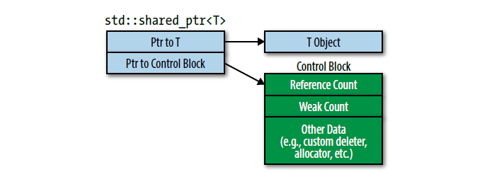
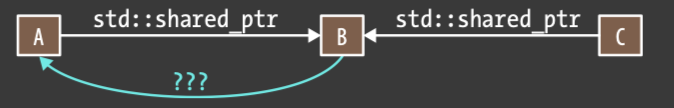
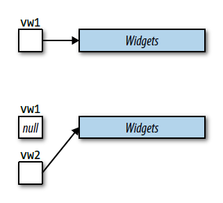
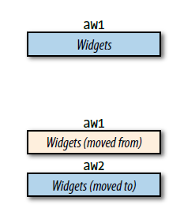

## 简介

> 本书主要针对 C++11 和 C++14。😀
>
> [CnTransGroup/EffectiveModernCppChinese: 《Effective Modern C++》- 完成翻译](https://github.com/CnTransGroup/EffectiveModernCppChinese)
>
> > 该框中均为我的注释。😀

如果你是一位经验丰富的 C++ 程序员并且多少跟我差不多，那你在初次接触 C++11 的时候就会想，“是的，是的，我知道的。它还是 C++，就是多了点东西。”但随着你了解越多，你会为改变的幅度之巨感到震惊。`auto` 声明，基于 range 的 `for` 循环，*lambda* 表达式，还有右值引用完全改变了 C++ 的面貌，这还不说新的并发特性。然后还有一些惯常的改进。`0` 和 `typedef` 出局，`nullptr` 和别名声明新晋。枚举现在应该是限域的了。相比内置的指针类型，现在要更倾向去使用智能指针。移动对象通常也好过于拷贝它们。

有很多C++11的东西要学，先不提C++14了。

更重要的是，要学习怎样**高效地**使用新机能。如果你需要关于”现代“C++的特性的基础信息，学习资源有很多，但是你想找一些指南，教你怎样应用这些特性来写出正确、高效、可维护、可移植的程序，那就相当有挑战性了。这就是这本书的切入点。它不致力于介绍C++11和C++14的特性，而致力于它们的高效应用。

书中这些信息被打碎成不同指导方针，称为**条款**。想理解类型推导的不同形式？或者想知道什么时候该用（或者不该用）`auto`声明？你对为什么`const`成员函数应当线程安全，怎样使用`std::unique_ptr`实现Pimpl惯用法，为何要避免*lambda*表达式用默认捕获模式，或者`std::atomic`与`volatile`的区别感兴趣吗？答案都在这里。而且，答案无关于平台，顺应于标准。这本书是关于**可移植**C++的。

本书的条款是**指导方针**，而不是**规则**，因为指导方针也有例外。每个条款中最关键的部分不是提出的建议，而是建议背后的基本原理。一旦你阅读了它，你就明白你的程序的情况是否违反了条款的指导意见。本书的真正目的不是告诉你应该做什么不应该做什么，而是帮你深入理解C++11和C++14中各种东西是如何工作的。

### 术语和惯例

为了保证我们互相理解，对一些术语达成共识非常重要，首先有点讽刺的是，“C++”。有四个C++官方版本，每个版本名字后面带有相应ISO标准被采纳时的年份：C++98，C++03，C++11和C++14。C++98和C++03只有技术细节上的区别，所以本书统称为C++98。当我提到C++11时，我的意思是C++11和C++14，因为C++14是C++11的超集，当我写下C++14，我只意味着C++14。如果我仅仅提到C++，说明适用于所有的语言版本。

| 我使用的词 | 我意思中的语言版本 |
| ---------- | ------------------ |
| C++        | 所有版本           |
| C++98      | C++98和C++03       |
| C++11      | C++11和C++14       |
| C++14      | C++14              |

因此，我可能会说C++重视效率（对所有版本正确），C++98缺少并发的支持（只对C++98和C++03正确），C++11支持*lambda*表达式（对C++11和C++14正确），C++14提供了普遍的函数返回类型推导（只对C++14正确）。

最遍布C++11各处的特性可能是移动语义了，移动语义的基础是区分右值和左值表达式。那是因为右值表明这个对象适合移动操作，而左值一般不适合。概念上（尽管不经常在实际上用），右值对应于从函数返回的临时对象，而左值对应于你可以引用的（can refer to）对象，或者通过名字，或者通过指针或左值引用。

对于判断一个表达式是否是左值的一个有用的启发就是，看看能否取得它的地址。如果能取地址，那么通常就是左值。如果不能，则通常是右值。这个启发的好处就是帮你记住，一个表达式的类型与它是左值还是右值无关。也就是说，有个类型`T`，你可以有类型`T`的左值和右值。当你碰到右值引用类型的形参时，记住这一点非常重要，因为形参本身是个左值：

```cpp
class Widget {
public:
    Widget(Widget&& rhs);   //rhs是个左值，
    …                       //尽管它有个右值引用的类型
};
```

在这里，在`Widget`移动构造函数里取`rhs`的地址非常合理，所以`rhs`是左值，尽管它的类型是右值引用。（由于相似的原因，所有形参都是左值。）

那一小段代码揭示了我通常遵循的惯用法：

+ 类的名字是`Widget`。每当我想指代任意的用户定义的类型时，我用`Widget`来代表。除非我需要展示类中的特定细节，否则我都直接使用`Widget`而不声明它。

+ 我使用形参名`rhs`（“right-hand side”）。这是我喜欢的**移动操作**（即移动构造函数和移动赋值运算符）和**拷贝操作**（拷贝构造函数和拷贝赋值运算符）的形参名。我也在双目运算符的右侧形参用它：

	```cpp
	Matrix operator+(const Matrix& lhs, const Matrix& rhs);
	```

	我希望你并不奇怪，我用`lhs`表示“left-hand side”。

+ 我在部分代码或者部分注释用特殊格式来吸引你的注意。（译者注：但是因为markdown没法在代码块中表明特殊格式，即原书使用的颜色改变和斜体注释，所以大部分情况下只能作罢，少部分地方会有额外说明。）在上面`Widget`移动构造函数中，我高亮了`rhs`的声明和“`rhs`是个左值”这部分注释。高亮代码不代表写的好坏。只是来提醒你需要额外的注意。

+ 我使用“`…`”来表示“这里有一些别的代码”。这种窄省略号不同于C++11可变参数模板源代码中的宽省略号（“`...`”）。这听起来不太清楚，但实际并不。比如：

	```cpp
	template<typename... Ts>                //这些是C++源代码的
	void processVals(const Ts&... params)   //省略号
	{
	    …                                   //这里意思是“这有一些别的代码”
	}
	```

	`processVals`的声明表明在声明模板的类型形参时我使用`typename`，但这只是我的个人偏好；关键字`class`可以做同样的事情。在我展示从C++标准中摘录的代码的情况下，我使用`class`声明类型形参，因为那就是标准中的做法。

当使用另一个同类型的对象来初始化一个对象时，新的对象被称为是用来初始化的对象（译者注：initializing object，即源对象）的一个**副本**（*copy*），尽管这个副本是通过移动构造函数创建的。很抱歉地说，C++中没有术语来区别一个对象是拷贝构造的副本还是移动构造的副本（译者注：此处为了区别拷贝这个“动作”与拷贝得到的“东西”，将*copy*按语境译为拷贝（动作）和副本（东西），此处及接下来几段按此方式翻译。在后面的条款中可能会不加区别地全部翻译为“拷贝”。）：

```cpp
void someFunc(Widget w);        //someFunc的形参w是传值过来

Widget wid;                     //wid是个Widget

someFunc(wid);                  //在这个someFunc调用中，w是通过拷贝构造函数
                                //创建的副本

someFunc(std::move(wid));       //在这个someFunc调用中，w是通过移动构造函数
                                //创建的副本
```

右值副本通常由移动构造产生，左值副本通常由拷贝构造产生。如果你仅仅知道一个对象是其他对象的副本，构造这个副本需要花费多大代价是没法说的。比如在上面的代码中，在不知道是用左值还是右值传给`someFunc`情况下，没法说来创建形参`w`花费代价有多大。（你必须还要知道移动和拷贝`Widget`的代价。）

在函数调用中，调用地传入的表达式称为函数的**实参**（*argument*）。实参被用来初始化函数的**形参**（*parameter*）。在上面第一次调用`someFunc`中，实参为`wid`。在第二次调用中，实参是`std::move(wid)`。两个调用中，形参都是`w`。实参和形参的区别非常重要，因为形参是左值，而用来初始化形参的实参可能是左值或者右值。这一点尤其与**完美转发**（*perfect forwarding*）过程有关，被传给函数的实参以原实参的右值性（*rvalueness*）或左值性（*lvalueness*），再被传给第二个函数。（完美转发讨论细节在[Item30](./5.RRefMovSemPerfForw/item30.md)。）

设计优良的函数是**异常安全**（*exception safe*）的，意味着他们至少提供基本的异常安全保证（即基本保证*basic guarantee*）。这样的函数保证调用者在异常抛出时，程序不变量保持完整（即没有数据结构是毁坏的），且没有资源泄漏。有强异常安全保证的函数确保调用者在异常产生时，程序保持在调用前的状态。

当我提到“**函数对象**”时，我通常指的是某个支持`operator()`成员函数的类型的对象。换句话说，这个对象的行为像函数一样。偶尔我用稍微更普遍一些的术语，表示可以用非成员函数语法调用的任何东西（即“`fuctionName(arguments)`”）。这个广泛定义包括的不仅有支持`operator()`的对象，还有函数和类似C的函数指针。（较窄的定义来自于C++98，广泛点的定义来自于C++11。）将成员函数指针加进来的更深的普遍化产生了我们所知的**可调用对象**（*callable objects*）。你通常可以忽略其中的微小区别，简单地认为函数对象和可调用对象为C++中可以用函数调用语法调用的东西。

通过*lambda*表达式创建的函数对象称为**闭包**（*closures*）。没什么必要去区别*lambda*表达式和它们创建的闭包，所以我经常把它们统称*lambdas*。类似地，我几乎不区分**函数模板**（*function templates*）（即产生函数的模板）和**模板函数**（*template functions*）（即从函数模板产生的函数）。**类模板**（*class templates*）和**模板类**（*template classes*）同上。

C++中的许多东西都可被声明和定义。**声明**（*declarations*）引入名字和类型，并不给出比如存放在哪或者怎样实现等的细节：

```cpp
extern int x;                       //对象声明

class Widget;                       //类声明

bool func(const Widget& w);         //函数声明

enum class Color;                   //限域enum声明（见条款10）
```

**定义**（*definitions*）提供存储位置或者实现细节：

```cpp
int x;                              //对象定义

class Widget {                      //类定义
    …
};

bool func(const Widget& w)
{ return w.size() < 10; }           //函数定义

enum class Color
{ Yellow, Red, Blue };              //限域enum定义
```

定义也有资格称为声明，所以我倾向于只有声明，除非这个东西有个定义非常重要。

我定义一个函数的**签名**（*signature*）为它声明的一部分，这个声明指定了形参类型和返回类型。函数名和形参名不是签名的一部分。在上面的例子中，`func`的签名是`bool(const Widget&)`。函数声明中除了形参类型和返回类型之外的元素（比如`noexcept`或者`constexpr`，如果存在的话）都被排除在外。（`noexcept`和`constexpr`在[Item14](./3.MovingToModernCpp/item14.md)和[15](./3.MovingToModernCpp/item15.md)叙述。）“签名”的官方定义和我的有点不一样，但是对本书来说，我的定义更有用。（官方定义有时排除返回类型。）

新的C++标准保持了旧标准写的代码的有效性，但是偶尔标准化委员会**废弃**（*deprecate*）一些特性。这些特性在标准化的“死囚区”中，可能在未来的标准中被移除。编译器可能警告也可能不警告这些废弃特性的使用，但是你应当尽量避免使用它们。它们不仅可能导致将来对移植的头痛，也通常不如来替代它们的新特性。例如，`std::auto_ptr`在C++11中被废弃，因为`std::unique_ptr`可以做同样的工作，而且只会做的更好。

有时标准说一个操作的结果有**未定义的行为**（*undefined behavior*）。这意味着运行时表现是不可预测的，不用说你也想避开这种不确定性。有未定义行为的行动的例子是，在`std::vector`范围外使用方括号（“`[]`”），解引用未初始化的迭代器，或者引入数据竞争（即有两个或以上线程，至少一个是writer，同时访问相同的内存位置）。

我将那些比如从`new`返回的内置指针（*build-in pointers*）称为**原始指针**（*raw pointers*）。原始指针的“反义词”是**智能指针**（*smart pointers*）。智能指针通常重载指针解引用运算符（`operator->`和`operator*`），但在[Item20](./4.SmartPointers/item20.md)中解释看`std::weak_ptr`是个例外。

在源代码注释中，我有时将“constructor”（构造函数）缩写为`ctor`，将“destructor”（析构函数）缩写为`dtor`。（译者注：但译文中基本都完整翻译了而没使用缩写。）

### 报告bug，提出改进意见

我尽力将本书写的清晰、准确、富含有用的信息，但是当然还有些去做得更好的办法。如果你找到了任何类型的错误（技术上的，叙述上的，语法上的，印刷上的等），或者有些建议如何改进本书，请给我发电子邮件到emc++@aristeia.com。新的印刷给了我改进《Modern Effective C++》的机会，但我也不能解决我不知道的问题！

要查看我所知道的事情，参见本书勘误表页，http://www.aristeia.com/BookErrata/emc++-errata.html 。

# 第1章 类型推导

**CHAPTER 1 Deducing Types**

C++98有一套类型推导的规则：用于函数模板的规则。C++11修改了其中的一些规则并增加了两套规则，一套用于`auto`，一套用于`decltype`。C++14扩展了`auto`和`decltype`可能使用的范围。类型推导的广泛应用，让你从拼写那些或明显或冗杂的类型名的暴行中脱离出来。它让C++程序更具适应性，因为在源代码某处修改类型会通过类型推导自动传播到其它地方。但是类型推导也会让代码更复杂，因为由编译器进行的类型推导并不总是如我们期望的那样进行。

如果对于类型推导操作没有一个扎实的理解，要想写出有现代感的C++程序是不可能的。类型推导随处可见：在函数模板调用中，在大多数`auto`出现的地方，在`decltype`表达式出现的地方，以及C++14中令人费解的应用`decltype(auto)`的地方。

这一章是每个C++程序员都应该掌握的知识。它解释了模板类型推导是如何工作的，`auto`是如何依赖类型推导的，以及`decltype`是如何按照它自己那套独特的规则工作的。它甚至解释了你该如何强制编译器使类型推导的结果可视，这能让你确认编译器的类型推导是否按照你期望的那样进行。

## 条款一：理解模板类型推导

**Item 1: Understand template type deduction**


对于一个复杂系统的用户来说，很多时候他们最关心的是它做了什么而不是它怎么做的。在这一点上，C++中的模板类型推导表现得非常出色。数百万的程序员只需要向模板函数传递实参，就能通过编译器的类型推导获得令人满意的结果，尽管他们中的大多数在被逼无奈的情况下，对于传递给函数的那些实参是如何引导编译器进行类型推导的，也只能给出非常模糊的描述。

如果那些人中包括你，我有一个好消息和一个坏消息。好消息是**现在C++最重要最吸引人的特性`auto`是建立在模板类型推导的基础上的**。如果你满意C++98的模板类型推导，那么你也会满意C++11的`auto`类型推导。坏消息是当模板类型推导规则应用于`auto`环境时，有时不如应用于template时那么直观。由于这个原因，真正理解`auto`基于的模板类型推导的方方面面非常重要。这项条款便包含了你需要知道的东西。

> 说 **`auto` 是建立在模板类型推导基础之上**，是因为 `auto` 的类型推导规则**本质上复用了 C++ 模板参数推导（Template Argument Deduction）** 的同一套逻辑。😀

如果你不介意浏览少许伪代码，我们可以考虑像这样一个函数模板：
````cpp
template<typename T>
void f(ParamType param);
````
它的调用看起来像这样
````cpp
f(expr);                        //使用表达式调用f
````
在编译期间，编译器使用`expr`进行两个类型推导：一个是针对`T`的，另一个是针对`ParamType`的。这两个类型通常是不同的，因为`ParamType`包含一些修饰，比如`const`和引用修饰符。举个例子，如果模板这样声明：
````cpp
template<typename T>
void f(const T& param);         //ParamType是const T&
````
然后这样进行调用
````cpp
int x = 0;
f(x);                           //用一个int类型的变量调用f
````
`T`被推导为`int`，`ParamType`却被推导为`const int&`

我们可能很自然的期望`T`和传递进函数的实参是相同的类型，也就是，`T`为`expr`的类型。在上面的例子中，事实就是那样：`x`是`int`，`T`被推导为`int`。但有时情况并非总是如此，`T`的类型推导不仅取决于`expr`的类型，也取决于`ParamType`的类型。这里有三种情况：

+ `ParamType`是一个指针或引用，但不是万能引用（关于万能引用请参见[Item24](../5.RRefMovSemPerfForw/item24.md)。在这里你只需要知道它存在，而且不同于左值引用和右值引用）
+ `ParamType`是一个万能引用
+ `ParamType`既不是指针也不是引用

我们下面将分成三个情景来讨论这三种情况，每个情景的都基于我们之前给出的模板：
````cpp
template<typename T>
void f(ParamType param);

f(expr);                        //从expr中推导T和ParamType
````

### 情景一：`ParamType`是一个指针或引用，但不是万能引用

最简单的情况是`ParamType`是一个指针或者引用，但非万能引用。在这种情况下，类型推导会这样进行：

1. 如果`expr`的类型是一个引用，忽略引用部分
2. 然后`expr`的类型与`ParamType`进行模式匹配来决定`T`

举个例子，如果这是我们的模板，
````cpp
template<typename T>
void f(T& param);               //param是一个引用
````
我们声明这些变量，
````cpp
int x=27;                       //x是int
const int cx=x;                 //cx是const int
const int& rx=x;                //rx是指向作为const int的x的引用
````
在不同的调用中，对`param`和`T`推导的类型会是这样：
````cpp
f(x);                           //T是int，param的类型是int&
f(cx);                          //T是const int，param的类型是const int&
f(rx);                          //T是const int，param的类型是const int&
````
在第二个和第三个调用中，注意因为`cx`和`rx`被指定为`const`值，所以`T`被推导为`const int`，从而产生了`const int&`的形参类型。这对于调用者来说很重要。当他们传递一个`const`对象给一个引用类型的形参时，他们期望对象保持不可改变性，也就是说，形参是reference-to-`const`的。这也是为什么将一个`const`对象传递给以`T&`类型为形参的模板安全的：对象的常量性`const`ness会被保留为`T`的一部分。

在第三个例子中，注意即使`rx`的类型是一个引用，`T`也会被推导为一个非引用 ，这是因为`rx`的引用性（reference-ness）在类型推导中会被忽略。

这些例子只展示了左值引用，但是类型推导会如左值引用一样对待右值引用。当然，右值只能传递给右值引用，但是在类型推导中这种限制将不复存在。

如果我们将`f`的形参类型`T&`改为`const T&`，情况有所变化，但不会变得那么出人意料。`cx`和`rx`的`const`ness依然被遵守，但是因为现在我们假设`param`是reference-to-`const`，`const`不再被推导为`T`的一部分：

```cpp
template<typename T>
void f(const T& param);         //param现在是reference-to-const

int x = 27;                     //如之前一样
const int cx = x;               //如之前一样
const int& rx = x;              //如之前一样

f(x);                           //T是int，param的类型是const int&
f(cx);                          //T是int，param的类型是const int&
f(rx);                          //T是int，param的类型是const int&
```

同之前一样，`rx`的reference-ness在类型推导中被忽略了。

如果`param`是一个指针（或者指向`const`的指针）而不是引用，情况本质上也一样：

```cpp
template<typename T>
void f(T* param);               //param现在是指针

int x = 27;                     //同之前一样
const int *px = &x;             //px是指向作为const int的x的指针

f(&x);                          //T是int，param的类型是int*
f(px);                          //T是const int，param的类型是const int*
```

到现在为止，你会发现你自己打哈欠犯困，因为C++的类型推导规则对引用和指针形参如此自然，书面形式来看这些非常枯燥。所有事情都那么理所当然！那正是在类型推导系统中你所想要的。

### 情景二：`ParamType`是一个万能引用

模板使用万能引用形参的话，那事情就不那么明显了。这样的形参被声明为像右值引用一样（也就是，在函数模板中假设有一个类型形参`T`，那么万能引用声明形式就是`T&&`)，它们的行为在传入左值实参时大不相同。完整的叙述请参见[Item24](../5.RRefMovSemPerfForw/item24.md)，在这有些最必要的你还是需要知道：

+ 如果`expr`是左值，`T`和`ParamType`都会被推导为左值引用。这非常不寻常，第一，这是模板类型推导中唯一一种`T`被推导为引用的情况。第二，虽然`ParamType`被声明为右值引用类型，但是最后推导的结果是左值引用。
+ 如果`expr`是右值，就使用正常的（也就是**情景一**）推导规则

举个例子：
````cpp
template<typename T>
void f(T&& param);              //param现在是一个万能引用类型
		
int x=27;                       //如之前一样
const int cx=x;                 //如之前一样
const int & rx=cx;              //如之前一样

f(x);                           //x是左值，所以T是int&，
                                //param类型也是int&

f(cx);                          //cx是左值，所以T是const int&，
                                //param类型也是const int&

f(rx);                          //rx是左值，所以T是const int&，
                                //param类型也是const int&

f(27);                          //27是右值，所以T是int，
                                //param类型就是int&&
````
[Item24](../5.RRefMovSemPerfForw/item24.md)详细解释了为什么这些例子是像这样发生的。这里关键在于万能引用的类型推导规则是不同于普通的左值或者右值引用的。尤其是，当万能引用被使用时，类型推导会区分左值实参和右值实参，但是对非万能引用时不会区分。

### 情景三：`ParamType`既不是指针也不是引用

当`ParamType`既不是指针也不是引用时，我们通过传值（pass-by-value）的方式处理：
````cpp
template<typename T>
void f(T param);                //以传值的方式处理param
````
这意味着无论传递什么`param`都会成为它的一份拷贝——一个完整的新对象。事实上`param`成为一个新对象这一行为会影响`T`如何从`expr`中推导出结果。

1. 和之前一样，如果`expr`的类型是一个引用，忽略这个引用部分
2. 如果忽略`expr`的引用性（reference-ness）之后，`expr`是一个`const`，那就再忽略`const`。如果它是`volatile`，也忽略`volatile`（`volatile`对象不常见，它通常用于驱动程序的开发中。关于`volatile`的细节请参见[Item40](../7.TheConcurrencyAPI/item40.md)）

因此
````cpp
int x=27;                       //如之前一样
const int cx=x;                 //如之前一样
const int & rx=cx;              //如之前一样

f(x);                           //T和param的类型都是int
f(cx);                          //T和param的类型都是int
f(rx);                          //T和param的类型都是int
````
注意即使`cx`和`rx`表示`const`值，`param`也不是`const`。这是有意义的。`param`是一个完全独立于`cx`和`rx`的对象——是`cx`或`rx`的一个拷贝。具有常量性的`cx`和`rx`不可修改并不代表`param`也是一样。这就是为什么`expr`的常量性`const`ness（或易变性`volatile`ness)在推导`param`类型时会被忽略：因为`expr`不可修改并不意味着它的拷贝也不能被修改。

> 实参的拷贝自然无需加上实参的 CV 属性。

认识到只有在传值给形参时才会忽略`const`（和`volatile`）这一点很重要，正如我们看到的，对于reference-to-`const`和pointer-to-`const`形参来说，`expr`的常量性`const`ness在推导时会被保留。但是考虑这样的情况，`expr`是一个`const`指针，指向`const`对象，`expr`通过传值传递给`param`：
````cpp
template<typename T>
void f(T param);                //仍然以传值的方式处理param

const char* const ptr =         //ptr是一个常量指针，指向常量对象 
    "Fun with pointers";

f(ptr);                         //传递const char * const类型的实参
````
在这里，解引用符号（\*）的右边的`const`表示`ptr`本身是一个`const`：`ptr`不能被修改为指向其它地址，也不能被设置为null（解引用符号左边的`const`表示`ptr`指向一个字符串，这个字符串是`const`，因此字符串不能被修改）。当`ptr`作为实参传给`f`，组成这个指针的每一比特都被拷贝进`param`。像这种情况，`ptr`**自身的值会被传给形参**，根据类型推导的第三条规则，`ptr`自身的常量性`const`ness将会被省略，所以`param`是`const char*`，也就是一个可变指针指向`const`字符串。在类型推导中，这个指针指向的数据的常量性`const`ness将会被保留，但是当拷贝`ptr`来创造一个新指针`param`时，`ptr`自身的常量性`const`ness将会被忽略。

> 忽略顶层 CV 属性。

### 数组实参

上面的内容几乎覆盖了模板类型推导的大部分内容，但这里还有一些小细节值得注意，比如 **数组类型不同于指针类型**，虽然它们两个有时候是可互换的。关于这个错觉最常见的例子是，在很多上下文中数组会退化为指向它的第一个元素的指针。这样的退化允许像这样的代码可以被编译：
````cpp
const char name[] = "J. P. Briggs";     //name的类型是const char[13]

const char * ptrToName = name;          //数组退化为指针
````
在这里`const char*`指针`ptrToName`会由`name`初始化，而`name`的类型为`const char[13]`，这两种类型（`const char*`和`const char[13]`）是不一样的，但是由于数组退化为指针的规则，编译器允许这样的代码。


但要是一个数组传值给一个模板会怎样？会发生什么？
````cpp
template<typename T>
void f(T param);                        //传值形参的模板

f(name);                                //T和param会推导成什么类型?
````
我们从一个简单的例子开始，这里有一个函数的形参是数组，是的，这样的语法是合法的，
````cpp
void myFunc(int param[]);
````
但是数组声明会被视作指针声明，这意味着`myFunc`的声明和下面声明是等价的：
````cpp
void myFunc(int* param);                //与上面相同的函数
````
数组与指针形参这样的等价是C语言的产物，C++又是建立在C语言的基础上，它让人产生了一种数组和指针是等价的的错觉。

> 数组和函数向指针的退化是 C 语言的历史遗留问题，C++ 继承了这个问题。😀

因为数组形参会视作指针形参，所以传值给模板的一个数组类型会被推导为一个指针类型。这意味着在模板函数`f`的调用中，它的类型形参`T`会被推导为`const char*`：
````cpp
f(name);                        //name是一个数组，但是T被推导为const char*
````
但是现在难题来了，虽然函数不能声明形参为真正的数组，但是**可以**接受指向数组的**引用**！所以我们修改`f`为传引用：
````cpp
template<typename T>
void f(T& param);                       //传引用形参的模板
````
我们这样进行调用，
````cpp
f(name);                                //传数组给f
````
`T`被推导为了真正的数组！这个类型包括了数组的大小，在这个例子中`T`被推导为`const char[13]`，`f`的形参（该数组的引用）的类型则为`const char (&)[13]`。是的，这种语法看起来又臭又长，但是知道它将会让你在关心这些问题的人的提问中获得大神的称号。

有趣的是，可声明指向数组的引用的能力，使得我们可以创建一个模板函数来推导出数组的大小：
````cpp
//在编译期间返回一个数组大小的常量值（//数组形参没有名字，
//因为我们只关心数组的大小）
template<typename T, std::size_t N>                     //关于
constexpr std::size_t arraySize(T (&)[N]) noexcept      //constexpr
{                                                       //和noexcept
    return N;                                           //的信息
}                                                       //请看下面
````
在[Item15](../3.MovingToModernCpp/item15.md)提到将一个函数声明为`constexpr`使得结果在编译期间可用。这使得我们可以用一个花括号声明一个数组，然后第二个数组可以使用第一个数组的大小作为它的大小，就像这样：
````cpp
int keyVals[] = { 1, 3, 7, 9, 11, 22, 35 };             //keyVals有七个元素

int mappedVals[arraySize(keyVals)];                     //mappedVals也有七个
````
当然作为一个现代C++程序员，你自然应该想到使用`std::array`而不是内置的数组：
````cpp
std::array<int, arraySize(keyVals)> mappedVals;         //mappedVals的大小为7
````
至于`arraySize`被声明为`noexcept`，会使得编译器生成更好的代码，具体的细节请参见[Item14](../3.MovingToModernCpp/item14.md)。

### 函数实参

在C++中不只是数组会退化为指针，函数类型也会退化为一个函数指针，我们对于数组类型推导的全部讨论都可以应用到函数类型推导和退化为函数指针上来。结果是：
````cpp
void someFunc(int, double);         //someFunc是一个函数，
                                    //类型是void(int, double)

template<typename T>
void f1(T param);                   //传值给f1

template<typename T>
void f2(T & param);                 //传引用给f2

f1(someFunc);                       //param被推导为指向函数的指针，
                                    //类型是void(*)(int, double)
f2(someFunc);                       //param被推导为指向函数的引用，
                                    //类型是void(&)(int, double)
````
这个实际上没有什么不同，但是如果你知道数组退化为指针，你也会知道函数退化为指针。

这里你需要知道：`auto`依赖于模板类型推导。正如我在开始谈论的，在大多数情况下它们的行为很直接。在万能引用中对于左值的特殊处理使得本来很直接的行为变得有些污点，然而，数组和函数退化为指针把这团水搅得更浑浊。有时你只需要编译器告诉你推导出的类型是什么。这种情况下，翻到[item4](../1.DeducingTypes/item4.md),它会告诉你如何让编译器这么做。

**请记住：**

+ 在模板类型推导时，有引用的实参会被视为无引用，他们的引用会被忽略
+ 对于万能引用的推导，左值实参会被特殊对待
+ 对于传值类型推导，`const`和/或`volatile`实参会被认为是non-`const`的和non-`volatile`的
+ 在模板类型推导时，数组名或者函数名实参会退化为指针，除非它们被用于初始化引用 

## 条款二：理解`auto`类型推导

**Item 2: Understand `auto` type deduction**

如果你已经读过[Item1](../1.DeducingTypes/item1.md)的模板类型推导，那么你几乎已经知道了`auto`类型推导的大部分内容，至于为什么不是全部是因为这里有一个`auto`不同于模板类型推导的例外。但这怎么可能？模板类型推导包括模板，函数，形参，但`auto`不处理这些东西啊。

你是对的，但没关系。**`auto`类型推导和模板类型推导有一个直接的映射关系。它们之间可以通过一个非常规范非常系统化的转换流程来转换彼此。**

在[Item1](../1.DeducingTypes/item2.md)中，模板类型推导使用下面这个函数模板
````cpp
template<typename T>
void f(ParmaType param);
````
和这个调用来解释：

```cpp
f(expr);                        //使用一些表达式调用f
```

在`f`的调用中，编译器使用`expr`推导`T`和`ParamType`的类型。

当一个变量使用`auto`进行声明时，`auto`扮演了模板中`T`的角色，变量的类型说明符扮演了`ParamType`的角色。废话少说，这里便是更直观的代码描述，考虑这个例子：

````cpp
auto x = 27;
````
这里`x`的类型说明符是`auto`自己，另一方面，在这个声明中：
````cpp
const auto cx = x;
````
类型说明符是`const auto`。另一个：
````cpp
const auto& rx = x;
````
类型说明符是`const auto&`。在这里例子中要推导`x`，`cx`和`rx`的类型，编译器的行为看起来就像是认为这里每个声明都有一个模板，然后使用合适的初始化表达式进行调用：
````cpp
template<typename T>            //概念化的模板用来推导x的类型
void func_for_x(T param);

func_for_x(27);                 //概念化调用：
                                //param的推导类型是x的类型

template<typename T>            //概念化的模板用来推导cx的类型
void func_for_cx(const T param);

func_for_cx(x);                 //概念化调用：
                                //param的推导类型是cx的类型

template<typename T>            //概念化的模板用来推导rx的类型
void func_for_rx(const T & param);

func_for_rx(x);                 //概念化调用：
                                //param的推导类型是rx的类型
````
正如我说的，`auto`类型推导除了一个例外（我们很快就会讨论），其他情况都和模板类型推导一样。

[Item1](../1.DeducingTypes/item1.md)基于`ParamType`——在函数模板中`param`的类型说明符——的不同特征，把模板类型推导分成三个部分来讨论。在使用`auto`作为类型说明符的变量声明中，类型说明符代替了`ParamType`，因此Item1描述的三个情景稍作修改就能适用于auto：

+ 情景一：类型说明符是一个指针或引用但不是万能引用
+ 情景二：类型说明符一个万能引用
+ 情景三：类型说明符既不是指针也不是引用

我们早已看过情景一和情景三的例子：
````cpp
auto x = 27;                    //情景三（x既不是指针也不是引用）
const auto cx = x;              //情景三（cx也一样）
const auto & rx=cx;             //情景一（rx是非万能引用）
````
情景二像你期待的一样运作：

```cpp
auto&& uref1 = x;               //x是int左值，
                                //所以uref1类型为int&
auto&& uref2 = cx;              //cx是const int左值，
                                //所以uref2类型为const int&
auto&& uref3 = 27;              //27是int右值，
                                //所以uref3类型为int&&
```

[Item1](../1.DeducingTypes/item1.md)讨论并总结了对于non-reference类型说明符，数组和函数名如何退化为指针。那些内容也同样适用于`auto`类型推导：

````cpp
const char name[] =             //name的类型是const char[13]
 "R. N. Briggs";

auto arr1 = name;               //arr1的类型是const char*
auto& arr2 = name;              //arr2的类型是const char (&)[13]

void someFunc(int, double);     //someFunc是一个函数，
                                //类型为void(int, double)

auto func1 = someFunc;          //func1的类型是void (*)(int, double)
auto& func2 = someFunc;         //func2的类型是void (&)(int, double)
````
就像你看到的那样，`auto`类型推导和模板类型推导几乎一样的工作，它们就像一个硬币的两面。

讨论完相同点接下来就是不同点，前面我们已经说到`auto`类型推导和模板类型推导有一个例外使得它们的工作方式不同，接下来我们要讨论的就是那个例外。
我们从一个简单的例子开始，如果你想声明一个带有初始值27的`int`，C++98提供两种语法选择：

````cpp
int x1 = 27;
int x2(27);
````
C++11由于也添加了用于支持统一初始化（**uniform initialization**）的语法：
````cpp
int x3 = { 27 };
int x4{ 27 };
````
总之，这四种不同的语法只会产生一个相同的结果：变量类型为`int`值为27

但是[Item5](../2.Auto/item5.md)解释了使用`auto`说明符代替指定类型说明符的好处，所以我们应该很乐意把上面声明中的`int`替换为`auto`，我们会得到这样的代码：
````cpp
auto x1 = 27;
auto x2(27);
auto x3 = { 27 };
auto x4{ 27 };
````
这些声明都能通过编译，但是他们不像替换之前那样有相同的意义。前面两个语句确实声明了一个类型为`int`值为27的变量，但是后面两个声明了一个存储一个元素27的 `std::initializer_list<int>`类型的变量。
````cpp
auto x1 = 27;                   //类型是int，值是27
auto x2(27);                    //同上
auto x3 = { 27 };               //类型是std::initializer_list<int>，
                                //值是{ 27 }
auto x4{ 27 };                  //同上
````
这就造成了`auto`类型推导不同于模板类型推导的特殊情况。当用`auto`声明的变量使用花括号进行初始化，`auto`类型推导推出的类型则为`std::initializer_list`。如果这样的一个类型不能被成功推导（比如花括号里面包含的是不同类型的变量），编译器会拒绝这样的代码：
````cpp
auto x5 = { 1, 2, 3.0 };        //错误！无法推导std::initializer_list<T>中的T
````
就像注释说的那样，在这种情况下类型推导将会失败，但是对我们来说认识到这里确实发生了两种类型推导是很重要的。一种是由于`auto`的使用：`x5`的类型不得不被推导。因为`x5`使用花括号的方式进行初始化，`x5`必须被推导为`std::initializer_list`。但是`std::initializer_list`是一个模板。`std::initializer_list<T>`会被某种类型`T`实例化，所以这意味着`T`也会被推导。 推导落入了这里发生的第二种类型推导——模板类型推导的范围。在这个例子中推导之所以失败，是因为在花括号中的值并不是同一种类型。

对于花括号的处理是`auto`类型推导和模板类型推导唯一不同的地方。当使用`auto`声明的变量使用花括号的语法进行初始化的时候，会推导出`std::initializer_list<T>`的实例化，但是对于模板类型推导这样就行不通：
````cpp
auto x = { 11, 23, 9 };         //x的类型是std::initializer_list<int>

template<typename T>            //带有与x的声明等价的
void f(T param);                //形参声明的模板

f({ 11, 23, 9 });               //错误！不能推导出T
````
然而如果在模板中指定`T`是`std::initializer_list<T>`而留下未知`T`,模板类型推导就能正常工作：
````cpp
template<typename T>
void f(std::initializer_list<T> initList);

f({ 11, 23, 9 });               //T被推导为int，initList的类型为
                                //std::initializer_list<int>
````
因此`auto`类型推导和模板类型推导的真正区别在于，`auto`类型推导假定花括号表示`std::initializer_list`而模板类型推导不会这样（确切的说是不知道怎么办）。

你可能想知道为什么`auto`类型推导和模板类型推导对于花括号有不同的处理方式。我也想知道。哎，我至今没找到一个令人信服的解释。但是规则就是规则，这意味着你必须记住如果你使用`auto`声明一个变量，并用花括号进行初始化，`auto`类型推导总会得出`std::initializer_list`的结果。如果你使用**uniform initialization（花括号的方式进行初始化）**用得很爽你就得记住这个例外以免犯错，在C++11编程中一个典型的错误就是偶然使用了`std::initializer_list<T>`类型的变量，这个陷阱也导致了很多C++程序员抛弃花括号初始化，只有不得不使用的时候再做考虑。（在[Item7](../3.MovingToModernCpp/item7.md)讨论了必须使用时该怎么做）

对于C++11故事已经说完了。但是对于C++14故事还在继续，C++14允许`auto`用于函数返回值并会被推导（参见[Item3](../1.DeducingTypes/item3.md)），而且C++14的*lambda*函数也允许在形参声明中使用`auto`。但是在这些情况下`auto`实际上使用**模板类型推导**的那一套规则在工作，而不是`auto`类型推导，所以说下面这样的代码不会通过编译：
````cpp
auto createInitList()
{
    return { 1, 2, 3 };         //错误！不能推导{ 1, 2, 3 }的类型
}
````
同样在C++14的lambda函数中这样使用auto也不能通过编译：
````cpp
std::vector<int> v;
…
auto resetV = 
    [&v](const auto& newValue){ v = newValue; };        //C++14
…
resetV({ 1, 2, 3 });            //错误！不能推导{ 1, 2, 3 }的类型
````

> auto 与 模板的唯一区别就是，auto 在处理花括号 `{}` 初始化时对直接初始化和复制初始化有不同的处理：
>
> * 直接初始化：类型 T
> * 复制初始化：`std::initializer_list<T>`
>
> 而对于模板来说，除非我们针对 `std::initializer_list` 进行特化，否则对于 `{x,y}` 这种实参，模板无法推导其类型。
>
> 在 C++14 中，我们可以在返回类型和 lambda 形参中指定 auto，但此时 auto 其实是使用模板类型推导，这意味着对于 `{x,y}`，这里的 auto 是无法推到的。😀

**请记住：**

+ `auto`类型推导通常和模板类型推导相同，但是`auto`类型推导假定花括号初始化代表`std::initializer_list`，而模板类型推导不这样做
+ 在C++14中`auto`允许出现在函数返回值或者*lambda*函数形参中，但是它的工作机制是模板类型推导那一套方案，而不是`auto`类型推导

## 条款三：理解`decltype`

**Item 3: Understand decltype**

`decltype`是一个奇怪的东西。给它一个名字或者表达式`decltype`就会告诉你这个名字或者表达式的类型。通常，它会精确的告诉你你想要的结果。但有时候它得出的结果也会让你挠头半天，最后只能求助网上问答或参考资料寻求启示。

我们将从一个简单的情况开始，没有任何令人惊讶的情况。相比模板类型推导和`auto`类型推导（参见[Item1](../1.DeducingTypes/item1.md)和[Item2](../1.DeducingTypes/item2.md)），`decltype`只是简单的返回名字或者表达式的类型：
````cpp
const int i = 0;                //decltype(i)是const int

bool f(const Widget& w);        //decltype(w)是const Widget&
                                //decltype(f)是bool(const Widget&)

struct Point{
    int x,y;                    //decltype(Point::x)是int
};                              //decltype(Point::y)是int

Widget w;                       //decltype(w)是Widget

if (f(w))…                      //decltype(f(w))是bool

template<typename T>            //std::vector的简化版本
class vector{
public:
    …
    T& operator[](std::size_t index);
    …
};

vector<int> v;                  //decltype(v)是vector<int>
…
if (v[0] == 0)…                 //decltype(v[0])是int&
````
看见了吧？没有任何奇怪的东西。

在C++11中，`decltype`最主要的用途就是用于声明函数模板，而这个函数返回类型依赖于形参类型。举个例子，假定我们写一个函数，一个形参为容器，一个形参为索引值，这个函数支持使用方括号的方式（也就是使用“`[]`”）访问容器中指定索引值的数据，然后在返回索引操作的结果前执行认证用户操作。函数的返回类型应该和索引操作返回的类型相同。

对一个`T`类型的容器使用`operator[]` 通常会返回一个`T&`对象，比如`std::deque`就是这样。但是`std::vector`有一个例外，对于`std::vector<bool>`，`operator[]`不会返回`bool&`，它会返回一个全新的对象（译注：MSVC的STL实现中返回的是`std::_Vb_reference<std::_Wrap_alloc<std::allocator<unsigned int>>>`对象）。关于这个问题的详细讨论请参见[Item6](../2.Auto/item6.md)，这里重要的是我们可以看到 **对一个容器进行`operator[]`操作返回的类型取决于容器本身。**

> `vector<bool>` 作为一个 STL 容器，既不是 bool，也不是 STL。😀

使用`decltype`使得我们很容易去实现它，这是我们写的第一个版本，使用`decltype`计算返回类型，这个模板需要改良，我们把这个推迟到后面：
````cpp
template<typename Container, typename Index>    //可以工作，
auto authAndAccess(Container& c, Index i)       //但是需要改良
    ->decltype(c[i])
{
    authenticateUser();
    return c[i];
}
````

函数名称前面的`auto`不会做任何的类型推导工作。相反的，他只是暗示使用了C++11的**尾置返回类型**语法，即在函数形参列表后面使用一个”`->`“符号指出函数的返回类型，尾置返回类型的好处是我们可以在函数返回类型中使用函数形参相关的信息。在`authAndAccess`函数中，我们使用`c`和`i`指定返回类型。如果我们按照传统语法把函数返回类型放在函数名称之前，`c`和`i`就未被声明所以不能使用。

在这种声明中，`authAndAccess`函数返回`operator[]`应用到容器中返回的对象的类型，这也正是我们期望的结果。

C++11允许自动推导单一语句的*lambda*表达式的返回类型， C++14扩展到允许自动推导所有的*lambda*表达式和函数，甚至它们内含多条语句。对于`authAndAccess`来说这意味着在C++14标准下我们可以忽略尾置返回类型，只留下一个`auto`。使用这种声明形式，auto标示这里会发生类型推导。更准确的说，编译器将会从函数实现中推导出函数的返回类型。
````cpp
template<typename Container, typename Index>    //C++14版本，
auto authAndAccess(Container& c, Index i)       //不那么正确
{
    authenticateUser();
    return c[i];                                //从c[i]中推导返回类型
}
````
[Item2](../1.DeducingTypes/item2.md)解释了函数返回类型中使用`auto`，编译器实际上是使用的模板类型推导的那套规则。如果那样的话这里就会有一些问题。正如我们之前讨论的，`operator[]`对于大多数`T`类型的容器会返回一个`T&`，但是[Item1](../1.DeducingTypes/item1.md)解释了在模板类型推导期间，表达式的引用性（reference-ness）会被忽略。基于这样的规则，考虑它会对下面用户的代码有哪些影响：

````cpp
std::deque<int> d;
…
authAndAccess(d, 5) = 10;               //认证用户，返回d[5]，
                                        //然后把10赋值给它
                                        //无法通过编译器！
````
在这里`d[5]`本该返回一个`int&`，但是模板类型推导会剥去引用的部分，因此产生了`int`返回类型。函数返回的那个`int`是一个右值，上面的代码尝试把10赋值给右值`int`，C++11禁止这样做，所以代码无法编译。

要想让`authAndAccess`像我们期待的那样工作，我们需要使用`decltype`类型推导来推导它的返回值，即指定`authAndAccess`应该返回一个和`c[i]`表达式类型一样的类型。C++期望在某些情况下当类型被暗示时需要使用`decltype`类型推导的规则，C++14通过使用`decltype(auto)`说明符使得这成为可能。我们第一次看见`decltype(auto)`可能觉得非常的矛盾（到底是`decltype`还是`auto`？），实际上我们可以这样解释它的意义：`auto`说明符表示这个类型将会被推导，`decltype`说明`decltype`的规则将会被用到这个推导过程中。因此我们可以这样写`authAndAccess`：
````cpp
template<typename Container, typename Index>    //C++14版本，
decltype(auto)                                  //可以工作，
authAndAccess(Container& c, Index i)            //但是还需要
{                                               //改良
    authenticateUser();
    return c[i];
}
````
> `delctype(auto)` 会使用 `decltype` 的规则。😀

现在`authAndAccess`将会真正的返回`c[i]`的类型。现在事情解决了，一般情况下`c[i]`返回`T&`，`authAndAccess`也会返回`T&`，特殊情况下`c[i]`返回一个对象，`authAndAccess`也会返回一个对象。

`decltype(auto)`的使用不仅仅局限于函数返回类型，当你想对初始化表达式使用`decltype`推导的规则，你也可以使用：

````cpp
Widget w;

const Widget& cw = w;

auto myWidget1 = cw;                    //auto类型推导
                                        //myWidget1的类型为Widget
decltype(auto) myWidget2 = cw;          //decltype类型推导
                                        //myWidget2的类型是const Widget&
````

但是这里有两个问题困惑着你。一个是我之前提到的`authAndAccess`的改良至今都没有描述。让我们现在加上它。

再看看C++14版本的`authAndAccess`声明：
````cpp
template<typename Container, typename Index>
decltype(auto) authAndAccess(Container& c, Index i);
````
容器通过传引用的方式传递非常量左值引用（lvalue-reference-to-non-**const**），因为返回一个引用允许用户可以修改容器。但是这意味着在不能给这个函数传递右值容器，右值不能被绑定到左值引用上（除非这个左值引用是一个const（lvalue-references-to-**const**），但是这里明显不是）。

公认的向`authAndAccess`传递一个右值是一个[edge case](https://en.wikipedia.org/wiki/Edge_case)（译注：在极限操作情况下会发生的事情，类似于会发生但是概率较小的事情）。一个右值容器，是一个临时对象，通常会在`authAndAccess`调用结束被销毁，这意味着`authAndAccess`返回的引用将会成为一个悬置的（dangle）引用。但是使用向`authAndAccess`传递一个临时变量也并不是没有意义，有时候用户可能只是想简单的获得临时容器中的一个元素的拷贝，比如这样：
````cpp
std::deque<std::string> makeStringDeque();      //工厂函数

//从makeStringDeque中获得第五个元素的拷贝并返回
auto s = authAndAccess(makeStringDeque(), 5);
````
要想支持这样使用`authAndAccess`我们就得修改一下当前的声明使得它支持左值和右值。重载是一个不错的选择（一个函数重载声明为左值引用，另一个声明为右值引用），但是我们就不得不维护两个重载函数。另一个方法是使`authAndAccess`的引用可以绑定左值和右值，[Item24](../5.RRefMovSemPerfForw/item24.md)解释了那正是万能引用能做的，所以我们这里可以使用万能引用进行声明：
````cpp
template<typename Containter, typename Index>   //现在c是万能引用
decltype(auto) authAndAccess(Container&& c, Index i);
````
在这个模板中，我们不知道我们操纵的容器的类型是什么，那意味着我们同样不知道它使用的索引对象（index objects）的类型，对一个未知类型的对象使用传值通常会造成不必要的拷贝，对程序的性能有极大的影响，还会造成对象切片行为（参见[item41](../8.Tweaks/item41.md)），以及给同事落下笑柄。但是就容器索引来说，我们遵照标准模板库对于索引的处理是有理由的（比如`std::string`，`std::vector`和`std::deque`的`operator[]`），所以我们坚持传值调用。

然而，我们还需要更新一下模板的实现，让它能听从[Item25](../5.RRefMovSemPerfForw/item25.md)的告诫应用`std::forward`实现万能引用：
````cpp
template<typename Container, typename Index>    //最终的C++14版本
decltype(auto)
authAndAccess(Container&& c, Index i)
{
    authenticateUser();
    return std::forward<Container>(c)[i];
}
````
这样就能对我们的期望交上一份满意的答卷，但是这要求编译器支持C++14。如果你没有这样的编译器，你还需要使用C++11版本的模板，它看起来和C++14版本的极为相似，除了你不得不指定函数返回类型之外：
````cpp
template<typename Container, typename Index>    //最终的C++11版本
auto
authAndAccess(Container&& c, Index i)
->decltype(std::forward<Container>(c)[i])
{
    authenticateUser();
    return std::forward<Container>(c)[i];
}
````

> 这里最后返回 `std::forward<Container>(c)[i]` 而不是 `std::forward<Container&&>(c)[i]` 是为了避免传入临时对象时产生 dangling reference。😀

另一个问题是就像我在条款的开始唠叨的那样，`decltype`通常会产生你期望的结果，但并不总是这样。在**极少数情况下**它产生的结果可能让你很惊讶。老实说如果你不是一个大型库的实现者你不太可能会遇到这些异常情况。

为了**完全**理解`decltype`的行为，你需要熟悉一些特殊情况。它们大多数都太过晦涩以至于几乎没有书进行有过权威的讨论，这本书也不例外，但是其中的一个会让我们更加理解`decltype`的使用。

将`decltype`应用于变量名会产生该变量名的声明类型。虽然变量名都是左值表达式，但这不会影响`decltype`的行为。（译者注：这里是说对于单纯的变量名，`decltype`只会返回变量的声明类型）然而，对于比单纯的变量名更复杂的左值表达式，`decltype`可以确保报告的类型始终是左值引用。也就是说，如果一个不是单纯变量名的左值表达式的类型是`T`，那么`decltype`会把这个表达式的类型报告为`T&`。这几乎没有什么太大影响，因为大多数左值表达式的类型天生具备一个左值引用修饰符。例如，返回左值的函数总是返回左值引用。

这个行为暗含的意义值得我们注意，在：
````cpp
int x = 0;
````
中，`x`是一个变量的名字，所以`decltype(x)`是`int`。但是如果用一个小括号包覆这个名字，比如这样`(x)` ，就会产生一个比名字更复杂的表达式。对于名字来说，`x`是一个左值，C++11定义了表达式`(x)`也是一个左值。因此`decltype((x))`是`int&`。用小括号覆盖一个名字可以改变`decltype`对于名字产生的结果。

> ``` cpp
> int x = 10;
> (x) = 11;
> cout << x << endl; // 11
> ```
>
> C++11定义了表达式`(x)`也是一个 **左值**。😀

在C++11中这稍微有点奇怪，但是由于C++14允许了`decltype(auto)`的使用，这意味着你在函数返回语句中细微的改变就可以影响类型的推导：
````cpp
decltype(auto) f1()
{
    int x = 0;
    return x;                            //decltype(x）是int，所以f1返回int
}

decltype(auto) f2()
{
    int x = 0;
    return (x);                          //decltype((x))是int&，所以f2返回int&
}
````
注意不仅`f2`的返回类型不同于`f1`，而且它还引用了一个局部变量！这样的代码将会把你送上未定义行为的特快列车，一辆你绝对不想上第二次的车。

当使用`decltype(auto)`的时候一定要加倍的小心，在表达式中看起来无足轻重的细节将会影响到`decltype(auto)`的推导结果。为了确认类型推导是否产出了你想要的结果，请参见[Item4](../1.DeducingTypes/item4.md)描述的那些技术。

同时你也不应该忽略`decltype`这块大蛋糕。没错，`decltype`（单独使用或者与`auto`一起用）可能会偶尔产生一些令人惊讶的结果，但那毕竟是少数情况。通常，`decltype`都会产生你想要的结果，尤其是当你对一个变量使用`decltype`时，因为在这种情况下，`decltype`只是做一件本分之事：它产出变量的声明类型。

**请记住：**

+ `decltype`总是不加修改的产生变量或者表达式的类型。
+ 对于`T`类型的不是单纯的变量名的左值表达式，`decltype`总是产出`T`的引用即`T&`。
+ C++14支持`decltype(auto)`，就像`auto`一样，推导出类型，但是它使用`decltype`的规则进行推导。

## 条款四：学会查看类型推导结果

**Item 4: Know how to view deduced types**

选择使用工具查看类型推导，取决于软件开发过程中你想在哪个阶段显示类型推导信息。我们探究三种方案：在你编辑代码的时候获得类型推导的结果，在编译期间获得结果，在运行时获得结果。

### IDE编辑器

在IDE中的代码编辑器通常可以显示程序代码中变量，函数，参数的类型，你只需要简单的把鼠标移到它们的上面，举个例子，有这样的代码中：
````cpp
const int theAnswer = 42;

auto x = theAnswer;
auto y = &theAnswer;
````
IDE编辑器可以直接显示`x`推导的结果为`int`，`y`推导的结果为`const int*`。

为此，你的代码必须或多或少的处于可编译状态，因为IDE之所以能提供这些信息是因为一个C++编译器（或者至少是前端中的一个部分）运行于IDE中。如果这个编译器对你的代码不能做出有意义的分析或者推导，它就不会显示推导的结果。

对于像`int`这样简单的推导，IDE产生的信息通常令人很满意。正如我们将看到的，如果更复杂的类型出现时，IDE提供的信息就几乎没有什么用了。

### 编译器诊断

另一个获得推导结果的方法是使用编译器出错时提供的错误消息。这些错误消息无形的提到了造成我们编译错误的类型是什么。

举个例子，假如我们想看到之前那段代码中`x`和`y`的类型，我们可以首先声明一个类模板但**不定义**。就像这样：

````cpp
template<typename T>                //只对TD进行声明
class TD;                           //TD == "Type Displayer"
````
如果尝试实例化这个类模板就会引出一个错误消息，因为这里没有用来实例化的类模板定义。为了查看`x`和`y`的类型，只需要使用它们的类型去实例化`TD`：
````cpp
TD<decltype(x)> xType;              //引出包含x和y
TD<decltype(y)> yType;              //的类型的错误消息
````
我使用***variableName*** **Type**的结构来命名变量，因为这样它们产生的错误消息可以有助于我们查找。对于上面的代码，我的编译器产生了这样的错误信息，我取一部分贴到下面：
````cpp
error: aggregate 'TD<int> xType' has incomplete type and 
        cannot be defined
error: aggregate 'TD<const int *> yType' has incomplete type and
        cannot be defined
````
另一个编译器也产生了一样的错误，只是格式稍微改变了一下：
````cpp
error: 'xType' uses undefined class 'TD<int>'
error: 'yType' uses undefined class 'TD<const int *>'
````
除了格式不同外，几乎所有我测试过的编译器都产生了这样有用的错误消息。

### 运行时输出

使用`printf`的方法使类型信息只有在运行时才会显示出来（尽管我不是非常建议你使用`printf`），但是它提供了一种格式化输出的方法。现在唯一的问题是只需对于你关心的变量使用一种优雅的文本表示。“这有什么难的，“你这样想，”这正是`typeid`和`std::type_info::name`的价值所在”。为了实现我们想要查看`x`和`y`的类型的需求，你可能会这样写：
````cpp
std::cout << typeid(x).name() << '\n';  //显示x和y的类型
std::cout << typeid(y).name() << '\n';
````
这种方法对一个对象如`x`或`y`调用`typeid`产生一个`std::type_info`的对象，然后`std::type_info`里面的成员函数`name()`来产生一个C风格的字符串（即一个`const char*`）表示变量的名字。

调用`std::type_info::name`不保证返回任何有意义的东西，但是库的实现者尝试尽量使它们返回的结果有用。实现者们对于“有用”有不同的理解。举个例子，GNU和Clang环境下`x`的类型会显示为”`i`“，`y`会显示为”`PKi`“，这样的输出你必须要问问编译器实现者们才能知道他们的意义：”`i`“表示”`int`“，”`PK`“表示”pointer to ~~`konst`~~ `const`“（指向常量的指针）。（这些编译器都提供一个工具`c++filt`，解释这些“混乱的”类型）Microsoft的编译器输出得更直白一些：对于`x`输出”`int`“对于`y`输出”`int const *`“

因为对于`x`和`y`来说这样的结果是正确的，你可能认为问题已经接近了，别急，考虑一个更复杂的例子：
````cpp
template<typename T>                    //要调用的模板函数
void f(const T& param);

std::vector<Widget> createVec();        //工厂函数

const auto vw = createVec();            //使用工厂函数返回值初始化vw

if (!vw.empty()){
    f(&vw[0]);                          //调用f
    // ...
}
````
在这段代码中包含了一个用户定义的类型`Widget`，一个STL容器`std::vector`和一个`auto`变量`vw`，这个更现实的情况是你可能在会遇到的并且想获得他们类型推导的结果，比如模板类型形参`T`，比如函数`f`形参`param`。

从这里中我们不难看出`typeid`的问题所在。我们在`f`中添加一些代码来显示类型：
````cpp
template<typename T>
void f(const T& param)
{
    using std::cout;
    cout << "T =     " << typeid(T).name() << '\n';             //显示T

    cout << "param = " << typeid(param).name() << '\n';         //显示
    …                                                           //param
}                                                               //的类型
````
GNU和Clang执行这段代码将会输出这样的结果
````cpp
T =     PK6Widget
param = PK6Widget
````
我们早就知道在这些编译器中`PK`表示“pointer to `const`”，所以只有数字`6`对我们来说是神奇的。其实数字是类名称（`Widget`）的字符串长度，所以这些编译器告诉我们`T`和`param`都是`const Widget*`。

Microsoft的编译器也同意上述言论：
````cpp
T =     class Widget const *
param = class Widget const *
````
> `std::type_info::name` 的结果并不总是可信的 😠

这三个独立的编译器产生了相同的信息并表示信息非常准确，当然看起来不是那么准确。在模板`f`中，`param`的声明类型是`const T&`。难道你们不觉得`T`和`param`类型相同很奇怪吗？比如`T`是`int`，`param`的类型应该是`const int&`而不是相同类型才对吧。

遗憾的是，事实就是这样，**`std::type_info::name`的结果并不总是可信的**，就像上面一样，三个编译器对`param`的报告都是错误的。因为它们本质上可以不正确，**因为`std::type_info::name`规范批准像传值形参一样来对待这些类型。正如[Item1](../1.DeducingTypes/item1.md)提到的，如果传递的是一个引用，那么引用部分（reference-ness）将被忽略，如果忽略后还具有`const`或者`volatile`，那么常量性`const`ness或者易变性`volatile`ness也会被忽略。**那就是为什么`param`的类型`const Widget * const &`会输出为`const Widget *`，首先引用被忽略，然后这个指针自身的常量性`const`ness被忽略，剩下的就是指针指向一个常量对象。

同样遗憾的是，IDE编辑器显示的类型信息也不总是可靠的，或者说不总是有用的。还是一样的例子，一个IDE编辑器可能会把`T`的类型显示为（我没有胡编乱造）：
````cpp
const
std::_Simple_types<std::_Wrap_alloc<std::_Vec_base_types<Widget,
std::allocator<Widget>>::_Alloc>::value_type>::value_type *
````
同样把`param`的类型显示为
````cpp
const std::_Simple_types<...>::value_type *const &
````
这个比起`T`来说要简单一些，但是如果你不知道“`...`”表示编译器忽略`T`的部分类型那么可能你还是会产生困惑。如果你运气好点你的IDE可能表现得比这个要好一些。

比起运气如果你更倾向于依赖库，那么你乐意被告知`std::type_info::name`和IDE不怎么好，Boost TypeIndex库（通常写作**Boost.TypeIndex**）是更好的选择。这个库不是标准C++的一部分，也不是IDE或者`TD`这样的模板。Boost库（可在[boost.com](http://boost.org)获得）是跨平台，开源，有良好的开源协议的库，这意味着使用Boost和STL一样具有高度可移植性。

这里是如何使用Boost.TypeIndex得到`f`的类型的代码
````cpp
#include <boost/type_index.hpp>

template<typename T>
void f(const T& param)
{
    using std::cout;
    using boost::typeindex::type_id_with_cvr;

    //显示T
    cout << "T =     "
         << type_id_with_cvr<T>().pretty_name()
         << '\n';
    
    //显示param类型
    cout << "param = "
         << type_id_with_cvr<decltype(param)>().pretty_name()
         << '\n';
}
````
`boost::typeindex::type_id_with_cvr`获取一个类型实参（我们想获得相应信息的那个类型），它不消除实参的`const`，`volatile`和引用修饰符（因此模板名中有“`with_cvr`”）。结果是一个`boost::typeindex::type_index`对象，它的`pretty_name`成员函数输出一个`std::string`，包含我们能看懂的类型表示。
基于这个`f`的实现版本，再次考虑那个使用`typeid`时获取`param`类型信息出错的调用：

````cpp
std::vetor<Widget> createVec();         //工厂函数
const auto vw = createVec();            //使用工厂函数返回值初始化vw
if (!vw.empty()){
    f(&vw[0]);                          //调用f
    …
}
````
在GNU和Clang的编译器环境下，使用Boost.TypeIndex版本的`f`最后会产生下面的（准确的）输出：
````cpp
T =     Widget const *
param = Widget const * const&
````
在Microsoft的编译器环境下，结果也是极其相似：
````cpp
T =     class Widget const *
param = class Widget const * const &
````
这样近乎一致的结果是很不错的，但是请记住IDE，编译器错误诊断或者像Boost.TypeIndex这样的库只是用来帮助你理解编译器推导的类型是什么。它们是有用的，但是作为本章结束语我想说它们根本不能替代你对[Item1](../1.DeducingTypes/item1.md)-[3](../1.DeducingTypes/item3.md)提到的类型推导的理解。

**请记住：**

+ 类型推断可以从IDE看出，从编译器报错看出，从Boost TypeIndex库的使用看出
+ 这些工具可能既不准确也无帮助，所以理解C++类型推导规则才是最重要的

# 第2章 `auto`

**CHAPTER 2 `auto`**

从概念上来说，`auto`要多简单有多简单，但是它比看起来要微妙一些。使用它可以存储类型，当然，它也会犯一些错误，而且比之手动声明一些复杂类型也会存在一些性能问题。此外，从程序员的角度来说，如果按照符合规定的流程走，那`auto`类型推导的一些结果是错误的。当这些情况发生时，对我们来说引导`auto`产生正确的结果是很重要的，因为严格按照说明书上面的类型写声明虽然可行但是最好避免。

本章简单的覆盖了`auto`的里里外外。

## 条款五：优先考虑`auto`而非显式类型声明

**Item 5: Prefer `auto` to explicit type declarations**

哈，开心一下：

````cpp
int x;
````
等等，该死！我忘记了初始化`x`，所以`x`的值是不确定的。它可能会被初始化为0，这得取决于工作环境。哎。

别介意，让我们转换一个话题， 对一个局部变量使用解引用迭代器的方式初始化：
````cpp
template<typename It>           //对从b到e的所有元素使用
void dwim(It b, It e)           //dwim（“do what I mean”）算法
{
    while (b != e) {
        typename std::iterator_traits<It>::value_type
        currValue = *b;
        …
    }
}
````

嘿！`typename std::iterator_traits<It>::value_type`是想表达迭代器指向的元素的值的类型吗？我无论如何都说不出它是多么有趣这样的话，该死！等等，我早就说过了吗？

好吧，声明一个局部变量，类型是一个闭包，闭包的类型只有编译器知道，因此我们写不出来，该死!

该死该死该死，C++编程不应该是这样不愉快的体验。

别担心，它只在过去是这样，到了C++11所有的这些问题都消失了，这都多亏了`auto`。`auto`变量从初始化表达式中推导出类型，所以我们必须初始化。这意味着当你在现代化C++的高速公路上飞奔的同时你不得不对只声明不初始化变量的老旧方法说拜拜：
````cpp
int x1;                         //潜在的未初始化的变量
	
auto x2;                        //错误！必须要初始化

auto x3 = 0;                    //没问题，x已经定义了
````
而且即使使用解引用迭代器初始化局部变量也不会对你的高速驾驶有任何影响
````cpp
template<typename It>           //如之前一样
void dwim(It b,It e)
{
    while (b != e) {
        auto currValue = *b;
        …
    }
}
````
因为使用[Item2](../1.DeducingTypes/item2.md)所述的`auto`类型推导技术，它甚至能表示一些只有编译器才知道的类型：
````cpp
auto derefUPLess = 
    [](const std::unique_ptr<Widget> &p1,       //用于std::unique_ptr
       const std::unique_ptr<Widget> &p2)       //指向的Widget类型的
    { return *p1 < *p2; };                      //比较函数
````
很酷对吧，如果使用C++14，将会变得更酷，因为*lambda*表达式中的形参也可以使用`auto`：
````cpp
auto derefLess =                                //C++14版本
    [](const auto& p1,                          //被任何像指针一样的东西
       const auto& p2)                          //指向的值的比较函数
    { return *p1 < *p2; };
````
尽管这很酷，但是你可能会想我们完全不需要使用`auto`声明局部变量来保存一个闭包，因为我们可以使用`std::function`对象。没错，我们的确可以那么做，但是事情可能不是完全如你想的那样。当然现在你可能会问，`std::function`对象到底是什么。让我来给你解释一下。

`std::function`是一个C++11标准模板库中的一个模板，它泛化了函数指针的概念。与函数指针只能指向函数不同，`std::function`可以指向任何可调用对象，也就是那些像函数一样能进行调用的东西。当你声明函数指针时你必须指定函数类型（即函数签名），同样当你创建`std::function`对象时你也需要提供函数签名，由于它是一个模板所以你需要在它的模板参数里面提供。举个例子，假设你想声明一个`std::function`对象`func`使它指向一个可调用对象，比如一个具有这样函数签名的函数，

````cpp
bool(const std::unique_ptr<Widget> &,           //C++11
     const std::unique_ptr<Widget> &)           //std::unique_ptr<Widget>
                                                //比较函数的签名
````
你就得这么写：
````cpp
std::function<bool(const std::unique_ptr<Widget> &,
                   const std::unique_ptr<Widget> &)> func;
````
因为*lambda*表达式能产生一个可调用对象，所以我们现在可以把闭包存放到`std::function`对象中。这意味着我们可以不使用`auto`写出C++11版的`derefUPLess`：
````cpp
std::function<bool(const std::unique_ptr<Widget> &,
                   const std::unique_ptr<Widget> &)>
derefUPLess = [](const std::unique_ptr<Widget> &p1,
                 const std::unique_ptr<Widget> &p2)
                { return *p1 < *p2; };
````
语法冗长不说，还需要重复写很多形参类型，使用`std::function`还不如使用`auto`。用`auto`声明的变量保存一个和闭包一样类型的（新）闭包，因此使用了与闭包相同大小存储空间。实例化`std::function`并声明一个对象这个对象将会有固定的大小。这个大小可能不足以存储一个闭包，这个时候`std::function`的构造函数将会在堆上面分配内存来存储，这就造成了使用`std::function`比`auto`声明变量会消耗更多的内存。并且通过具体实现我们得知通过`std::function`调用一个闭包几乎无疑比`auto`声明的对象调用要慢。换句话说，`std::function`方法比`auto`方法要更耗空间且更慢，还可能有*out-of-memory*异常。并且正如上面的例子，比起写`std::function`实例化的类型来，使用`auto`要方便得多。在这场存储闭包的比赛中，`auto`无疑取得了胜利（也可以使用`std::bind`来生成一个闭包，但在[Item34](../6.LambdaExpressions/item34.md)我会尽我最大努力说服你使用*lambda*表达式代替`std::bind`)

使用`auto`除了可以避免未初始化的无效变量，省略冗长的声明类型，直接保存闭包外，它还有一个好处是可以避免一个问题，我称之为与类型快捷方式（type shortcuts）有关的问题。你将看到这样的代码——甚至你会这么写：
````cpp
std::vector<int> v;
…
unsigned sz = v.size();
````
`v.size()`的标准返回类型是`std::vector<int>::size_type`，但是只有少数开发者意识到这点。`std::vector<int>::size_type`实际上被指定为无符号整型，所以很多人都认为用`unsigned`就足够了，写下了上述的代码。这会造成一些有趣的结果。举个例子，在**Windows 32-bit**上`std::vector<int>::size_type`和`unsigned`是一样的大小，但是在**Windows 64-bit**上`std::vector<int>::size_type`是64位，`unsigned`是32位。这意味着这段代码在Windows 32-bit上正常工作，但是当把应用程序移植到Windows 64-bit上时就可能会出现一些问题。谁愿意花时间处理这些细枝末节的问题呢？

所以使用`auto`可以确保你不需要浪费时间：
````cpp
auto sz =v.size();                      //sz的类型是std::vector<int>::size_type
````
你还是不相信使用`auto`是多么明智的选择？考虑下面的代码：
````cpp
std::unordered_map<std::string, int> m;
…

for(const std::pair<std::string, int>& p : m)
{
    …                                   //用p做一些事
}
````
看起来好像很合情合理的表达，但是这里有一个问题，你看到了吗？

要想看到错误你就得知道`std::unordered_map`的*key*是`const`的，所以*hash table*（`std::unordered_map`本质上的东西）中的`std::pair`的类型不是`std::pair<std::string, int>`，而是`std::pair<const std::string, int>`。但那不是在循环中的变量`p`声明的类型。编译器会努力的找到一种方法把`std::pair<const std::string, int>`（即*hash table*中的东西）转换为`std::pair<std::string, int>`（`p`的声明类型）。它会成功的，因为它会通过拷贝`m`中的对象创建一个临时对象，这个临时对象的类型是`p`想绑定到的对象的类型，即`m`中元素的类型，然后把`p`的引用绑定到这个临时对象上。在每个循环迭代结束时，临时对象将会销毁，如果你写了这样的一个循环，你可能会对它的一些行为感到非常惊讶，因为你确信你只是让成为`p`指向`m`中各个元素的引用而已。

使用`auto`可以避免这些很难被意识到的类型不匹配的错误：
````cpp
for(const auto& p : m)
{
    …                                   //如之前一样
}
````
这样无疑更具效率，且更容易书写。而且，这个代码有一个非常吸引人的特性，如果你获取`p`的地址，你确实会得到一个指向`m`中元素的指针。在没有`auto`的版本中`p`会指向一个临时变量，这个临时变量在每次迭代完成时会被销毁。

前面这两个例子——应当写`std::vector<int>::size_type`时写了`unsigned`，应当写`std::pair<const std::string, int>`时写了`std::pair<std::string, int>`——说明了显式的指定类型可能会导致你不想看到的类型转换。如果你使用`auto`声明目标变量你就不必担心这个问题。

基于这些原因我建议你优先考虑`auto`而非显式类型声明。然而`auto`也不是完美的。每个`auto`变量都从初始化表达式中推导类型，有一些表达式的类型和我们期望的大相径庭。关于在哪些情况下会发生这些问题，以及你可以怎么解决这些问题我们在[Item2](../1.DeducingTypes/item2.md)和[6](../2.Auto/item6.md)讨论，所以这里我不再赘述。我想把注意力放到你可能关心的另一点：使用auto代替传统类型声明对源码可读性的影响。

首先，深呼吸，放松，`auto`是**可选项**，不是**命令**，在某些情况下如果你的专业判断告诉你使用显式类型声明比`auto`要更清晰更易维护，那你就不必再坚持使用`auto`。但是要牢记，C++没有在其他众所周知的语言所拥有的类型推导（*type inference*）上开辟新土地。其他静态类型的过程式语言（如C#、D、Sacla、Visual Basic）或多或少都有等价的特性，更不必提那些静态类型的函数式语言了（如ML、Haskell、OCaml、F#等）。在某种程度上，这是因为动态类型语言，如Perl、Python、Ruby等的成功；在这些语言中，几乎没有显式的类型声明。软件开发社区对于类型推导有丰富的经验，他们展示了在维护大型工业强度的代码上使用这种技术没有任何争议。

一些开发者也担心使用`auto`就不能瞥一眼源代码便知道对象的类型，然而，IDE扛起了部分担子（也考虑到了[Item4](../1.DeducingTypes/item4.md)中提到的IDE类型显示问题），在很多情况下，少量显示一个对象的类型对于知道对象的确切类型是有帮助的，这通常已经足够了。举个例子，要想知道一个对象是容器还是计数器还是智能指针，不需要知道它的确切类型。一个适当的变量名称就能告诉我们大量的抽象类型信息。

事实是显式指定类型通常只会引入一些微妙的错误，无论是在正确性还是效率方面。而且，如果初始化表达式的类型改变，则`auto`推导出的类型也会改变，这意味着使用`auto`可以帮助我们完成一些重构工作。举个例子，如果一个函数返回类型被声明为`int`，但是后来你认为将它声明为`long`会更好，调用它作为初始化表达式的变量会自动改变类型，但是如果你不使用`auto`你就不得不在源代码中挨个找到调用地点然后修改它们。

**请记住：**

+ `auto`变量必须初始化，通常它可以避免一些移植性和效率性的问题，也使得重构更方便，还能让你少打几个字。
+ 正如[Item2](../1.DeducingTypes/item2.md)和[6](../2.Auto/item6.md)讨论的，`auto`类型的变量可能会踩到一些陷阱。

## 条款六：`auto`推导若非己愿，使用显式类型初始化惯用法

**Item 6: Use the explicitly typed initializer idiom when `auto` deduces undesired types**

在[Item5](../2.Auto/item5.md)中解释了比起显式指定类型使用`auto`声明变量有若干技术优势，但是有时当你想向左转`auto`却向右转。举个例子，假如我有一个函数，参数为`Widget`，返回一个`std::vector<bool>`，这里的`bool`表示`Widget`是否提供一个独有的特性。
````cpp
std::vector<bool> features(const Widget& w);
````
更进一步假设第5个*bit*表示`Widget`是否具有高优先级，我们可以写这样的代码：
````cpp
Widget w;
…
bool highPriority = features(w)[5];     //w高优先级吗？
…
processWidget(w, highPriority);         //根据它的优先级处理w
````
这个代码没有任何问题。它会正常工作，但是如果我们使用`auto`代替`highPriority`的显式指定类型做一些看起来很无害的改变：
````cpp
auto highPriority = features(w)[5];     //w高优先级吗？
````
情况变了。所有代码仍然可编译，但是行为不再可预测：
````cpp
processWidget(w,highPriority);          //未定义行为！
````
就像注释说的，这个`processWidget`是一个未定义行为。为什么呢？答案有可能让你很惊讶，使用`auto`后`highPriority`不再是`bool`类型。虽然从概念上来说`std::vector<bool>`意味着存放`bool`，但是`std::vector<bool>`的`operator[]`不会返回容器中元素的引用（这就是`std::vector::operator[]`可返回**除了`bool`以外**的任何类型），取而代之它返回一个`std::vector<bool>::reference`的对象（一个嵌套于`std::vector<bool>`中的类）。

`std::vector<bool>::reference`之所以存在是因为`std::vector<bool>`规定了使用一个打包形式（packed form）表示它的`bool`，每个`bool`占一个*bit*。那给`std::vector`的`operator[]`带来了问题，因为`std::vector<T>`的`operator[]`应当返回一个`T&`，但是C++禁止对`bit`s的引用。无法返回一个`bool&`，`std::vector<bool>`的`operator[]`返回一个**行为类似于**`bool&`的对象。要想成功扮演这个角色，`bool&`适用的上下文`std::vector<bool>::reference`也必须一样能适用。在`std::vector<bool>::reference`的特性中，使这个原则可行的特性是一个可以向`bool`的隐式转化。（不是`bool&`，是**`bool`**。要想完整的解释`std::vector<bool>::reference`能模拟`bool&`的行为所使用的一堆技术可能扯得太远了，所以这里简单地说隐式类型转换只是这个大型马赛克的一小块）

> `std::vector<bool>::operator[]` 返回一个 `std::vector<bool>::reference` 类型的对象。
>
> C++ 禁止对 bit 的引用。
>
> `std::vector<bool>::operator[]` 可以隐式的转换为 bool 类型。😀

有了这些信息，我们再来看看原始代码的一部分：
````cpp
bool highPriority = features(w)[5];     //显式的声明highPriority的类型
````
这里，`features`返回一个`std::vector<bool>`对象后再调用`operator[]`，`operator[]`将会返回一个`std::vector<bool>::reference`对象，然后再通过隐式转换赋值给`bool`变量`highPriority`。`highPriority`因此表示的是`features`返回的`std::vector<bool>`中的第五个*bit*，这也正如我们所期待的那样。

然后再对照一下当使用`auto`时发生了什么：

````cpp
auto highPriority = features(w)[5];     //推导highPriority的类型
````
同样的，`features`返回一个`std::vector<bool>`对象，再调用`operator[]`，`operator[]`将会返回一个`std::vector<bool>::reference`对象，但是现在这里有一点变化了，`auto`推导`highPriority`的类型为`std::vector<bool>::reference`，但是`highPriority`对象没有第五*bit*的值。

这个值取决于`std::vector<bool>::reference`的具体实现。其中的一种实现是这样的（`std::vector<bool>::reference`）对象包含一个指向机器字（*word*）的指针，然后加上方括号中的偏移实现被引用*bit*这样的行为。然后再来考虑`highPriority`初始化表达的意思，注意这里假设`std::vector<bool>::reference`就是刚提到的实现方式。

调用`features`将返回一个`std::vector<bool>`临时对象，这个对象没有名字，为了方便我们的讨论，我这里叫他`temp`。`operator[]`在`temp`上调用，它返回的`std::vector<bool>::reference`包含一个指向存着这些*bit*s的一个数据结构中的一个*word*的指针（`temp`管理这些*bit*s），还有相应于第5个*bit*的偏移。`highPriority`是这个`std::vector<bool>::reference`的拷贝，所以`highPriority`也包含一个指针，指向`temp`中的这个*word*，加上相应于第5个*bit*的偏移。在这个语句结束的时候`temp`将会被销毁，因为它是一个临时变量。因此`highPriority`包含一个悬置的（*dangling*）指针，如果用于`processWidget`调用中将会造成未定义行为：

````cpp
processWidget(w, highPriority);         //未定义行为！
                                        //highPriority包含一个悬置指针！
````

`std::vector<bool>::reference`是一个 **代理类（*proxy class*）**的例子：所谓代理类就是以模仿和增强一些类型的行为为目的而存在的类。很多情况下都会使用代理类，`std::vector<bool>::reference`展示了对`std::vector<bool>`使用`operator[]`来实现引用*bit*这样的行为。另外，C++标准模板库中的智能指针（见[第4章](../4.SmartPointers/item18.md)）也是用代理类实现了对原始指针的资源管理行为。代理类的功能已被大家广泛接受。事实上，“Proxy”设计模式是软件设计这座万神庙中一直都存在的高级会员。

一些代理类被设计于用以对客户可见。比如`std::shared_ptr`和`std::unique_ptr`。其他的代理类则或多或少不可见，比如`std::vector<bool>::reference`就是不可见代理类的一个例子，还有它在`std::bitset`的胞弟`std::bitset::reference`。

在后者的阵营（注：指不可见代理类）里一些C++库也是用了表达式模板（*expression templates*）的黑科技。这些库通常被用于提高数值运算的效率。给出一个矩阵类`Matrix`和矩阵对象`m1`，`m2`，`m3`，`m4`，举个例子，这个表达式
````cpp
Matrix sum = m1 + m2 + m3 + m4;
````
可以使计算更加高效，只需要使让`operator+`返回一个代理类代理结果而不是返回结果本身。也就是说，对两个`Matrix`对象使用`operator+`将会返回如`Sum<Matrix, Matrix>`这样的代理类作为结果而不是直接返回一个`Matrix`对象。在`std::vector<bool>::reference`和`bool`中存在一个隐式转换，同样对于`Matrix`来说也可以存在一个隐式转换允许`Matrix`的代理类转换为`Matrix`，这让表达式等号“`=`”右边能产生代理对象来初始化`sum`。（这个对象应当编码整个初始化表达式，即类似于`Sum<Sum<Sum<Matrix, Matrix>, Matrix>, Matrix>`的东西。客户应该避免看到这个实际的类型。）

**作为一个通则，不可见的代理类通常不适用于`auto`。**这样类型的对象的生命期通常不会设计为能活过一条语句，所以创建那样的对象你基本上就走向了违反程序库设计基本假设的道路。`std::vector<bool>::reference`就是这种情况，我们看到违反这个基本假设将导致未定义行为。

因此你想避开这种形式的代码：
````cpp
auto someVar = expression of "invisible" proxy class type;
````
但是你怎么能意识到你正在使用代理类？应用他们的软件不可能宣告它们的存在。它们被设计为**不可见**，至少概念上说是这样！每当你发现它们，你真的应该舍弃[Item5](../2.Auto/item5.md)演示的`auto`所具有的诸多好处吗？

让我们首先回到如何找到它们的问题上。虽然“不可见”代理类都在程序员日常使用的雷达下方飞行，但是很多库都证明它们可以上方飞行。当你越熟悉你使用的库的基本设计理念，你的思维就会越活跃，不至于思维僵化认为代理类只能在这些库中使用。

当缺少文档的时候，可以去看看头文件。很少会出现源代码全都用代理对象，它们通常用于一些函数的返回类型，所以通常能从函数签名中看出它们的存在。这里有一份`std::vector<bool>::operator[]`的说明书：
````cpp
namespace std{                                  //来自于C++标准库
    template<class Allocator>
    class vector<bool, Allocator>{
    public:
        …
        class reference { … };

        reference operator[](size_type n);
        …
    };
}
````
假设你知道对`std::vector<T>`使用`operator[]`通常会返回一个`T&`，在这里`operator[]`不寻常的返回类型提示你它使用了代理类。多关注你使用的接口可以暴露代理类的存在。

实际上， 很多开发者都是在跟踪一些令人困惑的复杂问题或在单元测试出错进行调试时才看到代理类的使用。不管你怎么发现它们的，一旦看到`auto`推导了代理类的类型而不是被代理的类型，解决方案并不需要抛弃`auto`。`auto`本身没什么问题，问题是`auto`不会推导出你想要的类型。解决方案是强制使用一个不同的类型推导形式，这种方法我通常称之为 **显式类型初始器惯用法（*the explicitly typed initialized idiom*)**。

显式类型初始器惯用法使用`auto`声明一个变量，然后对表达式强制类型转换（*cast*）得出你期望的推导结果。举个例子，我们该怎么将这个惯用法施加到`highPriority`上？
````cpp
auto highPriority = static_cast<bool>(features(w)[5]);
````
这里，`features(w)[5]`还是返回一个`std::vector<bool>::reference`对象，就像之前那样，但是这个转型使得表达式类型为`bool`，然后`auto`才被用于推导`highPriority`。在运行时，对`std::vector<bool>::operator[]`返回的`std::vector<bool>::reference`执行它支持的向`bool`的转型，在这个过程中指向`std::vector<bool>`的指针已经被解引用。这就避开了我们之前的未定义行为。然后5将被用于指向*bit*的指针，`bool`值被用于初始化`highPriority`。

对于`Matrix`来说，显式类型初始器惯用法是这样的：
````cpp
auto sum = static_cast<Matrix>(m1 + m2 + m3 + m4);
````
应用这个惯用法不限制初始化表达式产生一个代理类。它也可以用于强调你声明了一个变量类型，它的类型不同于初始化表达式的类型。举个例子，假设你有这样一个表达式计算公差值：
````cpp
double calcEpsilon();                           //返回公差值
````
`calcEpsilon`清楚的表明它返回一个`double`，但是假设你知道对于这个程序来说使用`float`的精度已经足够了，而且你很关心`double`和`float`的大小。你可以声明一个`float`变量储存`calEpsilon`的计算结果。

````cpp
float ep = calcEpsilon();                       //double到float隐式转换
````
但是这几乎没有表明“我确实要减少函数返回值的精度”。使用显式类型初始器惯用法我们可以这样：
````cpp
auto ep = static_cast<float>(calcEpsilon());
````
出于同样的原因，如果你故意想用整数类型存储一个表达式返回的浮点数类型的结果，你也可以使用这个方法。假如你需要计算一个随机访问迭代器（比如`std::vector`，`std::deque`或者`std::array`）中某元素的下标，你被提供一个`0.0`到`1.0`的`double`值表明这个元素离容器的头部有多远（`0.5`意味着位于容器中间）。进一步假设你很自信结果下标是`int`。如果容器是`c`，`d`是`double`类型变量，你可以用这样的方法计算容器下标：
````cpp
int index = d * c.size();
````
但是这种写法并没有明确表明你想将右侧的`double`类型转换成`int`类型，显式类型初始器可以帮助你正确表意：
````cpp
auto index = static_cast<int>(d * size());
````

**请记住：**

+ 不可见的代理类可能会使`auto`从表达式中推导出“错误的”类型
+ 显式类型初始器惯用法强制`auto`推导出你想要的结果

# 第3章 移步现代C++

**CHAPTER 3 Moving to Modern C++**

说起知名的特性，C++11/14有一大堆可以吹的东西，`auto`，智能指针（*smart pointer*），移动语义（*move semantics*），*lambda*，并发（*concurrency*）——每个都是如此的重要，这章将覆盖这些内容。掌握这些特性是必要的，要想成为高效率的现代C++程序员需要小步迈进。在从C++98小步迈进到现代C++过程中遇到的每个问题，本章都会一一回答。你什么时候应该用{}而不是()创建对象？为什么别名（*alias*）声明比`typedef`好？`constexpr`和`const`有什么不同？常量（`const`）成员函数和线程安全有什么关系？这个列表越列越多，这章将会逐个回答这些问题。

## 条款七：区别使用`()`和`{}`创建对象

**Item 7: Distinguish between `()` and `{}` when creating objects**

取决于你看问题的角度，C++11对象初始化的语法可能会让你觉得丰富的让人难以选择，亦或是乱的一塌糊涂。一般来说，初始化值要用圆括号()或者花括号{}括起来，或者放到等号"="的右边：
````cpp
int x(0);               //使用圆括号初始化

int y = 0;              //使用"="初始化

int z{ 0 };             //使用花括号初始化
````
在很多情况下，你可以使用"="和花括号的组合：
````cpp
int z = { 0 };          //使用"="和花括号
````
在这个条款的剩下部分，我通常会忽略"="和花括号组合初始化的语法，因为C++通常把它视作和只有花括号一样。

“乱的一塌糊涂”是指在初始化中使用"="可能会误导C++新手，使他们以为这里发生了赋值运算，然而实际并没有。对于像`int`这样的内置类型，研究两者区别就像在做学术，但是对于用户定义的类型而言，区别赋值运算符和初始化就非常重要了，因为它们涉及不同的函数调用：

````cpp
Widget w1;              //调用默认构造函数

Widget w2 = w1;         //不是赋值运算，调用拷贝构造函数

w1 = w2;                //是赋值运算，调用拷贝赋值运算符（copy operator=）
````
甚至对于一些初始化语法，在一些情况下C++98没有办法表达预期的初始化行为。举个例子，要想直接创建并初始化一个存放一些特殊值的STL容器是不可能的（比如1,3,5）。

C++11使用统一初始化（*uniform initialization*）来整合这些混乱且不适于所有情景的初始化语法，所谓统一初始化是指在任何涉及初始化的地方都使用单一的初始化语法。
它基于花括号，出于这个原因我更喜欢称之为括号初始化。（**译注：注意，这里的括号初始化指的是花括号初始化，在没有歧义的情况下下文的括号初始化指的都是用花括号进行初始化；当与圆括号初始化同时存在并可能产生歧义时我会直接指出。**）统一初始化是一个概念上的东西，而括号初始化是一个具体语法结构。

括号初始化让你可以表达以前表达不出的东西。使用花括号，创建并指定一个容器的初始元素变得很容易：

````cpp
std::vector<int> v{ 1, 3, 5 };  //v初始内容为1,3,5
````
括号初始化也能被用于为非静态数据成员指定默认初始值。C++11允许"="初始化不加花括号也拥有这种能力：
````cpp
class Widget{
    …

private:
    int x{ 0 };                 //没问题，x初始值为0
    int y = 0;                  //也可以
    int z(0);                   //错误！
}
````
另一方面，不可拷贝的对象（例如`std::atomic`——见[Item40](../7.TheConcurrencyAPI/item40.md)）可以使用花括号初始化或者圆括号初始化，但是不能使用"="初始化：
````cpp
std::atomic<int> ai1{ 0 };      //没问题
std::atomic<int> ai2(0);        //没问题
std::atomic<int> ai3 = 0;       //错误！
````
因此我们很容易理解为什么括号初始化又叫统一初始化，**在C++中这三种方式都被看做是初始化表达式，但是只有花括号任何地方都能被使用。**

括号表达式还有一个少见的特性，即它不允许内置类型间隐式的变窄转换（*narrowing conversion*）。如果一个使用了括号初始化的表达式的值，不能保证由被初始化的对象的类型来表示，代码就不会通过编译：
````cpp
double x, y, z;

int sum1{ x + y + z };          //错误！double的和可能不能表示为int
````
**使用圆括号和"="的初始化不检查是否转换为变窄转换，因为由于历史遗留问题它们必须要兼容老旧代码：**

````cpp
int sum2(x + y +z);             //可以（表达式的值被截为int）

int sum3 = x + y + z;           //同上
````
另一个值得注意的特性是括号表达式对于C++最令人头疼的解析问题有天生的免疫性。（译注：所谓最令人头疼的解析即*most vexing parse*，更多信息请参见[https://en.wikipedia.org/wiki/Most_vexing_parse](https://en.wikipedia.org/wiki/Most_vexing_parse)。）C++规定任何*可以被解析*为一个声明的东西*必须被解析*为声明。这个规则的副作用是让很多程序员备受折磨：他们可能想创建一个使用默认构造函数构造的对象，却不小心变成了函数声明。问题的根源是如果你调用带参构造函数，你可以这样做：

````cpp
Widget w1(10);                  //使用实参10调用Widget的一个构造函数
````
但是如果你尝试使用相似的语法调用`Widget`无参构造函数，它就会变成函数声明：
````cpp
Widget w2();                    //最令人头疼的解析！声明一个函数w2，返回Widget
````
由于函数声明中形参列表不能带花括号，所以使用花括号初始化表明你想调用默认构造函数构造对象就没有问题：
````cpp
Widget w3{};                    //调用没有参数的构造函数构造对象
````
关于括号初始化还有很多要说的。它的语法能用于各种不同的上下文，它防止了隐式的变窄转换，而且对于C++最令人头疼的解析也天生免疫。既然好到这个程度那为什么这个条款不叫“优先考虑括号初始化语法”呢？

括号初始化的缺点是有时它有一些令人惊讶的行为。这些行为使得括号初始化、`std::initializer_list`和构造函数参与重载决议时本来就不清不楚的暧昧关系进一步混乱。把它们放到一起会让看起来应该左转的代码右转。举个例子，[Item2](../1.DeducingTypes/item2.md)解释了当`auto`声明的变量使用花括号初始化，变量类型会被推导为`std::initializer_list`，但是使用相同内容的其他初始化方式会产生更符合直觉的结果。所以，你越喜欢用`auto`，你就越不能用括号初始化。

在构造函数调用中，只要不包含`std::initializer_list`形参，那么花括号初始化和圆括号初始化都会产生一样的结果：
````cpp
class Widget { 
public:  
    Widget(int i, bool b);      //构造函数未声明
    Widget(int i, double d);    //std::initializer_list这个形参 
    …
};
Widget w1(10, true);            //调用第一个构造函数
Widget w2{10, true};            //也调用第一个构造函数
Widget w3(10, 5.0);             //调用第二个构造函数
Widget w4{10, 5.0};             //也调用第二个构造函数
````
然而，如果有一个或者多个构造函数的声明包含一个`std::initializer_list`形参，那么使用括号初始化语法的调用更倾向于选择带`std::initializer_list`的那个构造函数。如果编译器遇到一个括号初始化并且有一个带std::initializer_list的构造函数，那么它一定会选择该构造函数。如果上面的`Widget`类有一个`std::initializer_list<long double>`作为参数的构造函数，就像这样：
````cpp
class Widget { 
public:  
    Widget(int i, bool b);      //同上
    Widget(int i, double d);    //同上
    Widget(std::initializer_list<long double> il);      //新添加的
    …
}; 
````
`w2`和`w4`将会使用新添加的构造函数，即使另一个非`std::initializer_list`构造函数和实参更匹配：

````cpp
Widget w1(10, true);    //使用圆括号初始化，同之前一样
                        //调用第一个构造函数

Widget w2{10, true};    //使用花括号初始化，但是现在
                        //调用带std::initializer_list的构造函数
                        //(10 和 true 转化为long double)

Widget w3(10, 5.0);     //使用圆括号初始化，同之前一样
                        //调用第二个构造函数 

Widget w4{10, 5.0};     //使用花括号初始化，但是现在
                        //调用带std::initializer_list的构造函数
                        //(10 和 5.0 转化为long double)
````
甚至普通构造函数和移动构造函数都会被带`std::initializer_list`的构造函数劫持：
````cpp
class Widget { 
public:  
    Widget(int i, bool b);                              //同之前一样
    Widget(int i, double d);                            //同之前一样
    Widget(std::initializer_list<long double> il);      //同之前一样
    operator float() const;                             //转换为float
    …
};

Widget w5(w4);                  //使用圆括号，调用拷贝构造函数

Widget w6{w4};                  //使用花括号，调用std::initializer_list构造
                                //函数（w4转换为float，float转换为double）

Widget w7(std::move(w4));       //使用圆括号，调用移动构造函数

Widget w8{std::move(w4)};       //使用花括号，调用std::initializer_list构造
                                //函数（与w6相同原因）
````
编译器一遇到括号初始化就选择带`std::initializer_list`的构造函数的决心是如此强烈，以至于就算带`std::initializer_list`的构造函数不能被调用，它也会硬选。
````cpp
class Widget { 
public: 
    Widget(int i, bool b);                      //同之前一样
    Widget(int i, double d);                    //同之前一样
    Widget(std::initializer_list<bool> il);     //现在元素类型为bool
    …                                           //没有隐式转换函数
};

Widget w{10, 5.0};              //错误！要求变窄转换
````
这里，编译器会直接忽略前面两个构造函数（其中第二个构造函数是所有实参类型的最佳匹配），然后尝试调用`std::initializer_list<bool>`构造函数。调用这个函数将会把`int(10)`和`double(5.0)`转换为`bool`，由于会产生变窄转换（`bool`不能准确表示其中任何一个值），括号初始化拒绝变窄转换，所以这个调用无效，代码无法通过编译。

只有当没办法把括号初始化中实参的类型转化为`std::initializer_list`时，编译器才会回到正常的函数决议流程中。比如我们在构造函数中用`std::initializer_list<std::string>`代替`std::initializer_list<bool>`，这时非`std::initializer_list`构造函数将再次成为函数决议的候选者，因为没有办法把`int`和`bool`转换为`std::string`:

````cpp
class Widget { 
public:  
    Widget(int i, bool b);                              //同之前一样
    Widget(int i, double d);                            //同之前一样
    //现在std::initializer_list元素类型为std::string
    Widget(std::initializer_list<std::string> il);
    …                                                   //没有隐式转换函数
};

Widget w1(10, true);     // 使用圆括号初始化，调用第一个构造函数
Widget w2{10, true};     // 使用花括号初始化，现在调用第一个构造函数
Widget w3(10, 5.0);      // 使用圆括号初始化，调用第二个构造函数
Widget w4{10, 5.0};      // 使用花括号初始化，现在调用第二个构造函数
````
代码的行为和我们刚刚的论述如出一辙。这里还有一个有趣的[边缘情况](https://en.wikipedia.org/wiki/Edge_case)。假如你使用的花括号初始化是空集，并且你欲构建的对象有默认构造函数，也有`std::initializer_list`构造函数。你的空的花括号意味着什么？如果它们意味着没有实参，就该使用默认构造函数，但如果它意味着一个空的`std::initializer_list`，就该调用`std::initializer_list`构造函数。

最终会调用默认构造函数。空的花括号意味着没有实参，不是一个空的`std::initializer_list`：
````cpp
class Widget { 
public:  
    Widget();                                   //默认构造函数
    Widget(std::initializer_list<int> il);      //std::initializer_list构造函数

    …                                           //没有隐式转换函数
};

Widget w1;                      //调用默认构造函数
Widget w2{};                    //也调用默认构造函数
Widget w3();                    //最令人头疼的解析！声明一个函数
````
如果你**想**用空`std::initializer`来调用`std::initializer_list`构造函数，你就得创建一个空花括号作为函数实参——把空花括号放在圆括号或者另一个花括号内来界定你想传递的东西。
````cpp
Widget w4({});                  //使用空花括号列表调用std::initializer_list构造函数
Widget w5{{}};                  //同上
````
此时，括号初始化，`std::initializer_list`和构造函数重载的晦涩规则就会一下子涌进你的脑袋，你可能会想研究半天这些东西在你的日常编程中到底占多大比例。可能比你想象的要有用。因为`std::vector`作为受众之一会直接受到影响。`std::vector`有一个非`std::initializer_list`构造函数允许你去指定容器的初始大小，以及使用一个值填满你的容器。但它也有一个`std::initializer_list`构造函数允许你使用花括号里面的值初始化容器。如果你创建一个数值类型的`std::vector`（比如`std::vector<int>`），然后你传递两个实参，把这两个实参放到圆括号和放到花括号中有天壤之别：

````cpp
std::vector<int> v1(10, 20);    //使用非std::initializer_list构造函数
                                //创建一个包含10个元素的std::vector，
                                //所有的元素的值都是20
std::vector<int> v2{10, 20};    //使用std::initializer_list构造函数
                                //创建包含两个元素的std::vector，
                                //元素的值为10和20
````
让我们回到之前的话题。从以上讨论中我们得出两个重要结论。第一，作为一个类库作者，你需要意识到如果一堆重载的构造函数中有一个或者多个含有`std::initializer_list`形参，用户代码如果使用了括号初始化，可能只会看到你`std::initializer_list`版本的重载的构造函数。因此，你最好把你的构造函数设计为不管用户是使用圆括号还是使用花括号进行初始化都不会有什么影响。换句话说，了解了`std::vector`设计缺点后，你以后设计类的时候应该避免诸如此类的问题。

这里的暗语是如果一个类没有`std::initializer_list`构造函数，然后你添加一个，用户代码中如果使用括号初始化，可能会发现过去被决议为非`std::initializer_list`构造函数而现在被决议为新的函数。当然，这种事情也可能发生在你添加一个函数到那堆重载函数的时候：过去被决议为旧的重载函数而现在调用了新的函数。`std::initializer_list`重载不会和其他重载函数比较，它直接盖过了其它重载函数，其它重载函数几乎不会被考虑。所以如果你要加入`std::initializer_list`构造函数，请三思而后行。

第二，作为一个类库使用者，你必须认真的在花括号和圆括号之间选择一个来创建对象。大多数开发者都使用其中一种作为默认情况，只有当他们不能使用这种的时候才会考虑另一种。默认使用花括号初始化的开发者主要被适用面广、禁止变窄转换、免疫C++最令人头疼的解析这些优点所吸引。这些开发者知道在一些情况下（比如给定一个容器大小和一个初始值创建`std::vector`）要使用圆括号。默认使用圆括号初始化的开发者主要被C++98语法一致性、避免`std::initializer_list`自动类型推导、避免不会不经意间调用`std::initializer_list`构造函数这些优点所吸引。这些开发者也承认有时候只能使用花括号（比如创建一个包含着特定值的容器）。关于花括号初始化和圆括号初始化哪种更好大家没有达成一致，所以我的建议是选择一种并坚持使用它。

如果你是一个模板的作者，花括号和圆括号创建对象就更麻烦了。通常不能知晓哪个会被使用。举个例子，假如你想创建一个接受任意数量的参数来创建的对象。使用可变参数模板（*variadic template*）可以非常简单的解决：

````cpp
template<typename T,            //要创建的对象类型
         typename... Ts>        //要使用的实参的类型
void doSomeWork(Ts&&... params)
{
    create local T object from params...
    …
} 
````
在现实中我们有两种方式实现这个伪代码（关于`std::forward`请参见[Item25](../5.RRefMovSemPerfForw/item25.md)）：
````cpp
T localObject(std::forward<Ts>(params)...);             //使用圆括号
T localObject{std::forward<Ts>(params)...};             //使用花括号
````
考虑这样的调用代码：
````cpp
std::vector<int> v; 
…
doSomeWork<std::vector<int>>(10, 20);
````
如果`doSomeWork`创建`localObject`时使用的是圆括号，`std::vector`就会包含10个元素。如果`doSomeWork`创建`localObject`时使用的是花括号，`std::vector`就会包含2个元素。哪个是正确的？`doSomeWork`的作者不知道，只有调用者知道。

这正是标准库函数`std::make_unique`和`std::make_shared`（参见[Item21](../4.SmartPointers/item21.md)）面对的问题。它们的解决方案是使用圆括号，并被记录在文档中作为接口的一部分。（注：更灵活的设计——允许调用者决定从模板来的函数应该使用圆括号还是花括号——是有可能的。详情参见[Andrzej’s C++ blog](http://akrzemi1.wordpress.com/)在2013年6月5日的文章，“[Intuitive interface — Part I.](http://akrzemi1.wordpress.com/2013/06/05/intuitive-interface-part-i/)”）

**请记住：**

+ 花括号初始化是最广泛使用的初始化语法，它防止变窄转换，并且对于C++最令人头疼的解析有天生的免疫性
+ 在构造函数重载决议中，编译器会尽最大努力将括号初始化与`std::initializer_list`参数匹配，即便其他构造函数看起来是更好的选择
+ 对于数值类型的`std::vector`来说使用花括号初始化和圆括号初始化会造成巨大的不同
+ 在模板类选择使用圆括号初始化或使用花括号初始化创建对象是一个挑战。

## 条款八：优先考虑`nullptr`而非`0`和`NULL`

**Item 8: Prefer `nullptr` to `0` and `NULL`**

你看这样对不对：字面值`0`是一个`int`不是指针。如果C++发现在当前上下文只能使用指针，它会很不情愿的把`0`解释为指针，但是那是最后的退路。一般来说C++的解析策略是把`0`看做`int`而不是指针。

实际上，`NULL`也是这样的。但在`NULL`的实现细节有些不确定因素，因为实现被允许给`NULL`一个除了`int`之外的整型类型（比如`long`）。这不常见，但也算不上问题所在。这里的问题不是`NULL`没有一个确定的类型，而是`0`和`NULL`都不是指针类型。

在C++98中，对指针类型和整型进行重载意味着可能导致奇怪的事情。如果给下面的重载函数传递`0`或`NULL`，它们绝不会调用指针版本的重载函数：
````cpp
void f(int);        //三个f的重载函数
void f(bool);
void f(void*);

f(0);               //调用f(int)而不是f(void*)

f(NULL);            //可能不会被编译，一般来说调用f(int)，
                    //绝对不会调用f(void*)
````
而`f(NULL)`的不确定行为是由`NULL`的实现不同造成的。如果`NULL`被定义为`0L`（指的是`0`为`long`类型），这个调用就具有二义性，因为从`long`到`int`的转换或从`long`到`bool`的转换或`0L`到`void*`的转换都同样好。有趣的是源代码**表现出**的意思（“我使用空指针`NULL`调用`f`”）和**实际表达出**的意思（“我是用整型数据而不是空指针调用`f`”）是相矛盾的。这种违反直觉的行为导致C++98程序员都将避开同时重载指针和整型作为编程准则（译注：请务必注意结合上下文使用这条规则）。在C++11中这个编程准则也有效，因为尽管我这个条款建议使用`nullptr`，可能很多程序员还是会继续使用`0`或`NULL`，哪怕`nullptr`是更好的选择。

`nullptr`的优点是它不是整型。老实说它也不是一个指针类型，但是你可以把它认为是**所有**类型的指针。`nullptr`的真正类型是`std::nullptr_t`，在一个完美的循环定义以后，`std::nullptr_t`又被定义为`nullptr`。`std::nullptr_t`可以隐式转换为指向任何内置类型的指针，这也是为什么`nullptr`表现得像所有类型的指针。

使用`nullptr`调用`f`将会调用`void*`版本的重载函数，因为`nullptr`不能被视作任何整型：
````cpp
f(nullptr);         //调用重载函数f的f(void*)版本
````
使用`nullptr`代替`0`和`NULL`可以避开了那些令人奇怪的函数重载决议，这不是它的唯一优势。它也可以使代码表意明确，尤其是当涉及到与`auto`声明的变量一起使用时。举个例子，假如你在一个代码库中遇到了这样的代码：
````cpp
auto result = findRecord( /* arguments */ );
if (result == 0) {
    …
} 
````
如果你不知道`findRecord`返回了什么（或者不能轻易的找出），那么你就不太清楚到底`result`是一个指针类型还是一个整型。毕竟，`0`（用来测试`result`的值的那个）也可以像我们之前讨论的那样被解析。但是换一种假设如果你看到这样的代码：
````cpp
auto result = findRecord( /* arguments */ );

if (result == nullptr) {  
    …
}
````
这就没有任何歧义：`result`的结果一定是指针类型。

当模板出现时`nullptr`就更有用了。假如你有一些函数只能被合适的已锁互斥量调用。每个函数都有一个不同类型的指针：
````cpp
int    f1(std::shared_ptr<Widget> spw);     //只能被合适的
double f2(std::unique_ptr<Widget> upw);     //已锁互斥量
bool   f3(Widget* pw);                      //调用
````
如果这样传递空指针：
````cpp
std::mutex f1m, f2m, f3m;       //用于f1，f2，f3函数的互斥量

using MuxGuard =                //C++11的typedef，参见Item9
    std::lock_guard<std::mutex>;
…

{  
    MuxGuard g(f1m);            //为f1m上锁
    auto result = f1(0);        //向f1传递0作为空指针
}                               //解锁 
…
{  
    MuxGuard g(f2m);            //为f2m上锁
    auto result = f2(NULL);     //向f2传递NULL作为空指针
}                               //解锁 
…
{
    MuxGuard g(f3m);            //为f3m上锁
    auto result = f3(nullptr);  //向f3传递nullptr作为空指针
}                               //解锁 
````
令人遗憾前两个调用没有使用`nullptr`，但是代码可以正常运行，这也许对一些东西有用。但是重复的调用代码——为互斥量上锁，调用函数，解锁互斥量——更令人遗憾。它让人很烦。模板就是被设计于减少重复代码，所以让我们模板化这个调用流程：
````cpp
template<typename FuncType,
         typename MuxType,
         typename PtrType>
auto lockAndCall(FuncType func,                 
                 MuxType& mutex,                 
                 PtrType ptr) -> decltype(func(ptr))
{
    MuxGuard g(mutex);  
    return func(ptr); 
}
````
如果你对函数返回类型（`auto ... -> decltype(func(ptr))`）感到困惑不解，[Item3](../1.DeducingTypes/item3.md)可以帮助你。在C++14中代码的返回类型还可以被简化为`decltype(auto)`：

````cpp
template<typename FuncType,
         typename MuxType,
         typename PtrType>
decltype(auto) lockAndCall(FuncType func,       //C++14
                           MuxType& mutex,
                           PtrType ptr)
{ 
    MuxGuard g(mutex);  
    return func(ptr); 
}
````
可以写这样的代码调用`lockAndCall`模板（两个版本都可）：
````cpp
auto result1 = lockAndCall(f1, f1m, 0);         //错误！
...
auto result2 = lockAndCall(f2, f2m, NULL);      //错误！
...
auto result3 = lockAndCall(f3, f3m, nullptr);   //没问题
````
代码虽然可以这样写，但是就像注释中说的，前两个情况不能通过编译。在第一个调用中存在的问题是当`0`被传递给`lockAndCall`模板，模板类型推导会尝试去推导实参类型，`0`的类型总是`int`，所以这就是这次调用`lockAndCall`实例化出的`ptr`的类型。不幸的是，这意味着`lockAndCall`中`func`会被`int`类型的实参调用，这与`f1`期待的`std::shared_ptr<Widget>`形参不符。传递`0`给`lockAndCall`本来想表示空指针，但是实际上得到的一个普通的`int`。把`int`类型看做`std::shared_ptr<Widget>`类型给`f1`自然是一个类型错误。在模板`lockAndCall`中使用`0`之所以失败是因为在模板中，传给的是`int`但实际上函数期待的是一个`std::shared_ptr<Widget>`。

第二个使用`NULL`调用的分析也是一样的。当`NULL`被传递给`lockAndCall`，形参`ptr`被推导为整型（译注：由于依赖于具体实现所以不一定是整数类型，所以用整型泛指`int`，`long`等类型），然后当`ptr`——一个`int`或者类似`int`的类型——传递给`f2`的时候就会出现类型错误，`f2`期待的是`std::unique_ptr<Widget>`。

然而，使用`nullptr`是调用没什么问题。当`nullptr`传给`lockAndCall`时，`ptr`被推导为`std::nullptr_t`。当`ptr`被传递给`f3`的时候，隐式转换使`std::nullptr_t`转换为`Widget*`，因为`std::nullptr_t`可以隐式转换为任何指针类型。


模板类型推导将`0`和`NULL`推导为一个错误的类型（即它们的实际类型，而不是作为空指针的隐含意义），这就导致在当你想要一个空指针时，它们的替代品`nullptr`很吸引人。使用`nullptr`，模板不会有什么特殊的转换。另外，使用`nullptr`不会让你受到同重载决议特殊对待`0`和`NULL`一样的待遇。当你想用一个空指针，使用`nullptr`，不用`0`或者`NULL`。

**记住**

+ 优先考虑`nullptr`而非`0`和`NULL`
+ 避免重载指针和整型

## 条款九：优先考虑别名声明而非`typedef`

**Item 9: Prefer alias declarations to `typedef`**

我相信每个人都同意使用STL容器是个好主意，并且我希望[Item18](../4.SmartPointers/item18.md)能说服你让你觉得使用`std:unique_ptr`也是个好主意，但我猜没有人喜欢写上几次 `std::unique_ptr<std::unordered_map<std::string, std::string>>`这样的类型，它可能会让你患上腕管综合征的风险大大增加。

避免上述医疗悲剧也很简单，引入`typedef`即可：
````cpp
typedef
    std::unique_ptr<std::unordered_map<std::string, std::string>>
    UPtrMapSS; 
````
但`typedef`是C++98的东西。虽然它可以在C++11中工作，但是C++11也提供了一个别名声明（*alias declaration*）：
````cpp
using UPtrMapSS =
    std::unique_ptr<std::unordered_map<std::string, std::string>>;
````
由于这里给出的`typedef`和别名声明做的都是完全一样的事情，我们有理由想知道会不会出于一些技术上的原因两者有一个更好。

这里，在说它们之前我想提醒一下很多人都发现当声明一个函数指针时别名声明更容易理解：
````cpp
//FP是一个指向函数的指针的同义词，它指向的函数带有
//int和const std::string&形参，不返回任何东西
typedef void (*FP)(int, const std::string&);    //typedef

//含义同上
using FP = void (*)(int, const std::string&);   //别名声明
````

当然，两个结构都不是非常让人满意，没有人喜欢花大量的时间处理函数指针类型的别名（译注：指`FP`），所以至少在这里，没有一个吸引人的理由让你觉得别名声明比`typedef`好。

不过有一个地方使用别名声明吸引人的理由是存在的：模板。特别地，别名声明可以被模板化（这种情况下称为别名模板*alias template*s）但是`typedef`不能。这使得C++11程序员可以很直接的表达一些C++98中只能把`typedef`嵌套进模板化的`struct`才能表达的东西。考虑一个链表的别名，链表使用自定义的内存分配器，`MyAlloc`。使用别名模板，这真是太容易了：

````cpp
template<typename T>                            //MyAllocList<T>是
using MyAllocList = std::list<T, MyAlloc<T>>;   //std::list<T, MyAlloc<T>>
                                                //的同义词

MyAllocList<Widget> lw;                         //用户代码
````
使用`typedef`，你就只能从头开始：
````cpp
template<typename T>                            //MyAllocList<T>是
struct MyAllocList {                            //std::list<T, MyAlloc<T>>
    typedef std::list<T, MyAlloc<T>> type;      //的同义词  
};

MyAllocList<Widget>::type lw;                   //用户代码
````
更糟糕的是，如果你想使用在一个模板内使用`typedef`声明一个链表对象，而这个对象又使用了模板形参，你就不得不在`typedef`前面加上`typename`：
````cpp
template<typename T>
class Widget {                              //Widget<T>含有一个
private:                                    //MyAllocLIst<T>对象
    typename MyAllocList<T>::type list;     //作为数据成员
    …
}; 
````
这里`MyAllocList<T>::type`使用了一个类型，这个类型依赖于模板参数`T`。因此`MyAllocList<T>::type`是一个依赖类型（*dependent type*），在C++很多讨人喜欢的规则中的一个提到必须要在依赖类型名前加上`typename`。

如果使用别名声明定义一个`MyAllocList`，就不需要使用`typename`（同时省略麻烦的“`::type`”后缀）：

````cpp
template<typename T> 
using MyAllocList = std::list<T, MyAlloc<T>>;   //同之前一样

template<typename T> 
class Widget {
private:
    MyAllocList<T> list;                        //没有“typename”
    …                                           //没有“::type”
};
````
对你来说，`MyAllocList<T>`（使用了模板别名声明的版本）可能看起来和`MyAllocList<T>::type`（使用`typedef`的版本）一样都应该依赖模板参数`T`，但是你不是编译器。当编译器处理`Widget`模板时遇到`MyAllocList<T>`（使用模板别名声明的版本），它们知道`MyAllocList<T>`是一个类型名，因为`MyAllocList`是一个别名模板：它**一定**是一个类型名。因此`MyAllocList<T>`就是一个**非依赖类型**（*non-dependent type*），就不需要也不允许使用`typename`修饰符。

当编译器在`Widget`的模板中看到`MyAllocList<T>::type`（使用`typedef`的版本），它不能确定那是一个类型的名称。因为可能存在一个`MyAllocList`的它们没见到的特化版本，那个版本的`MyAllocList<T>::type`指代了一种不是类型的东西。那听起来很不可思议，但不要责备编译器穷尽考虑所有可能。因为人确实能写出这样的代码。

举个例子，一个误入歧途的人可能写出这样的代码：

````cpp
class Wine { … };

template<>                          //当T是Wine
class MyAllocList<Wine> {           //特化MyAllocList
private:  
    enum class WineType             //参见Item10了解  
    { White, Red, Rose };           //"enum class"

    WineType type;                  //在这个类中，type是
    …                               //一个数据成员！
};
````
就像你看到的，`MyAllocList<Wine>::type`不是一个类型。如果`Widget`使用`Wine`实例化，在`Widget`模板中的`MyAllocList<Wine>::type`将会是一个数据成员，不是一个类型。在`Widget`模板内，`MyAllocList<T>::type`是否表示一个类型取决于`T`是什么，这就是为什么编译器会坚持要求你在前面加上`typename`。

如果你尝试过模板元编程（*template metaprogramming*，TMP）， 你一定会碰到取模板类型参数然后基于它创建另一种类型的情况。举个例子，给一个类型`T`，如果你想去掉`T`的常量修饰和引用修饰（`const`- or reference qualifiers），比如你想把`const std::string&`变成`std::string`。又或者你想给一个类型加上`const`或变为左值引用，比如把`Widget`变成`const Widget`或`Widget&`。（如果你没有用过模板元编程，太遗憾了，因为如果你真的想成为一个高效C++程序员，你需要至少熟悉C++在这方面的基本知识。你可以看看在[Item23](../5.RRefMovSemPerfForw/item23.md)，[27](../5.RRefMovSemPerfForw/item27.md)里的TMP的应用实例，包括我提到的类型转换）。

C++11在*type traits*（类型特性）中给了你一系列工具去实现类型转换，如果要使用这些模板请包含头文件`<type_traits>`。里面有许许多多*type traits*，也不全是类型转换的工具，也包含一些可预测接口的工具。给一个你想施加转换的类型`T`，结果类型就是`std::`transformation`<T>::type`，比如：

````cpp
std::remove_const<T>::type          //从const T中产出T
std::remove_reference<T>::type      //从T&和T&&中产出T
std::add_lvalue_reference<T>::type  //从T中产出T&
````
注释仅仅简单的总结了类型转换做了什么，所以不要太随便的使用。在你的项目使用它们之前，你最好看看它们的详细说明书。

尽管写了一些，但我这里不是想给你一个关于*type traits*使用的教程。注意类型转换尾部的`::type`。如果你在一个模板内部将他们施加到类型形参上（实际代码中你也总是这么用），你也需要在它们前面加上`typename`。至于为什么要这么做是因为这些C++11的*type traits*是通过在`struct`内嵌套`typedef`来实现的。是的，它们使用类型同义词（译注：根据上下文指的是使用`typedef`的做法）技术实现，而正如我之前所说这比别名声明要差。

关于为什么这么实现是有历史原因的，但是我们跳过它（我认为太无聊了），因为标准委员会没有及时认识到别名声明是更好的选择，所以直到C++14它们才提供了使用别名声明的版本。这些别名声明有一个通用形式：对于C++11的类型转换`std::`transformation`<T>::type`在C++14中变成了`std::`transformation`_t`。举个例子或许更容易理解：

````cpp
std::remove_const<T>::type          //C++11: const T → T 
std::remove_const_t<T>              //C++14 等价形式

std::remove_reference<T>::type      //C++11: T&/T&& → T 
std::remove_reference_t<T>          //C++14 等价形式

std::add_lvalue_reference<T>::type  //C++11: T → T& 
std::add_lvalue_reference_t<T>      //C++14 等价形式
````
C++11的的形式在C++14中也有效，但是我不能理解为什么你要去用它们。就算你没办法使用C++14，使用别名模板也是小儿科。只需要C++11的语言特性，甚至每个小孩都能仿写，对吧？如果你有一份C++14标准，就更简单了，只需要复制粘贴：
````cpp
template <class T> 
using remove_const_t = typename remove_const<T>::type;

template <class T> 
using remove_reference_t = typename remove_reference<T>::type;

template <class T> 
using add_lvalue_reference_t =
  typename add_lvalue_reference<T>::type; 
````
看见了吧？不能再简单了。

**请记住：**

+ `typedef`不支持模板化，但是别名声明支持。
+ 别名模板避免了使用“`::type`”后缀，而且在模板中使用`typedef`还需要在前面加上`typename`
+ C++14提供了C++11所有*type traits*转换的别名声明版本

## 条款十：优先考虑限域`enum`而非未限域`enum`

**Item 10: Prefer scoped `enum`s to unscoped `enum`s**

通常来说，在花括号中声明一个名字会限制它的作用域在花括号之内。但这对于C++98风格的`enum`中声明的枚举名（译注：*enumerator*，连同下文“枚举名”都指*enumerator*）是不成立的。这些枚举名的名字（译注：*enumerator* names，连同下文“名字”都指names）属于包含这个`enum`的作用域，这意味着作用域内不能含有相同名字的其他东西：
```cpp
enum Color { black, white, red };   //black, white, red在
                                    //Color所在的作用域
auto white = false;                 //错误! white早已在这个作用
                                    //域中声明
```
这些枚举名的名字泄漏进它们所被定义的`enum`在的那个作用域，这个事实有一个官方的术语：未限域枚举(*unscoped `enum`*)。在C++11中它们有一个相似物，限域枚举(*scoped `enum`*)，它不会导致枚举名泄漏：
```cpp
enum class Color { black, white, red }; //black, white, red
                                        //限制在Color域内
auto white = false;                     //没问题，域内没有其他“white”

Color c = white;                        //错误，域中没有枚举名叫white

Color c = Color::white;                 //没问题
auto c = Color::white;                  //也没问题（也符合Item5的建议）
```
因为限域`enum`是通过“`enum class`”声明，所以它们有时候也被称为枚举类(*`enum` classes*)。

使用限域`enum`来减少命名空间污染，这是一个足够合理使用它而不是它的同胞未限域`enum`的理由，其实限域`enum`还有第二个吸引人的优点：在它的作用域中，枚举名是强类型。未限域`enum`中的枚举名会隐式转换为整型（现在，也可以转换为浮点类型）。因此下面这种歪曲语义的做法也是完全有效的：
```cpp
enum Color { black, white, red };       //未限域enum

std::vector<std::size_t>                //func返回x的质因子
  primeFactors(std::size_t x);

Color c = red;
…

if (c < 14.5) {                         // Color与double比较 (!)
    auto factors =                      // 计算一个Color的质因子(!)
      primeFactors(c);
    …
}
```
在`enum`后面写一个`class`就可以将非限域`enum`转换为限域`enum`，接下来就是完全不同的故事展开了。现在不存在任何隐式转换可以将限域`enum`中的枚举名转化为任何其他类型：
```cpp
enum class Color { black, white, red }; //Color现在是限域enum

Color c = Color::red;                   //和之前一样，只是
...                                     //多了一个域修饰符

if (c < 14.5) {                         //错误！不能比较
                                        //Color和double
    auto factors =                      //错误！不能向参数为std::size_t
      primeFactors(c);                  //的函数传递Color参数
    …
}
```
如果你真的很想执行`Color`到其他类型的转换，和平常一样，使用正确的类型转换运算符扭曲类型系统：
```cpp
if (static_cast<double>(c) < 14.5) {    //奇怪的代码，
                                        //但是有效
    auto factors =                                  //有问题，但是
      primeFactors(static_cast<std::size_t>(c));    //能通过编译
    …
}
```
似乎比起非限域`enum`而言，限域`enum`有第三个好处，因为限域`enum`可以被前置声明。也就是说，它们可以不指定枚举名直接声明：
```cpp
enum Color;         //错误！
enum class Color;   //没问题
```
其实这是一个误导。在C++11中，非限域`enum`也可以被前置声明，但是只有在做一些其他工作后才能实现。这些工作来源于一个事实：在C++中所有的`enum`都有一个由编译器决定的整型的底层类型。对于非限域`enum`比如`Color`，
```cpp
enum Color { black, white, red };
```
编译器可能选择`char`作为底层类型，因为这里只需要表示三个值。然而，有些`enum`中的枚举值范围可能会大些，比如：
```cpp
enum Status { good = 0,
              failed = 1,
              incomplete = 100,
              corrupt = 200,
              indeterminate = 0xFFFFFFFF
            };
```
这里值的范围从`0`到`0xFFFFFFFF`。除了在不寻常的机器上（比如一个`char`至少有32bits的那种），编译器都会选择一个比`char`大的整型类型来表示`Status`。

为了高效使用内存，编译器通常在确保能包含所有枚举值的前提下为`enum`选择一个最小的底层类型。在一些情况下，编译器将会优化速度，舍弃大小，这种情况下它可能不会选择最小的底层类型，但它们当然希望能够针对大小进行优化。为此，C++98只支持`enum`定义（所有枚举名全部列出来）；`enum`声明是不被允许的。这使得编译器能在使用之前为每一个`enum`选择一个底层类型。

但是不能前置声明`enum`也是有缺点的。最大的缺点莫过于它可能增加编译依赖。再次考虑`Status` `enum`：
```cpp
enum Status { good = 0,
              failed = 1,
              incomplete = 100,
              corrupt = 200,
              indeterminate = 0xFFFFFFFF
            };
```
这种`enum`很有可能用于整个系统，因此系统中每个包含这个头文件的组件都会依赖它。如果引入一个新状态值，
```cpp
enum Status { good = 0,
              failed = 1,
              incomplete = 100,
              corrupt = 200,
              audited = 500,
              indeterminate = 0xFFFFFFFF
            };
```
那么可能整个系统都得重新编译，即使只有一个子系统——或者只有一个函数——使用了新添加的枚举名。这是大家都**不希望**看到的。C++11中的前置声明`enum`s可以解决这个问题。比如这里有一个完全有效的限域`enum`声明和一个以该限域`enum`作为形参的函数声明：

```cpp
enum class Status;                  //前置声明
void continueProcessing(Status s);  //使用前置声明enum
```
即使`Status`的定义发生改变，包含这些声明的头文件也不需要重新编译。而且如果`Status`有改动（比如添加一个`audited`枚举名），`continueProcessing`的行为不受影响（比如因为`continueProcessing`没有使用这个新添加的`audited`），`continueProcessing`也不需要重新编译。

但是如果编译器在使用它之前需要知晓该`enum`的大小，该怎么声明才能让C++11做到C++98不能做到的事情呢？答案很简单：限域`enum`的底层类型总是已知的，而对于非限域`enum`，你可以指定它。

默认情况下，限域枚举的底层类型是`int`：

```cpp
enum class Status;                  //底层类型是int
```
如果默认的`int`不适用，你可以重写它：
```cpp
enum class Status: std::uint32_t;   //Status的底层类型
                                    //是std::uint32_t
                                    //（需要包含 <cstdint>）
```
不管怎样，编译器都知道限域`enum`中的枚举名占用多少字节。

要为非限域`enum`指定底层类型，你可以同上，结果就可以前向声明：

```cpp
enum Color: std::uint8_t;   //非限域enum前向声明
                            //底层类型为
                            //std::uint8_t
```
底层类型说明也可以放到`enum`定义处：
```cpp
enum class Status: std::uint32_t { good = 0,
                                   failed = 1,
                                   incomplete = 100,
                                   corrupt = 200,
                                   audited = 500,
                                   indeterminate = 0xFFFFFFFF
                                 };
```
限域`enum`避免命名空间污染而且不接受荒谬的隐式类型转换，但它并非万事皆宜，你可能会很惊讶听到至少有一种情况下非限域`enum`是很有用的。那就是牵扯到C++11的`std::tuple`的时候。比如在社交网站中，假设我们有一个*tuple*保存了用户的名字，email地址，声望值：
```cpp
using UserInfo =                //类型别名，参见Item9
    std::tuple<std::string,     //名字
               std::string,     //email地址
               std::size_t> ;   //声望
```
虽然注释说明了tuple各个字段对应的意思，但当你在另一文件遇到下面的代码那之前的注释就不是那么有用了：
```cpp
UserInfo uInfo;                 //tuple对象
…
auto val = std::get<1>(uInfo);	//获取第一个字段
```
作为一个程序员，你有很多工作要持续跟进。你应该记住第一个字段代表用户的email地址吗？我认为不。可以使用非限域`enum`将名字和字段编号关联起来以避免上述需求：
```cpp
enum UserInfoFields { uiName, uiEmail, uiReputation };

UserInfo uInfo;                         //同之前一样
…
auto val = std::get<uiEmail>(uInfo);    //啊，获取用户email字段的值
```
之所以它能正常工作是因为`UserInfoFields`中的枚举名隐式转换成`std::size_t`了，其中`std::size_t`是`std::get`模板实参所需的。

对应的限域`enum`版本就很啰嗦了：

```cpp
enum class UserInfoFields { uiName, uiEmail, uiReputation };

UserInfo uInfo;                         //同之前一样
…
auto val =
    std::get<static_cast<std::size_t>(UserInfoFields::uiEmail)>
        (uInfo);
```
为避免这种冗长的表示，我们可以写一个函数传入枚举名并返回对应的`std::size_t`值，但这有一点技巧性。`std::get`是一个模板（函数），需要你给出一个`std::size_t`值的模板实参（注意使用`<>`而不是`()`），因此将枚举名变换为`std::size_t`值的函数必须**在编译期**产生这个结果。如[Item15](../3.MovingToModernCpp/item15.md)提到的，那必须是一个`constexpr`函数。

事实上，它也的确该是一个`constexpr`函数模板，因为它应该能用于任何`enum`。如果我们想让它更一般化，我们还要泛化它的返回类型。较之于返回`std::size_t`，我们更应该返回枚举的底层类型。这可以通过`std::underlying_type`这个*type trait*获得。（参见[Item9](../3.MovingToModernCpp/item9.md)关于*type trait*的内容）。最终我们还要再加上`noexcept`修饰（参见[Item14](../3.MovingToModernCpp/item14.md)），因为我们知道它肯定不会产生异常。根据上述分析最终得到的`toUType`函数模板在编译期接受任意枚举名并返回它的值：

```cpp
template<typename E>
constexpr typename std::underlying_type<E>::type
    toUType(E enumerator) noexcept
{
    return
        static_cast<typename
                    std::underlying_type<E>::type>(enumerator);
}
```
在C++14中，`toUType`还可以进一步用`std::underlying_type_t`（参见[Item9](../3.MovingToModernCpp/item9.md)）代替`typename std::underlying_type<E>::type`打磨：

```cpp
template<typename E>                //C++14
constexpr std::underlying_type_t<E>
    toUType(E enumerator) noexcept
{
    return static_cast<std::underlying_type_t<E>>(enumerator);
}
```
还可以再用C++14 `auto`（参见[Item3](../1.DeducingTypes/item3.md)）打磨一下代码：
```cpp
template<typename E>                //C++14
constexpr auto
    toUType(E enumerator) noexcept
{
    return static_cast<std::underlying_type_t<E>>(enumerator);
}
```
不管它怎么写，`toUType`现在允许这样访问tuple的字段了：
```cpp
auto val = std::get<toUType(UserInfoFields::uiEmail)>(uInfo);
```
这仍然比使用非限域`enum`要写更多的代码，但同时它也避免命名空间污染，防止不经意间使用隐式转换。大多数情况下，你应该会觉得多敲几个（几行）字符作为避免使用未限域枚举这种老得和2400波特率猫同时代技术的代价是值得的。

**记住**
+ C++98的`enum`即非限域`enum`。
+ 限域`enum`的枚举名仅在`enum`内可见。要转换为其它类型只能使用*cast*。
+ 非限域/限域`enum`都支持底层类型说明语法，限域`enum`底层类型默认是`int`。非限域`enum`没有默认底层类型。
+ 限域`enum`总是可以前置声明。非限域`enum`仅当指定它们的底层类型时才能前置。

## 条款十一：优先考虑使用*deleted*函数而非使用未定义的私有声明

**Item 11: Prefer deleted functions to private undefined ones.**

如果你写的代码要被其他人使用，你不想让他们调用某个特殊的函数，你通常不会声明这个函数。无声明，不函数。简简单单！但有时C++会给你自动声明一些函数，如果你想防止客户调用这些函数，事情就不那么简单了。

上述场景见于特殊的成员函数，即当有必要时C++自动生成的那些函数。[Item17](../3.MovingToModernCpp/item17.md)详细讨论了这些函数，但是现在，我们只关心拷贝构造函数和拷贝赋值运算符重载。本节主要致力于讨论C++98中那些被C++11所取代的最佳实践，而且在C++98中，你想要禁止使用的成员函数，几乎总是拷贝构造函数或者赋值运算符，或者两者都是。

在C++98中防止调用这些函数的方法是将它们声明为私有（`private`）成员函数并且不定义。举个例子，在C++ 标准库*iostream*继承链的顶部是模板类`basic_ios`。所有*istream*和*ostream*类都继承此类（直接或者间接）。拷贝*istream*和*ostream*是不合适的，因为这些操作应该怎么做是模棱两可的。比如一个`istream`对象，代表一个输入值的流，流中有一些已经被读取，有一些可能马上要被读取。如果一个*istream*被拷贝，需要拷贝将要被读取的值和已经被读取的值吗？解决这个问题最好的方法是不定义这个操作。直接禁止拷贝流。

要使这些*istream*和*ostream*类不可拷贝，`basic_ios`在C++98中是这样声明的（包括注释）：
```cpp
template <class charT, class traits = char_traits<charT> >
class basic_ios : public ios_base {
public:
    …

private:
    basic_ios(const basic_ios& );           // not defined
    basic_ios& operator=(const basic_ios&); // not defined
};
```
将它们声明为私有成员可以防止客户端调用这些函数。故意不定义它们意味着假如还是有代码用它们（比如成员函数或者类的友元`friend`），就会在链接时引发缺少函数定义（*missing function definitions*）错误。

在C++11中有一种更好的方式达到相同目的：用“`= delete`”将拷贝构造函数和拷贝赋值运算符标记为***deleted*函数**（译注：一些文献翻译为“删除的函数”）。上面相同的代码在C++11中是这样声明的：
```cpp
template <class charT, class traits = char_traits<charT> >
class basic_ios : public ios_base {
public:
    …

    basic_ios(const basic_ios& ) = delete;
    basic_ios& operator=(const basic_ios&) = delete;
    …
};
```
删除这些函数（译注：添加"`= delete`"）和声明为私有成员可能看起来只是方式不同，别无其他区别。其实还有一些实质性意义。*deleted*函数不能以任何方式被调用，即使你在成员函数或者友元函数里面调用*deleted*函数也不能通过编译。这是较之C++98行为的一个改进，C++98中不正确的使用这些函数在链接时才被诊断出来。

通常，*deleted*函数被声明为`public`而不是`private`。这也是有原因的。当客户端代码试图调用成员函数，C++会在检查*deleted*状态前检查它的访问性。当客户端代码调用一个私有的*deleted*函数，一些编译器只会给出该函数是`private`的错误（译注：而没有诸如该函数被*deleted*修饰的错误），即使函数的访问性不影响它是否能被使用。所以值得牢记，如果要将老代码的“私有且未定义”函数替换为*deleted*函数时请一并修改它的访问性为`public`，这样可以让编译器产生更好的错误信息。

*deleted*函数还有一个重要的优势是**任何**函数都可以标记为*deleted*，而只有成员函数可被标记为`private`。（译注：从下文可知“任何”是包含普通函数和成员函数等所有可声明函数的地方，而`private`方法只适用于成员函数）假如我们有一个非成员函数，它接受一个整型参数，检查它是否为幸运数：

```cpp
bool isLucky(int number);
```
C++有沉重的C包袱，使得含糊的、能被视作数值的任何类型都能隐式转换为`int`，但是有一些调用可能是没有意义的：
```cpp
if (isLucky('a')) …         //字符'a'是幸运数？
if (isLucky(true)) …        //"true"是?
if (isLucky(3.5)) …         //难道判断它的幸运之前还要先截尾成3？
```
如果幸运数必须真的是整型，我们该禁止这些调用通过编译。

其中一种方法就是创建*deleted*重载函数，其参数就是我们想要过滤的类型：

```cpp
bool isLucky(int number);       //原始版本
bool isLucky(char) = delete;    //拒绝char
bool isLucky(bool) = delete;    //拒绝bool
bool isLucky(double) = delete;  //拒绝float和double
```
(上面`double`重载版本的注释说拒绝`float`和`double`可能会让你惊讶，但是请回想一下：将`float`转换为`int`和`double`，C++更喜欢转换为`double`。使用`float`调用`isLucky`因此会调用`double`重载版本，而不是`int`版本。好吧，它也会那么去尝试。事实是调用被删除的`double`重载版本不能通过编译。不再惊讶了吧。)

虽然*deleted*函数不能被使用，但它们还是存在于你的程序中。也即是说，重载决议会考虑它们。这也是为什么上面的函数声明导致编译器拒绝一些不合适的函数调用。
```cpp
if (isLucky('a')) …     //错误！调用deleted函数
if (isLucky(true)) …    //错误！
if (isLucky(3.5f)) …    //错误！
```
另一个*deleted*函数用武之地（`private`成员函数做不到的地方）是禁止一些模板的实例化。假如你要求一个模板仅支持原生指针（尽管[第四章](../4.SmartPointers/item18.md)建议使用智能指针代替原生指针）：
```cpp
template<typename T>
void processPointer(T* ptr);
```
在指针的世界里有两种特殊情况。一是`void*`指针，因为没办法对它们进行解引用，或者加加减减等。另一种指针是`char*`，因为它们通常代表C风格的字符串，而不是正常意义下指向单个字符的指针。这两种情况要特殊处理，在`processPointer`模板里面，我们假设正确的函数应该拒绝这些类型。也即是说，`processPointer`不能被`void*`和`char*`调用。

要想确保这个很容易，使用`delete`标注模板实例：

```cpp
template<>
void processPointer<void>(void*) = delete;

template<>
void processPointer<char>(char*) = delete;
```
现在如果使用`void*`和`char*`调用`processPointer`就是无效的，按常理说`const void*`和`const char*`也应该无效，所以这些实例也应该标注`delete`:
```cpp
template<>
void processPointer<const void>(const void*) = delete;

template<>
void processPointer<const char>(const char*) = delete;
```
如果你想做得更彻底一些，你还要删除`const volatile void*`和`const volatile char*`重载版本，另外还需要一并删除其他标准字符类型的重载版本：`std::wchar_t`，`std::char16_t`和`std::char32_t`。

有趣的是，如果类里面有一个函数模板，你可能想用`private`（经典的C++98惯例）来禁止这些函数模板实例化，但是不能这样做，因为不能给特化的成员模板函数指定一个不同于主函数模板的访问级别。如果`processPointer`是类`Widget`里面的模板函数， 你想禁止它接受`void*`参数，那么通过下面这样C++98的方法就不能通过编译：

```cpp
class Widget {
public:
    …
    template<typename T>
    void processPointer(T* ptr)
    { … }

private:
    template<>                          //错误！
    void processPointer<void>(void*);
    
};
```
问题是模板特例化必须位于一个命名空间作用域，而不是类作用域。*deleted*函数不会出现这个问题，因为它不需要一个不同的访问级别，且他们可以在类外被删除（因此位于命名空间作用域）：
```cpp
class Widget {
public:
    …
    template<typename T>
    void processPointer(T* ptr)
    { … }
    …

};

template<>                                          //还是public，
void Widget::processPointer<void>(void*) = delete;  //但是已经被删除了
```
事实上C++98的最佳实践即声明函数为`private`但不定义是在做C++11 *deleted*函数要做的事情。作为模仿者，C++98的方法不是十全十美。它不能在类外正常工作，不能总是在类中正常工作，它的罢工可能直到链接时才会表现出来。所以请坚定不移的使用*deleted*函数。

**请记住：**

+ 比起声明函数为`private`但不定义，使用*deleted*函数更好
+ 任何函数都能被删除（be deleted），包括非成员函数和模板实例（译注：实例化的函数）

## 条款十二：使用`override`声明重写函数

**Item 12: Declare overriding functions `override`**

在C++面向对象的世界里，涉及的概念有类，继承，虚函数。这个世界最基本的概念是派生类的虚函数**重写**基类同名函数。令人遗憾的是虚函数重写可能一不小心就错了。似乎这部分语言的设计理念是不仅仅要遵守墨菲定律，还应该尊重它。

虽然“重写（*overriding*）”听起来像“重载（*overloading*）”，然而两者完全不相关，所以让我澄清一下，正是虚函数重写机制的存在，才使我们可以通过基类的接口调用派生类的成员函数：

```cpp
class Base {
public:
    virtual void doWork();          //基类虚函数
    …
};

class Derived: public Base {
public:
    virtual void doWork();          //重写Base::doWork
    …                               //（这里“virtual”是可以省略的）
}; 

std::unique_ptr<Base> upb =         //创建基类指针指向派生类对象
    std::make_unique<Derived>();    //关于std::make_unique
…                                   //请参见Item21

    
upb->doWork();                      //通过基类指针调用doWork，
                                    //实际上是派生类的doWork
                                    //函数被调用
```
要想重写一个函数，必须满足下列要求：

+ 基类函数必须是`virtual`
+ 基类和派生类函数名必须完全一样（除非是析构函数)
+ 基类和派生类函数形参类型必须完全一样
+ 基类和派生类函数常量性`const`ness必须完全一样
+ 基类和派生类函数的返回值和异常说明（*exception specifications*）必须兼容

除了这些C++98就存在的约束外，C++11又添加了一个：
+ 函数的引用限定符（*reference qualifiers*）必须完全一样。成员函数的引用限定符是C++11很少抛头露脸的特性，所以如果你从没听过它无需惊讶。它可以限定成员函数只能用于左值或者右值。成员函数不需要`virtual`也能使用它们：
```cpp
class Widget {
public:
    …
    void doWork() &;    //只有*this为左值的时候才能被调用
    void doWork() &&;   //只有*this为右值的时候才能被调用
}; 
…
Widget makeWidget();    //工厂函数（返回右值）
Widget w;               //普通对象（左值）
…
w.doWork();             //调用被左值引用限定修饰的Widget::doWork版本
                        //（即Widget::doWork &）
makeWidget().doWork();  //调用被右值引用限定修饰的Widget::doWork版本
                        //（即Widget::doWork &&）
```
后面我还会提到引用限定符修饰成员函数，但是现在，只需要记住如果基类的虚函数有引用限定符，派生类的重写就必须具有相同的引用限定符。如果没有，那么新声明的函数还是属于派生类，但是不会重写父类的任何函数。

这么多的重写需求意味着哪怕一个小小的错误也会造成巨大的不同。代码中包含重写错误通常是有效的，但它的意图不是你想要的。因此你不能指望当你犯错时编译器能通知你。比如，下面的代码是完全合法的，咋一看，还很有道理，但是它没有任何虚函数重写——没有一个派生类函数联系到基类函数。你能识别每种情况的错误吗，换句话说，为什么派生类函数没有重写同名基类函数？
```cpp
class Base {
public:
    virtual void mf1() const;
    virtual void mf2(int x);
    virtual void mf3() &;
    void mf4() const;
};

class Derived: public Base {
public:
    virtual void mf1();
    virtual void mf2(unsigned int x);
    virtual void mf3() &&;
    void mf4() const;
};
```
需要一点帮助吗？
+ `mf1`在`Base`基类声明为`const`，但是`Derived`派生类没有这个常量限定符

+ `mf2`在`Base`基类声明为接受一个`int`参数，但是在`Derived`派生类声明为接受`unsigned int`参数

+ `mf3`在`Base`基类声明为左值引用限定，但是在`Derived`派生类声明为右值引用限定

+ `mf4`在`Base`基类没有声明为`virtual`虚函数

你可能会想，“哎呀，实际操作的时候，这些warnings都能被编译器探测到，所以我不需要担心。”你说的可能对，也可能不对。就我目前检查的两款编译器来说，这些代码编译时没有任何warnings，即使我开启了输出所有warnings。（其他编译器可能会为这些问题的部分输出warnings，但不是全部。）

由于正确声明派生类的重写函数很重要，但很容易出错，C++11提供一个方法让你可以显式地指定一个派生类函数是基类版本的重写：将它声明为`override`。还是上面那个例子，我们可以这样做：
```cpp
class Derived: public Base {
public:
    virtual void mf1() override;
    virtual void mf2(unsigned int x) override;
    virtual void mf3() && override;
    virtual void mf4() const override;
};
```
代码不能编译，当然了，因为这样写的时候，编译器会抱怨所有与重写有关的问题。这也是你想要的，以及为什么要在所有重写函数后面加上`override`。

使用`override`的代码编译时看起来就像这样（假设我们的目的是`Derived`派生类中的所有函数重写`Base`基类的相应虚函数）:

```cpp
class Base {
public:
    virtual void mf1() const;
    virtual void mf2(int x);
    virtual void mf3() &;
    virtual void mf4() const;
};

class Derived: public Base {
public:
    virtual void mf1() const override;
    virtual void mf2(int x) override;
    virtual void mf3() & override;
    void mf4() const override;          //可以添加virtual，但不是必要
}; 
```
注意在这个例子中`mf4`有别于之前，它在`Base`中的声明有`virtual`修饰，所以能正常工作。大多数和重写有关的错误都是在派生类引发的，但也可能是基类的不正确导致。

比起让编译器（译注：通过warnings）告诉你想重写的而实际没有重写，不如给你的派生类重写函数全都加上`override`。如果你考虑修改修改基类虚函数的函数签名，`override`还可以帮你评估后果。如果派生类全都用上`override`，你可以只改变基类函数签名，重编译系统，再看看你造成了多大的问题（即，多少派生类不能通过编译），然后决定是否值得如此麻烦更改函数签名。没有`override`，你只能寄希望于完善的单元测试，因为，正如我们所见，派生类虚函数本想重写基类，但是没有，编译器也没有探测并发出诊断信息。

C++既有很多关键字，C++11引入了两个上下文关键字（*contextual keywords*），`override`和`final`（向虚函数添加`final`可以防止派生类重写。`final`也能用于类，这时这个类不能用作基类）。这两个关键字的特点是它们是保留的，它们只是位于特定上下文才被视为关键字。对于`override`，它只在成员函数声明结尾处才被视为关键字。这意味着如果你以前写的代码里面已经用过**override**这个名字，那么换到C++11标准你也无需修改代码：
```cpp
class Warning {         //C++98潜在的传统类代码
public:
    …
    void override();    //C++98和C++11都合法（且含义相同）
    …
};
```
关于`override`想说的就这么多，但对于成员函数引用限定（*reference qualifiers*）还有一些内容。我之前承诺我会在后面提供更多的关于它们的资料，现在就是"后面"了。

如果我们想写一个函数只接受左值实参，我们声明一个non-`const`左值引用形参：

```cpp
void doSomething(Widget& w);    //只接受左值Widget对象
```
如果我们想写一个函数只接受右值实参，我们声明一个右值引用形参：
```cpp
void doSomething(Widget&& w);   //只接受右值Widget对象
```
成员函数的引用限定可以很容易的区分一个成员函数被哪个对象（即`*this`）调用。它和在成员函数声明尾部添加一个`const`很相似，暗示了调用这个成员函数的对象（即`*this`）是`const`的。

对成员函数添加引用限定不常见，但是可以见。举个例子，假设我们的`Widget`类有一个`std::vector`数据成员，我们提供一个访问函数让客户端可以直接访问它：

```cpp
class Widget {
public:
    using DataType = std::vector<double>;   //“using”的信息参见Item9
    …
    DataType& data() { return values; }
    …
private:
    DataType values;
};
```
这是最具封装性的设计，只给外界保留一线光。但先把这个放一边，思考一下下面的客户端代码：
```cpp
Widget w;
…
auto vals1 = w.data();  //拷贝w.values到vals1
```
`Widget::data`函数的返回值是一个左值引用（准确的说是`std::vector<double>&`）,
因为左值引用是左值，所以`vals1`是从左值初始化的。因此`vals1`由`w.values`拷贝构造而得，就像注释说的那样。

现在假设我们有一个创建`Widget`s的工厂函数，

```cpp
Widget makeWidget();
```
我们想用`makeWidget`返回的`Widget`里的`std::vector`初始化一个变量：
```cpp
auto vals2 = makeWidget().data();   //拷贝Widget里面的值到vals2
```
再说一次，`Widgets::data`返回的是左值引用，还有，左值引用是左值。所以，我们的对象（`vals2`）得从`Widget`里的`values`拷贝构造。这一次，`Widget`是`makeWidget`返回的临时对象（即右值），所以将其中的`std::vector`进行拷贝纯属浪费。最好是移动，但是因为`data`返回左值引用，C++的规则要求编译器不得不生成一个拷贝。（这其中有一些优化空间，被称作“as if rule”，但是你依赖编译器使用这个优化规则就有点傻。）（译注：“as if rule”简单来说就是在不影响程序的“外在表现”情况下做一些改变）

我们需要的是指明当`data`被右值`Widget`对象调用的时候结果也应该是一个右值。现在就可以使用引用限定，为左值`Widget`和右值`Widget`写一个`data`的重载函数来达成这一目的：

```cpp
class Widget {
public:
    using DataType = std::vector<double>;
    …
    DataType& data() &              //对于左值Widgets,
    { return values; }              //返回左值
    
    DataType data() &&              //对于右值Widgets,
    { return std::move(values); }   //返回右值
    …

private:
    DataType values;
};
```
注意`data`重载的返回类型是不同的，左值引用重载版本返回一个左值引用（即一个左值），右值引用重载返回一个临时对象（即一个右值）。这意味着现在客户端的行为和我们的期望相符了：
```cpp
auto vals1 = w.data();              //调用左值重载版本的Widget::data，
                                    //拷贝构造vals1
auto vals2 = makeWidget().data();   //调用右值重载版本的Widget::data, 
                                    //移动构造vals2
```
这真的很棒，但别被这结尾的暖光照耀分心以致忘记了该条款的中心。这个条款的中心是只要你在派生类声明想要重写基类虚函数的函数，就加上`override`。

**请记住：**

+ 为重写函数加上`override`
+ 成员函数引用限定让我们可以区别对待左值对象和右值对象（即`*this`)

## 条款十三：优先考虑`const_iterator`而非`iterator`

**Item 13: Prefer `const_iterators` to `iterators`**

STL `const_iterator`等价于指向常量的指针（pointer-to-`const`）。它们都指向不能被修改的值。标准实践是能加上`const`就加上，这也指示我们需要一个迭代器时只要没必要修改迭代器指向的值，就应当使用`const_iterator`。

> `const_iterator` 是底层 const。

上面的说法对C++11和C++98都是正确的，但是在C++98中，标准库对`const_iterator`的支持不是很完整。首先不容易创建它们，其次就算你有了它，它的使用也是受限的。假如你想在`std::vector<int>`中查找第一次出现1983（C++代替C with classes的那一年）的位置，然后插入1998（第一个ISO C++标准被接纳的那一年）。如果*vector*中没有1983，那么就在*vector*尾部插入。在C++98中使用`iterator`可以很容易做到：

```cpp
std::vector<int> values;
…
std::vector<int>::iterator it =
    std::find(values.begin(), values.end(), 1983);
values.insert(it, 1998);
```

但是这里`iterator`真的不是一个好的选择，因为这段代码不修改`iterator`指向的内容。用`const_iterator`重写这段代码是很平常的，但是在C++98中就不是了。下面是一种概念上可行但是不正确的方法：

```cpp
typedef std::vector<int>::iterator IterT;               //typedef
typedef std::vector<int>::const_iterator ConstIterT;

std::vector<int> values;
…
ConstIterT ci =
    std::find(static_cast<ConstIterT>(values.begin()),  //cast
              static_cast<ConstIterT>(values.end()),    //cast
              1983);

values.insert(static_cast<IterT>(ci), 1998);    //可能无法通过编译，
                                                //原因见下
```

`typedef`不是强制的，但是可以让代码中的*cast*更好写。（你可能想知道为什么我使用`typedef`而不是[Item9](../3.MovingToModernCpp/item9.md)提到的别名声明，因为这段代码在演示C++98做法，别名声明是C++11加入的特性）

之所以`std::find`的调用会出现类型转换是因为在C++98中`values`是non-`const`容器，没办法简简单单的从non-`const`容器中获取`const_iterator`。严格来说类型转换不是必须的，因为用其他方法获取`const_iterator`也是可以的（比如你可以把`values`绑定到reference-to-`const`变量上，然后再用这个变量代替`values`），但不管怎么说，从non-`const`容器中获取`const_iterator`的做法都有点别扭。

当你费劲地获得了`const_iterator`，事情可能会变得更糟，因为C++98中，插入操作（以及删除操作）的位置只能由`iterator`指定，`const_iterator`是不被接受的。这也是我在上面的代码中，将`const_iterator`（我那么小心地从`std::find`搞出来的东西）转换为`iterator`的原因，因为向`insert`传入`const_iterator`不能通过编译。

老实说，上面的代码也可能无法编译，因为没有一个可移植的从`const_iterator`到`iterator`的方法，即使使用`static_cast`也不行。甚至传说中的牛刀`reinterpret_cast`也杀不了这条鸡。（它不是C++98的限制，也不是C++11的限制，只是`const_iterator`就是不能转换为`iterator`，不管看起来对它们施以转换是有多么合理。）不过有办法生成一个`iterator`，使其指向和`const_iterator`指向相同，但是看起来不明显，也没有广泛应用，在这本书也不值得讨论。除此之外，我希望目前我陈述的观点是清晰的：`const_iterator`在C++98中会有很多问题，不如它的兄弟（译注：指`iterator`）有用。最终，开发者们不再相信能加`const`就加它的教条，而是只在实用的地方加它，C++98的`const_iterator`不是那么实用。

所有的这些都在C++11中改变了，现在`const_iterator`既容易获取又容易使用。容器的成员函数`cbegin`和`cend`产出`const_iterator`，甚至对于non-`const`容器也可用，那些之前使用*iterator*指示位置（如`insert`和`erase`）的STL成员函数也可以使用`const_iterator`了。使用C++11 `const_iterator`重写C++98使用`iterator`的代码也稀松平常：
```cpp
std::vector<int> values;                                //和之前一样
…
auto it =                                               //使用cbegin
	std::find(values.cbegin(), values.cend(), 1983);//和cend
values.insert(it, 1998);
```
现在使用`const_iterator`的代码就很实用了！

唯一一个C++11对于`const_iterator`支持不足（译注：C++14支持但是C++11的时候还没）的情况是：当你想写最大程度通用的库，并且这些库代码为一些容器和类似容器的数据结构提供`begin`、`end`（以及`cbegin`，`cend`，`rbegin`，`rend`等）作为**非成员函数**而不是成员函数时。其中一种情况就是原生数组，还有一种情况是一些只由自由函数组成接口的第三方库。（译注：自由函数*free function*，指的是非成员函数，即一个函数，只要不是成员函数就可被称作*free function*）最大程度通用的库会考虑使用非成员函数而不是假设成员函数版本存在。

举个例子，我们可以泛化下面的`findAndInsert`：

```cpp
template<typename C, typename V>
void findAndInsert(C& container,            //在容器中查找第一次
                   const V& targetVal,      //出现targetVal的位置，
                   const V& insertVal)      //然后在那插入insertVal
{
    using std::cbegin;
    using std::cend;

    auto it = std::find(cbegin(container),  //非成员函数cbegin
                        cend(container),    //非成员函数cend
                        targetVal);
    container.insert(it, insertVal);
}
```

它可以在C++14工作良好，但是很遗憾，C++11不在良好之列。由于标准化的疏漏，C++11只添加了非成员函数`begin`和`end`，但是没有添加`cbegin`，`cend`，`rbegin`，`rend`，`crbegin`，`crend`。C++14修订了这个疏漏。

如果你使用C++11，并且想写一个最大程度通用的代码，而你使用的STL没有提供缺失的非成员函数`cbegin`和它的朋友们，你可以简单的写下你自己的实现。比如，下面就是非成员函数`cbegin`的实现：

```cpp
template <class C>
auto cbegin(const C& container)->decltype(std::begin(container))
{
    return std::begin(container);   //解释见下
}
```

你可能很惊讶非成员函数`cbegin`没有调用成员函数`cbegin`吧？我也是。但是请跟逻辑走。这个`cbegin`模板接受任何代表类似容器的数据结构的实参类型`C`，并且通过reference-to-`const`形参`container`访问这个实参。如果`C`是一个普通的容器类型（如`std::vector<int>`），`container`将会引用一个`const`版本的容器（如`const std::vector<int>&`）。对`const`容器调用非成员函数`begin`（由C++11提供）将产出`const_iterator`，这个迭代器也是模板要返回的。用这种方法实现的好处是就算容器只提供`begin`成员函数（对于容器来说，C++11的非成员函数`begin`调用这些成员函数）不提供`cbegin`成员函数也没问题。那么现在你可以将这个非成员函数`cbegin`施于只直接支持`begin`的容器。

如果`C`是原生数组，这个模板也能工作。这时，`container`成为一个`const`数组的引用。C++11为数组提供特化版本的非成员函数`begin`，它返回指向数组第一个元素的指针。一个`const`数组的元素也是`const`，所以对于`const`数组，非成员函数`begin`返回指向`const`的指针（pointer-to-`const`）。在数组的上下文中，所谓指向`const`的指针（pointer-to-`const`），也就是`const_iterator`了。

回到最开始，本条款的中心是鼓励你只要能就使用`const_iterator`。最原始的动机——只要它有意义就加上`const`——是C++98就有的思想。但是在C++98，它（译注：`const_iterator`）只是一般有用，到了C++11，它就是极其有用了，C++14在其基础上做了些修补工作。

**请记住：**

+ 优先考虑`const_iterator`而非`iterator`
+ 在最大程度通用的代码中，优先考虑非成员函数版本的`begin`，`end`，`rbegin`等，而非同名成员函数

## 条款十四：如果函数不抛出异常请使用`noexcept`

**Item 14: Declare functions `noexcept` if they won’t emit exceptions**

在C++98中，异常说明（*exception specifications*）是喜怒无常的野兽。你不得不写出函数可能抛出的异常类型，如果函数实现有所改变，异常说明也可能需要修改。改变异常说明会影响客户端代码，因为调用者可能依赖原版本的异常说明。编译器不会在函数实现，异常说明和客户端代码之间提供一致性保障。大多数程序员最终都认为不值得为C++98的异常说明做得如此麻烦。

在C++11标准化过程中，大家一致认为异常说明真正有用的信息是一个函数是否会抛出异常。非黑即白，一个函数可能抛异常，或者不会。这种"可能-绝不"的二元论构成了C++11异常说的基础，从根本上改变了C++98的异常说明。（C++98风格的异常说明也有效，但是已经标记为deprecated（废弃））。在C++11中，无条件的`noexcept`保证函数不会抛出任何异常。

> C++11 以后，异常只关心一个问题：是否抛出异常。至于抛出什么样的异常不在程序员的考虑范围。

关于一个函数是否已经声明为`noexcept`是接口设计的事。函数的异常抛出行为是客户端代码最关心的。调用者可以查看函数是否声明为`noexcept`，这个可以影响到调用代码的异常安全性（*exception safety*）和效率。就其本身而言，函数是否为`noexcept`和成员函数是否`const`一样重要。当你知道这个函数不会抛异常而没加上`noexcept`，那这个接口说明就有点差劲了。

不过这里还有给不抛异常的函数加上`noexcept`的动机：它允许编译器生成更好的目标代码。要想知道为什么，了解C++98和C++11指明一个函数不抛异常的方式是很有用了。考虑一个函数`f`，它保证调用者永远不会收到一个异常。两种表达方式如下：
```cpp
int f(int x) throw();   //C++98风格，没有来自f的异常
int f(int x) noexcept;  //C++11风格，没有来自f的异常
```
如果在运行时，`f`出现一个异常，那么就和`f`的异常说明冲突了。在C++98的异常说明中，调用栈（the *call stack*）会展开至`f`的调用者，在一些与这地方不相关的动作后，程序被终止。C++11异常说明的运行时行为有些不同：调用栈只是**可能**在程序终止前展开。

展开调用栈和**可能**展开调用栈两者对于代码生成（code generation）有非常大的影响。在一个`noexcept`函数中，当异常可能传播到函数外时，优化器不需要保证运行时栈（the runtime stack）处于可展开状态；也不需要保证当异常离开`noexcept`函数时，`noexcept`函数中的对象按照构造的反序析构。而标注“`throw()`”异常声明的函数缺少这样的优化灵活性，没加异常声明的函数也一样。可以总结一下：

```cpp
RetType function(params) noexcept;  //极尽所能优化
RetType function(params) throw();   //较少优化
RetType function(params);           //较少优化
```
这是一个充分的理由使得你当知道它不抛异常时加上`noexcept`。

还有一些函数更符合这个情况。移动操作是绝佳的例子。假如你有一份C++98代码，里面用到了`std::vector<Widget>`。`Widget`通过`push_back`一次又一次的添加进`std::vector`：
```cpp
std::vector<Widget> vw;
…
Widget w;
…                   //用w做点事
vw.push_back(w);    //把w添加进vw
…
```
假设这个代码能正常工作，你也无意修改为C++11风格。但是你确实想要C++11移动语义带来的性能优势，毕竟这里的类型是可以移动的（move-enabled types）。因此你需要确保`Widget`有移动操作，可以手写代码也可以让编译器自动生成，当然前提是能满足自动生成的条件（参见[Item17](../3.MovingToModernCpp/item17.md)）。

当新元素添加到`std::vector`，`std::vector`可能没地方放它，换句话说，`std::vector`的大小（size）等于它的容量（capacity）。这时候，`std::vector`会分配一个新的更大块的内存用于存放其中元素，然后将元素从老内存区移动到新内存区，然后析构老内存区里的对象。在C++98中，移动是通过复制老内存区的每一个元素到新内存区完成的，然后老内存区的每个元素发生析构。这种方法使得`push_back`可以提供很强的异常安全保证：如果在复制元素期间抛出异常，`std::vector`状态保持不变，因为老内存元素析构必须建立在它们已经成功复制到新内存的前提下。

在C++11中，一个很自然的优化就是将上述复制操作替换为移动操作。但是很不幸运，这会破坏`push_back`的异常安全保证。如果**n**个元素已经从老内存移动到了新内存区，但异常在移动第**n+1**个元素时抛出，那么`push_back`操作就不能完成。但是原始的`std::vector`已经被修改：有**n**个元素已经移动走了。恢复`std::vector`至原始状态也不太可能，因为从新内存移动到老内存本身又可能引发异常。

这是个很严重的问题，因为老代码可能依赖于`push_back`提供的强烈的异常安全保证。因此，C++11版本的实现不能简单的将`push_back`里面的复制操作替换为移动操作，除非知晓移动操作绝不抛异常，这时复制替换为移动就是安全的，唯一的副作用就是性能得到提升。

`std::vector::push_back`受益于“如果可以就移动，如果必要则复制”策略，并且它不是标准库中唯一采取该策略的函数。C++98中还有一些函数（如`std::vector::reverse`，`std::deque::insert`等）也受益于这种强异常保证。对于这个函数只有在知晓移动不抛异常的情况下用C++11的移动操作替换C++98的复制操作才是安全的。但是如何知道一个函数中的移动操作是否产生异常？答案很明显：它检查这个操作是否被声明为`noexcept`。（这个检查非常弯弯绕。像是`std::vector::push_back`之类的函数调用`std::move_if_noexcept`，这是个`std::move`的变体，根据其中类型的移动构造函数是否为`noexcept`的，视情况转换为右值或保持左值（参见[Item23](../5.RRefMovSemPerfForw/item23.md)）。反过来，`std::move_if_noexcept`查阅`std::is_nothrow_move_constructible`这个*type trait*，基于移动构造函数是否有`noexcept`（或者`throw()`）的设计，编译器设置这个*type trait*的值。）

`swap`函数是`noexcept`的另一个绝佳用地。`swap`是STL算法实现的一个关键组件，它也常用于拷贝运算符重载中。它的广泛使用意味着对其施加不抛异常的优化是非常有价值的。有趣的是，标准库的`swap`是否`noexcept`有时依赖于用户定义的`swap`是否`noexcept`。比如，数组和`std::pair`的`swap`声明如下：

```cpp
template <class T, size_t N>
void swap(T (&a)[N],
          T (&b)[N]) noexcept(noexcept(swap(*a, *b)));  //见下文

template <class T1, class T2>
struct pair {
    …
    void swap(pair& p) noexcept(noexcept(swap(first, p.first)) &&
                                noexcept(swap(second, p.second)));
    …
};
```
这些函数**视情况**`noexcept`：它们是否`noexcept`依赖于`noexcept`声明中的表达式是否`noexcept`。假设有两个`Widget`数组，交换数组操作为`noexcept`的前提是数组中的元素交换是`noexcept`的，即`Widget`的`swap`是`noexcept`。因此`Widget`的`swap`的作者决定了交换`widget`的数组是否`noexcept`。对于`Widget`的交换是否`noexcept`决定了对于`Widget`数组的交换是否`noexcept`，以及其他交换，比如`Widget`的数组的数组的交换是否`noexcept`。类似地，交换两个含有`Widget`的`std::pair`是否`noexcept`依赖于`Widget`的`swap`是否`noexcept`。事实上交换高层次数据结构是否`noexcept`取决于它的构成部分的那些低层次数据结构是否`noexcept`，这激励你只要可以就提供`noexcept` `swap`函数（译注：因为如果你的函数不提供`noexcept`保证，其它依赖你的高层次`swap`就不能保证`noexcept`）。

现在，我希望你能为`noexcept`提供的优化机会感到高兴，同时我还得让你缓一缓别太高兴了。优化很重要，但是正确性更重要。我在这个条款的开头提到`noexcept`是函数接口的一部分，所以仅当你保证一个函数实现在长时间内不会抛出异常时才声明`noexcept`。如果你声明一个函数为`noexcept`，但随即又后悔了，你没有选择。你可以从函数声明中移除`noexcept`（即改变它的接口），这理所当然会影响客户端代码。你可以改变实现使得这个异常可以避免，再保留原版本（现在来看不正确的）异常说明。如果你这么做，在异常试图离开这个函数时程序将会终止。或者你就顺从了既有实现，舍弃了激起你兴趣的东西，从一开始就改变实现。这些选择都不尽人意。


这个问题的本质是实际上大多数函数都是异常中立（*exception-neutral*）的。这些函数自己不抛异常，但是它们内部的调用可能抛出。此时，异常中立函数允许那些抛出异常的函数在调用链上更进一步直到遇到异常处理程序，而不是就地终止。异常中立函数决不应该声明为`noexcept`，因为它们可能抛出那种“让它们过吧”的异常（译注：也就是说在当前这个函数内不处理异常，但是又不立即终止程序，而是让调用这个函数的函数处理异常。）因此大多数函数缺少`noexcept`设计。

然而，一些函数很自然的不应该抛异常，更进一步——尤其是移动操作和`swap`——使其`noexcept`有重大意义，只要可能就应该将它们实现为`noexcept`。（STL对容器的移动操作的接口规范里缺少`noexcept`。然而实现者可以增强STL函数的异常说明，实际上，至少有些容器的移动操作已被声明为`noexcept`，这些做法就是本条例所给建议的好示例。发现了容器移动操作可以写成不抛异常的之后，实现者经常将这些操作声明为`noexcept`的，尽管标准并没有要求他们这么做。）老实说，当你确保函数决不抛异常的时候，一定要将它们声明为`noexcept`。

请注意我说有些函数有**自然的**`noexcept`实现法。为了`noexcept`而扭曲函数实现来达成目的是本末倒置。是把马车放到马前，是一叶障目不见泰山。是...选择你喜欢的比喻吧。（译注：几个英语熟语，都是想说明“本末倒置”。）如果一个简单的函数实现可能引发异常（比如调用一个可能抛异常的函数），而你为了讨好调用者隐藏了这个（比如捕获所有异常，然后替换为状态码或者特殊返回值），这不仅会使你的函数实现变得复杂，还会让调用点的代码变得复杂。调用者可能不得不检查状态码或特殊返回值。而这些复杂的运行时开销（比如额外的分支，大的函数给指令缓存带来的压力等）可能超出`noexcept`带来的性能提升，再加上你会悲哀的发现这些代码又难读又难维护。那是糟糕的软件工程化。

对于一些函数，使其成为`noexcept`是很重要的，它们应当默认如是。在C++98，允许内存释放（memory deallocation）函数（即`operator delete`和`operator delete[]`）和析构函数抛出异常是糟糕的代码设计，C++11将这种作风升级为语言规则。**默认情况下，内存释放函数和析构函数——不管是用户定义的还是编译器生成的——都是隐式`noexcept`。**因此它们不需要声明`noexcept`。（这么做也不会有问题，只是不合常规）。析构函数非隐式`noexcept`的情况仅当类的数据成员（包括继承的成员还有继承成员内的数据成员）明确声明它的析构函数可能抛出异常（如声明“`noexcept(false)`”）。这种析构函数不常见，标准库里面没有。如果一个对象的析构函数可能被标准库使用（比如在容器内或者被传给一个算法），析构函数又可能抛异常，那么程序的行为是未定义的。

值得注意的是一些库接口设计者会区分有宽泛契约（**wild contracts**）和严格契约（**narrow contracts**）的函数。有宽泛契约的函数没有前置条件。这种函数不管程序状态如何都能调用，它对调用者传来的实参不设约束。（“不管程序状态如何”和“不设约束”对已经行为未定义的程序无效。比如`std::vector::size`有宽泛契约，但是并不保证如果你把一块随机内存转换为一个`std::vector`，在这块内存上调用它会有合理的表现。转换的结果是未定义的，所以包含这个转换的程序也无法保证表现合理）宽泛契约的函数决不表现出未定义行为。

反之，没有宽泛契约的函数就有严格契约。对于这些函数，如果违反前置条件，结果将会是未定义的。

如果你写了一个有宽泛契约的函数并且你知道它不会抛异常，那么遵循这个条款给它声明一个`noexcept`是很容易的。对于严格契约的函数，情况就有点微妙了。举个例子，假如你在写一个形参为`std::string`的函数`f`，并且假定这个函数`f`很自然的决不引发异常。这就表明`f`应该被声明为`noexcept`。

现在假如`f`有一个前置条件：类型为`std::string`的参数的长度不能超过32个字符。如果现在调用`f`并传给它一个大于32字符的`std::string`，函数行为将是未定义的，因为**根据定义**违反了前置条件，导致了未定义行为。`f`没有义务去检查前置条件，它假设这些前置条件都是满足的。（调用者有责任确保参数字符不超过32字符等这些假设有效。）即使有前置条件，将`f`声明为`noexcept`似乎也是合适的：
```cpp
void f(const std::string& s) noexcept;  //前置条件：
                                        //s.length() <= 32 
```
假定`f`的实现者在函数里面检查前置条件冲突。虽然检查是没有必要的，但是也没禁止这么做，检查前置条件可能也是有用的，比如在系统测试时。debug一个抛出的异常一般都比跟踪未定义行为起因更容易。那么怎么报告前置条件冲突使得测试工具或客户端错误处理程序能检测到它呢？简单直接的做法是抛出“precondition was violated”异常，但是如果`f`声明了`noexcept`，这就行不通了；抛出一个异常会导致程序终止。因为这个原因，区分严格/宽泛契约库设计者一般会将`noexcept`留给宽泛契约函数。

作为结束语，让我详细说明一下之前的观察，即编译器不会为函数实现和异常规范提供一致性保障。考虑下面的代码，它是完全正确的：
```cpp
void setup();           //函数定义另在一处
void cleanup();

void doWork() noexcept
{
 setup();               //设置要做的工作
 …                      //真实工作
 cleanup();             //执行清理动作
}
```
这里，`doWork`声明为`noexcept`，即使它调用了non-`noexcept`函数`setup`和`cleanup`。看起来有点矛盾，其实可以猜想`setup`和`cleanup`在文档上写明了它们决不抛出异常，即使它们没有写上`noexcept`。至于为什么明明不抛异常却不写`noexcept`也是有合理原因的。比如，它们可能是用C写的库函数的一部分。（即使一些函数从C标准库移动到了`std`命名空间，也可能缺少异常规范，`std::strlen`就是一个例子，它没有声明`noexcept`。）或者它们可能是C++98库的一部分，它们不使用C++98异常规范，到了C++11还没有修订。

因为有很多合理原因解释为什么`noexcept`依赖于缺少`noexcept`保证的函数，所以C++允许这些代码，编译器一般也不会给出warnings。

**请记住：**

+ `noexcept`是函数接口的一部分，这意味着调用者可能会依赖它
+ `noexcept`函数较之于non-`noexcept`函数更容易优化
+ `noexcept`对于移动语义，`swap`，内存释放函数和析构函数非常有用
+ 大多数函数是异常中立的（译注：可能抛也可能不抛异常）而不是`noexcept`

## 条款十五：尽可能的使用`constexpr`
**Item 15: Use `constexpr` whenever possible**

如果要给C++11颁一个“最令人困惑新词”奖，`constexpr`十有八九会折桂。当用于对象上面，它本质上就是`const`的加强形式，但是当它用于函数上，意思就大不相同了。有必要消除困惑，因为你绝对会用它的，特别是当你发现`constexpr` “正合吾意”的时候。

从概念上来说，`constexpr`表明一个值不仅仅是常量，还是 **编译期可知的**。这个表述并不全面，因为当`constexpr`被用于函数的时候，事情就有一些细微差别了。为了避免我毁了结局带来的surprise，我现在只想说，**你不能假设`constexpr`函数的结果是`const`，也不能保证它们的（译注：返回）值是在编译期可知的。**最有意思的是，这些是**特性**。关于`constexpr`函数返回的结果不需要是`const`，也不需要编译期可知这一点是**良好的**行为！

不过我们还是先从`constexpr`对象开始说起。这些对象，实际上，和`const`一样，它们是编译期可知的。（技术上来讲，它们的值在翻译期（translation）决议，所谓翻译不仅仅包含是编译（compilation）也包含链接（linking），除非你准备写C++的编译器和链接器，否则这些对你不会造成影响，所以你编程时无需担心，把这些`constexpr`对象值看做编译期决议也无妨的。）

**编译期可知的值“享有特权”，它们可能被存放到只读存储空间中**。对于那些嵌入式系统的开发者，这个特性是相当重要的。更广泛的应用是“其值编译期可知”的常量整数会出现在需要“整型常量表达式（**integral constant expression**）的上下文中，这类上下文包括数组大小，整数模板参数（包括`std::array`对象的长度），枚举名的值，对齐修饰符（译注：[`alignas(val)`](https://en.cppreference.com/w/cpp/language/alignas)），等等。如果你想在这些上下文中使用变量，你一定会希望将它们声明为`constexpr`，因为编译器会确保它们是编译期可知的：

```cpp
int sz;                             //non-constexpr变量
…
constexpr auto arraySize1 = sz;     //错误！sz的值在
                                    //编译期不可知
std::array<int, sz> data1;          //错误！一样的问题
constexpr auto arraySize2 = 10;     //没问题，10是
                                    //编译期可知常量
std::array<int, arraySize2> data2;  //没问题, arraySize2是constexpr
```
注意`const`不提供`constexpr`所能保证之事，因为`const`对象不需要在编译期初始化它的值。
 ```cpp
int sz;                            //和之前一样
…
const auto arraySize = sz;         //没问题，arraySize是sz的const复制
std::array<int, arraySize> data;   //错误，arraySize值在编译期不可知
 ```

 简而言之，所有`constexpr`对象都是`const`，但不是所有`const`对象都是`constexpr`。如果你想编译器保证一个变量有一个值，这个值可以放到那些需要编译期常量（compile-time constants）的上下文的地方，你需要的工具是`constexpr`而不是`const`。

涉及到`constexpr`函数时，`constexpr`对象的使用情况就更有趣了。如果实参是编译期常量，这些函数将产出编译期常量；如果实参是运行时才能知道的值，它们就将产出运行时值。这听起来就像你不知道它们要做什么一样，那么想是错误的，请这么看：
+ `constexpr`函数可以用于需求编译期常量的上下文。如果你传给`constexpr`函数的实参在编译期可知，那么结果将在编译期计算。如果实参的值在编译期不知道，你的代码就会被拒绝。
+ 当一个`constexpr`函数被一个或者多个编译期不可知值调用时，它就像普通函数一样，运行时计算它的结果。这意味着你不需要两个函数，一个用于编译期计算，一个用于运行时计算。`constexpr`全做了。

假设我们需要一个数据结构来存储一个实验的结果，而这个实验可能以各种方式进行。实验期间风扇转速，温度等等都可能导致亮度值改变，亮度值可以是高，低，或者无。如果有**n**个实验相关的环境条件，它们每一个都有三个状态，最终可以得到的组合有3<sup>n</sup>个。储存所有实验结果的所有组合需要足够存放3<sup>n</sup>个值的数据结构。假设每个结果都是`int`并且**n**是编译期已知的（或者可以被计算出的），一个`std::array`是一个合理的选择。我们需要一个方法在编译期计算3<sup>n</sup>。C++标准库提供了`std::pow`，它的数学功能正是我们所需要的，但是，对我们来说，这里还有两个问题。第一，`std::pow`是为浮点类型设计的，我们需要整型结果。第二，`std::pow`不是`constexpr`（即，不保证使用编译期可知值调用而得到编译期可知的结果），所以我们不能用它作为`std::array`的大小。

幸运的是，我们可以应需写个`pow`。我将展示怎么快速完成它，不过现在让我们先看看它应该怎么被声明和使用：
```cpp
constexpr                                   //pow是绝不抛异常的
int pow(int base, int exp) noexcept         //constexpr函数
{
 …                                          //实现在下面
}
constexpr auto numConds = 5;                //（上面例子中）条件的个数
std::array<int, pow(3, numConds)> results;  //结果有3^numConds个元素
```
回忆下`pow`前面的`constexpr`不表明`pow`返回一个`const`值，它只说了如果`base`和`exp`是编译期常量，`pow`的值可以被当成编译期常量使用。如果`base`和/或`exp`不是编译期常量，`pow`结果将会在运行时计算。这意味着`pow`不止可以用于像`std::array`的大小这种需要编译期常量的地方，它也可以用于运行时环境：
```cpp
auto base = readFromDB("base");     //运行时获取这些值
auto exp = readFromDB("exponent"); 
auto baseToExp = pow(base, exp);    //运行时调用pow函数
```
因为`constexpr`函数必须能在编译期值调用的时候返回编译期结果，就必须对它的实现施加一些限制。这些限制在C++11和C++14标准间有所出入。

C++11中，`constexpr`函数的代码不超过一行语句：一个`return`。听起来很受限，但实际上有两个技巧可以扩展`constexpr`函数的表达能力。第一，使用三元运算符“`?:`”来代替`if`-`else`语句，第二，使用递归代替循环。因此`pow`可以像这样实现：
```cpp
constexpr int pow(int base, int exp) noexcept
{
    return (exp == 0 ? 1 : base * pow(base, exp - 1));
}
```
这样没问题，但是很难想象除了使用函数式语言的程序员外会觉得这样硬核的编程方式更好。在C++14中，`constexpr`函数的限制变得非常宽松了，所以下面的函数实现成为了可能：
```cpp
constexpr int pow(int base, int exp) noexcept   //C++14
{
    auto result = 1;
    for (int i = 0; i < exp; ++i) result *= base;
    
    return result;
}
```
`constexpr`函数限制为只能获取和返回**字面值类型**，这基本上意味着那些有了值的类型能在编译期决定。在C++11中，除了`void`外的所有内置类型，以及一些用户定义类型都可以是字面值类型，因为构造函数和其他成员函数可能是`constexpr`：

```cpp
class Point {
public:
    constexpr Point(double xVal = 0, double yVal = 0) noexcept
    : x(xVal), y(yVal)
    {}

    constexpr double xValue() const noexcept { return x; } 
    constexpr double yValue() const noexcept { return y; }

    void setX(double newX) noexcept { x = newX; }
    void setY(double newY) noexcept { y = newY; }

private:
    double x, y;
};
```
`Point`的构造函数可被声明为`constexpr`，因为如果传入的参数在编译期可知，`Point`的数据成员也能在编译器可知。因此这样初始化的`Point`就能为`constexpr`：

```cpp
constexpr Point p1(9.4, 27.7);  //没问题，constexpr构造函数
                                //会在编译期“运行”
constexpr Point p2(28.8, 5.3);  //也没问题
```
类似的，`xValue`和`yValue`的*getter*（取值器）函数也能是`constexpr`，因为如果对一个编译期已知的`Point`对象（如一个`constexpr` `Point`对象）调用*getter*，数据成员`x`和`y`的值也能在编译期知道。这使得我们可以写一个`constexpr`函数，里面调用`Point`的*getter*并初始化`constexpr`的对象：
```cpp
constexpr
Point midpoint(const Point& p1, const Point& p2) noexcept
{
    return { (p1.xValue() + p2.xValue()) / 2,   //调用constexpr
             (p1.yValue() + p2.yValue()) / 2 }; //成员函数
}
constexpr auto mid = midpoint(p1, p2);      //使用constexpr函数的结果
                                            //初始化constexpr对象
```
这太令人激动了。它意味着`mid`对象通过调用构造函数，*getter*和非成员函数来进行初始化过程就能在只读内存中被创建出来！它也意味着你可以在模板实参或者需要枚举名的值的表达式里面使用像`mid.xValue() * 10`的表达式！（因为`Point::xValue`返回`double`，`mid.xValue() * 10`也是个`double`。浮点数类型不可被用于实例化模板或者说明枚举名的值，但是它们可以被用来作为产生整数值的大表达式的一部分。比如，`static_cast<int>(mid.xValue() * 10)`可以被用来实例化模板或者说明枚举名的值。）它也意味着以前相对严格的编译期完成的工作和运行时完成的工作的界限变得模糊，一些传统上在运行时的计算过程能并入编译时。越多这样的代码并入，你的程序就越快。（然而，编译会花费更长时间）

在C++11中，有两个限制使得`Point`的成员函数`setX`和`setY`不能声明为`constexpr`。第一，它们修改它们操作的对象的状态， 并且在C++11中，`constexpr`成员函数是隐式的`const`。第二，它们有`void`返回类型，`void`类型不是C++11中的字面值类型。这两个限制在C++14中放开了，所以C++14中`Point`的*setter*（赋值器）也能声明为`constexpr`：
```cpp
class Point {
public:
    …
    constexpr void setX(double newX) noexcept { x = newX; } //C++14
    constexpr void setY(double newY) noexcept { y = newY; } //C++14
    …
};
```
现在也能写这样的函数：
```cpp
//返回p相对于原点的镜像
constexpr Point reflection(const Point& p) noexcept
{
    Point result;                   //创建non-const Point
    result.setX(-p.xValue());       //设定它的x和y值
    result.setY(-p.yValue());
    return result;                  //返回它的副本
}
```
客户端代码可以这样写：
```cpp
constexpr Point p1(9.4, 27.7);          //和之前一样
constexpr Point p2(28.8, 5.3);
constexpr auto mid = midpoint(p1, p2);

constexpr auto reflectedMid =         //reflectedMid的值
    reflection(mid);                  //(-19.1, -16.5)在编译期可知
```
本条款的建议是尽可能的使用`constexpr`，现在我希望大家已经明白缘由：`constexpr`对象和`constexpr`函数可以使用的范围比non-`constexpr`对象和函数大得多。使用`constexpr`关键字可以最大化你的对象和函数可以使用的场景。

还有个重要的需要注意的是`constexpr`是对象和函数接口的一部分。加上`constexpr`相当于宣称“我能被用在C++要求常量表达式的地方”。如果你声明一个对象或者函数是`constexpr`，客户端程序员就可能会在那些场景中使用它。如果你后面认为使用`constexpr`是一个错误并想移除它，你可能造成大量客户端代码不能编译。（为了debug或者性能优化而添加I/O到一个函数中这样简单的动作可能就导致这样的问题，因为I/O语句一般不被允许出现在`constexpr`函数里）“尽可能”的使用`constexpr`表示你需要长期坚持对某个对象或者函数施加这种限制。

**请记住：**

+ `constexpr`对象是`const`，它被在编译期可知的值初始化
+ 当传递编译期可知的值时，`constexpr`函数可以产出编译期可知的结果
+ `constexpr`对象和函数可以使用的范围比non-`constexpr`对象和函数要大
+ `constexpr`是对象和函数接口的一部分

## 条款十六：让`const`成员函数线程安全
**Item 16: Make `const` member functions thread safe**

如果我们在数学领域中工作，我们就会发现用一个类表示多项式是很方便的。在这个类中，使用一个函数来计算多项式的根是很有用的，也就是多项式的值为零的时候（译者注：通常也被叫做零点，即使得多项式值为零的那些取值）。这样的一个函数它不会更改多项式。所以，它自然被声明为`const`函数。

```c++
class Polynomial {
public:
    using RootsType =           //数据结构保存多项式为零的值
          std::vector<double>;  //（“using” 的信息查看条款9）
    …
    RootsType roots() const;
    …
};
```

计算多项式的根是很复杂的，因此如果不需要的话，我们就不做。如果必须做，我们肯定不想再做第二次。所以，如果必须计算它们，就缓存多项式的根，然后实现`roots`来返回缓存的值。下面是最基本的实现：

```c++
class Polynomial {
public:
    using RootsType = std::vector<double>;
    
    RootsType roots() const
    {
        if (!rootsAreValid) {               //如果缓存不可用
            …                               //计算根
                                            //用rootVals存储它们
            rootsAreValid = true;
        }
        
        return rootVals;
    }
    
private:
    mutable bool rootsAreValid{ false };    //初始化器（initializer）的
    mutable RootsType rootVals{};           //更多信息请查看条款7
};
```

从概念上讲，`roots`并不改变它所操作的`Polynomial`对象。但是作为缓存的一部分，它也许会改变`rootVals`和`rootsAreValid`的值。这就是`mutable`的经典使用样例，这也是为什么它是数据成员声明的一部分。

假设现在有两个线程同时调用`Polynomial`对象的`roots`方法:

```c++
Polynomial p;
…

/*------ Thread 1 ------*/      /*-------- Thread 2 --------*/
auto rootsOfp = p.roots();      auto valsGivingZero = p.roots();
```

这些用户代码是非常合理的。`roots`是`const`成员函数，那就表示着它是一个读操作。在没有同步的情况下，让多个线程执行读操作是安全的。它最起码应该做到这点。在本例中却没有做到线程安全。因为在`roots`中，这些线程中的一个或两个可能尝试修改成员变量`rootsAreValid`和`rootVals`。这就意味着在没有同步的情况下，这些代码会有不同的线程读写相同的内存，这就是数据竞争（*data race*）的定义。这段代码的行为是未定义的。

问题就是`roots`被声明为`const`，但不是线程安全的。`const`声明在C++11中与在C++98中一样正确（检索多项式的根并不会更改多项式的值），因此需要纠正的是线程安全的缺乏。

解决这个问题最普遍简单的方法就是——使用`mutex`（互斥量）：
```c++
class Polynomial {
public:
    using RootsType = std::vector<double>;
    
    RootsType roots() const
    {
        std::lock_guard<std::mutex> g(m);       //锁定互斥量
        
        if (!rootsAreValid) {                   //如果缓存无效
            …                                   //计算/存储根值
            rootsAreValid = true;
        }
        
        return rootsVals;
    }                                           //解锁互斥量
    
private:
    mutable std::mutex m;
    mutable bool rootsAreValid { false };
    mutable RootsType rootsVals {};
};
```

`std::mutex m`被声明为`mutable`，因为锁定和解锁它的都是non-`const`成员函数。在`roots`（`const`成员函数）中，`m`却被视为`const`对象。

~~值得注意的是，因为`std::mutex`是一种只可移动类型（*move-only type*，一种可以移动但不能复制的类型），所以将`m`添加进`Polynomial`中的副作用是使`Polynomial`失去了被复制的能力。不过，它仍然可以移动。~~ （译者注：实际上 `std::mutex` 既不可移动，也不可复制。因而包含他们的类也同时是不可移动和不可复制的。）

在某些情况下，互斥量的副作用显会得过大。例如，如果你所做的只是计算成员函数被调用了多少次，使用`std::atomic` 修饰的计数器（保证其他线程视它的操作为不可分割的整体，参见[item40](../7.TheConcurrencyAPI/item40.md)）通常会是一个开销更小的方法。（然而它是否轻量取决于你使用的硬件和标准库中互斥量的实现。）以下是如何使用`std::atomic`来统计调用次数。

```c++
class Point {                                   //2D点
public:
    …
    double distanceFromOrigin() const noexcept  //noexcept的使用
    {                                           //参考条款14
        ++callCount;                            //atomic的递增
        
        return std::sqrt((x * x) + (y * y));
    }

private:
    mutable std::atomic<unsigned> callCount{ 0 };
    double x, y;
};
```

~~与`std::mutex`一样，`std::atomic`是只可移动类型，所以在`Point`中存在`callCount`就意味着`Point`也是只可移动的。~~（译者注：与 `std::mutex` 类似的，实际上 `std::atomic` 既不可移动，也不可复制。因而包含他们的类也同时是不可移动和不可复制的。）

因为对`std::atomic`变量的操作通常比互斥量的获取和释放的消耗更小，所以你可能会过度倾向与依赖`std::atomic`。例如，在一个类中，缓存一个开销昂贵的`int`，你就会尝试使用一对`std::atomic`变量而不是互斥量。

```c++
class Widget {
public:
    …
    int magicValue() const
    {
        if (cacheValid) return cachedValue;
        else {
            auto val1 = expensiveComputation1();
            auto val2 = expensiveComputation2();
            cachedValue = val1 + val2;              //第一步
            cacheValid = true;                      //第二步
            return cachedValid;
        }
    }
    
private:
    mutable std::atomic<bool> cacheValid{ false };
    mutable std::atomic<int> cachedValue;
};
```

这是可行的，但难以避免有时出现重复计算的情况。考虑：

+ 一个线程调用`Widget::magicValue`，将`cacheValid`视为`false`，执行这两个昂贵的计算，并将它们的和分配给`cachedValue`。
+ 此时，第二个线程调用`Widget::magicValue`，也将`cacheValid`视为`false`，因此执行刚才完成的第一个线程相同的计算。（这里的“第二个线程”实际上可能是其他**几个**线程。）

这种行为与使用缓存的目的背道而驰。将`cachedValue`和`CacheValid`的赋值顺序交换可以解决这个问题，但结果会更糟：

```c++
class Widget {
public:
    …
    int magicValue() const
    {
        if (cacheValid) return cachedValue;
        else {
            auto val1 = expensiveComputation1();
            auto val2 = expensiveComputation2();
            cacheValid = true;                      //第一步
            return cachedValue = val1 + val2;       //第二步
        }
    }
    …
}
```

假设`cacheValid`是false，那么：

+ 一个线程调用`Widget::magicValue`，刚执行完将`cacheValid`设置`true`的语句。
+ 在这时，第二个线程调用`Widget::magicValue`，检查`cacheValid`。看到它是`true`，就返回`cacheValue`，即使第一个线程还没有给它赋值。因此返回的值是不正确的。

这里有一个坑。对于需要同步的是单个的变量或者内存位置，使用`std::atomic`就足够了。不过，一旦你需要对两个以上的变量或内存位置作为一个单元来操作的话，就应该使用互斥量。对于`Widget::magicValue`是这样的。

```c++
class Widget {
public:
    …
    int magicValue() const
    {
        std::lock_guard<std::mutex> guard(m);   //锁定m
        
        if (cacheValid) return cachedValue;
        else {
            auto val1 = expensiveComputation1();
            auto val2 = expensiveComputation2();
            cachedValue = val1 + val2;
            cacheValid = true;
            return cachedValue;
        }
    }                                           //解锁m
    …

private:
    mutable std::mutex m;
    mutable int cachedValue;                    //不再用atomic
    mutable bool cacheValid{ false };           //不再用atomic
};

```

现在，这个条款是基于，多个线程可以同时在一个对象上执行一个`const`成员函数这个假设的。如果你不是在这种情况下编写一个`const`成员函数——你可以**保证**在一个对象上永远不会有多个线程执行该成员函数——该函数的线程安全是无关紧要的。比如，为独占单线程使用而设计的类的成员函数是否线程安全并不重要。在这种情况下，你可以避免因使用互斥量和`std::atomics`所消耗的资源，以及包含它们的类~~只能使用移动语义~~（译者注：既不能移动也不能复制）带来的副作用。然而，这种线程无关的情况越来越少见，而且很可能会越来越少。可以肯定的是，`const`成员函数应支持并发执行，这就是为什么你应该确保`const`成员函数是线程安全的。

**请记住：**

+ 确保`const`成员函数线程安全，除非你**确定**它们永远不会在并发上下文（*concurrent context*）中使用。
+ 使用`std::atomic`变量可能比互斥量提供更好的性能，但是它只适合操作单个变量或内存位置。

## 条款十七：理解特殊成员函数的生成
**Item 17: Understand special member function generation**

在C++术语中，**特殊成员函数**是指C++自己生成的函数。C++98有四个：默认构造函数，析构函数，拷贝构造函数，拷贝赋值运算符。当然在这里有些细则要注意。**这些函数仅在需要的时候才生成**，比如某个代码使用它们但是它们没有在类中明确声明。默认构造函数仅在类完全没有构造函数的时候才生成。（防止编译器为某个类生成构造函数，但是你希望那个构造函数有参数）生成的特殊成员函数是隐式public且`inline`，它们是非虚的，除非相关函数是在派生类中的析构函数，派生类继承了有虚析构函数的基类。在这种情况下，编译器为派生类生成的析构函数是虚的。

但是你早就知道这些了。好吧好吧，都说古老的历史：美索不达米亚，商朝，FORTRAN，C++98。但是时代改变了，C++生成特殊成员的规则也改变了。要留意这些新规则，知道什么时候编译器会悄悄地向你的类中添加成员函数，因为没有什么比这件事对C++高效编程更重要。

C++11特殊成员函数俱乐部迎来了两位新会员：移动构造函数和移动赋值运算符。它们的签名是：
```cpp
class Widget {
public:
    …
    Widget(Widget&& rhs);               //移动构造函数
    Widget& operator=(Widget&& rhs);    //移动赋值运算符
    …
};
```
掌控它们生成和行为的规则类似于拷贝系列。移动操作仅在需要的时候生成，如果生成了，就会对类的non-static数据成员执行逐成员的移动。那意味着移动构造函数根据`rhs`参数里面对应的成员移动构造出新non-static部分，移动赋值运算符根据参数里面对应的non-static成员移动赋值。移动构造函数也移动构造基类部分（如果有的话），移动赋值运算符也是移动赋值基类部分。

现在，当我对一个数据成员或者基类使用移动构造或者移动赋值时，没有任何保证移动一定会真的发生。逐成员移动，实际上，更像是逐成员移动**请求**，因为  <font color=blue>对不可移动类型（即对移动操作没有特殊支持的类型，比如大部分C++98传统类）使用“移动”操作实际上执行的是拷贝操作。逐成员移动的核心是对对象使用`std::move`，然后函数决议时会选择执行移动还是拷贝操作。</font>[Item23](../5.RRefMovSemPerfForw/item23.md)包括了这个操作的细节。本条款中，简单记住如果支持移动就会逐成员移动类成员和基类成员，如果不支持移动就执行拷贝操作就好了。

像拷贝操作情况一样，如果你自己声明了移动操作，编译器就不会生成。然而它们生成的精确条件与拷贝操作的条件有点不同。

**两个拷贝操作是独立的**：声明一个不会限制编译器生成另一个。所以如果你声明一个拷贝构造函数，但是没有声明拷贝赋值运算符，如果写的代码用到了拷贝赋值，编译器会帮助你生成拷贝赋值运算符。同样的，如果你声明拷贝赋值运算符但是没有拷贝构造函数，代码用到拷贝构造函数时编译器就会生成它。上述规则在C++98和C++11中都成立。

**两个移动操作不是相互独立的。**如果你声明了其中一个，编译器就不再生成另一个。如果你给类声明了，比如，一个移动构造函数，就表明对于移动操作应怎样实现，与编译器应生成的默认逐成员移动有些区别。如果逐成员移动构造有些问题，那么逐成员移动赋值同样也可能有问题。所以声明移动构造函数阻止移动赋值运算符的生成，声明移动赋值运算符同样阻止编译器生成移动构造函数。

再进一步，如果一个类显式声明了拷贝操作，编译器就不会生成移动操作。这种限制的解释是如果声明拷贝操作（构造或者赋值）就暗示着平常拷贝对象的方法（逐成员拷贝）不适用于该类，编译器会明白如果逐成员拷贝对拷贝操作来说不合适，逐成员移动也可能对移动操作来说不合适。

这是另一个方向。声明移动操作（构造或赋值）使得编译器禁用拷贝操作。（编译器通过给拷贝操作加上*delete*来保证，参见[Item11](../3.MovingToModernCpp/item11.md)。）（译注：禁用的是自动生成的拷贝操作，对于用户声明的拷贝操作不受影响）毕竟，如果逐成员移动对该类来说不合适，也没有理由指望逐成员拷贝操作是合适的。听起来会破坏C++98的某些代码，因为C++11中拷贝操作可用的条件比C++98更受限，但事实并非如此。C++98的代码没有移动操作，因为C++98中没有移动对象这种概念。只有一种方法能让老代码使用用户声明的移动操作，那就是使用C++11标准然后添加这些操作，使用了移动语义的类必须接受C++11特殊成员函数生成规则的限制。

也许你早已听过_Rule of Three_规则。这个规则告诉我们如果你声明了拷贝构造函数，拷贝赋值运算符，或者析构函数三者之一，你应该也声明其余两个。它来源于长期的观察，即用户接管拷贝操作的需求几乎都是因为该类会做其他资源的管理，这也几乎意味着（1）无论哪种资源管理如果在一个拷贝操作内完成，也应该在另一个拷贝操作内完成（2）类的析构函数也需要参与资源的管理（通常是释放）。通常要管理的资源是内存，这也是为什么标准库里面那些管理内存的类（如会动态内存管理的STL容器）都声明了“*the big three*”：拷贝构造，拷贝赋值和析构。

*Rule of Three*带来的后果就是只要出现用户定义的析构函数就意味着简单的逐成员拷贝操作不适用于该类。那意味着如果一个类声明了析构，拷贝操作可能不应该自动生成，因为它们做的事情可能是错误的。在C++98提出的时候，上述推理没有得倒足够的重视，所以C++98用户声明析构函数不会左右编译器生成拷贝操作的意愿。C++11中情况仍然如此，但仅仅是因为限制拷贝操作生成的条件会破坏老代码。

*Rule of Three*规则背后的解释依然有效，再加上对声明拷贝操作阻止移动操作隐式生成的观察，使得C++11不会为那些有用户定义的析构函数的类生成移动操作。

所以仅当下面条件成立时才会生成移动操作（当需要时）：

+ 类中没有拷贝操作
+ 类中没有移动操作
+ 类中没有用户定义的析构

有时，类似的规则也会扩展至拷贝操作上面，C++11抛弃了已声明拷贝操作或析构函数的类的拷贝操作的自动生成。这意味着如果你的某个声明了析构或者拷贝的类依赖自动生成的拷贝操作，你应该考虑升级这些类，消除依赖。假设编译器生成的函数行为是正确的（即逐成员拷贝类non-static数据是你期望的行为），你的工作很简单，C++11的`= default`就可以表达你想做的：
```cpp
class Widget {
    public:
    … 
    ~Widget();                              //用户声明的析构函数
    …                                       //默认拷贝构造函数
    Widget(const Widget&) = default;        //的行为还可以

    Widget&                                 //默认拷贝赋值运算符
        operator=(const Widget&) = default; //的行为还可以
    … 
};
```
这种方法通常在多态基类中很有用，即通过操作的是哪个派生类对象来定义接口。多态基类通常有一个虚析构函数，因为如果它们非虚，一些操作（比如通过一个基类指针或者引用对派生类对象使用`delete`或者`typeid`）会产生未定义或错误结果。除非类继承了一个已经是*virtual*的析构函数，否则要想析构函数为虚函数的唯一方法就是加上`virtual`关键字。通常，默认实现是对的，`= default`是一个不错的方式表达默认实现。然而用户声明的析构函数会抑制编译器生成移动操作，所以如果该类需要具有移动性，就为移动操作加上`= default`。声明移动会抑制拷贝生成，所以如果拷贝性也需要支持，再为拷贝操作加上`= default`：
```cpp
class Base {
public:
    virtual ~Base() = default;              //使析构函数virtual
    
    Base(Base&&) = default;                 //支持移动
    Base& operator=(Base&&) = default;
    
    Base(const Base&) = default;            //支持拷贝
    Base& operator=(const Base&) = default;
    … 
};
```
实际上，就算编译器乐于为你的类生成拷贝和移动操作，生成的函数也如你所愿，你也应该手动声明它们然后加上`= default`。这看起来比较多余，但是它让你的意图更明确，也能帮助你避免一些微妙的bug。比如，你有一个类来表示字符串表，即一种支持使用整数ID快速查找字符串值的数据结构：
```cpp
class StringTable {
public:
    StringTable() {}
    …                   //插入、删除、查找等函数，但是没有拷贝/移动/析构功能
private:
    std::map<int, std::string> values;
};
```
假设这个类没有声明拷贝操作，没有移动操作，也没有析构，如果它们被用到编译器会自动生成。没错，很方便。

后来需要在对象构造和析构中打日志，增加这种功能很简单：
```cpp
class StringTable {
public:
    StringTable()
    { makeLogEntry("Creating StringTable object"); }    //增加的

    ~StringTable()                                      //也是增加的
    { makeLogEntry("Destroying StringTable object"); }
    …                                               //其他函数同之前一样
private:
    std::map<int, std::string> values;              //同之前一样
};
```
看起来合情合理，但是声明析构有潜在的副作用：它阻止了移动操作的生成。然而，拷贝操作的生成是不受影响的。因此代码能通过编译，运行，也能通过功能（译注：即打日志的功能）测试。功能测试也包括移动功能，因为即使该类不支持移动操作，对该类的移动请求也能通过编译和运行。这个请求正如之前提到的，会转而由拷贝操作完成。它意味着对`StringTable`对象的移动实际上是对对象的拷贝，即拷贝里面的`std::map<int, std::string>`对象。拷贝`std::map<int, std::string>`对象很可能比移动慢**几个数量级**。简单的加个析构就引入了极大的性能问题！对拷贝和移动操作显式加个`= default`，问题将不再出现。

受够了我喋喋不休的讲述C++11拷贝移动规则了吧，你可能想知道什么时候我才会把注意力转入到剩下两个特殊成员函数，默认构造函数和析构函数。现在就是时候了，但是只有一句话，因为它们几乎没有改变：它们在C++98中是什么样，在C++11中就是什么样。

C++11对于特殊成员函数处理的规则如下：

+ **默认构造函数**：和C++98规则相同。仅当类不存在用户声明的构造函数时才自动生成。
+ **析构函数**：基本上和C++98相同；稍微不同的是现在析构默认`noexcept`（参见[Item14](../3.MovingToModernCpp/item14.md)）。和C++98一样，仅当基类析构为虚函数时该类析构才为虚函数。
+ **拷贝构造函数**：和C++98运行时行为一样：逐成员拷贝non-static数据。仅当类没有用户定义的拷贝构造时才生成。如果类声明了移动操作它就是*delete*的。当用户声明了拷贝赋值或者析构，该函数自动生成已被废弃。
+ **拷贝赋值运算符**：和C++98运行时行为一样：逐成员拷贝赋值non-static数据。仅当类没有用户定义的拷贝赋值时才生成。如果类声明了移动操作它就是*delete*的。当用户声明了拷贝构造或者析构，该函数自动生成已被废弃。
+ **移动构造函数**和**移动赋值运算符**：都对非static数据执行逐成员移动。仅当类没有用户定义的拷贝操作，移动操作或析构时才自动生成。

注意没有“成员函数**模版**阻止编译器生成特殊成员函数”的规则。这意味着如果`Widget`是这样：
```cpp
class Widget {
    …
    template<typename T>                //从任何东西构造Widget
    Widget(const T& rhs);

    template<typename T>                //从任何东西赋值给Widget
    Widget& operator=(const T& rhs);
    …
};
```
编译器仍会生成移动和拷贝操作（假设正常生成它们的条件满足），即使可以模板实例化产出拷贝构造和拷贝赋值运算符的函数签名。（当`T`为`Widget`时。）很可能你会觉得这是一个不值得承认的边缘情况，但是我提到它是有道理的，[Item26](../5.RRefMovSemPerfForw/item26.md)将会详细讨论它可能带来的后果。

**请记住：**

+ 特殊成员函数是编译器可能自动生成的函数：默认构造函数，析构函数，拷贝操作，移动操作。
+ 移动操作仅当类没有显式声明移动操作，拷贝操作，析构函数时才自动生成。
+ 拷贝构造函数仅当类没有显式声明拷贝构造函数时才自动生成，并且如果用户声明了移动操作，拷贝构造就是*delete*。拷贝赋值运算符仅当类没有显式声明拷贝赋值运算符时才自动生成，并且如果用户声明了移动操作，拷贝赋值运算符就是*delete*。当用户声明了析构函数，拷贝操作的自动生成已被废弃。
+ 成员函数模板不抑制特殊成员函数的生成。

# 第4章 智能指针

**CHAPTER 4 Smart Pointers**

诗人和歌曲作家喜欢爱。有时候喜欢计数。很少情况下两者兼有。受伊丽莎白·巴雷特·勃朗宁（Elizabeth Barrett Browning）对爱和数的不同看法的启发（“我怎么爱你？让我数一数。”）和保罗·西蒙（Paul Simon）（“离开你的爱人必须有50种方法。”），我们可以试着枚举一些为什么原始指针很难被爱的原因：

1. 它的声明不能指示所指到底是单个对象还是数组。
2. 它的声明没有告诉你用完后是否应该销毁它，即指针是否拥有所指之物。
3. 如果你决定你应该销毁指针所指对象，没人告诉你该用`delete`还是其他析构机制（比如将指针传给专门的销毁函数）。
4. 如果你发现该用`delete`。 原因1说了可能不知道该用单个对象形式（“`delete`”）还是数组形式（“`delete[]`”）。如果用错了结果是未定义的。
5. 假设你确定了指针所指，知道销毁机制，也很难确定你在所有执行路径上都执行了**恰为一次**销毁操作（包括异常产生后的路径）。少一条路径就会产生资源泄漏，销毁多次还会导致未定义行为。
6. 一般来说没有办法告诉你指针是否变成了悬空指针（dangling pointers），即内存中不再存在指针所指之物。在对象销毁后指针仍指向它们就会产生悬空指针。

原始指针是强大的工具，当然，另一方面几十年的经验证明，只要注意力稍有疏忽，这个强大的工具就会攻击它的主人。

**智能指针**（*smart pointers*）是解决这些问题的一种办法。智能指针包裹原始指针，它们的行为看起来像被包裹的原始指针，但避免了原始指针的很多陷阱。你应该更倾向于智能指针而不是原始指针。几乎原始指针能做的所有事情智能指针都能做，而且出错的机会更少。

在C++11中存在四种智能指针：`std::auto_ptr`，`std::unique_ptr`，`std::shared_ptr`，` std::weak_ptr`。都是被设计用来帮助管理动态对象的生命周期，在适当的时间通过适当的方式来销毁对象，以避免出现资源泄露或者异常行为。

`std::auto_ptr`是来自C++98的已废弃遗留物，它是一次标准化的尝试，后来变成了C++11的`std::unique_ptr`。要正确的模拟原生指针需要移动语义，但是C++98没有这个东西。取而代之，`std::auto_ptr`拉拢拷贝操作来达到自己的移动意图。这导致了令人奇怪的代码（拷贝一个`std::auto_ptr`会将它本身设置为null！）和令人沮丧的使用限制（比如不能将`std::auto_ptr`放入容器）。

`std::unique_ptr`能做`std::auto_ptr`可以做的所有事情以及更多。它能高效完成任务，而且不会扭曲自己的原本含义而变成拷贝对象。在所有方面它都比`std::auto_ptr`好。现在`std::auto_ptr`唯一合法的使用场景就是代码使用C++98编译器编译。除非你有上述限制，否则你就该把`std::auto_ptr`替换为`std::unique_ptr`而且绝不回头。

各种智能指针的API有极大的不同。唯一功能性相似的可能就是默认构造函数。因为有很多关于这些API的详细手册，所以我将只关注那些API概览没有提及的内容，比如值得注意的使用场景，运行时性能分析等，掌握这些信息可以更高效的使用智能指针。


## 条款十八：对于独占资源使用`std::unique_ptr`
**Item 18: Use `std::unique_ptr` for exclusive-ownership resource management**

当你需要一个智能指针时，`std::unique_ptr`通常是最合适的。可以合理假设，默认情况下，`std::unique_ptr`大小等同于原始指针，而且对于大多数操作（包括取消引用），他们执行的指令完全相同。这意味着你甚至可以在内存和时间都比较紧张的情况下使用它。如果原始指针够小够快，那么`std::unique_ptr`一样可以。

`std::unique_ptr`体现了专有所有权（*exclusive ownership*）语义。一个non-null `std::unique_ptr`始终拥有其指向的内容。移动一个`std::unique_ptr`将所有权从源指针转移到目的指针。（源指针被设为null。）拷贝一个`std::unique_ptr`是不允许的，因为如果你能拷贝一个`std::unique_ptr`，你会得到指向相同内容的两个`std::unique_ptr`，每个都认为自己拥有（并且应当最后销毁）资源，销毁时就会出现重复销毁。因此，`std::unique_ptr`是一种只可移动类型（*move-only type*）。当析构时，一个non-null `std::unique_ptr`销毁它指向的资源。默认情况下，资源析构通过对`std::unique_ptr`里原始指针调用`delete`来实现。

`std::unique_ptr`的常见用法是作为继承层次结构中对象的 <font color=blue>工厂函数返回类型</font>。假设我们有一个投资类型（比如股票、债券、房地产等）的继承结构，使用基类`Investment`。

```cpp
class Investment { … };
class Stock: public Investment { … };
class Bond: public Investment { … };
class RealEstate: public Investment { … };
```

这种继承关系的工厂函数在堆上分配一个对象然后返回指针，调用方在不需要的时候有责任销毁对象。这使用场景完美匹配`std::unique_ptr`，因为调用者对工厂返回的资源负责（即对该资源的专有所有权），并且`std::unique_ptr`在自己被销毁时会自动销毁指向的内容。`Investment`继承关系的工厂函数可以这样声明：

```cpp
template<typename... Ts>            //返回指向对象的std::unique_ptr，
std::unique_ptr<Investment>         //对象使用给定实参创建
makeInvestment(Ts&&... params);
```

调用者应该在单独的作用域中使用返回的`std::unique_ptr`智能指针：

```cpp
{
    …
    auto pInvestment =                  //pInvestment是
        makeInvestment( arguments );    //std::unique_ptr<Investment>类型
    …
}                                       //销毁 *pInvestment
```

但是也可以在所有权转移的场景中使用它，比如将工厂返回的`std::unique_ptr`移入容器中，然后将容器元素移入一个对象的数据成员中，然后对象过后被销毁。发生这种情况时，这个对象的`std::unique_ptr`数据成员也被销毁，并且智能指针数据成员的析构将导致从工厂返回的资源被销毁。如果所有权链由于异常或者其他非典型控制流出现中断（比如提前从函数return或者循环中的`break`），则拥有托管资源的`std::unique_ptr`将保证指向内容的析构函数被调用，销毁对应资源。（这个规则也有些例外。大多数情况发生于不正常的程序终止。如果一个异常传播到线程的基本函数（比如程序初始线程的`main`函数）外，或者违反`noexcept`说明（见[Item14](../3.MovingToModernCpp/item14.md)），局部变量可能不会被销毁；如果`std::abort`或者退出函数（如`std::_Exit`，`std::exit`，或`std::quick_exit`）被调用，局部变量一定没被销毁。）

默认情况下，销毁将通过`delete`进行，但是在构造过程中，`std::unique_ptr`对象可以被设置为使用（对资源的）**自定义删除器**：当资源需要销毁时可调用的任意函数（或者函数对象，包括*lambda*表达式）。如果通过`makeInvestment`创建的对象不应仅仅被`delete`，而应该先写一条日志，`makeInvestment`可以以如下方式实现。（代码后有说明，别担心有些东西的动机不那么明显。）

```cpp
auto delInvmt = [](Investment* pInvestment)         //自定义删除器
                {                                   //（lambda表达式）
                    makeLogEntry(pInvestment);
                    delete pInvestment; 
                };

template<typename... Ts>
std::unique_ptr<Investment, decltype(delInvmt)>     //更改后的返回类型
makeInvestment(Ts&&... params)
{
    std::unique_ptr<Investment, decltype(delInvmt)> //应返回的指针
        pInv(nullptr, delInvmt);
    if (/*一个Stock对象应被创建*/)
    {
        pInv.reset(new Stock(std::forward<Ts>(params)...));
    }
    else if ( /*一个Bond对象应被创建*/ )   
    {     
        pInv.reset(new Bond(std::forward<Ts>(params)...));   
    }   
    else if ( /*一个RealEstate对象应被创建*/ )   
    {     
        pInv.reset(new RealEstate(std::forward<Ts>(params)...));   
    }   
    return pInv;
}
```

稍后，我将解释其工作原理，但首先请考虑如果你是调用者，情况如何。假设你存储`makeInvestment`调用结果到`auto`变量中，那么你将在愉快中忽略在删除过程中需要特殊处理的事实。当然，你确实幸福，因为使用了`unique_ptr`意味着你不需要关心什么时候资源应被释放，不需要考虑在资源释放时的路径，以及确保只释放一次，`std::unique_ptr`自动解决了这些问题。从使用者角度，`makeInvestment`接口很棒。

这个实现确实相当棒，如果你理解了：

- `delInvmt`是从`makeInvestment`返回的对象的自定义的删除器。所有的自定义的删除行为接受要销毁对象的原始指针，然后执行所有必要行为实现销毁操作。在上面情况中，操作包括调用`makeLogEntry`然后应用`delete`。使用*lambda*创建`delInvmt`是方便的，而且，正如稍后看到的，比编写常规的函数更有效。

- <font color=blue>当使用自定义删除器时，删除器类型必须作为第二个类型实参传给`std::unique_ptr`。</font>在上面情况中，就是`delInvmt`的类型，这就是为什么`makeInvestment`返回类型是`std::unique_ptr<Investment, decltype(delInvmt)>`。（对于`decltype`，更多信息查看[Item3](../1.DeducingTypes/item3.md)）

- `makeInvestment`的基本策略是创建一个空的`std::unique_ptr`，然后指向一个合适类型的对象，然后返回。为了将自定义删除器`delInvmt`与`pInv`关联，我们把`delInvmt`作为`pInv`构造函数的第二个实参。

- 尝试将原始指针（比如`new`创建）赋值给`std::unique_ptr`通不过编译，因为是一种从原始指针到智能指针的隐式转换。这种隐式转换会出问题，所以C++11的智能指针禁止这个行为。这就是通过`reset`来让`pInv`接管通过`new`创建的对象的所有权的原因。

- 使用`new`时，我们使用`std::forward`把传给`makeInvestment`的实参完美转发出去（查看[Item25](../5.RRefMovSemPerfForw/item25.md)）。这使调用者提供的所有信息可用于正在创建的对象的构造函数。

- 自定义删除器的一个形参，类型是`Investment*`，不管在`makeInvestment`内部创建的对象的真实类型（如`Stock`，`Bond`，或`RealEstate`）是什么，它最终在*lambda*表达式中，作为`Investment*`对象被删除。这意味着我们通过基类指针删除派生类实例，为此，基类`Investment`必须有虚析构函数：

  ```cpp
  class Investment {
  public:
      …
      virtual ~Investment();          //关键设计部分！
      …
  };
  ```

在C++14中，函数返回类型推导的存在（参阅[Item3](../1.DeducingTypes/item3.md)），意味着`makeInvestment`可以以更简单，更封装的方式实现：

```cpp
template<typename... Ts>
auto makeInvestment(Ts&&... params)                 //C++14
{
    auto delInvmt = [](Investment* pInvestment)     //现在在
                    {                               //makeInvestment里
                        makeLogEntry(pInvestment);
                        delete pInvestment; 
                    };

    std::unique_ptr<Investment, decltype(delInvmt)> //同之前一样
        pInv(nullptr, delInvmt);
    if ( … )                                        //同之前一样
    {
        pInv.reset(new Stock(std::forward<Ts>(params)...));
    }
    else if ( … )                                   //同之前一样
    {     
        pInv.reset(new Bond(std::forward<Ts>(params)...));   
    }   
    else if ( … )                                   //同之前一样
    {     
        pInv.reset(new RealEstate(std::forward<Ts>(params)...));   
    }   
    return pInv;                                    //同之前一样
}
```

我之前说过，<font color=blue>当使用默认删除器时（如`delete`），你可以合理假设`std::unique_ptr`对象和原始指针大小相同。当自定义删除器时，情况可能不再如此。</font>函数指针形式的删除器，通常会使`std::unique_ptr`的大小从一个字（*word*）增加到两个。对于函数对象形式的删除器来说，变化的大小取决于函数对象中存储的状态多少，无状态函数（stateless function）对象（比如不捕获变量的*lambda*表达式）对大小没有影响，这意味当自定义删除器可以实现为函数或者*lambda*时，尽量使用*lambda*：

```cpp
auto delInvmt1 = [](Investment* pInvestment)        //无状态lambda的
                 {                                  //自定义删除器
                     makeLogEntry(pInvestment);
                     delete pInvestment; 
                 };

template<typename... Ts>                            //返回类型大小是
std::unique_ptr<Investment, decltype(delInvmt1)>    //Investment*的大小
makeInvestment(Ts&&... args);

void delInvmt2(Investment* pInvestment)             //函数形式的
{                                                   //自定义删除器
    makeLogEntry(pInvestment);
    delete pInvestment;
}
template<typename... Ts>                            //返回类型大小是
std::unique_ptr<Investment, void (*)(Investment*)>  //Investment*的指针
makeInvestment(Ts&&... params);                     //加至少一个函数指针的大小
```

具有很多状态的自定义删除器会产生大尺寸`std::unique_ptr`对象。如果你发现自定义删除器使得你的`std::unique_ptr`变得过大，你需要审视修改你的设计。

工厂函数不是`std::unique_ptr`的唯一常见用法。作为实现**Pimpl Idiom**（译注：*pointer to implementation*，一种隐藏实际实现而减弱编译依赖性的设计思想，《Effective C++》条款31对此有过叙述）的一种机制，它更为流行。代码并不复杂，但是在某些情况下并不直观，所以这安排在[Item22](../4.SmartPointers/item22.md)的专门主题中。

`std::unique_ptr`有两种形式，一种用于单个对象（`std::unique_ptr<T>`），一种用于数组（`std::unique_ptr<T[]>`）。结果就是，指向哪种形式没有歧义。`std::unique_ptr`的API设计会自动匹配你的用法，比如`operator[]`就是数组对象，解引用操作符（`operator*`和`operator->`）就是单个对象专有。

你应该对数组的`std::unique_ptr`的存在兴趣泛泛，因为`std::array`，`std::vector`，`std::string`这些更好用的数据容器应该取代原始数组。<font color=blue>`std::unique_ptr<T[]>`有用的唯一情况是你使用类似C的API返回一个指向堆数组的原始指针，而你想接管这个数组的所有权。</font>

`std::unique_ptr`是C++11中表示专有所有权的方法，但是其最吸引人的功能之一是它可以轻松高效的转换为`std::shared_ptr`：

```cpp
std::shared_ptr<Investment> sp =            //将std::unique_ptr
    makeInvestment(arguments);              //转为std::shared_ptr
```

这就是`std::unique_ptr`非常适合用作工厂函数返回类型的原因的关键部分。 工厂函数无法知道调用者是否要对它们返回的对象使用专有所有权语义，或者共享所有权（即`std::shared_ptr`）是否更合适。 通过返回`std::unique_ptr`，工厂为调用者提供了最有效的智能指针，但它们并不妨碍调用者用其更灵活的兄弟替换它。（有关`std::shared_ptr`的信息，请转到[Item19](../4.SmartPointers/item19.md)。)

**请记住：**

- `std::unique_ptr`是轻量级、快速的、只可移动（*move-only*）的管理专有所有权语义资源的智能指针
- 默认情况，资源销毁通过`delete`实现，但是支持自定义删除器。有状态的删除器和函数指针会增加`std::unique_ptr`对象的大小
- 将`std::unique_ptr`转化为`std::shared_ptr`非常简单

## 条款十九：对于共享资源使用`std::shared_ptr`
**Item 19: Use `std::shared_ptr` for shared-ownership resource management**

使用带垃圾回收的语言的程序员指着C++程序员笑看他们如何防止资源泄露。“真是原始啊！”他们嘲笑着说：“你们没有从1960年的Lisp那里得到启发吗，机器应该自己管理资源的生命周期而不应该依赖人类。”C++程序员翻白眼：“你们得到的所谓启示就是只有内存算资源，而且资源回收的时间点是不确定的？我们更喜欢通用，可预料的销毁，谢谢你。”但我们的虚张声势可能底气不足。因为垃圾回收真的很方便，而且手动管理生命周期真的就像是使用石头小刀和兽皮制作RAM电路。为什么我们不能同时有两个完美的世界：一个自动工作的世界（像是垃圾回收），一个销毁可预测的世界（像是析构）？

C++11中的`std::shared_ptr`将两者组合了起来。一个通过`std::shared_ptr`访问的对象其生命周期由指向它的有共享所有权（*shared ownership*）的指针们来管理。没有特定的`std::shared_ptr`拥有该对象。相反，所有指向它的`std::shared_ptr`都能相互合作确保在它不再使用的那个点进行析构。当最后一个指向某对象的`std::shared_ptr`不再指向那（比如因为`std::shared_ptr`被销毁或者指向另一个不同的对象），`std::shared_ptr`会销毁它所指向的对象。就垃圾回收来说，客户端不需要关心指向对象的生命周期，而对象的析构是确定性的。

`std::shared_ptr`通过引用计数（*reference count*）来确保它是否是最后一个指向某种资源的指针，引用计数关联资源并跟踪有多少`std::shared_ptr`指向该资源。`std::shared_ptr`构造函数递增引用计数值（注意是**通常**——原因参见下面），析构函数递减值，拷贝赋值运算符做前面这两个工作。（如果`sp1`和`sp2`是`std::shared_ptr`并且指向不同对象，赋值“`sp1 = sp2;`”会使`sp1`指向`sp2`指向的对象。直接效果就是`sp1`引用计数减一，`sp2`引用计数加一。）如果`std::shared_ptr`在计数值递减后发现引用计数值为零，没有其他`std::shared_ptr`指向该资源，它就会销毁资源。

引用计数暗示着性能问题：
+ **`std::shared_ptr`大小是原始指针的两倍**，因为它内部包含一个指向资源的原始指针，还包含一个指向资源的引用计数值的原始指针。（这种实现法并不是标准要求的，但是我（指原书作者Scott Meyers）熟悉的所有标准库都这样实现。）
+ **引用计数的内存必须动态分配**。 概念上，引用计数与所指对象关联起来，但是实际上被指向的对象不知道这件事情（译注：不知道有一个关联到自己的计数值）。因此它们没有办法存放一个引用计数值。（一个好消息是任何对象——甚至是内置类型的——都可以由`std::shared_ptr`管理。）[Item21](../4.SmartPointers/item21.md)会解释使用`std::make_shared`创建`std::shared_ptr`可以避免引用计数的动态分配，但是还存在一些`std::make_shared`不能使用的场景，这时候引用计数就会动态分配。
+ **递增递减引用计数必须是原子性的**，因为多个reader、writer可能在不同的线程。比如，指向某种资源的`std::shared_ptr`可能在一个线程执行析构（于是递减指向的对象的引用计数），在另一个不同的线程，`std::shared_ptr`指向相同的对象，但是执行的却是拷贝操作（因此递增了同一个引用计数）。原子操作通常比非原子操作要慢，所以即使引用计数通常只有一个*word*大小，你也应该假定读写它们是存在开销的。

我写道`std::shared_ptr`构造函数只是“通常”递增指向对象的引用计数会不会让你有点好奇？创建一个指向对象的`std::shared_ptr`就产生了又一个指向那个对象的`std::shared_ptr`，为什么我没说**总是**增加引用计数值？

原因是移动构造函数的存在。从另一个`std::shared_ptr`移动构造新`std::shared_ptr`会将原来的`std::shared_ptr`设置为null，那意味着老的`std::shared_ptr`不再指向资源，同时新的`std::shared_ptr`指向资源。这样的结果就是不需要修改引用计数值。因此移动`std::shared_ptr`会比拷贝它要快：拷贝要求递增引用计数值，移动不需要。移动赋值运算符同理，所以移动构造比拷贝构造快，移动赋值运算符也比拷贝赋值运算符快。

> 移动 `std::shared_ptr` 不需要修改引用计数。😀

类似`std::unique_ptr`（参见[Item18](../4.SmartPointers/item18.md)），`std::shared_ptr`使用`delete`作为资源的默认销毁机制，但是它也支持自定义的删除器。这种支持有别于`std::unique_ptr`。<font color=blue>对于`std::unique_ptr`来说，删除器类型是智能指针类型的一部分。对于`std::shared_ptr`则不是：</font>
```CPP
auto loggingDel = [](Widget *pw)        //自定义删除器
                  {                     //（和条款18一样）
                      makeLogEntry(pw);
                      delete pw;
                  };

std::unique_ptr<                        //删除器类型是
    Widget, decltype(loggingDel)        //指针类型的一部分
    > upw(new Widget, loggingDel);
std::shared_ptr<Widget>                 //删除器类型不是
    spw(new Widget, loggingDel);        //指针类型的一部分
```
> 删除器是 `unique_ptr` 的一部分是为了使用 Empty Base Optimization。

`std::shared_ptr`的设计更为灵活。考虑有两个`std::shared_ptr<Widget>`，每个自带不同的删除器（比如通过*lambda*表达式自定义删除器）：

```CPP
auto customDeleter1 = [](Widget *pw) { … };     //自定义删除器，
auto customDeleter2 = [](Widget *pw) { … };     //每种类型不同
std::shared_ptr<Widget> pw1(new Widget, customDeleter1);
std::shared_ptr<Widget> pw2(new Widget, customDeleter2);
```
因为`pw1`和`pw2`有相同的类型，所以它们都可以放到存放那个类型的对象的容器中：
```CPP
std::vector<std::shared_ptr<Widget>> vpw{ pw1, pw2 };
```
它们也能相互赋值，也可以传入一个形参为`std::shared_ptr<Widget>`的函数。但是自定义删除器类型不同的`std::unique_ptr`就不行，因为`std::unique_ptr`把删除器视作类型的一部分。

另一个不同于`std::unique_ptr`的地方是，指定自定义删除器不会改变`std::shared_ptr`对象的大小。<font color=blue>不管删除器是什么，一个`std::shared_ptr`对象都是两个指针大小。</font>这是个好消息，但是它应该让你隐隐约约不安。自定义删除器可以是函数对象，函数对象可以包含任意多的数据。它意味着函数对象是任意大的。`std::shared_ptr`怎么能引用一个任意大的删除器而不使用更多的内存？

它不能。它必须使用更多的内存。然而，那部分内存不是`std::shared_ptr`对象的一部分。那部分在堆上面，或者`std::shared_ptr`创建者利用`std::shared_ptr`对自定义分配器的支持能力，那部分内存随便在哪都行。我前面提到了`std::shared_ptr`对象包含了所指对象的引用计数的指针。没错，但是有点误导人。因为引用计数是另一个更大的数据结构的一部分，那个数据结构通常叫做**控制块**（*control block*）。<font color=blue>每个`std::shared_ptr`管理的对象都有个相应的控制块。控制块除了包含引用计数值外还有一个自定义删除器的拷贝，当然前提是存在自定义删除器。如果用户还指定了自定义分配器，控制块也会包含一个分配器的拷贝。控制块可能还包含一些额外的数据，正如[Item21](../4.SmartPointers/item21.md)提到的，一个次级引用计数*weak count*，</font>但是目前我们先忽略它。我们可以想象`std::shared_ptr`对象在内存中是这样：



当指向对象的`std::shared_ptr`一创建，对象的控制块就建立了。至少我们期望是如此。通常，对于一个创建指向对象的`std::shared_ptr`的函数来说不可能知道是否有其他`std::shared_ptr`早已指向那个对象，所以控制块的创建会遵循下面几条规则：

+ **`std::make_shared`（参见[Item21](../4.SmartPointers/item21.md)）总是创建一个控制块**。它创建一个要指向的新对象，所以可以肯定`std::make_shared`调用时对象不存在其他控制块。
+ **当从独占指针（即`std::unique_ptr`或者`std::auto_ptr`）上构造出`std::shared_ptr`时会创建控制块**。独占指针没有使用控制块，所以指针指向的对象没有关联控制块。（作为构造的一部分，`std::shared_ptr`侵占独占指针所指向的对象的独占权，所以独占指针被设置为null）
+ **当从原始指针上构造出`std::shared_ptr`时会创建控制块**。如果你想从一个早已存在控制块的对象上创建`std::shared_ptr`，你将假定传递一个`std::shared_ptr`或者`std::weak_ptr`（参见[Item20](../4.SmartPointers/item20.md)）作为构造函数实参，而不是原始指针。用`std::shared_ptr`或者`std::weak_ptr`作为构造函数实参创建`std::shared_ptr`不会创建新控制块，因为它可以依赖传递来的智能指针指向控制块。

这些规则造成的后果就是从原始指针上构造超过一个`std::shared_ptr`就会让你走上未定义行为的快车道，因为指向的对象有多个控制块关联。多个控制块意味着多个引用计数值，多个引用计数值意味着对象将会被销毁多次（每个引用计数一次）。那意味着像下面的代码是有问题的，很有问题，问题很大：
```cpp
auto pw = new Widget;                           //pw是原始指针
…
std::shared_ptr<Widget> spw1(pw, loggingDel);   //为*pw创建控制块
…
std::shared_ptr<Widget> spw2(pw, loggingDel);   //为*pw创建第二个控制块
```
创建原始指针`pw`指向动态分配的对象很糟糕，因为它完全背离了这章的建议：倾向于使用智能指针而不是原始指针。（如果你忘记了该建议的动机，请翻到[本章开头](../4.SmartPointers/item18.md)）。撇开那个不说，创建`pw`那一行代码虽然让人厌恶，但是至少不会造成未定义程序行为。

> 如果必须通过 new 原始指针创建 sptr，那么应该直接在创建 sptr 时 new：😀
>
> ``` cpp
> std::shared_ptr<Widget> spw(new Widget, loggingDel)
> ```

现在，传给`spw1`的构造函数一个原始指针，它会为指向的对象创建一个控制块（因此有个引用计数值）。这种情况下，指向的对象是`*pw`（即`pw`指向的对象）。就其本身而言没什么问题，但是将同样的原始指针传递给`spw2`的构造函数会再次为`*pw`创建一个控制块（所以也有个引用计数值）。因此`*pw`有两个引用计数值，每一个最后都会变成零，然后最终导致`*pw`销毁两次。第二个销毁会产生未定义行为。

> 将一个原始指针传递给多个 sptr 导致 double delete 的根本原因是每个 sptr 都创建了单独的 control block。😀

`std::shared_ptr`给我们上了两堂课。第一，避免传给`std::shared_ptr`构造函数原始指针。通常替代方案是使用`std::make_shared`（参见[Item21](../4.SmartPointers/item21.md)），不过上面例子中，我们使用了自定义删除器，用`std::make_shared`就没办法做到。第二，如果你必须传给`std::shared_ptr`构造函数原始指针，直接传`new`出来的结果，不要传指针变量。如果上面代码第一部分这样重写：

```cpp
std::shared_ptr<Widget> spw1(new Widget,    //直接使用new的结果
                             loggingDel);
```
会少了很多从原始指针上构造第二个`std::shared_ptr`的诱惑。相应的，创建`spw2`也会很自然的用`spw1`作为初始化参数（即用`std::shared_ptr`拷贝构造函数），那就没什么问题了：
```CPP
std::shared_ptr<Widget> spw2(spw1);         //spw2使用spw1一样的控制块
```
一个尤其令人意外的地方是使用`this`指针作为`std::shared_ptr`构造函数实参的时候可能导致创建多个控制块。假设我们的程序使用`std::shared_ptr`管理`Widget`对象，我们有一个数据结构用于跟踪已经处理过的`Widget`对象：
```cpp
std::vector<std::shared_ptr<Widget>> processedWidgets;
```
继续，假设`Widget`有一个用于处理的成员函数：
```cpp
class Widget {
public:
    …
    void process();
    …
};
```
对于`Widget::process`看起来合理的代码如下：
```cpp
void Widget::process()
{
    …                                       //处理Widget
    processedWidgets.emplace_back(this);    //然后将它加到已处理过的Widget
}                                           //的列表中，这是错的！
```
注释已经说了这是错的——或者至少大部分是错的。（错误的部分是传递`this`，而不是使用了`emplace_back`。如果你不熟悉`emplace_back`，参见[Item42](../8.Tweaks/item42.md)）。上面的代码可以通过编译，但是向`std::shared_ptr`的容器传递一个原始指针（`this`），`std::shared_ptr`会由此为指向的`Widget`（`*this`）创建一个控制块。那看起来没什么问题，直到你意识到如果成员函数外面早已存在指向那个`Widget`对象的指针，它是未定义行为。

`std::shared_ptr`API已有处理这种情况的设施。它的名字可能是C++标准库中最奇怪的一个：`std::enable_shared_from_this`。如果你想创建一个用`std::shared_ptr`管理的类，这个类能够用`this`指针安全地创建一个`std::shared_ptr`，`std::enable_shared_from_this`就可作为基类的模板类。在我们的例子中，`Widget`将会继承自`std::enable_shared_from_this`：

```cpp
class Widget: public std::enable_shared_from_this<Widget> {
public:
    …
    void process();
    …
};
```
正如我所说，`std::enable_shared_from_this`是一个基类模板。它的模板参数总是某个继承自它的类，所以`Widget`继承自`std::enable_shared_from_this<Widget>`。如果某类型继承自一个由该类型（译注：作为模板类型参数）进行模板化得到的基类这个东西让你心脏有点遭不住，别去想它就好了。代码完全合法，而且它背后的设计模式也是没问题的，并且这种设计模式还有个标准名字，尽管该名字和`std::enable_shared_from_this`一样怪异。这个标准名字就是奇异递归模板模式（***The Curiously Recurring Template Pattern*（*CRTP*）**）。如果你想学更多关于它的内容，请搜索引擎一展身手，现在我们要回到`std::enable_shared_from_this`上。

<font color=blue>`std::enable_shared_from_this`定义了一个成员函数，成员函数会创建指向当前对象的`std::shared_ptr`却不创建多余控制块。这个成员函数就是`shared_from_this`，无论在哪当你想在成员函数中使用`std::shared_ptr`指向`this`所指对象时都请使用它。</font>这里有个`Widget::process`的安全实现：

```cpp
void Widget::process()
{
    //和之前一样，处理Widget
    …
    //把指向当前对象的std::shared_ptr加入processedWidgets
    processedWidgets.emplace_back(shared_from_this());
}
```
<font color=blue>从内部来说，`shared_from_this`查找当前对象控制块，然后创建一个新的`std::shared_ptr`关联这个控制块。</font>设计的依据是当前对象已经存在一个关联的控制块。要想符合设计依据的情况，必须已经存在一个指向当前对象的`std::shared_ptr`（比如调用`shared_from_this`的成员函数外面已经存在一个`std::shared_ptr`）。如果没有`std::shared_ptr`指向当前对象（即当前对象没有关联控制块），行为是未定义的，`shared_from_this`通常抛出一个异常。

要想防止客户端在存在一个指向对象的`std::shared_ptr`前先调用含有`shared_from_this`的成员函数，继承自`std::enable_shared_from_this`的类通常将它们的构造函数声明为`private`，并且让客户端通过返回`std::shared_ptr`的工厂函数创建对象。以`Widget`为例，代码可以是这样：
```cpp
class Widget: public std::enable_shared_from_this<Widget> {
public:
    //完美转发参数给private构造函数的工厂函数
    template<typename... Ts>
    static std::shared_ptr<Widget> create(Ts&&... params);
    …
    void process();     //和前面一样
    …
private:
    …                   //构造函数
};
```
现在，你可能隐约记得我们讨论控制块的动机是想了解有关`std::shared_ptr`的成本。既然我们已经知道了怎么避免创建过多控制块，就让我们回到原来的主题。

<font color=blue>控制块通常只占几个*word*大小，自定义删除器和分配器可能会让它变大一点。通常控制块的实现比你想的更复杂一些。它使用继承，甚至里面还有一个虚函数（用来确保指向的对象被正确销毁）。这意味着使用`std::shared_ptr`还会招致控制块使用虚函数带来的成本。</font>

了解了动态分配控制块，任意大小的删除器和分配器，虚函数机制，原子性的引用计数修改，你对于`std::shared_ptr`的热情可能有点消退。可以理解，对每个资源管理问题来说都没有最佳的解决方案。但就它提供的功能来说，`std::shared_ptr`的开销是非常合理的。在通常情况下，使用默认删除器和默认分配器，使用`std::make_shared`创建`std::shared_ptr`，产生的控制块只需三个word大小。它的分配基本上是无开销的。（开销被并入了指向的对象的分配成本里。细节参见[Item21](../4.SmartPointers/item21.md)）。对`std::shared_ptr`解引用的开销不会比原始指针高。执行需要原子引用计数修改的操作需要承担一两个原子操作开销，这些操作通常都会一一映射到机器指令上，所以即使对比非原子指令来说，原子指令开销较大，但是它们仍然只是单个指令上的。对于每个被`std::shared_ptr`指向的对象来说，控制块中的虚函数机制产生的开销通常只需要承受一次，即对象销毁的时候。

作为这些轻微开销的交换，你得到了动态分配的资源的生命周期自动管理的好处。大多数时候，比起手动管理，使用`std::shared_ptr`管理共享性资源都是非常合适的。如果你还在犹豫是否能承受`std::shared_ptr`带来的开销，那就再想想你是否需要共享所有权。如果独占资源可行或者**可能**可行，用`std::unique_ptr`是一个更好的选择。它的性能表现更接近于原始指针，并且从`std::unique_ptr`升级到`std::shared_ptr`也很容易，因为`std::shared_ptr`可以从`std::unique_ptr`上创建。

反之不行。当你的资源由`std::shared_ptr`管理，现在又想修改资源生命周期管理方式是没有办法的。即使引用计数为一，你也不能重新修改资源所有权，改用`std::unique_ptr`管理它。资源和指向它的`std::shared_ptr`的签订的所有权协议是“除非死亡否则永不分开”。不能分离，不能废除，没有特许。

`std::shared_ptr`不能处理的另一个东西是数组。和`std::unique_ptr`不同的是，`std::shared_ptr`的API设计之初就是针对单个对象的，没有办法`std::shared_ptr<T[]>`。一次又一次，“聪明”的程序员踌躇于是否该使用`std::shared_ptr<T>`指向数组，然后传入自定义删除器来删除数组（即`delete []`）。这可以通过编译，但是是一个糟糕的主意。一方面，`std::shared_ptr`没有提供`operator[]`，所以数组索引操作需要借助怪异的指针算术。另一方面，`std::shared_ptr`支持转换为指向基类的指针，这对于单个对象来说有效，但是当用于数组类型时相当于在类型系统上开洞。（出于这个原因，`std::unique_ptr<T[]>` API禁止这种转换。）更重要的是，C++11已经提供了很多内置数组的候选方案（比如`std::array`，`std::vector`，`std::string`）。声明一个指向傻瓜数组的智能指针（译注：也是”聪明的指针“之意）几乎总是表示着糟糕的设计。

> C++11 就支持 `std::unique_ptr<T[]>`。
>
> 但C++17 才引入了对 `std::shared_ptr<T[]>` 的原生支持，例如：
>
> ``` cpp
> std::shared_ptr<int[]> p(new int[10]);
> ```
>
> 不过，更好的选择是使用 vector/string/array 来管理数组。😀

**请记住：**

+ `std::shared_ptr`为有共享所有权的任意资源提供一种自动垃圾回收的便捷方式。
+ 较之于`std::unique_ptr`，`std::shared_ptr`对象通常大两倍，控制块会产生开销，需要原子性的引用计数修改操作。
+ 默认资源销毁是通过`delete`，但是也支持自定义删除器。删除器的类型是什么对于`std::shared_ptr`的类型没有影响。
+ 避免从原始指针变量上创建`std::shared_ptr`。

## 条款二十：当`std::shared_ptr`可能悬空时使用`std::weak_ptr`

**Item 20: Use `std::weak_ptr` for `std::shared_ptr`-like pointers that can dangle**

自相矛盾的是，如果有一个像`std::shared_ptr`（见[Item19](../4.SmartPointers/item19.md)）的但是不参与资源所有权共享的指针是很方便的。换句话说，是一个类似`std::shared_ptr`但不影响对象引用计数的指针。这种类型的智能指针必须要解决一个`std::shared_ptr`不存在的问题：可能指向已经销毁的对象。一个真正的智能指针应该跟踪所指对象，在悬空时知晓，悬空（*dangle*）就是指针指向的对象不再存在。这就是对`std::weak_ptr`最精确的描述。

你可能想知道什么时候该用`std::weak_ptr`。你可能想知道关于`std::weak_ptr` API的更多。它什么都好除了不太智能。`std::weak_ptr`不能解引用，也不能测试是否为空值。因为`std::weak_ptr`不是一个独立的智能指针。它是`std::shared_ptr`的增强。

这种关系在它创建之时就建立了。<font color=blue>`std::weak_ptr`通常从`std::shared_ptr`上创建。</font>当从`std::shared_ptr`上创建`std::weak_ptr`时两者指向相同的对象，但是`std::weak_ptr`不会影响所指对象的引用计数：
```cpp
auto spw =                      //spw创建之后，指向的Widget的
    std::make_shared<Widget>(); //引用计数（ref count，RC）为1。
                                //std::make_shared的信息参见条款21
…
std::weak_ptr<Widget> wpw(spw); //wpw指向与spw所指相同的Widget。RC仍为1
…
spw = nullptr;                  //RC变为0，Widget被销毁。
                                //wpw现在悬空
```
悬空的`std::weak_ptr`被称作已经**expired**（过期）。你可以用它直接做测试：

```CPP
if (wpw.expired()) …            //如果wpw没有指向对象…
```
> ### 如何从 weak_ptr 获取 shared_ptr😀
>
> weak_ptr 是不能直接解引用的， 我们必须先将其转换为 shared_ptr
>
> ``` cpp
>   shared_ptr<int> sp(new int(10));
>     weak_ptr<int> wp(sp);
>     // ...
>     if(wp.expired()) puts("nullptr");
>     else {
>         shared_ptr<int> sp(wp);
>         cout << *sp << endl;
>     }
> ```
>
> 使用 `std::weak_ptr::expired()` 来判断一个 weak_ptr 所指向 shared_ptr 是否释放在多线程环境下是不安全的，这其实是一个经典的检查-使用不原子的问题。
>
> 为了解决该问题， weak_ptr 提供了两个 API：
>
> ``` cpp
> shared_ptr<int> sp(new int(10));
> weak_ptr<int> wp(sp);
> 
> // ...    
> sp.reset();
> // ...
> 
> // 1. lock
> shared_ptr<int> sp_ = wp.lock();
> if(shared_ptr<int> sp_ = wp.lock()) cout << *sp_ << endl;
> else puts("nullptr");
> 
> // 2. 以 weak_ptr 为实参构造 shared_ptr
> // 如果 weak_ptr 过期则会抛出异常
> // terminate called after throwing an instance of 'std::bad_weak_ptr'
> // what():  bad_weak_ptr
> // make: *** [makefile:19: test] Aborted (core dumped)
> shared_ptr<int> sp__(wp);
> cout << *sp << endl;
> ```

但是通常你期望的是检查`std::weak_ptr`是否已经过期，如果没有过期则访问其指向的对象。这做起来可不是想着那么简单。因为缺少解引用操作，没有办法写这样的代码。即使有，将检查和解引用分开会引入竞态条件：在调用`expired`和解引用操作之间，另一个线程可能对指向这对象的`std::shared_ptr`重新赋值或者析构，并由此造成对象已析构。这种情况下，你的解引用将会产生未定义行为。

你需要的是一个原子操作检查`std::weak_ptr`是否已经过期，如果没有过期就访问所指对象。这可以通过从`std::weak_ptr`创建`std::shared_ptr`来实现，具体有两种形式可以从`std::weak_ptr`上创建`std::shared_ptr`，具体用哪种取决于`std::weak_ptr`过期时你希望`std::shared_ptr`表现出什么行为。一种形式是`std::weak_ptr::lock`，它返回一个`std::shared_ptr`，如果`std::weak_ptr`过期这个`std::shared_ptr`为空：
```cpp
std::shared_ptr<Widget> spw1 = wpw.lock();  //如果wpw过期，spw1就为空
 											
auto spw2 = wpw.lock();                     //同上，但是使用auto
```
另一种形式是以`std::weak_ptr`为实参构造`std::shared_ptr`。这种情况中，如果`std::weak_ptr`过期，会抛出一个异常：
```cpp
std::shared_ptr<Widget> spw3(wpw);          //如果wpw过期，抛出std::bad_weak_ptr异常
```
但是你可能还想知道为什么`std::weak_ptr`就有用了。考虑一个工厂函数，它基于一个唯一ID从只读对象上产出智能指针。根据[Item18](../4.SmartPointers/item19.md)的描述，工厂函数会返回一个该对象类型的`std::unique_ptr`：
```cpp
std::unique_ptr<const Widget> loadWidget(WidgetID id);
```
如果调用`loadWidget`是一个昂贵的操作（比如它操作文件或者数据库I/O）并且重复使用ID很常见，一个合理的优化是再写一个函数除了完成`loadWidget`做的事情之外再缓存它的结果。当每个请求获取的`Widget`阻塞了缓存也会导致本身性能问题，所以另一个合理的优化可以是当`Widget`不再使用的时候销毁它的缓存。

对于可缓存的工厂函数，返回`std::unique_ptr`不是好的选择。调用者应该接收缓存对象的智能指针，调用者也应该确定这些对象的生命周期，但是缓存本身也需要一个指针指向它所缓存的对象。缓存对象的指针需要知道它是否已经悬空，因为当工厂客户端使用完工厂产生的对象后，对象将被销毁，关联的缓存条目会悬空。所以缓存应该使用`std::weak_ptr`，这可以知道是否已经悬空。这意味着工厂函数返回值类型应该是`std::shared_ptr`，因为只有当对象的生命周期由`std::shared_ptr`管理时，`std::weak_ptr`才能检测到悬空。

下面是一个临时凑合的`loadWidget`的缓存版本的实现：
```cpp
std::shared_ptr<const Widget> fastLoadWidget(WidgetID id)
{
    static std::unordered_map<WidgetID,
                              std::weak_ptr<const Widget>> cache;
                                        //译者注：这里std::weak_ptr<const Widget>是高亮
    auto objPtr = cache[id].lock();     //objPtr是去缓存对象的
                                        //std::shared_ptr（或
                                        //当对象不在缓存中时为null）

    if (!objPtr) {                      //如果不在缓存中
        objPtr = loadWidget(id);        //加载它
        cache[id] = objPtr;             //缓存它
    }
    return objPtr;
}
```

这个实现使用了C++11的hash表容器`std::unordered_map`，但是需要的`WidgetID`哈希和相等性比较函数在这里没有展示。

`fastLoadWidget`的实现忽略了以下事实：缓存可能会累积过期的`std::weak_ptr`，这些指针对应了不再使用的`Widget`（也已经被销毁了）。其实可以改进实现方式，但是花时间在这个问题上不会让我们对`std::weak_ptr`有更深入的理解，让我们考虑第二个用例：观察者设计模式（Observer design pattern）。此模式的主要组件是subjects（状态可能会更改的对象）和observers（状态发生更改时要通知的对象）。在大多数实现中，每个subject都包含一个数据成员，该成员持有指向其observers的指针。这使subjects很容易发布状态更改通知。subjects对控制observers的生命周期（即它们什么时候被销毁）没有兴趣，但是subjects对确保另一件事具有极大的兴趣，那事就是一个observer被销毁时，不再尝试访问它。一个合理的设计是每个subject持有一个`std::weak_ptr`s容器指向observers，因此可以在使用前检查是否已经悬空。

作为最后一个使用`std::weak_ptr`的例子，考虑一个持有三个对象`A`、`B`、`C`的数据结构，`A`和`C`共享`B`的所有权，因此持有`std::shared_ptr`：


假定从B指向A的指针也很有用。应该使用哪种指针？



有三种选择：

- **原始指针**。使用这种方法，如果`A`被销毁，但是`C`继续指向`B`，`B`就会有一个指向`A`的悬空指针。而且`B`不知道指针已经悬空，所以`B`可能会继续访问，就会导致未定义行为。
- **`std::shared_ptr`**。这种设计，`A`和`B`都互相持有对方的`std::shared_ptr`，导致的`std::shared_ptr`环状结构（`A`指向`B`，`B`指向`A`）阻止`A`和`B`的销毁。甚至`A`和`B`无法从其他数据结构访问了（比如，`C`不再指向`B`），每个的引用计数都还是1。如果发生了这种情况，`A`和`B`都被泄漏：程序无法访问它们，但是资源并没有被回收。
- **`std::weak_ptr`**。这避免了上述两个问题。如果`A`被销毁，`B`指向它的指针悬空，但是`B`可以检测到这件事。尤其是，尽管`A`和`B`互相指向对方，`B`的指针不会影响`A`的引用计数，因此在没有`std::shared_ptr`指向`A`时不会导致`A`无法被销毁。

使用`std::weak_ptr`显然是这些选择中最好的。但是，需要注意使用`std::weak_ptr`打破`std::shared_ptr`循环并不常见。在严格分层的数据结构比如树中，子节点只被父节点持有。当父节点被销毁时，子节点就被销毁。从父到子的链接关系可以使用`std::unique_ptr`很好的表征。从子到父的反向连接可以使用原始指针安全实现，因为子节点的生命周期肯定短于父节点。因此没有子节点解引用一个悬垂的父节点指针这样的风险。

当然，不是所有的使用指针的数据结构都是严格分层的，所以当发生这种情况时，比如上面所述缓存和观察者列表的实现之类的，知道`std::weak_ptr`随时待命也是不错的。

从效率角度来看，`std::weak_ptr`与`std::shared_ptr`基本相同。两者的大小是相同的，使用相同的控制块（参见[Item19](../4.SmartPointers/item19.md)），构造、析构、赋值操作涉及引用计数的原子操作。这可能让你感到惊讶，因为本条款开篇就提到`std::weak_ptr`不影响引用计数。我写的是`std::weak_ptr`不参与对象的**共享所有权**，因此不影响**指向对象的引用计数**。实际上在控制块中还是有第二个引用计数，`std::weak_ptr`操作的是第二个引用计数。想了解细节的话，继续看[Item21](../4.SmartPointers/item21.md)吧。

> `shared_ptr` 中数据块的生命周期由 `shared_count` 决定，控制块的声明周期由 `weak_count` 决定。

**请记住：**

- 用`std::weak_ptr`替代可能会悬空的`std::shared_ptr`。
- `std::weak_ptr`的潜在使用场景包括：缓存、观察者列表、打破`std::shared_ptr`环状结构。

## 条款二十一：优先考虑使用`std::make_unique`和`std::make_shared`，而非直接使用`new`

**Item 21: Prefer `std::make_unique` and `std::make_shared` to direct use of `new`**

让我们先对`std::make_unique`和`std::make_shared`做个铺垫。<font color=blue>`std::make_shared`是C++11标准的一部分，但很可惜的是，`std::make_unique`不是。它从C++14开始加入标准库。</font>如果你在使用C++11，不用担心，一个基础版本的`std::make_unique`是很容易自己写出的，如下：

```cpp
template<typename T, typename... Ts>
std::unique_ptr<T> make_unique(Ts&&... params)
{
    return std::unique_ptr<T>(new T(std::forward<Ts>(params)...));
}
```

> 注意，这个版本无法处理数组和自定义析构😀

正如你看到的，`make_unique`只是将它的参数完美转发到所要创建的对象的构造函数，从`new`产生的原始指针里面构造出`std::unique_ptr`，并返回这个`std::unique_ptr`。这种形式的函数不支持数组和自定义析构（见[Item18](../4.SmartPointers/item18.md)），但它给出了一个示范：只需一点努力就能写出你想要的`make_unique`函数。（要想实现一个特性完备的`make_unique`，就去找提供这个的标准化文件吧，然后拷贝那个实现。你想要的这个文件是N3656，是Stephan T. Lavavej写于2013-04-18的文档。）需要记住的是，不要把它放到`std`命名空间中，因为你可能并不希望看到升级C++14标准库的时候你放进`std`命名空间的内容和编译器供应商提供的`std`命名空间的内容发生冲突。

`std::make_unique`和`std::make_shared`是三个**make函数** 中的两个：接收任意的多参数集合，完美转发到构造函数去动态分配一个对象，然后返回这个指向这个对象的指针。第三个`make`函数是`std::allocate_shared`。它行为和`std::make_shared`一样，只不过第一个参数是用来动态分配内存的*allocator*对象。

> 容易被忽略 `std::allocate_shared`😀
>
> ``` cpp
> template< class T, class Alloc, class... Args >
> shared_ptr<T> allocate_shared( const Alloc& alloc, Args&&... args )
> ```

即使通过用和不用`make`函数来创建智能指针的一个小小比较，也揭示了为何使用`make`函数更好的第一个原因。例如：

```c++
auto upw1(std::make_unique<Widget>());      //使用make函数
std::unique_ptr<Widget> upw2(new Widget);   //不使用make函数
auto spw1(std::make_shared<Widget>());      //使用make函数
std::shared_ptr<Widget> spw2(new Widget);   //不使用make函数
```

我高亮了关键区别：使用`new`的版本重复了类型，但是`make`函数的版本没有。（译者注：这里高亮的是`Widget`，用`new`的声明语句需要写2遍`Widget`，`make`函数只需要写一次。）重复写类型和软件工程里面一个关键原则相冲突：应该避免重复代码。源代码中的重复增加了编译的时间，会导致目标代码冗余，并且通常会让代码库使用更加困难。它经常演变成不一致的代码，而代码库中的不一致常常导致bug。此外，打两次字比一次更费力，而且没人不喜欢少打字吧？

第二个使用`make`函数的原因和<font color=blue>异常安全</font>有关。假设我们有个函数按照某种优先级处理`Widget`：

```c++
void processWidget(std::shared_ptr<Widget> spw, int priority);
```

值传递`std::shared_ptr`可能看起来很可疑，但是[Item41](../8.Tweaks/item41.md)解释了，如果`processWidget`总是复制`std::shared_ptr`（例如，通过将其存储在已处理的`Widget`的一个数据结构中），那么这可能是一个合理的设计选择。

现在假设我们有一个函数来计算相关的优先级，

```c++
int computePriority();
```

并且我们在调用`processWidget`时使用了`new`而不是`std::make_shared`：

```c++
processWidget(std::shared_ptr<Widget>(new Widget),  //潜在的资源泄漏！
              computePriority());
```

如注释所说，这段代码可能在`new`一个`Widget`时发生泄漏。为何？调用的代码和被调用的函数都用`std::shared_ptr`s，且`std::shared_ptr`s就是设计出来防止泄漏的。它们会在最后一个`std::shared_ptr`销毁时自动释放所指向的内存。如果每个人在每个地方都用`std::shared_ptr`s，这段代码怎么会泄漏呢？

答案和编译器将源码转换为目标代码有关。在运行时，一个函数的实参必须先被计算，这个函数再被调用，所以在调用`processWidget`之前，必须执行以下操作，`processWidget`才开始执行：

- 表达式“`new Widget`”必须计算，例如，一个`Widget`对象必须在堆上被创建
- 负责管理`new`出来指针的`std::shared_ptr<Widget>`构造函数必须被执行
-  `computePriority`必须运行

编译器不需要按照执行顺序生成代码。“`new Widget`”必须在`std::shared_ptr`的构造函数被调用前执行，因为`new`出来的结果作为构造函数的实参，但`computePriority`可能在这之前，之后，或者**之间**执行。也就是说，编译器可能按照这个执行顺序生成代码：

1. 执行“`new Widget`”
2. 执行`computePriority`
3. 运行`std::shared_ptr`构造函数

如果按照这样生成代码，并且在运行时`computePriority`产生了异常，那么第一步动态分配的`Widget`就会泄漏。因为它永远都不会被第三步的`std::shared_ptr`所管理了。

使用`std::make_shared`可以防止这种问题。调用代码看起来像是这样：

```c++
processWidget(std::make_shared<Widget>(),   //没有潜在的资源泄漏
              computePriority());
```

在运行时，`std::make_shared`和`computePriority`其中一个会先被调用。如果是`std::make_shared`先被调用，在`computePriority`调用前，动态分配`Widget`的原始指针会安全的保存在作为返回值的`std::shared_ptr`中。如果`computePriority`产生一个异常，那么`std::shared_ptr`析构函数将确保管理的`Widget`被销毁。如果首先调用`computePriority`并产生一个异常，那么`std::make_shared`将不会被调用，因此也就不需要担心动态分配`Widget`（会泄漏）。

如果我们将`std::shared_ptr`，`std::make_shared`替换成`std::unique_ptr`，`std::make_unique`，同样的道理也适用。因此，在编写异常安全代码时，使用`std::make_unique`而不是`new`与使用`std::make_shared`（而不是`new`）同样重要。

`std::make_shared`的一个特性（与直接使用`new`相比）是<font color=blue>效率提升</font>。<font color=blue>使用`std::make_shared`允许编译器生成更小，更快的代码，并使用更简洁的数据结构。</font>考虑以下对new的直接使用：

```c++
std::shared_ptr<Widget> spw(new Widget);
```
> `std::shared_ptr<Widget> spw(new Widget);` 需要两次动态内存分配：
>
> 1. new Widget 分配数据块
> 2. std::shared_ptr 分配控制块
>
> 而 `auto spw = std::make_shared<Widget>();` 只需要一次动态内存分配，`make_shared` 会直接分配一块内容容纳数据块和控制块。😀

显然，这段代码需要进行内存分配，但它实际上执行了两次。[Item19](../4.SmartPointers/item19.md)解释了每个`std::shared_ptr`指向一个控制块，其中包含被指向对象的引用计数，还有其他东西。这个控制块的内存在`std::shared_ptr`构造函数中分配。因此，直接使用`new`需要为`Widget`进行一次内存分配，为控制块再进行一次内存分配。

如果使用`std::make_shared`代替：

```c++
auto spw = std::make_shared<Widget>();
```

一次分配足矣。这是因为`std::make_shared`分配一块内存，同时容纳了`Widget`对象和控制块。这种优化减少了程序的静态大小，因为代码只包含一个内存分配调用，并且它提高了可执行代码的速度，因为内存只分配一次。此外，使用<font color=blue>`std::make_shared`避免了对控制块中的某些簿记信息的需要，潜在地减少了程序的总内存占用。</font>

对于`std::make_shared`的效率分析同样适用于`std::allocate_shared`，因此`std::make_shared`的性能优势也扩展到了该函数。

更倾向于使用`make`函数而不是直接使用`new`的争论非常激烈。尽管它们在软件工程、异常安全和效率方面具有优势，但本条款的建议是，更**倾向于**使用`make`函数，而不是完全依赖于它们。这是因为有些情况下它们不能或不应该被使用。

例如，<font color=blue>`make`函数都不允许指定自定义删除器</font>（见[Item18](../4.SmartPointers/item18.md)和[19](../4.SmartPointers/item19.md)），但是`std::unique_ptr`和`std::shared_ptr`的构造函数可以接收一个删除器参数。有个`Widget`的自定义删除器：
```cpp
auto widgetDeleter = [](Widget* pw) { … };
```
创建一个使用它的智能指针只能直接使用`new`：
```cpp
std::unique_ptr<Widget, decltype(widgetDeleter)>
    upw(new Widget, widgetDeleter);

std::shared_ptr<Widget> spw(new Widget, widgetDeleter);
```
对于`make`函数，没有办法做同样的事情。

`make`函数第二个限制来自于其实现中的语法细节。[Item7](../3.MovingToModernCpp/item7.md)解释了，当构造函数重载，有使用`std::initializer_list`作为参数的重载形式和不用其作为参数的的重载形式，用花括号创建的对象更倾向于使用`std::initializer_list`作为形参的重载形式，而用小括号创建对象将调用不用`std::initializer_list`作为参数的的重载形式。`make`函数会将它们的参数完美转发给对象构造函数，但是它们是使用小括号还是花括号？对某些类型，问题的答案会很不相同。例如，在这些调用中，

```cpp
auto upv = std::make_unique<std::vector<int>>(10, 20);
auto spv = std::make_shared<std::vector<int>>(10, 20);
```
> 对面上面的调用方法，我们不清楚 make 在 forward 时，是使用圆括号转发还是使用花括号转发。😀

生成的智能指针指向带有10个元素的`std::vector`，每个元素值为20，还是指向带有两个元素的`std::vector`，其中一个元素值10，另一个为20？或者结果是不确定的？

好消息是这并非不确定：两种调用都创建了10个元素，每个值为20的`std::vector`。这意味着在`make`函数中，完美转发使用小括号，而不是花括号。坏消息是如果你想用花括号初始化指向的对象，你必须直接使用`new`。使用`make`函数会需要能够完美转发花括号初始化的能力，但是，正如[Item30](../5.RRefMovSemPerfForw/item30.md)所说，<font color=blue>花括号初始化无法完美转发。</font>但是，[Item30](../5.RRefMovSemPerfForw/item30.md)介绍了一个变通的方法：使用`auto`类型推导从花括号初始化创建`std::initializer_list`对象（见[Item2](../1.DeducingTypes/item2.md)），然后将`auto`创建的对象传递给`make`函数。

```cpp
//创建std::initializer_list
auto initList = { 10, 20 };
//使用std::initializer_list为形参的构造函数创建std::vector
auto spv = std::make_shared<std::vector<int>>(initList);
```

> 事实上，花括号初始化无法完美转发，但我们有一种 track 做法。😀

<font color=blue>对于`std::unique_ptr`，只有这两种情景（自定义删除器和花括号初始化）使用`make`函数有点问题。</font>对于`std::shared_ptr`和它的`make`函数，还有2个问题。都属于边缘情况，但是一些开发者常碰到，你也可能是其中之一。

一些类重载了`operator new`和`operator delete`。这些函数的存在意味着对这些类型的对象的全局内存分配和释放是不合常规的。设计这种定制操作往往只会精确的分配、释放对象大小的内存。例如，`Widget`类的`operator new`和`operator delete`只会处理`sizeof(Widget)`大小的内存块的分配和释放。这种系列行为不太适用于`std::shared_ptr`对自定义分配（通过`std::allocate_shared`）和释放（通过自定义删除器）的支持，因为`std::allocate_shared`需要的内存总大小不等于动态分配的对象大小，还需要**再加上**控制块大小。因此，使用`make`函数去创建重载了`operator new`和`operator delete`类的对象是个典型的糟糕想法。

> 简而言之，make_shared 会使用自己的内存管理逻辑，而不是我们类中自定义的内存管理（CLAS::operator new 和 CLASS::operator delete）。😀

<font color=blue>与直接使用`new`相比，`std::make_shared`在大小和速度上的优势源于`std::shared_ptr`的控制块与指向的对象放在同一块内存中。当对象的引用计数降为0，对象被销毁（即析构函数被调用）。但是，因为控制块和对象被放在同一块分配的内存块中，直到控制块的内存也被销毁，对象占用的内存才被释放。</font>

> new 分配所得到的数据块和控制块在两块内存，可以单独释放，但是 make 所得到的内存不可以，因为此时数据块和控制块绑定在了一起。😀

正如我说，控制块除了引用计数，还包含簿记信息。引用计数追踪有多少`std::shared_ptr`s指向控制块，但控制块还有第二个计数，记录多少个`std::weak_ptr`s指向控制块。第二个引用计数就是*weak count*。（实际上，*weak count*的值不总是等于指向控制块的`std::weak_ptr`的数目，因为库的实现者找到一些方法在*weak count*中添加附加信息，促进更好的代码产生。为了本条款的目的，我们会忽略这一点，假定*weak count*的值等于指向控制块的`std::weak_ptr`的数目。）当一个`std::weak_ptr`检测它是否过期时（见[Item19](../4.SmartPointers/item19.md)），它会检测指向的控制块中的引用计数（而不是*weak count*）。如果引用计数是0（即对象没有`std::shared_ptr`再指向它，已经被销毁了），`std::weak_ptr`就已经过期。否则就没过期。

只要`std::weak_ptr`s引用一个控制块（即*weak count*大于零），该控制块必须继续存在。只要控制块存在，包含它的内存就必须保持分配。通过`std::shared_ptr`的`make`函数分配的内存，直到最后一个`std::shared_ptr`和最后一个指向它的`std::weak_ptr`已被销毁，才会释放。

如果对象类型非常大，而且销毁最后一个`std::shared_ptr`和销毁最后一个`std::weak_ptr`之间的时间很长，那么在销毁对象和释放它所占用的内存之间可能会出现延迟。

```c++
class ReallyBigType { … };

auto pBigObj =                          //通过std::make_shared
    std::make_shared<ReallyBigType>();  //创建一个大对象
                    
…           //创建std::shared_ptrs和std::weak_ptrs
            //指向这个对象，使用它们

…           //最后一个std::shared_ptr在这销毁，
            //但std::weak_ptrs还在

…           //在这个阶段，原来分配给大对象的内存还分配着

…           //最后一个std::weak_ptr在这里销毁；
            //控制块和对象的内存被释放
```

直接只用`new`，一旦最后一个`std::shared_ptr`被销毁，`ReallyBigType`对象的内存就会被释放：

```c++
class ReallyBigType { … };              //和之前一样

std::shared_ptr<ReallyBigType> pBigObj(new ReallyBigType);
                                        //通过new创建大对象

…           //像之前一样，创建std::shared_ptrs和std::weak_ptrs
            //指向这个对象，使用它们
            
…           //最后一个std::shared_ptr在这销毁,
            //但std::weak_ptrs还在；
            //对象的内存被释放

…           //在这阶段，只有控制块的内存仍然保持分配

…           //最后一个std::weak_ptr在这里销毁；
            //控制块内存被释放
```

如果你发现自己处于不可能或不合适使用`std::make_shared`的情况下，你将想要保证自己不受我们之前看到的异常安全问题的影响。最好的方法是确保在直接使用`new`时，在**一个不做其他事情的语句中**，立即将结果传递到智能指针构造函数。这可以防止编译器生成的代码在使用`new`和调用管理`new`出来对象的智能指针的构造函数之间发生异常。

例如，考虑我们前面讨论过的`processWidget`函数，对其非异常安全调用的一个小修改。这一次，我们将指定一个自定义删除器:
```c++
void processWidget(std::shared_ptr<Widget> spw,     //和之前一样
                   int priority);
void cusDel(Widget *ptr);                           //自定义删除器
```

这是非异常安全调用:
```c++
processWidget( 									    //和之前一样，
    std::shared_ptr<Widget>(new Widget, cusDel),    //潜在的内存泄漏！
    computePriority() 
);
```
回想一下：如果`computePriority`在“`new Widget`”之后，而在`std::shared_ptr`构造函数之前调用，并且如果`computePriority`产生一个异常，那么动态分配的`Widget`将会泄漏。

这里使用自定义删除排除了对`std::make_shared`的使用，因此避免出现问题的方法是将`Widget`的分配和`std::shared_ptr`的构造放入它们自己的语句中，然后使用得到的`std::shared_ptr`调用`processWidget`。这是该技术的本质，不过，正如我们稍后将看到的，我们可以对其进行调整以提高其性能：
```c++
std::shared_ptr<Widget> spw(new Widget, cusDel);
processWidget(spw, computePriority());  // 正确，但是没优化，见下
```
这是可行的，因为`std::shared_ptr`获取了传递给它的构造函数的原始指针的所有权，即使构造函数产生了一个异常。此例中，如果`spw`的构造函数抛出异常（比如无法为控制块动态分配内存），仍然能够保证`cusDel`会在“`new Widget`”产生的指针上调用。

一个小小的性能问题是，在非异常安全调用中，我们将一个右值传递给`processWidget`：
```c++
processWidget(
    std::shared_ptr<Widget>(new Widget, cusDel),    //实参是一个右值
    computePriority()
);
```
但是在异常安全调用中，我们传递了左值：
```c++
processWidget(spw, computePriority());              //实参是左值
```
因为`processWidget`的`std::shared_ptr`形参是传值，从右值构造只需要移动，而传递左值构造需要拷贝。对`std::shared_ptr`而言，这种区别是有意义的，因为拷贝`std::shared_ptr`需要对引用计数原子递增，移动则不需要对引用计数有操作。为了使异常安全代码达到非异常安全代码的性能水平，我们需要用`std::move`将`spw`转换为右值（见[Item23](../5.RRefMovSemPerfForw/item23.md)）：
```c++
processWidget(std::move(spw), computePriority());   //高效且异常安全
```
这很有趣，也值得了解，但通常是无关紧要的，因为您很少有理由不使用`make`函数。除非你有令人信服的理由这样做，否则你应该使用`make`函数。

**请记住：**
- 和直接使用`new`相比，`make`函数消除了代码重复，提高了异常安全性。对于`std::make_shared`和`std::allocate_shared`，生成的代码更小更快。
- 不适合使用`make`函数的情况包括需要指定自定义删除器和希望用花括号初始化。
- 对于`std::shared_ptr`s，其他不建议使用`make`函数的情况包括(1)有自定义内存管理的类；(2)特别关注内存的系统，非常大的对象，以及`std::weak_ptr`s比对应的`std::shared_ptr`s活得更久。

## 条款二十二：当使用Pimpl惯用法，请在实现文件中定义特殊成员函数

**Item 22: When using the Pimpl Idiom, define special member functions in the implementation file**

如果你曾经与过多的编译次数斗争过，你会对**Pimpl**（*pointer to implementation*）**惯用法**很熟悉。 凭借这样一种技巧，你可以将类数据成员替换成一个指向包含具体实现的类（或结构体）的指针，并将放在主类（primary class）的数据成员们移动到实现类（implementation class）去，而这些数据成员的访问将通过指针间接访问。 举个例子，假如有一个类`Widget`看起来如下：

```cpp
class Widget() {                    //定义在头文件“widget.h”
public:
    Widget();
    …
private:
    std::string name;
    std::vector<double> data;
    Gadget g1, g2, g3;              //Gadget是用户自定义的类型
};
```

因为类`Widget`的数据成员包含有类型`std::string`，`std::vector`和`Gadget`， 定义有这些类型的头文件在类`Widget`编译的时候，必须被包含进来，这意味着类`Widget`的使用者必须要`#include <string>`，`<vector>`以及`gadget.h`。 这些头文件将会增加类`Widget`使用者的编译时间，并且让这些使用者依赖于这些头文件。 如果一个头文件的内容变了，类`Widget`使用者也必须要重新编译。 标准库文件`<string>`和`<vector>`不是很常变，但是`gadget.h`可能会经常修订。

在C++98中使用Pimpl惯用法，可以把`Widget`的数据成员替换成一个原始指针，指向一个已经被声明过却还未被定义的结构体，如下:

```cpp
class Widget                        //仍然在“widget.h”中
{
public:
    Widget();
    ~Widget();                      //析构函数在后面会分析
    …

private:
    struct Impl;                    //声明一个 实现结构体
    Impl *pImpl;                    //以及指向它的指针
};
```

因为类`Widget`不再提到类型`std::string`，`std::vector`以及`Gadget`，`Widget`的使用者不再需要为了这些类型而引入头文件。 这可以加速编译，并且意味着，如果这些头文件中有所变动，`Widget`的使用者不会受到影响。

> Pimpl Idiot 可以减少编译依赖，加快编译速度。😀

一个已经被声明，却还未被实现的类型，被称为**不完整类型**（*incomplete type*）。 `Widget::Impl`就是这种类型。 你能对一个不完整类型做的事很少，但是声明一个指向它的指针是可以的。Pimpl惯用法利用了这一点。

Pimpl惯用法的第一步，是声明一个数据成员，它是个指针，指向一个不完整类型。 第二步是动态分配和回收一个对象，该对象包含那些以前在原来的类中的数据成员。 内存分配和回收的代码都写在实现文件里，比如，对于类`Widget`而言，写在`Widget.cpp`里:

```cpp
#include "widget.h"             //以下代码均在实现文件“widget.cpp”里
#include "gadget.h"
#include <string>
#include <vector>

struct Widget::Impl {           //含有之前在Widget中的数据成员的
    std::string name;           //Widget::Impl类型的定义
    std::vector<double> data;
    Gadget g1,g2,g3;
};

Widget::Widget()                //为此Widget对象分配数据成员
: pImpl(new Impl)
{}

Widget::~Widget()               //销毁数据成员
{ delete pImpl; }
```

在这里我把`#include`命令写出来是为了明确一点，对于`std::string`，`std::vector`和`Gadget`的头文件的整体依赖依然存在。 然而，这些依赖从头文件`widget.h`（它被所有`Widget`类的使用者包含，并且对他们可见）移动到了`widget.cpp`（该文件只被`Widget`类的实现者包含，并只对他可见）。 我高亮了其中动态分配和回收`Impl`对象的部分（译者注：markdown高亮不了，实际高亮的是`new Impl`和`delete pImpl;`两个语句）。这就是为什么我们需要`Widget`的析构函数——我们需要`Widget`被销毁时回收该对象。

但是，我展示给你们看的是一段C++98的代码，散发着一股已经过去了几千年的腐朽气息。 它使用了原始指针，原始的`new`和原始的`delete`，一切都让它如此的...原始。这一章建立在“智能指针比原始指针更好”的主题上，并且，如果我们想要的只是在类`Widget`的构造函数动态分配`Widget::impl`对象，在`Widget`对象销毁时一并销毁它， `std::unique_ptr`（见[Item18](../4.SmartPointers/item18.md)）是最合适的工具。在头文件中用`std::unique_ptr`替代原始指针，就有了头文件中如下代码:

```cpp
class Widget {                      //在“widget.h”中
public:
    Widget();
    …

private:
    struct Impl;
    std::unique_ptr<Impl> pImpl;    //使用智能指针而不是原始指针
};
```

实现文件也可以改成如下：

```cpp
#include "widget.h"                 //在“widget.cpp”中
#include "gadget.h"
#include <string>
#include <vector>

struct Widget::Impl {               //跟之前一样
    std::string name;
    std::vector<double> data;
    Gadget g1,g2,g3;
};

Widget::Widget()                    //根据条款21，通过std::make_unique
: pImpl(std::make_unique<Impl>())   //来创建std::unique_ptr
{}
```

你会注意到，`Widget`的析构函数不存在了。这是因为我们没有代码加在里面了。 `std::unique_ptr`在自身析构时，会自动销毁它所指向的对象，所以我们自己无需手动销毁任何东西。这就是智能指针的众多优点之一：它使我们从手动资源释放中解放出来。


以上的代码能编译，但是，最普通的`Widget`用法却会导致编译出错：

```cpp
#include "widget.h"

Widget w;                           //错误！
```

你所看到的错误信息根据编译器不同会有所不同，但是其文本一般会提到一些有关于“把`sizeof`或`delete`应用到不完整类型上”的信息。对于不完整类型，使用以上操作是禁止的。

在Pimpl惯用法中使用`std::unique_ptr`会抛出错误，有点惊悚，因为第一`std::unique_ptr`宣称它支持不完整类型，第二Pimpl惯用法是`std::unique_ptr`的最常见的使用情况之一。 幸运的是，让这段代码能正常运行很简单。 只需要对上面出现的问题的原因有一个基础的认识就可以了。

在对象`w`被析构时（例如离开了作用域），问题出现了。在这个时候，它的析构函数被调用。我们在类的定义里使用了`std::unique_ptr`，所以我们没有声明一个析构函数，因为我们并没有任何代码需要写在里面。根据编译器自动生成的特殊成员函数的规则（见 [Item17](../3.MovingToModernCpp/item17.md)），编译器会自动为我们生成一个析构函数。 在这个析构函数里，编译器会插入一些代码来调用类`Widget`的数据成员`pImpl`的析构函数。 `pImpl`是一个`std::unique_ptr<Widget::Impl>`，也就是说，一个使用默认删除器的`std::unique_ptr`。<font color=blue> 默认删除器是一个函数，它使用`delete`来销毁内置于`std::unique_ptr`的原始指针。</font>然而，在使用`delete`之前，通常会使默认删除器使用C++11的特性`static_assert`来确保原始指针指向的类型不是一个不完整类型。 当编译器为`Widget w`的析构生成代码时，它会遇到`static_assert`检查并且失败，这通常是错误信息的来源。 这些错误信息只在对象`w`销毁的地方出现，因为类`Widget`的析构函数，正如其他的编译器生成的特殊成员函数一样，是暗含`inline`属性的。 错误信息自身往往指向对象`w`被创建的那行，因为这行代码明确地构造了这个对象，导致了后面潜在的析构。

为了解决这个问题，你只需要确保在编译器生成销毁`std::unique_ptr<Widget::Impl>`的代码之前， `Widget::Impl`已经是一个完整类型（*complete type*）。 当编译器“看到”它的定义的时候，该类型就成为完整类型了。 但是 `Widget::Impl`的定义在`widget.cpp`里。成功编译的关键，就是在`widget.cpp`文件内，让编译器在“看到” `Widget`的析构函数实现之前（也即编译器插入的，用来销毁`std::unique_ptr`这个数据成员的代码的，那个位置），先定义`Widget::Impl`。

做出这样的调整很容易。只需要先在`widget.h`里，只声明类`Widget`的析构函数，但不要在这里定义它：

```cpp
class Widget {                  //跟之前一样，在“widget.h”中
public:
    Widget();
    ~Widget();                  //只有声明语句
    …

private:                        //跟之前一样
    struct Impl;
    std::unique_ptr<Impl> pImpl;
};
```

在`widget.cpp`文件中，在结构体`Widget::Impl`被定义之后，再定义析构函数：

```cpp
#include "widget.h"                 //跟之前一样，在“widget.cpp”中
#include "gadget.h"
#include <string>
#include <vector>

struct Widget::Impl {               //跟之前一样，定义Widget::Impl
    std::string name;
    std::vector<double> data;
    Gadget g1,g2,g3;
}

Widget::Widget()                    //跟之前一样
: pImpl(std::make_unique<Impl>())
{}

Widget::~Widget()                   //析构函数的定义（译者注：这里高亮）
{}
```

这样就可以了，并且这样增加的代码也最少，你声明`Widget`析构函数只是为了在 Widget 的实现文件中（译者注：指`widget.cpp`）写出它的定义，但是如果你想强调编译器自动生成的析构函数会做和你一样正确的事情，你可以直接使用“`= default`”定义析构函数体

```cpp
Widget::~Widget() = default;        //同上述代码效果一致
```

使用了Pimpl惯用法的类自然适合支持移动操作，因为编译器自动生成的移动操作正合我们所意：对其中的`std::unique_ptr`进行移动。 正如[Item17](../3.MovingToModernCpp/item17.md)所解释的那样，声明一个类`Widget`的析构函数会阻止编译器生成移动操作，所以如果你想要支持移动操作，你必须自己声明相关的函数。考虑到编译器自动生成的版本会正常运行，你可能会很想按如下方式实现它们：

```cpp
class Widget {                                  //仍然在“widget.h”中
public:
    Widget();
    ~Widget();

    Widget(Widget&& rhs) = default;             //思路正确，
    Widget& operator=(Widget&& rhs) = default;  //但代码错误
    …

private:                                        //跟之前一样
    struct Impl;
    std::unique_ptr<Impl> pImpl;
};
```

这样的做法会导致同样的错误，和之前的声明一个不带析构函数的类的错误一样，并且是因为同样的原因。 编译器生成的移动赋值操作符，在重新赋值之前，需要先销毁指针`pImpl`指向的对象。然而在`Widget`的头文件里，`pImpl`指针指向的是一个不完整类型。移动构造函数的情况有所不同。 移动构造函数的问题是编译器自动生成的代码里，包含有抛出异常的事件，在这个事件里会生成销毁`pImpl`的代码。然而，销毁`pImpl`需要`Impl`是一个完整类型。

因为这个问题同上面一致，所以解决方案也一样——把移动操作的定义移动到实现文件里：
```cpp
class Widget {                          //仍然在“widget.h”中
public:
    Widget();
    ~Widget();

    Widget(Widget&& rhs);               //只有声明
    Widget& operator=(Widget&& rhs);
    …

private:                                //跟之前一样
    struct Impl;
    std::unique_ptr<Impl> pImpl;
};
```

```cpp
#include <string>                   //跟之前一样，仍然在“widget.cpp”中
…
    
struct Widget::Impl { … };          //跟之前一样

Widget::Widget()                    //跟之前一样
: pImpl(std::make_unique<Impl>())
{}

Widget::~Widget() = default;        //跟之前一样

Widget::Widget(Widget&& rhs) = default;             //这里定义
Widget& Widget::operator=(Widget&& rhs) = default;
```

Pimpl惯用法是用来减少类的实现和类使用者之间的编译依赖的一种方法，但是，从概念而言，使用这种惯用法并不改变这个类的表现。 原来的类`Widget`包含有`std::string`，`std::vector`和`Gadget`数据成员，并且，假设类型`Gadget`，如同`std::string`和`std::vector`一样，允许复制操作，所以类`Widget`支持复制操作也很合理。 我们必须要自己来写这些函数，因为第一，对包含有只可移动（*move-only*）类型，如`std::unique_ptr`的类，编译器不会生成复制操作；第二，即使编译器帮我们生成了，生成的复制操作也只会复制`std::unique_ptr`（也即浅拷贝（*shallow copy*）），而实际上我们需要复制指针所指向的对象（也即深拷贝（*deep copy*））。

使用我们已经熟悉的方法，我们在头文件里声明函数，而在实现文件里去实现他们:

```cpp
class Widget {                          //仍然在“widget.h”中
public:
    …

    Widget(const Widget& rhs);          //只有声明
    Widget& operator=(const Widget& rhs);

private:                                //跟之前一样
    struct Impl;
    std::unique_ptr<Impl> pImpl;
};
```

```cpp
#include <string>                   //跟之前一样，仍然在“widget.cpp”中
…
    
struct Widget::Impl { … };          //跟之前一样

Widget::~Widget() = default;		//其他函数，跟之前一样

Widget::Widget(const Widget& rhs)   //拷贝构造函数
: pImpl(std::make_unique<Impl>(*rhs.pImpl))
{}

Widget& Widget::operator=(const Widget& rhs)    //拷贝operator=
{
    *pImpl = *rhs.pImpl;
    return *this;
}
```

两个函数的实现都比较中规中矩。 在每个情况中，我们都只从源对象（`rhs`）中，复制了结构体`Impl`的内容到目标对象中（`*this`）。我们利用了编译器会为我们自动生成结构体`Impl`的复制操作函数的机制，而不是逐一复制结构体`Impl`的成员，自动生成的复制操作能自动复制每一个成员。 因此我们通过调用编译器生成的`Widget::Impl`的复制操作函数来实现了类`Widget`的复制操作。 在复制构造函数中，注意，我们仍然遵从了[Item21](../4.SmartPointers/item21.md)的建议，使用`std::make_unique`而非直接使用`new`。

为了实现Pimpl惯用法，`std::unique_ptr`是我们使用的智能指针，因为位于对象内部的`pImpl`指针（例如，在类`Widget`内部），对所指向的对应实现的对象的享有独占所有权。然而，有趣的是，如果我们使用`std::shared_ptr`而不是`std::unique_ptr`来做`pImpl`指针， 我们会发现本条款的建议不再适用。 我们不需要在类`Widget`里声明析构函数，没有了用户定义析构函数，编译器将会愉快地生成移动操作，并且将会如我们所期望般工作。`widget.h`里的代码如下，

```cpp
class Widget {                      //在“widget.h”中
public:
    Widget();
    …                               //没有析构函数和移动操作的声明

private:
    struct Impl;
    std::shared_ptr<Impl> pImpl;    //用std::shared_ptr
};                                  //而不是std::unique_ptr
```

这是`#include`了`widget.h`的客户代码，

```cpp
Widget w1;
auto w2(std::move(w1));     //移动构造w2
w1 = std::move(w2);         //移动赋值w1
```

这些都能编译，并且工作地如我们所望：`w1`将会被默认构造，它的值会被移动进`w2`，随后值将会被移动回`w1`，然后两者都会被销毁（因此导致指向的`Widget::Impl`对象一并也被销毁）。

`std::unique_ptr`和`std::shared_ptr`在`pImpl`指针上的表现上的区别的深层原因在于，他们支持自定义删除器的方式不同。 对`std::unique_ptr`而言，删除器的类型是这个智能指针的一部分，这让编译器有可能生成更小的运行时数据结构和更快的运行代码。 这种更高效率的后果之一就是`std::unique_ptr`指向的类型，在编译器的生成特殊成员函数（如析构函数，移动操作）被调用时，必须已经是一个完整类型。 而对`std::shared_ptr`而言，删除器的类型不是该智能指针的一部分，这让它会生成更大的运行时数据结构和稍微慢点的代码，但是当编译器生成的特殊成员函数被使用的时候，指向的对象不必是一个完整类型。（译者注：知道`std::unique_ptr`和`std::shared_ptr`的实现，这一段才比较容易理解。）

对于Pimpl惯用法而言，在`std::unique_ptr`和`std::shared_ptr`的特性之间，没有一个比较好的折中。 因为对于像`Widget`的类以及像`Widget::Impl`的类之间的关系而言，他们是独享占有权关系，这让`std::unique_ptr`使用起来很合适。 然而，有必要知道，在其他情况中，当共享所有权存在时，`std::shared_ptr`是很适用的选择的时候，就没有`std::unique_ptr`所必需的声明——定义（function-definition）这样的麻烦事了。

**请记住：**

- Pimpl惯用法通过减少在类实现和类使用者之间的编译依赖来减少编译时间。
- 对于`std::unique_ptr`类型的`pImpl`指针，需要在头文件的类里声明特殊的成员函数，但是在实现文件里面来实现他们。即使是编译器自动生成的代码可以工作，也要这么做。
- 以上的建议只适用于`std::unique_ptr`，不适用于`std::shared_ptr`。

# 第5章 右值引用，移动语义，完美转发

**CHAPTER 5 RValue References, Move Semantics and Perfect Forwarding**

当你第一次了解到移动语义（*move semantics*）和完美转发（*perfect forwarding*）的时候，它们看起来非常直观：

- **移动语义**使编译器有可能用廉价的移动操作来代替昂贵的拷贝操作。正如拷贝构造函数和拷贝赋值操作符给了你控制拷贝语义的权力，移动构造函数和移动赋值操作符也给了你控制移动语义的权力。移动语义也允许创建只可移动（*move-only*）的类型，例如`std::unique_ptr`，`std::future`和`std::thread`。

- **完美转发**使接收任意数量实参的函数模板成为可能，它可以将实参转发到其他的函数，使目标函数接收到的实参与被传递给转发函数的实参保持一致。

**右值引用**是连接这两个截然不同的概念的胶合剂。它是使移动语义和完美转发变得可能的基础语言机制。

你对这些特点越熟悉，你就越会发现，你的初印象只不过是冰山一角。移动语义、完美转发和右值引用的世界比它所呈现的更加微妙。举个例子，`std::move`并不移动任何东西，完美转发也并不完美。移动操作并不永远比复制操作更廉价；即便如此，它也并不总是像你期望的那么廉价。而且，它也并不总是被调用，即使在当移动操作可用的时候。构造“`type&&`”也并非总是代表一个右值引用。

无论你挖掘这些特性有多深，它们看起来总是还有更多隐藏起来的部分。幸运的是，它们的深度总是有限的。本章将会带你到最基础的部分。一旦到达，C++11的这部分特性将会具有非常大的意义。比如，你会掌握`std::move`和`std::forward`的惯用法。你能够适应“`type&&`”的歧义性质。你会理解移动操作的令人惊奇的不同表现的背后真相。这些片段都会豁然开朗。在这一点上，你会重新回到一开始的状态，因为移动语义、完美转发和右值引用都会又一次显得直截了当。但是这一次，它们不再使人困惑。

在本章的这些小节中，非常重要的一点是要牢记形参永远是**左值**，即使它的类型是一个右值引用。比如，假设
```c++
void f(Widget&& w);
```
形参`w`是一个左值，即使它的类型是一个rvalue-reference-to-`Widget`。（如果这里震惊到你了，请重新回顾从本书[简介](../Introduction.md)开始的关于左值和右值的总览。）

## 条款二十三：理解`std::move`和`std::forward`

**Item 23: Understand `std::move` and `std::forward`**

为了了解`std::move`和`std::forward`，一种有用的方式是从**它们不做什么**这个角度来了解它们。`std::move`不移动（move）任何东西，`std::forward`也不转发（forward）任何东西。在运行时，它们不做任何事情。它们不产生任何可执行代码，一字节也没有。

`std::move`和`std::forward`仅仅是执行转换（cast）的函数（事实上是函数模板）。`std::move`无条件的将它的实参转换为右值，而`std::forward`只在特定情况满足时下进行转换。它们就是如此。这样的解释带来了一些新的问题，但是从根本上而言，这就是全部内容。

为了使这个故事更加的具体，这里是一个C++11的`std::move`的示例实现。它并不完全满足标准细则，但是它已经非常接近了。

```cpp
template<typename T>                            //在std命名空间
typename remove_reference<T>::type&&
move(T&& param)
{
    using ReturnType =                          //别名声明，见条款9
        typename remove_reference<T>::type&&;

    return static_cast<ReturnType>(param);
}
```

我为你们高亮了这段代码的两部分（译者注：高亮的部分为函数名`move`和`static_cast<ReturnType>(param)`）。一个是函数名字，因为函数的返回值非常具有干扰性，而且我不想你们被它搞得晕头转向。另外一个高亮的部分是包含这段函数的本质的转换。正如你所见，`std::move`接受一个对象的引用（准确的说，一个万能引用（universal reference），见[Item24](../5.RRefMovSemPerfForw/item24.md))，返回一个指向同对象的引用。

该函数返回类型的`&&`部分表明`std::move`函数返回的是一个右值引用，但是，正如[Item28](../5.RRefMovSemPerfForw/item28.md)所解释的那样，如果类型`T`恰好是一个左值引用，那么`T&&`将会成为一个左值引用。为了避免如此，*type trait*（见[Item9](../3.MovingToModernCpp/item9.md)）`std::remove_reference`应用到了类型`T`上，因此确保了`&&`被正确的应用到了一个不是引用的类型上。这保证了`std::move`返回的真的是右值引用，这很重要，因为函数返回的右值引用是右值。因此，`std::move`将它的实参转换为一个右值，这就是它的全部作用。

此外，`std::move`在C++14中可以被更简单地实现。多亏了函数返回值类型推导（见[Item3](../1.DeducingTypes/item3.md)）和标准库的模板别名`std::remove_reference_t`（见[Item9](../3.MovingToModernCpp/item9.md)），`std::move`可以这样写：

```cpp
template<typename T>
decltype(auto) move(T&& param)          //C++14，仍然在std命名空间
{
    using ReturnType = remove_referece_t<T>&&;
    return static_cast<ReturnType>(param);
}
```

看起来更简单，不是吗？

因为`std::move`除了转换它的实参到右值以外什么也不做，有一些提议说它的名字叫`rvalue_cast`之类可能会更好。虽然可能确实是这样，但是它的名字已经是`std::move`，所以记住`std::move`做什么和不做什么很重要。它只进行转换，不移动任何东西。

当然，右值本来就是移动操作的候选者，所以对一个对象使用`std::move`就是告诉编译器，这个对象很适合被移动。所以这就是为什么`std::move`叫现在的名字：更容易指定可以被移动的对象。

事实上，右值只不过**经常**是移动操作的候选者。假设你有一个类，它用来表示一段注解。这个类的构造函数接受一个包含有注解的`std::string`作为形参，然后它复制该形参到数据成员。假设你了解[Item41](../8.Tweaks/item41.md)，你声明一个值传递的形参：

```cpp
class Annotation {
public:
    explicit Annotation(std::string text);  //将会被复制的形参，
    …                                       //如同条款41所说，
};                                          //值传递
```

但是`Annotation`类的构造函数仅仅是需要读取`text`的值，它并不需要修改它。为了和历史悠久的传统：能使用`const`就使用`const`保持一致，你修订了你的声明以使`text`变成`const`：

```cpp
class Annotation {
public:
    explicit Annotation(const std::string text);
    …
};
```

当复制`text`到一个数据成员的时候，为了避免一次复制操作的代价，你仍然记得来自[Item41](../8.Tweaks/item41.md)的建议，把`std::move`应用到`text`上，因此产生一个右值：

```cpp
class Annotation {
public:
    explicit Annotation(const std::string text)
    ：value(std::move(text))    //“移动”text到value里；这段代码执行起来
    { … }                       //并不是看起来那样
    
    …

private:
    std::string value;
};
```

这段代码可以编译，可以链接，可以运行。这段代码将数据成员`value`设置为`text`的值。这段代码与你期望中的完美实现的唯一区别，是`text`并不是被移动到`value`，而是被**拷贝**。诚然，`text`通过`std::move`被转换到右值，但是`text`被声明为`const std::string`，所以在转换之前，`text`是一个左值的`const std::string`，而转换的结果是一个右值的`const std::string`，但是纵观全程，`const`属性一直保留。

当编译器决定哪一个`std::string`的构造函数被调用时，考虑它的作用，将会有两种可能性：

```cpp
class string {                  //std::string事实上是
public:                         //std::basic_string<char>的类型别名
    …
    string(const string& rhs);  //拷贝构造函数
    string(string&& rhs);       //移动构造函数
    …
};
```

在类`Annotation`的构造函数的成员初始化列表中，`std::move(text)`的结果是一个`const std::string`的右值。这个右值不能被传递给`std::string`的移动构造函数，因为移动构造函数只接受一个指向**non-`const`**的`std::string`的右值引用。然而，该右值却可以被传递给`std::string`的拷贝构造函数，因为lvalue-reference-to-`const`允许被绑定到一个`const`右值上。因此，`std::string`在成员初始化的过程中调用了**拷贝**构造函数，即使`text`已经被转换成了右值。这样是为了确保维持`const`属性的正确性。从一个对象中移动出某个值通常代表着修改该对象，所以语言不允许`const`对象被传递给可以修改他们的函数（例如移动构造函数）。

从这个例子中，可以总结出两点。第一，不要在你希望能移动对象的时候，声明他们为`const`。对`const`对象的移动请求会悄无声息的被转化为拷贝操作。第二点，`std::move`不仅不移动任何东西，而且它也不保证它执行转换的对象可以被移动。关于`std::move`，你能确保的唯一一件事就是将它应用到一个对象上，你能够得到一个右值。

关于`std::forward`的故事与`std::move`是相似的，但是与`std::move`总是**无条件**的将它的实参为右值不同，`std::forward`只有在满足一定条件的情况下才执行转换。`std::forward`是**有条件**的转换。要明白什么时候它执行转换，什么时候不，想想`std::forward`的典型用法。最常见的情景是一个模板函数，接收一个万能引用形参，并将它传递给另外的函数：

```cpp
void process(const Widget& lvalArg);        //处理左值
void process(Widget&& rvalArg);             //处理右值

template<typename T>                        //用以转发param到process的模板
void logAndProcess(T&& param)
{
    auto now =                              //获取现在时间
        std::chrono::system_clock::now();
    
    makeLogEntry("Calling 'process'", now);
    process(std::forward<T>(param));
}
```

考虑两次对`logAndProcess`的调用，一次左值为实参，一次右值为实参：

```cpp
Widget w;

logAndProcess(w);               //用左值调用
logAndProcess(std::move(w));    //用右值调用
```

在`logAndProcess`函数的内部，形参`param`被传递给函数`process`。函数`process`分别对左值和右值做了重载。当我们使用左值来调用`logAndProcess`时，自然我们期望该左值被当作左值转发给`process`函数，而当我们使用右值来调用`logAndProcess`函数时，我们期望`process`函数的右值重载版本被调用。

但是`param`，正如所有的其他函数形参一样，是一个左值。每次在函数`logAndProcess`内部对函数`process`的调用，都会因此调用函数`process`的左值重载版本。为防如此，我们需要一种机制：当且仅当传递给函数`logAndProcess`的用以初始化`param`的实参是一个右值时，`param`会被转换为一个右值。这就是`std::forward`做的事情。这就是为什么`std::forward`是一个**有条件**的转换：它的实参用右值初始化时，转换为一个右值。

你也许会想知道`std::forward`是怎么知道它的实参是否是被一个右值初始化的。举个例子，在上述代码中，`std::forward`是怎么分辨`param`是被一个左值还是右值初始化的？ 简短的说，该信息藏在函数`logAndProcess`的模板参数`T`中。该参数被传递给了函数`std::forward`，它解开了含在其中的信息。该机制工作的细节可以查询[Item28](../5.RRefMovSemPerfForw/item28.md)。

考虑到`std::move`和`std::forward`都可以归结于转换，它们唯一的区别就是`std::move`总是执行转换，而`std::forward`偶尔为之。你可能会问是否我们可以免于使用`std::move`而在任何地方只使用`std::forward`。 从纯技术的角度，答案是yes：`std::forward`是可以完全胜任，`std::move`并非必须。当然，其实两者中没有哪一个函数是**真的必须**的，因为我们可以到处直接写转换代码，但是我希望我们能同意：这将相当的，嗯，让人恶心。

`std::move`的吸引力在于它的便利性：减少了出错的可能性，增加了代码的清晰程度。考虑一个类，我们希望统计有多少次移动构造函数被调用了。我们只需要一个`static`的计数器，它会在移动构造的时候自增。假设在这个类中，唯一一个非静态的数据成员是`std::string`，一种经典的移动构造函数（即，使用`std::move`）可以被实现如下：

```cpp
class Widget {
public:
    Widget(Widget&& rhs)
    : s(std::move(rhs.s))
    { ++moveCtorCalls; }

    …

private:
    static std::size_t moveCtorCalls;
    std::string s;
};
```

如果要用`std::forward`来达成同样的效果，代码可能会看起来像：

```cpp
class Widget{
public:
    Widget(Widget&& rhs)                    //不自然，不合理的实现
    : s(std::forward<std::string>(rhs.s))
    { ++moveCtorCalls; }

    …

}
```

注意，第一，`std::move`只需要一个函数实参（`rhs.s`），而`std::forward`不但需要一个函数实参（`rhs.s`），还需要一个模板类型实参`std::string`。其次，我们传递给`std::forward`的类型应当是一个non-reference，因为惯例是传递的实参应该是一个右值（见[Item28](../5.RRefMovSemPerfForw/item28.md)）。同样，这意味着`std::move`比起`std::forward`来说需要打更少的字，并且免去了传递一个表示我们正在传递一个右值的类型实参。同样，它根绝了我们传递错误类型的可能性（例如，`std::string&`可能导致数据成员`s`被复制而不是被移动构造）。

更重要的是，`std::move`的使用代表着无条件向右值的转换，而使用`std::forward`只对绑定了右值的引用进行到右值转换。这是两种完全不同的动作。前者是典型地为了移动操作，而后者只是传递（亦为转发）一个对象到另外一个函数，保留它原有的左值属性或右值属性。因为这些动作实在是差异太大，所以我们拥有两个不同的函数（以及函数名）来区分这些动作。

**请记住：**

+ `std::move`执行到右值的无条件的转换，但就自身而言，它不移动任何东西。
+ `std::forward`只有当它的参数被绑定到一个右值时，才将参数转换为右值。
+ `std::move`和`std::forward`在运行期什么也不做。

## 条款二十四：区分万能引用与右值引用

**Item 24: Distinguish universal references from rvalue references**

据说，真相使人自由，然而在特定的环境下，一个精心挑选的谎言也同样使人解放。这一条款就是这样一个谎言。因为我们在和软件打交道，然而，让我们避开“谎言（lie）”这个词，不妨说，本条款包含了一种“抽象（abstraction）”。

为了声明一个指向某个类型`T`的右值引用，你写下了`T&&`。由此，一个合理的假设是，当你看到一个“`T&&`”出现在源码中，你看到的是一个右值引用。唉，事情并不如此简单:

```cpp
void f(Widget&& param);             //右值引用
Widget&& var1 = Widget();           //右值引用
auto&& var2 = var1;                 //不是右值引用

template<typename T>
void f(std::vector<T>&& param);     //右值引用

template<typename T>
void f(T&& param);                  //不是右值引用
```

事实上，“`T&&`”有两种不同的意思。第一种，当然是右值引用。这种引用表现得正如你所期待的那样：它们只绑定到右值上，并且它们主要的存在原因就是为了识别可以移动操作的对象。

“`T&&`”的另一种意思是，它既可以是右值引用，也可以是左值引用。这种引用在源码里看起来像右值引用（即“`T&&`”），但是它们可以表现得像是左值引用（即“`T&`”）。它们的二重性使它们既可以绑定到右值上（就像右值引用），也可以绑定到左值上（就像左值引用）。 此外，它们还可以绑定到`const`或者non-`const`的对象上，也可以绑定到`volatile`或者non-`volatile`的对象上，甚至可以绑定到既`const`又`volatile`的对象上。它们可以绑定到几乎任何东西。这种空前灵活的引用值得拥有自己的名字。我把它叫做**万能引用**（*universal references*）。（[Item25](../5.RRefMovSemPerfForw/item25.md)解释了`std::forward`几乎总是可以应用到万能引用上，并且在这本书即将出版之际，一些C++社区的成员已经开始将这种万能引用称之为**转发引用**（*forwarding references*））。

在两种情况下会出现万能引用。最常见的一种是函数模板形参，正如在之前的示例代码中所出现的例子：

```cpp
template<typename T>
void f(T&& param);                  //param是一个万能引用
```

第二种情况是`auto`声明符，它是从以上示例中拿出的：

```cpp
auto&& var2 = var1;                 //var2是一个万能引用
```

这两种情况的共同之处就是都存在**类型推导**（*type deduction*）。在模板`f`的内部，`param`的类型需要被推导，而在变量`var2`的声明中，`var2`的类型也需要被推导。同以下的例子相比较（同样来自于上面的示例代码），下面的例子不带有类型推导。如果你看见“`T&&`”不带有类型推导，那么你看到的就是一个右值引用：

```cpp
void f(Widget&& param);         //没有类型推导，
                                //param是一个右值引用
Widget&& var1 = Widget();       //没有类型推导，
                                //var1是一个右值引用
```

因为万能引用是引用，所以它们必须被初始化。一个万能引用的初始值决定了它是代表了右值引用还是左值引用。如果初始值是一个右值，那么万能引用就会是对应的右值引用，如果初始值是一个左值，那么万能引用就会是一个左值引用。对那些是函数形参的万能引用来说，初始值在调用函数的时候被提供：

```cpp
template<typename T>
void f(T&& param);              //param是一个万能引用

Widget w;
f(w);                           //传递给函数f一个左值；param的类型
                                //将会是Widget&，也即左值引用

f(std::move(w));                //传递给f一个右值；param的类型会是
                                //Widget&&，即右值引用
```

对一个万能引用而言，类型推导是必要的，但是它还不够。引用声明的**形式**必须正确，并且该形式是被限制的。它必须恰好为“`T&&`”。再看看之前我们已经看过的代码示例：

```cpp
template <typename T>
void f(std::vector<T>&& param);     //param是一个右值引用
```

当函数`f`被调用的时候，类型`T`会被推导（除非调用者显式地指定它，这种边缘情况我们不考虑）。但是`param`的类型声明并不是`T&&`，而是一个`std::vector<T>&&`。这排除了`param`是一个万能引用的可能性。`param`因此是一个右值引用——当你向函数`f`传递一个左值时，你的编译器将会乐于帮你确认这一点:

```cpp
std::vector<int> v;
f(v);                           //错误！不能将左值绑定到右值引用
```

即使一个简单的`const`修饰符的出现，也足以使一个引用失去成为万能引用的资格:

```cpp
template <typename T>
void f(const T&& param);        //param是一个右值引用
```
如果你在一个模板里面看见了一个函数形参类型为“`T&&`”，你也许觉得你可以假定它是一个万能引用。错！这是由于在模板内部并不保证一定会发生类型推导。考虑如下`push_back`成员函数，来自`std::vector`：

```cpp
template<class T, class Allocator = allocator<T>>   //来自C++标准
class vector
{
public:
    void push_back(T&& x);
    …
}
```

`push_back`函数的形参当然有一个万能引用的正确形式，然而，在这里并没有发生类型推导。因为`push_back`在有一个特定的`vector`实例之前不可能存在，而实例化`vector`时的类型已经决定了`push_back`的声明。也就是说，

```cpp
std::vector<Widget> v;
```

将会导致`std::vector`模板被实例化为以下代码：

```cpp
class vector<Widget, allocator<Widget>> {
public:
    void push_back(Widget&& x);             //右值引用
    …
};
```

现在你可以清楚地看到，函数`push_back`不包含任何类型推导。`push_back`对于`vector<T>`而言（有两个函数——它被重载了）总是声明了一个类型为rvalue-reference-to-`T`的形参。

作为对比，`std::vector`内的概念上相似的成员函数`emplace_back`，却确实包含类型推导:

```cpp
template<class T, class Allocator = allocator<T>>   //依旧来自C++标准
class vector {
public:
    template <class... Args>
    void emplace_back(Args&&... args);
    …
};
```

这儿，类型参数（*type parameter*）`Args`是独立于`vector`的类型参数`T`的，所以`Args`会在每次`emplace_back`被调用的时候被推导。（好吧，`Args`实际上是一个[*parameter pack*](https://en.cppreference.com/w/cpp/language/parameter_pack)，而不是一个类型参数，但是为了方便讨论，我们可以把它当作是一个类型参数。）

虽然函数`emplace_back`的类型参数被命名为`Args`，但是它仍然是一个万能引用，这补充了我之前所说的，万能引用的格式必须是“`T&&`”。你使用的名字`T`并不是必要的。举个例子，如下模板接受一个万能引用，因为形式（“`type&&`”）是正确的，并且`param`的类型将会被推导（重复一次，不考虑边缘情况，即当调用者明确给定类型的时候）。

```cpp
template<typename MyTemplateType>           //param是万能引用
void someFunc(MyTemplateType&& param);
```

我之前提到，类型为`auto`的变量可以是万能引用。更准确地说，类型声明为`auto&&`的变量是万能引用，因为会发生类型推导，并且它们具有正确形式(`T&&`)。`auto`类型的万能引用不如函数模板形参中的万能引用常见，但是它们在C++11中常常突然出现。而它们在C++14中出现得更多，因为C++14的*lambda*表达式可以声明`auto&&`类型的形参。举个例子，如果你想写一个C++14标准的*lambda*表达式，来记录任意函数调用的时间开销，你可以这样写：

```cpp
auto timeFuncInvocation =
    [](auto&& func, auto&&... params)           //C++14
    {
        start timer;
        std::forward<decltype(func)>(func)(     //对params调用func
            std::forward<delctype(params)>(params)...
        );
        stop timer and record elapsed time;
    };
```

如果你对*lambda*里的代码“`std::forward<decltype(blah blah blah)>`”反应是“这是什么鬼...?!”，只能说你可能还没有读[Item33](../6.LambdaExpressions/item33.md)。别担心。在本条款，重要的事是*lambda*表达式中声明的`auto&&`类型的形参。`func`是一个万能引用，可以被绑定到任何可调用对象，无论左值还是右值。`args`是0个或者多个万能引用（即它是个万能引用*parameter pack*），它可以绑定到任意数目、任意类型的对象上。多亏了`auto`类型的万能引用，函数`timeFuncInvocation`可以对**近乎任意**（pretty much any）函数进行计时。(如果你想知道任意（any）和近乎任意（pretty much any）的区别，往后翻到[Item30](../5.RRefMovSemPerfForw/item30.md))。

牢记整个本条款——万能引用的基础——是一个谎言，噢不，是一个“抽象”。其底层真相被称为**引用折叠**（*reference collapsing*），[Item28](../5.RRefMovSemPerfForw/item28.md)的专题将致力于讨论它。但是这个真相并不降低该抽象的有用程度。区分右值引用和万能引用将会帮助你更准确地阅读代码（“究竟我眼前的这个`T&&`是只绑定到右值还是可以绑定任意对象呢？”），并且，当你在和你的合作者交流时，它会帮助你避免歧义（“在这里我在用一个万能引用，而非右值引用”）。它也可以帮助你弄懂[Item25](../5.RRefMovSemPerfForw/item25.md)和[26](../5.RRefMovSemPerfForw/item26.md)，它们依赖于右值引用和万能引用的区别。所以，拥抱这份抽象，陶醉于它吧。就像牛顿的力学定律（本质上不正确），比起爱因斯坦的广义相对论（这是真相）而言，往往更简单，更易用。所以万能引用的概念，相较于穷究引用折叠的细节而言，是更合意之选。

**请记住：**

- 如果一个函数模板形参的类型为`T&&`，并且`T`需要被推导得知，或者如果一个对象被声明为`auto&&`，这个形参或者对象就是一个万能引用。
- 如果类型声明的形式不是标准的`type&&`，或者如果类型推导没有发生，那么`type&&`代表一个右值引用。
- 万能引用，如果它被右值初始化，就会对应地成为右值引用；如果它被左值初始化，就会成为左值引用。

## 条款二十五：对右值引用使用`std::move`，对万能引用使用`std::forward`

**Item 25: Use `std::move` on rvalue references, `std::forward` on universal references**

右值引用仅绑定可以移动的对象。如果你有一个右值引用形参就知道这个对象可能会被移动：

```cpp
class Widget {
    Widget(Widget&& rhs);       //rhs定义上引用一个有资格移动的对象
    …
};
```

这是个例子，你将希望传递这样的对象给其他函数，允许那些函数利用对象的右值性（rvalueness）。这样做的方法是将绑定到此类对象的形参转换为右值。如[Item23](../5.RRefMovSemPerfForw/item23.md)中所述，这不仅是`std::move`所做，而且它的创建就是为了这个目的：

```cpp
class Widget {
public:
    Widget(Widget&& rhs)        //rhs是右值引用
    : name(std::move(rhs.name)),
      p(std::move(rhs.p))
      { … }
    …
private:
    std::string name;
    std::shared_ptr<SomeDataStructure> p;
};
```

另一方面（查看[Item24](../5.RRefMovSemPerfForw/item24.md)），万能引用**可能**绑定到有资格移动的对象上。万能引用使用右值初始化时，才将其强制转换为右值。[Item23](../5.RRefMovSemPerfForw/item23.md)阐释了这正是`std::forward`所做的：

```cpp
class Widget {
public:
    template<typename T>
    void setName(T&& newName)           //newName是万能引用
    { name = std::forward<T>(newName); }

    …
};
```

总而言之，当把右值引用转发给其他函数时，右值引用应该被**无条件转换**为右值（通过`std::move`），因为它们**总是**绑定到右值；当转发万能引用时，万能引用应该**有条件地转换**为右值（通过`std::forward`），因为它们只是**有时**绑定到右值。

[Item23](../5.RRefMovSemPerfForw/item23.md)解释说，可以在右值引用上使用`std::forward`表现出适当的行为，但是代码较长，容易出错，所以应该避免在右值引用上使用`std::forward`。更糟的是在万能引用上使用`std::move`，这可能会意外改变左值（比如局部变量）：

```cpp
class Widget {
public:
    template<typename T>
    void setName(T&& newName)       //万能引用可以编译，
    { name = std::move(newName); }  //但是代码太太太差了！
    …

private:
    std::string name;
    std::shared_ptr<SomeDataStructure> p;
};

std::string getWidgetName();        //工厂函数

Widget w;

auto n = getWidgetName();           //n是局部变量

w.setName(n);                       //把n移动进w！

…                                   //现在n的值未知
```

上面的例子，局部变量`n`被传递给`w.setName`，调用方可能认为这是对`n`的只读操作——这一点倒是可以被原谅。但是因为`setName`内部使用`std::move`无条件将传递的引用形参转换为右值，`n`的值被移动进`w.name`，调用`setName`返回时`n`最终变为未定义的值。这种行为使得调用者蒙圈了——还有可能变得狂躁。

你可能争辩说`setName`不应该将其形参声明为万能引用。此类引用不能使用`const`（见[Item24](../5.RRefMovSemPerfForw/item24.md)），但是`setName`肯定不应该修改其形参。你可能会指出，如果为`const`左值和为右值分别重载`setName`可以避免整个问题，比如这样：

```cpp
class Widget {
public:
    void setName(const std::string& newName)    //用const左值设置
    { name = newName; }
    
    void setName(std::string&& newName)         //用右值设置
    { name = std::move(newName); }
    
    …
};
```

这样的话，当然可以工作，但是有缺点。首先编写和维护的代码更多（两个函数而不是单个模板）；其次，效率下降。比如，考虑如下场景：

```cpp
w.setName("Adela Novak");
```

使用万能引用的版本的`setName`，字面字符串“`Adela Novak`”可以被传递给`setName`，再传给`w`内部`std::string`的赋值运算符。`w`的`name`的数据成员通过字面字符串直接赋值，没有临时`std::string`对象被创建。但是，`setName`重载版本，会有一个临时`std::string`对象被创建，`setName`形参绑定到这个对象，然后这个临时`std::string`移动到`w`的数据成员中。一次`setName`的调用会包括`std::string`构造函数调用（创建中间对象），`std::string`赋值运算符调用（移动`newName`到`w.name`），`std::string`析构函数调用（析构中间对象）。这比调用接受`const char*`指针的`std::string`赋值运算符开销昂贵许多。增加的开销根据实现不同而不同，这些开销是否值得担心也跟应用和库的不同而有所不同，但是事实上，将万能引用模板替换成对左值引用和右值引用的一对函数重载在某些情况下会导致运行时的开销。如果把例子泛化，`Widget`数据成员是任意类型（而不是知道是个`std::string`），性能差距可能会变得更大，因为不是所有类型的移动操作都像`std::string`开销较小（参看[Item29](../5.RRefMovSemPerfForw/item29.md)）。

但是，关于对左值和右值的重载函数最重要的问题不是源代码的数量，也不是代码的运行时性能。而是设计的可扩展性差。`Widget::setName`有一个形参，因此需要两种重载实现，但是对于有更多形参的函数，每个都可能是左值或右值，重载函数的数量几何式增长：n个参数的话，就要实现2<sup>n</sup>种重载。这还不是最坏的。有的函数——实际上是函数模板——接受**无限制**个数的参数，每个参数都可以是左值或者右值。此类函数的典型代表是`std::make_shared`，还有对于C++14的`std::make_unique`（见[Item21](../4.SmartPointers/item21.md)）。查看他们的的重载声明：

```cpp
template<class T, class... Args>                //来自C++11标准
shared_ptr<T> make_shared(Args&&... args);

template<class T, class... Args>                //来自C++14标准
unique_ptr<T> make_unique(Args&&... args);
```

对于这种函数，对于左值和右值分别重载就不能考虑了：万能引用是仅有的实现方案。对这种函数，我向你保证，肯定使用`std::forward`传递万能引用形参给其他函数。这也是你应该做的。

好吧，通常，最终。但是不一定最开始就是如此。在某些情况，你可能需要在一个函数中多次使用绑定到右值引用或者万能引用的对象，并且确保在完成其他操作前，这个对象不会被移动。这时，你只想在最后一次使用时，使用`std::move`（对右值引用）或者`std::forward`（对万能引用）。比如：

```cpp
template<typename T>
void setSignText(T&& text)                  //text是万能引用
{
  sign.setText(text);                       //使用text但是不改变它
  
  auto now = 
      std::chrono::system_clock::now();     //获取现在的时间
  
  signHistory.add(now, 
                  std::forward<T>(text));   //有条件的转换为右值
}
```

这里，我们想要确保`text`的值不会被`sign.setText`改变，因为我们想要在`signHistory.add`中继续使用。因此`std::forward`只在最后使用。

对于`std::move`，同样的思路（即最后一次用右值引用的时候再调用`std::move`），但是需要注意，在有些稀少的情况下，你需要调用`std::move_if_noexcept`代替`std::move`。要了解何时以及为什么，参考[Item14](../3.MovingToModernCpp/item14.md)。

如果你在**按值**返回的函数中，返回值绑定到右值引用或者万能引用上，需要对返回的引用使用`std::move`或者`std::forward`。要了解原因，考虑两个矩阵相加的`operator+`函数，左侧的矩阵为右值（可以被用来保存求值之后的和）：

```cpp
Matrix                              //按值返回
operator+(Matrix&& lhs, const Matrix& rhs)
{
    lhs += rhs;
    return std::move(lhs);	        //移动lhs到返回值中
}
```

通过在`return`语句中将`lhs`转换为右值（通过`std::move`），`lhs`可以移动到返回值的内存位置。如果省略了`std::move`调用，

```cpp
Matrix                              //同之前一样
operator+(Matrix&& lhs, const Matrix& rhs)
{
    lhs += rhs;
    return lhs;                     //拷贝lhs到返回值中
}
```

`lhs`是个左值的事实，会强制编译器拷贝它到返回值的内存空间。假定`Matrix`支持移动操作，并且比拷贝操作效率更高，在`return`语句中使用`std::move`的代码效率更高。

如果`Matrix`不支持移动操作，将其转换为右值不会变差，因为右值可以直接被`Matrix`的拷贝构造函数拷贝（见[Item23](../5.RRefMovSemPerfForw/item23.md)）。如果`Matrix`随后支持了移动操作，`operator+`将在下一次编译时受益。就是这种情况，通过将`std::move`应用到按值返回的函数中要返回的右值引用上，不会损失什么（还可能获得收益）。

使用万能引用和`std::forward`的情况类似。考虑函数模板`reduceAndCopy`收到一个未规约（unreduced）对象`Fraction`，将其规约，并返回一个规约后的副本。如果原始对象是右值，可以将其移动到返回值中（避免拷贝开销），但是如果原始对象是左值，必须创建副本，因此如下代码：

```cpp
template<typename T>
Fraction                            //按值返回
reduceAndCopy(T&& frac)             //万能引用的形参
{
    frac.reduce();
    return std::forward<T>(frac);		//移动右值，或拷贝左值到返回值中
}
```

如果`std::forward`被忽略，`frac`就被无条件复制到`reduceAndCopy`的返回值内存空间。

有些开发者获取到上面的知识后，并尝试将其扩展到不适用的情况。“如果对要被拷贝到返回值的右值引用形参使用`std::move`，会把拷贝构造变为移动构造，”他们想，“我也可以对我要返回的局部对象应用同样的优化。”换句话说，他们认为有个按值返回局部对象的函数，像这样，

```cpp
Widget makeWidget()                 //makeWidget的“拷贝”版本
{
    Widget w;                       //局部对象
    …                               //配置w
    return w;                       //“拷贝”w到返回值中
}
```

他们想要“优化”代码，把“拷贝”变为移动：

```cpp
Widget makeWidget()                 //makeWidget的移动版本
{
    Widget w;
    …
    return std::move(w);            //移动w到返回值中（不要这样做！）
}
```

我的注释告诉你这种想法是有问题的，但是问题在哪？

这是错的，因为对于这种优化，标准化委员会远领先于开发者。早就为人认识到的是，`makeWidget`的“拷贝”版本可以避免复制局部变量`w`的需要，通过在分配给函数返回值的内存中构造`w`来实现。这就是所谓的**返回值优化**（*return value optimization*，RVO），这在C++标准中已经实现了。

对这种好事遣词表达是个讲究活，因为你想只在那些不影响软件外在行为的地方允许这样的**拷贝消除**（copy elision）。对标准中教条的（也可以说是有毒的）絮叨做些解释，这个特定的好事就是说，编译器可能会在按值返回的函数中消除对局部对象的拷贝（或者移动），如果满足（1）局部对象与函数返回值的类型相同；（2）局部对象就是要返回的东西。（适合的局部对象包括大多数局部变量（比如`makeWidget`里的`w`），还有作为`return`语句的一部分而创建的临时对象。函数形参不满足要求。一些人将RVO的应用区分为命名的和未命名的（即临时的）局部对象，限制了RVO术语应用到未命名对象上，并把对命名对象的应用称为**命名返回值优化**（*named return value optimization*，NRVO）。）把这些记在脑子里，再看看`makeWidget`的“拷贝”版本：

```cpp
Widget makeWidget()                 //makeWidget的“拷贝”版本
{
    Widget w;
    …
    return w;                       //“拷贝”w到返回值中
}
```

这里两个条件都满足，你一定要相信我，对于这些代码，每个合适的C++编译器都会应用RVO来避免拷贝`w`。那意味着`makeWidget`的“拷贝”版本实际上不拷贝任何东西。

移动版本的`makeWidget`行为与其名称一样（假设`Widget`有移动构造函数），将`w`的内容移动到`makeWidget`的返回值位置。但是为什么编译器不使用RVO消除这种移动，而是在分配给函数返回值的内存中再次构造`w`呢？答案很简单：它们不能。条件（2）中规定，仅当返回值为局部对象时，才进行RVO，但是`makeWidget`的移动版本不满足这条件，再次看一下返回语句：

```cpp
return std::move(w);
```

返回的已经不是局部对象`w`，而是**`w`的引用**——`std::move(w)`的结果。返回局部对象的引用不满足RVO的第二个条件，所以编译器必须移动`w`到函数返回值的位置。开发者试图对要返回的局部变量用`std::move`帮助编译器优化，反而限制了编译器的优化选项。

但是RVO就是个优化。编译器不被**要求**消除拷贝和移动操作，即使他们被允许这样做。或许你会疑惑，并担心编译器用拷贝操作惩罚你，因为它们确实可以这样。或者你可能有足够的了解，意识到有些情况很难让编译器实现RVO，比如当函数不同控制路径返回不同局部变量时。（编译器必须产生一些代码在分配的函数返回值的内存中构造适当的局部变量，但是编译器如何确定哪个变量是合适的呢？）如果这样，你可能会愿意以移动的代价来保证不会产生拷贝。那就是，极可能仍然认为应用`std::move`到一个要返回的局部对象上是合理的，只因为可以不再担心拷贝的代价。

那种情况下，应用`std::move`到一个局部对象上**仍然**是一个坏主意。C++标准关于RVO的部分表明，如果满足RVO的条件，但是编译器选择不执行拷贝消除，则返回的对象**必须被视为右值**。实际上，标准要求当RVO被允许时，或者实行拷贝消除，或者将`std::move`隐式应用于返回的局部对象。因此，在`makeWidget`的“拷贝”版本中，

```cpp
Widget makeWidget()                 //同之前一样
{
    Widget w;
    …
    return w;
}
```

编译器要不消除`w`的拷贝，要不把函数看成像下面写的一样：

```cpp
Widget makeWidget()
{
    Widget w;
    …
    return std::move(w);            //把w看成右值，因为不执行拷贝消除
}
```

这种情况与返回函数传值形参的情况很像。传值形参们没资格参与函数返回值的拷贝消除，但是如果作为返回值的话编译器会将其视作右值。结果就是，如果代码如下：

```cpp
Widget makeWidget(Widget w)         //传值形参，与函数返回的类型相同
{
    …
    return w;
}
```

编译器必须看成像下面这样写的代码：

```cpp
Widget makeWidget(Widget w)
{
    …
    return std::move(w);
}
```

这意味着，如果对从按值返回的函数返回来的局部对象使用`std::move`，你并不能帮助编译器（如果不能实行拷贝消除的话，他们必须把局部对象看做右值），而是阻碍其执行优化选项（通过阻止RVO）。在某些情况下，将`std::move`应用于局部变量可能是一件合理的事（即，你把一个变量传给函数，并且知道不会再用这个变量），但是满足RVO的`return`语句或者返回一个传值形参并不在此列。

**请记住：**

- 最后一次使用时，在右值引用上使用`std::move`，在万能引用上使用`std::forward`。
- 对按值返回的函数要返回的右值引用和万能引用，执行相同的操作。
- 如果局部对象可以被返回值优化消除，就绝不使用`std::move`或者`std::forward`。

## 条款二十六：避免在万能引用上重载

**Item 26: Avoid overloading on universal references**

假定你需要写一个函数，它使用名字作为形参，打印当前日期和时间到日志中，然后将名字加入到一个全局数据结构中。你可能写出来这样的代码：

```cpp
std::multiset<std::string> names;           //全局数据结构
void logAndAdd(const std::string& name)
{
    auto now =                              //获取当前时间
        std::chrono::system_clock::now();
    log(now, "logAndAdd");                  //志记信息
    names.emplace(name);                    //把name加到全局数据结构中；
}                                           //emplace的信息见条款42
```

这份代码没有问题，但是同样的也没有效率。考虑这三个调用：

```cpp
std::string petName("Darla");
logAndAdd(petName);                     //传递左值std::string
logAndAdd(std::string("Persephone"));	//传递右值std::string
logAndAdd("Patty Dog");                 //传递字符串字面值
```

在第一个调用中，`logAndAdd`的形参`name`绑定到变量`petName`。在`logAndAdd`中`name`最终传给`names.emplace`。因为`name`是左值，会拷贝到`names`中。没有方法避免拷贝，因为是左值（`petName`）传递给`logAndAdd`的。

在第二个调用中，形参`name`绑定到右值（显式从“`Persephone`”创建的临时`std::string`）。`name`本身是个左值，所以它被拷贝到`names`中，但是我们意识到，原则上，它的值可以被移动到`names`中。本次调用中，我们有个拷贝代价，但是我们应该能用移动勉强应付。

在第三个调用中，形参`name`也绑定一个右值，但是这次是通过“`Patty Dog`”隐式创建的临时`std::string`变量。就像第二个调用中，`name`被拷贝到`names`，但是这里，传递给`logAndAdd`的实参是一个字符串字面量。如果直接将字符串字面量传递给`emplace`，就不会创建`std::string`的临时变量，而是直接在`std::multiset`中通过字面量构建`std::string`。在第三个调用中，我们有个`std::string`拷贝开销，但是我们连移动开销都不想要，更别说拷贝的。

我们可以通过使用万能引用（参见[Item24](../5.RRefMovSemPerfForw/item24.md)）重写`logAndAdd`来使第二个和第三个调用效率提升，按照[Item25](../5.RRefMovSemPerfForw/item25.md)的说法，`std::forward`转发这个引用到`emplace`。代码如下：

```cpp
template<typename T>
void logAndAdd(T&& name)
{
    auto now = std::chrono::system_clock::now();
    log(now, "logAndAdd");
    names.emplace(std::forward<T>(name));
}

std::string petName("Darla");           //跟之前一样
logAndAdd(petName);                     //跟之前一样，拷贝左值到multiset
logAndAdd(std::string("Persephone"));	//移动右值而不是拷贝它
logAndAdd("Patty Dog");                 //在multiset直接创建std::string
                                        //而不是拷贝一个临时std::string
```

非常好，效率优化了！

在故事的最后，我们可以骄傲的交付这个代码，但是我还没有告诉你客户不总是有直接访问`logAndAdd`要求的名字的权限。有些客户只有索引，`logAndAdd`拿着索引在表中查找相应的名字。为了支持这些客户，`logAndAdd`需要重载为：

```cpp
std::string nameFromIdx(int idx);   //返回idx对应的名字

void logAndAdd(int idx)             //新的重载
{
    auto now = std::chrono::system_clock::now();
    log(now, "logAndAdd");
    names.emplace(nameFromIdx(idx));
}
```

之后的两个调用按照预期工作：

```cpp
std::string petName("Darla");           //跟之前一样

logAndAdd(petName);                     //跟之前一样，
logAndAdd(std::string("Persephone")); 	//这些调用都去调用
logAndAdd("Patty Dog");                 //T&&重载版本

logAndAdd(22);                          //调用int重载版本
```

事实上，这只能基本按照预期工作，假定一个客户将`short`类型索引传递给`logAndAdd`：

```cpp
short nameIdx;
…                                       //给nameIdx一个值
logAndAdd(nameIdx);                     //错误！
```

最后一行的注释并不清楚明白，下面让我来说明发生了什么。

有两个重载的`logAndAdd`。使用万能引用的那个推导出`T`的类型是`short`，因此可以精确匹配。对于`int`类型参数的重载也可以在`short`类型提升后匹配成功。根据正常的重载解决规则，精确匹配优先于类型提升的匹配，所以被调用的是万能引用的重载。

在万能引用那个重载中，`name`形参绑定到要传入的`short`上，然后`name`被`std::forward`给`names`（一个`std::multiset<std::string>`）的`emplace`成员函数，然后又被转发给`std::string`构造函数。`std::string`没有接受`short`的构造函数，所以`logAndAdd`调用里的`multiset::emplace`调用里的`std::string`构造函数调用失败。（译者注：这句话比较绕，实际上就是调用链。）所有这一切的原因就是对于`short`类型万能引用重载优先于`int`类型的重载。

使用万能引用的函数在C++中是最贪婪的函数。它们几乎可以精确匹配任何类型的实参（极少不适用的实参在[Item30](../5.RRefMovSemPerfForw/item30.md)中介绍）。这也是把重载和万能引用组合在一块是糟糕主意的原因：万能引用的实现会匹配比开发者预期要多得多的实参类型。

一个更容易掉入这种陷阱的例子是写一个完美转发构造函数。简单对`logAndAdd`例子进行改造就可以说明这个问题。不用写接受`std::string`或者用索引查找`std::string`的自由函数，只是想一个构造函数有着相同操作的`Person`类：

```cpp
class Person {
public:
    template<typename T>
    explicit Person(T&& n)              //完美转发的构造函数，初始化数据成员
    : name(std::forward<T>(n)) {}

    explicit Person(int idx)            //int的构造函数
    : name(nameFromIdx(idx)) {}
    …

private:
    std::string name;
};
```

就像在`logAndAdd`的例子中，传递一个不是`int`的整型变量（比如`std::size_t`，`short`，`long`等）会调用万能引用的构造函数而不是`int`的构造函数，这会导致编译错误。这里这个问题甚至更糟糕，因为`Person`中存在的重载比肉眼看到的更多。在[Item17](../3.MovingToModernCpp/item17.md)中说明，在适当的条件下，C++会生成拷贝和移动构造函数，即使类包含了模板化的构造函数，模板函数能实例化产生与拷贝和移动构造函数一样的签名，也在合适的条件范围内。如果拷贝和移动构造被生成，`Person`类看起来就像这样：

```cpp
class Person {
public:
    template<typename T>            //完美转发的构造函数
    explicit Person(T&& n)
    : name(std::forward<T>(n)) {}

    explicit Person(int idx);       //int的构造函数

    Person(const Person& rhs);      //拷贝构造函数（编译器生成）
    Person(Person&& rhs);           //移动构造函数（编译器生成）
    …
};
```

只有你在花了很多时间在编译器领域时，下面的行为才变得直观（译者注：这里意思就是这种实现会导致不符合人类直觉的结果，下面就解释了这种现象的原因）：

```cpp
Person p("Nancy"); 
auto cloneOfP(p);                   //从p创建新Person；这通不过编译！
```

这里我们试图通过一个`Person`实例创建另一个`Person`，显然应该调用拷贝构造即可。（`p`是左值，我们可以把通过移动操作来完成“拷贝”的想法请出去了。）但是这份代码不是调用拷贝构造函数，而是调用完美转发构造函数。然后，完美转发的函数将尝试使用`Person`对象`p`初始化`Person`的`std::string`数据成员，编译器就会报错。

“为什么？”你可能会疑问，“为什么拷贝构造会被完美转发构造替代？我们显然想拷贝`Person`到另一个`Person`”。确实我们是这样想的，但是编译器严格遵循C++的规则，这里的相关规则就是控制对重载函数调用的解析规则。

编译器的理由如下：`cloneOfP`被non-`const`左值`p`初始化，这意味着模板化构造函数可被实例化为采用`Person`类型的non-`const`左值。实例化之后，`Person`类看起来是这样的：

```cpp
class Person {
public:
    explicit Person(Person& n)          //由完美转发模板初始化
    : name(std::forward<Person&>(n)) {}

    explicit Person(int idx);           //同之前一样

    Person(const Person& rhs);          //拷贝构造函数（编译器生成的）
    …
};
```

在这个语句中，

```cpp
auto cloneOfP(p);
```

其中`p`被传递给拷贝构造函数或者完美转发构造函数。调用拷贝构造函数要求在`p`前加上`const`的约束来满足函数形参的类型，而调用完美转发构造不需要加这些东西。从模板产生的重载函数是更好的匹配，所以编译器按照规则：调用最佳匹配的函数。“拷贝”non-`const`左值类型的`Person`交由完美转发构造函数处理，而不是拷贝构造函数。

如果我们将本例中的传递的对象改为`const`的，会得到完全不同的结果：

```cpp
const Person cp("Nancy");   //现在对象是const的
auto cloneOfP(cp);          //调用拷贝构造函数！
```

因为被拷贝的对象是`const`，是拷贝构造函数的精确匹配。虽然模板化的构造函数可以被实例化为有完全一样的函数签名，

```cpp
class Person {
public:
    explicit Person(const Person& n);   //从模板实例化而来
  
    Person(const Person& rhs);          //拷贝构造函数（编译器生成的）
    …
};
```

但是没啥影响，因为重载规则规定当模板实例化函数和非模板函数（或者称为“正常”函数）匹配优先级相当时，优先使用“正常”函数。拷贝构造函数（正常函数）因此胜过具有相同签名的模板实例化函数。

（如果你想知道为什么编译器在生成一个拷贝构造函数时还会模板实例化一个相同签名的函数，参考[Item17](../3.MovingToModernCpp/item17.md)。）

当继承纳入考虑范围时，完美转发的构造函数与编译器生成的拷贝、移动操作之间的交互会更加复杂。尤其是，派生类的拷贝和移动操作的传统实现会表现得非常奇怪。来看一下：

```cpp
class SpecialPerson: public Person {
public:
    SpecialPerson(const SpecialPerson& rhs) //拷贝构造函数，调用基类的
    : Person(rhs)                           //完美转发构造函数！
    { … }

    SpecialPerson(SpecialPerson&& rhs)      //移动构造函数，调用基类的
    : Person(std::move(rhs))                //完美转发构造函数！
    { … }
};
```

如同注释表示的，派生类的拷贝和移动构造函数没有调用基类的拷贝和移动构造函数，而是调用了基类的完美转发构造函数！为了理解原因，要知道派生类将`SpecialPerson`类型的实参传递给其基类，然后通过模板实例化和重载解析规则作用于基类`Person`。最终，代码无法编译，因为`std::string`没有接受一个`SpecialPerson`的构造函数。

我希望到目前为止，已经说服了你，如果可能的话，避免对万能引用形参的函数进行重载。但是，如果在万能引用上重载是糟糕的主意，那么如果需要可转发大多数实参类型的函数，但是对于某些实参类型又要特殊处理应该怎么办？存在多种办法。实际上，下一个条款，[Item27](../5.RRefMovSemPerfForw/item27.md)专门来讨论这个问题，敬请阅读。

**请记住：**

- 对万能引用形参的函数进行重载，万能引用函数的调用机会几乎总会比你期望的多得多。
- 完美转发构造函数是糟糕的实现，因为对于non-`const`左值，它们比拷贝构造函数而更匹配，而且会劫持派生类对于基类的拷贝和移动构造函数的调用。

## 条款二十七：熟悉万能引用重载的替代方法

**Item 27: Familiarize yourself with alternatives to overloading on universal references**

[Item26](../5.RRefMovSemPerfForw/item26.md)中说明了对使用万能引用形参的函数，无论是独立函数还是成员函数（尤其是构造函数），进行重载都会导致一系列问题。但是也提供了一些示例，如果能够按照我们期望的方式运行，重载可能也是有用的。这个条款探讨了几种，通过避免在万能引用上重载的设计，或者通过限制万能引用可以匹配的参数类型，来实现所期望行为的方法。

讨论基于[Item26](../5.RRefMovSemPerfForw/item26.md)中的示例，如果你还没有阅读那个条款，请先阅读那个条款再继续。

### 放弃重载

在[Item26](../5.RRefMovSemPerfForw/item26.md)中的第一个例子中，`logAndAdd`是许多函数的代表，这些函数可以使用不同的名字来避免在万能引用上的重载的弊端。例如两个重载的`logAndAdd`函数，可以分别改名为`logAndAddName`和`logAndAddNameIdx`。但是，这种方式不能用在第二个例子，`Person`构造函数中，因为构造函数的名字被语言固定了（译者注：即构造函数名与类名相同）。此外谁愿意放弃重载呢？

### 传递const T&

一种替代方案是退回到C++98，然后将传递万能引用替换为传递lvalue-refrence-to-`const`。事实上，这是[Item26](../5.RRefMovSemPerfForw/item26.md)中首先考虑的方法。缺点是效率不高。现在我们知道了万能引用和重载的相互关系，所以放弃一些效率来确保行为正确简单可能也是一种不错的折中。

### 传值

通常在不增加复杂性的情况下提高性能的一种方法是，将按传引用形参替换为按值传递，这是违反直觉的。该设计遵循[Item41](../8.Tweaks/item41.md)中给出的建议，即在你知道要拷贝时就按值传递，因此会参考那个条款来详细讨论如何设计与工作，效率如何。这里，在`Person`的例子中展示：

```cpp
class Person {
public:
    explicit Person(std::string n)  //代替T&&构造函数，
    : name(std::move(n)) {}         //std::move的使用见条款41
  
    explicit Person(int idx)        //同之前一样
    : name(nameFromIdx(idx)) {}
    …

private:
    std::string name;
};
```

因为没有`std::string`构造函数可以接受整型参数，所有`int`或者其他整型变量（比如`std::size_t`、`short`、`long`等）都会使用`int`类型重载的构造函数。相似的，所有`std::string`类似的实参（还有可以用来创建`std::string`的东西，比如字面量“`Ruth`”等）都会使用`std::string`类型的重载构造函数。没有意外情况。我想你可能会说有些人使用`0`或者`NULL`指代空指针会调用`int`重载的构造函数让他们很吃惊，但是这些人应该参考[Item8](../3.MovingToModernCpp/item8.md)反复阅读直到使用`0`或者`NULL`作为空指针让他们恶心。

### 使用*tag dispatch*

传递lvalue-reference-to-`const`以及按值传递都不支持完美转发。如果使用万能引用的动机是完美转发，我们就只能使用万能引用了，没有其他选择。但是又不想放弃重载。所以如果不放弃重载又不放弃万能引用，如何避免在万能引用上重载呢？

实际上并不难。通过查看所有重载的所有形参以及调用点的所有传入实参，然后选择最优匹配的函数——考虑所有形参/实参的组合。万能引用通常提供了最优匹配，但是如果万能引用是包含其他**非**万能引用的形参列表的一部分，则非万能引用形参的较差匹配会使有一个万能引用的重载版本不被运行。这就是*tag dispatch*方法的基础，下面的示例会使这段话更容易理解。

我们将标签分派应用于`logAndAdd`例子，下面是原来的代码，以免你再分心回去查看：

```cpp
std::multiset<std::string> names;       //全局数据结构

template<typename T>                    //志记信息，将name添加到数据结构
void logAndAdd(T&& name)
{
    auto now = std::chrono::system_clokc::now();
    log(now, "logAndAdd");
    names.emplace(std::forward<T>(name));
}
```

就其本身而言，功能执行没有问题，但是如果引入一个`int`类型的重载来用索引查找对象，就会重新陷入[Item26](../5.RRefMovSemPerfForw/item26.md)中描述的麻烦。这个条款的目标是避免它。不通过重载，我们重新实现`logAndAdd`函数分拆为两个函数，一个针对整型值，一个针对其他。`logAndAdd`本身接受所有实参类型，包括整型和非整型。

这两个真正执行逻辑的函数命名为`logAndAddImpl`，即我们使用重载。其中一个函数接受万能引用。所以我们同时使用了重载和万能引用。但是每个函数接受第二个形参，表征传入的实参是否为整型。这第二个形参可以帮助我们避免陷入到[Item26](../5.RRefMovSemPerfForw/item26.md)中提到的麻烦中，因为我们将其安排为第二个实参决定选择哪个重载函数。

是的，我知道，“不要在啰嗦了，赶紧亮出代码”。没有问题，代码如下，这是最接近正确版本的：

```cpp
template<typename T>
void logAndAdd(T&& name) 
{
    logAndAddImpl(std::forward<T>(name),
                  std::is_integral<T>());   //不那么正确
}
```

这个函数转发它的形参给`logAndAddImpl`函数，但是多传递了一个表示形参`T`是否为整型的实参。至少，这就是应该做的。对于右值的整型实参来说，这也是正确的。但是如同[Item28](../5.RRefMovSemPerfForw/item28.md)中说明，如果左值实参传递给万能引用`name`，对`T`类型推断会得到左值引用。所以如果左值`int`被传入`logAndAdd`，`T`将被推断为`int&`。这不是一个整型类型，因为引用不是整型类型。这意味着`std::is_integral<T>`对于任何左值实参返回false，即使确实传入了整型值。

意识到这个问题基本相当于解决了它，因为C++标准库有一个*type trait*（参见[Item9](../3.MovingToModernCpp/item9.md)），`std::remove_reference`，函数名字就说明做了我们希望的：移除类型的引用说明符。所以正确实现的代码应该是这样：

```cpp
template<typename T>
void logAndAdd(T&& name)
{
    logAndAddImpl(
        std::forward<T>(name),
        std::is_integral<typename std::remove_reference<T>::type>()
    );
}
```

这个代码很巧妙。（在C++14中，你可以通过`std::remove_reference_t<T>`来简化写法，参看[Item9](../3.MovingToModernCpp/item9.md)）

处理完之后，我们可以将注意力转移到名为`logAndAddImpl`的函数上了。有两个重载函数，第一个仅用于非整型类型（即`std::is_integral<typename std::remove_reference<T>::type>`是false）：

```cpp
template<typename T>                            //非整型实参：添加到全局数据结构中
void logAndAddImpl(T&& name, std::false_type)	//译者注：高亮std::false_type
{
    auto now = std::chrono::system_clock::now();
    log(now, "logAndAdd");
    names.emplace(std::forward<T>(name));
}
```

一旦你理解了高亮参数的含义，代码就很直观。概念上，`logAndAdd`传递一个布尔值给`logAndAddImpl`表明是否传入了一个整型类型，但是`true`和`false`是**运行时**值，我们需要使用重载决议——**编译时**决策——来选择正确的`logAndAddImpl`重载。这意味着我们需要一个**类型**对应`true`，另一个不同的类型对应`false`。这个需要是经常出现的，所以标准库提供了这样两个命名`std::true_type`和`std::false_type`。`logAndAdd`传递给`logAndAddImpl`的实参是个对象，如果`T`是整型，对象的类型就继承自`std::true_type`，反之继承自`std::false_type`。最终的结果就是，当`T`不是整型类型时，这个`logAndAddImpl`重载是个可供调用的候选者。

第二个重载覆盖了相反的场景：当`T`是整型类型。在这个场景中，`logAndAddImpl`简单找到对应传入索引的名字，然后传递给`logAndAdd`：

```cpp
std::string nameFromIdx(int idx);           //与条款26一样，整型实参：查找名字并用它调用logAndAdd
void logAndAddImpl(int idx, std::true_type) //译者注：高亮std::true_type
{
  logAndAdd(nameFromIdx(idx)); 
}
```

通过索引找到对应的`name`，然后让`logAndAddImpl`传递给`logAndAdd`（名字会被再`std::forward`给另一个`logAndAddImpl`重载），我们避免了将日志代码放入这个`logAndAddImpl`重载中。

在这个设计中，类型`std::true_type`和`std::false_type`是“标签”（tag），其唯一目的就是强制重载解析按照我们的想法来执行。注意到我们甚至没有对这些参数进行命名。他们在运行时毫无用处，事实上我们希望编译器可以意识到这些标签形参没被使用，然后在程序执行时优化掉它们。（至少某些时候有些编译器会这样做。）通过创建标签对象，在`logAndAdd`内部将重载实现函数的调用“分发”（*dispatch*）给正确的重载。因此这个设计名称为：*tag dispatch*。这是模板元编程的标准构建模块，你对现代C++库中的代码了解越多，你就会越多遇到这种设计。

就我们的目的而言，*tag dispatch*的重要之处在于它可以允许我们组合重载和万能引用使用，而没有[Item26](../5.RRefMovSemPerfForw/item26.md)中提到的问题。分发函数——`logAndAdd`——接受一个没有约束的万能引用参数，但是这个函数没有重载。实现函数——`logAndAddImpl`——是重载的，一个接受万能引用参数，但是重载规则不仅依赖万能引用形参，还依赖新引入的标签形参，标签值设计来保证有不超过一个的重载是合适的匹配。结果是标签来决定采用哪个重载函数。万能引用参数可以生成精确匹配的事实在这里并不重要。（译者注：这里确实比较啰嗦，如果理解了上面的内容，这段完全可以没有。）

### 约束使用万能引用的模板

*tag dispatch*的关键是存在单独一个函数（没有重载）给客户端API。这个单独的函数分发给具体的实现函数。创建一个没有重载的分发函数通常是容易的，但是[Item26](../5.RRefMovSemPerfForw/item26.md)中所述第二个问题案例是`Person`类的完美转发构造函数，是个例外。编译器可能会自行生成拷贝和移动构造函数，所以即使你只写了一个构造函数并在其中使用*tag dispatch*，有一些对构造函数的调用也被编译器生成的函数处理，绕过了分发机制。

实际上，真正的问题不是编译器生成的函数会绕过*tag dispatch*设计，而是不**总**会绕过去。你希望类的拷贝构造函数总是处理该类型的左值拷贝请求，但是如同[Item26](../5.RRefMovSemPerfForw/item26.md)中所述，提供具有万能引用的构造函数，会使万能引用构造函数在拷贝non-`const`左值时被调用（而不是拷贝构造函数）。那个条款还说明了当一个基类声明了完美转发构造函数，派生类实现自己的拷贝和移动构造函数时会调用那个完美转发构造函数，尽管正确的行为是调用基类的拷贝或者移动构造。

这种情况，采用万能引用的重载函数通常比期望的更加贪心，虽然不像单个分派函数一样那么贪心，而又不满足使用*tag dispatch*的条件。你需要另外的技术，可以让你确定允许使用万能引用模板的条件。朋友，你需要的就是`std::enable_if`。

`std::enable_if`可以给你提供一种强制编译器执行行为的方法，像是特定模板不存在一样。这种模板被称为被**禁止**（disabled）。默认情况下，所有模板是**启用**的（enabled），但是使用`std::enable_if`可以使得仅在`std::enable_if`指定的条件满足时模板才启用。在这个例子中，我们只在传递的类型不是`Person`时使用`Person`的完美转发构造函数。如果传递的类型是`Person`，我们要禁止完美转发构造函数（即让编译器忽略它），因为这会让拷贝或者移动构造函数处理调用，这是我们想要使用`Person`初始化另一个`Person`的初衷。

这个主意听起来并不难，但是语法比较繁杂，尤其是之前没有接触过的话，让我慢慢引导你。有一些`std::enbale_if`的contidion（条件）部分的样板，让我们从这里开始。下面的代码是`Person`完美转发构造函数的声明，多展示`std::enable_if`的部分来简化使用难度。我仅展示构造函数的声明，因为`std::enable_if`的使用对函数实现没影响。实现部分跟[Item26](../5.RRefMovSemPerfForw/item26.md)中没有区别。

```cpp
class Person {
public:
    template<typename T,
             typename = typename std::enable_if<condition>::type>   //译者注：本行高亮，condition为某其他特定条件
    explicit Person(T&& n);
    …
};
```

为了理解高亮部分发生了什么，我很遗憾的表示你要自行参考其他代码，因为详细解释需要花费一定空间和时间，而本书并没有足够的空间（在你自行学习过程中，请研究“SFINAE”以及`std::enable_if`，因为“SFINAE”就是使`std::enable_if`起作用的技术）。这里我想要集中讨论条件的表示，该条件表示此构造函数是否启用。

这里我们想表示的条件是确认`T`不是`Person`类型，即模板构造函数应该在`T`不是`Person`类型的时候启用。多亏了*type trait*可以确定两个对象类型是否相同（`std::is_same`），看起来我们需要的就是`!std::is_same<Person, T>::value`（注意语句开始的`!`，我们想要的是**不**相同）。这很接近我们想要的了，但是不完全正确，因为如同[Item28](../5.RRefMovSemPerfForw/item28.md)中所述，使用左值来初始化万能引用的话会推导成左值引用，比如这个代码:

```cpp
Person p("Nancy");
auto cloneOfP(p);       //用左值初始化
```

`T`的类型在万能引用的构造函数中被推导为`Person&`。`Person`和`Person&`类型是不同的，`std::is_same`的结果也反映了：`std::is_same<Person, Person&>::value`是false。

如果我们更精细考虑仅当`T`不是`Person`类型才启用模板构造函数，我们会意识到当我们查看`T`时，应该忽略：

- **是否是个引用**。对于决定是否万能引用构造函数启用的目的来说，`Person`，`Person&`，`Person&&`都是跟`Person`一样的。
- **是不是`const`或者`volatile`**。如上所述，`const Person`，`volatile Person` ，`const volatile Person`也是跟`Person`一样的。

这意味着我们需要一种方法消除对于`T`的引用，`const`，`volatile`修饰。再次，标准库提供了这样功能的*type trait*，就是`std::decay`。`std::decay<T>::type`与`T`是相同的，只不过会移除引用和cv限定符（*cv-qualifiers*，即`const`或`volatile`标识符）的修饰。（这里我没有说出另外的真相，`std::decay`如同其名一样，可以将数组或者函数退化成指针，参考[Item1](../1.DeducingTypes/item1.md)，但是在这里讨论的问题中，它刚好合适）。我们想要控制构造函数是否启用的条件可以写成：

```cpp
!std::is_same<Person, typename std::decay<T>::type>::value
```

即`Person`和`T`的类型不同，忽略了所有引用和cv限定符。（如[Item9](../3.MovingToModernCpp/item9.md)所述，`std::decay`前的“`typename`”是必需的，因为`std::decay<T>::type`的类型取决于模板形参`T`。）

将其带回上面`std::enable_if`样板的代码中，加上调整一下格式，让各部分如何组合在一起看起来更容易，`Person`的完美转发构造函数的声明如下：

```cpp
class Person {
public:
    template<
        typename T,
        typename = typename std::enable_if<
                       !std::is_same<Person, 
                                     typename std::decay<T>::type
                                    >::value
                   >::type
    >
    explicit Person(T&& n);
    …
};
```

如果你之前从没有看到过这种类型的代码，那你可太幸福了。最后才放出这种设计是有原因的。当你有其他机制来避免同时使用重载和万能引用时（你总会这样做），确实应该那样做。不过，一旦你习惯了使用函数语法和尖括号的使用，也不坏。此外，这可以提供你一直想要的行为表现。在上面的声明中，使用`Person`初始化一个`Person`——无论是左值还是右值，`const`还是non-`const`，`volatile`还是non-`volatile`——都不会调用到万能引用构造函数。

成功了，对吗？确实！

啊，不对。等会再庆祝。[Item26](../5.RRefMovSemPerfForw/item26.md)还有一个情景需要解决，我们需要继续探讨下去。

假定从`Person`派生的类以常规方式实现拷贝和移动操作：

```cpp
class SpecialPerson: public Person {
public:
    SpecialPerson(const SpecialPerson& rhs) //拷贝构造函数，调用基类的
    : Person(rhs)                           //完美转发构造函数！
    { … }
    
    SpecialPerson(SpecialPerson&& rhs)      //移动构造函数，调用基类的
    : Person(std::move(rhs))                //完美转发构造函数！
    { … }
    
    …
};
```

这和[Item26](../5.RRefMovSemPerfForw/item26.md)中的代码是一样的，包括注释也是一样。当我们拷贝或者移动一个`SpecialPerson`对象时，我们希望调用基类对应的拷贝和移动构造函数，来拷贝或者移动基类部分，但是这里，我们将`SpecialPerson`传递给基类的构造函数，因为`SpecialPerson`和`Person`类型不同（在应用`std::decay`后也不同），所以完美转发构造函数是启用的，会实例化为精确匹配`SpecialPerson`实参的构造函数。相比于派生类到基类的转化——这个转化对于在`Person`拷贝和移动构造函数中把`SpecialPerson`对象绑定到`Person`形参非常重要，生成的精确匹配是更优的，所以这里的代码，拷贝或者移动`SpecialPerson`对象就会调用`Person`类的完美转发构造函数来执行基类的部分。跟[Item26](../5.RRefMovSemPerfForw/item26.md)的困境一样。

派生类仅仅是按照常规的规则生成了自己的移动和拷贝构造函数，所以这个问题的解决还要落实在基类，尤其是控制是否使用`Person`万能引用构造函数启用的条件。现在我们意识到不只是禁止`Person`类型启用模板构造函数，而是禁止`Person`**以及任何派生自`Person`**的类型启用模板构造函数。讨厌的继承！

你应该不意外在这里看到标准库中也有*type trait*判断一个类型是否继承自另一个类型，就是`std::is_base_of`。如果`std::is_base_of<T1, T2>`是true就表示`T2`派生自`T1`。类型也可被认为是从他们自己派生，所以`std::is_base_of<T, T>::value`总是true。这就很方便了，我们想要修正控制`Person`完美转发构造函数的启用条件，只有当`T`在消除引用和cv限定符之后，并且既不是`Person`又不是`Person`的派生类时，才满足条件。所以使用`std::is_base_of`代替`std::is_same`就可以了：

```cpp
class Person {
public:
    template<
        typename T,
        typename = typename std::enable_if<
                       !std::is_base_of<Person, 
                                        typename std::decay<T>::type
                                       >::value
                   >::type
    >
    explicit Person(T&& n);
    …
};
```

现在我们终于完成了最终版本。这是C++11版本的代码，如果我们使用C++14，这份代码也可以工作，但是可以使用`std::enable_if`和`std::decay`的别名模板来少写“`typename`”和“`::type`”这样的麻烦东西，产生了下面这样看起来舒爽的代码：

```cpp
class Person  {                                         //C++14
public:
    template<
        typename T,
        typename = std::enable_if_t<                    //这儿更少的代码
                       !std::is_base_of<Person,
                                        std::decay_t<T> //还有这儿
                                       >::value
                   >                                    //还有这儿
    >
    explicit Person(T&& n);
    …
};
```

好了，我承认，我又撒谎了。我们还没有完成，但是越发接近最终版本了。非常接近，我保证。

我们已经知道如何使用`std::enable_if`来选择性禁止`Person`万能引用构造函数，来使得一些实参类型确保使用到拷贝或者移动构造函数，但是我们还没将其应用于区分整型参数和非整型参数。毕竟，我们的原始目标是解决构造函数模糊性问题。

我们需要的所有东西——我确实意思是所有——是（1）加入一个`Person`构造函数重载来处理整型参数；（2）约束模板构造函数使其对于某些实参禁用。使用这些我们讨论过的技术组合起来，就能解决这个问题了：

```cpp
class Person {
public:
    template<
        typename T,
        typename = std::enable_if_t<
            !std::is_base_of<Person, std::decay_t<T>>::value
            &&
            !std::is_integral<std::remove_reference_t<T>>::value
        >
    >
    explicit Person(T&& n)          //对于std::strings和可转化为
    : name(std::forward<T>(n))      //std::strings的实参的构造函数
    { … }

    explicit Person(int idx)        //对于整型实参的构造函数
    : name(nameFromIdx(idx))
    { … }

    …                               //拷贝、移动构造函数等

private:
    std::string name;
};
```

看！多么优美！好吧，优美之处只是对于那些迷信模板元编程之人，但是确实提出了不仅能工作的方法，而且极具技巧。因为使用了完美转发，所以具有最大效率，因为控制了万能引用与重载的结合而不是禁止它，这种技术可以被用于不可避免要用重载的情况（比如构造函数）。

### 折中

本条款提到的前三个技术——放弃重载、传递const T&、传值——在函数调用中指定每个形参的类型。后两个技术——*tag dispatch*和限制模板适用范围——使用完美转发，因此不需要指定形参类型。这一基本决定（是否指定类型）有一定后果。

通常，完美转发更有效率，因为它避免了仅仅去为了符合形参声明的类型而创建临时对象。在`Person`构造函数的例子中，完美转发允许将“`Nancy`”这种字符串字面量转发到`Person`内部的`std::string`的构造函数，不使用完美转发的技术则会从字符串字面值创建一个临时`std::string`对象，来满足`Person`构造函数指定的形参要求。

但是完美转发也有缺点。即使某些类型的实参可以传递给接受特定类型的函数，也无法完美转发。[Item30](../5.RRefMovSemPerfForw/item30.md)中探索了完美转发失败的例子。

第二个问题是当客户传递无效参数时错误消息的可理解性。例如假如客户传递了一个由`char16_t`（一种C++11引入的类型表示16位字符）而不是`char`（`std::string`包含的）组成的字符串字面值来创建一个`Person`对象：

```cpp
Person p(u"Konrad Zuse");   //“Konrad Zuse”由const char16_t类型字符组成
```

使用本条款中讨论的前三种方法，编译器将看到可用的采用`int`或者`std::string`的构造函数，它们或多或少会产生错误消息，表示没有可以从`const char16_t[12]`转换为`int`或者`std::string`的方法。

但是，基于完美转发的方法，`const char16_t`不受约束地绑定到构造函数的形参。从那里将转发到`Person`的`std::string`数据成员的构造函数，在这里，调用者传入的内容（`const char16_t`数组）与所需内容（`std::string`构造函数可接受的类型）发生的不匹配会被发现。由此产生的错误消息会让人更印象深刻，在我使用的编译器上，会产生超过160行错误信息。

在这个例子中，万能引用仅被转发一次（从`Person`构造函数到`std::string`构造函数），但是更复杂的系统中，在最终到达判断实参类型是否可接受的地方之前，万能引用会被多层函数调用转发。万能引用被转发的次数越多，产生的错误消息偏差就越大。许多开发者发现，这种特殊问题是发生在留有万能引用形参的接口上，这些接口以性能作为首要考虑点。

在`Person`这个例子中，我们知道完美转发函数的万能引用形参要作为`std::string`的初始化器，所以我们可以用`static_assert`来确认它可以起这个作用。`std::is_constructible`这个*type trait*执行编译时测试，确定一个类型的对象是否可以用另一个不同类型（或多个类型）的对象（或多个对象）来构造，所以代码可以这样：

```cpp
class Person {
public:
    template<                       //同之前一样
        typename T,
        typename = std::enable_if_t<
            !std::is_base_of<Person, std::decay_t<T>>::value
            &&
            !std::is_integral<std::remove_reference_t<T>>::value
        >
    >
    explicit Person(T&& n)
    : name(std::forward<T>(n))
    {
        //断言可以用T对象创建std::string
        static_assert(
        std::is_constructible<std::string, T>::value,
        "Parameter n can't be used to construct a std::string"
        );

        …               //通常的构造函数的工作写在这

    }
    
    …                   //Person类的其他东西（同之前一样）
};
```

如果客户代码尝试使用无法构造`std::string`的类型创建`Person`，会导致指定的错误消息。不幸的是，在这个例子中，`static_assert`在构造函数体中，但是转发的代码作为成员初始化列表的部分在检查之前。所以我使用的编译器，结果是由`static_assert`产生的清晰的错误消息在常规错误消息（多达160行以上那个）后出现。

**请记住：**

- 万能引用和重载的组合替代方案包括使用不同的函数名，通过lvalue-reference-to-`const`传递形参，按值传递形参，使用*tag dispatch*。
- 通过`std::enable_if`约束模板，允许组合万能引用和重载使用，但它也控制了编译器在哪种条件下才使用万能引用重载。
- 万能引用参数通常具有高效率的优势，但是可用性就值得斟酌。

## 条款二十八：理解引用折叠

**Item 28: Understand reference collapsing**

[Item23](../5.RRefMovSemPerfForw/item23.md)中指出，当实参传递给模板函数时，被推导的模板形参`T`根据实参是左值还是右值来编码。但是那条款并没有提到只有当实参被用来实例化万能引用形参时，上述推导才会发生，但是有充分的理由忽略这一点：因为万能引用是[Item24](../5.RRefMovSemPerfForw/item24.md)中才提到。回过头来看，对万能引用和左值/右值编码的观察意味着对于这个模板，

```cpp
template<typename T>
void func(T&& param);
```

不管传给param的实参是左值还是右值，模板形参`T`都会编码。

编码机制是简单的。当左值实参被传入时，`T`被推导为左值引用。当右值被传入时，`T`被推导为非引用。（请注意不对称性：左值被编码为左值引用，右值被编码为**非引用**。）因此：

```cpp
Widget widgetFactory();     //返回右值的函数
Widget w;                   //一个变量（左值）
func(w);                    //用左值调用func；T被推导为Widget&
func(widgetFactory());      //用右值调用func；T被推导为Widget
```

上面的两种`func`调用中，`Widget`被传入，因为一个是左值，一个是右值，模板形参`T`被推导为不同的类型。正如我们很快看到的，这决定了万能引用成为左值还是右值，也是`std::forward`的工作基础。

在我们更加深入`std::forward`和万能引用之前，必须明确在C++中引用的引用是非法的。不知道你是否尝试过下面的写法，编译器会报错：

```cpp
int x;
…
auto& & rx = x;             //错误！不能声明引用的引用
```

考虑下，如果一个左值传给接受万能引用的模板函数会发生什么：

```cpp
template<typename T>
void func(T&& param);       //同之前一样

func(w);                    //用左值调用func；T被推导为Widget&
```

如果我们用`T`推导出来的类型（即`Widget&`）初始化模板，会得到：

```cpp
void func(Widget& && param);
```

引用的引用！但是编译器没有报错。我们从[Item24](../5.RRefMovSemPerfForw/item24.md)中了解到因为万能引用`param`被传入一个左值，所以`param`的类型应该为左值引用，但是编译器如何把`T`推导的类型带入模板变成如下的结果，也就是最终的函数签名？

```cpp
void func(Widget& param);
```

答案是**引用折叠**（*reference collapsing*）。是的，禁止**你**声明引用的引用，但是**编译器**会在特定的上下文中产生这些，模板实例化就是其中一种情况。当编译器生成引用的引用时，引用折叠指导下一步发生什么。

存在两种类型的引用（左值和右值），所以有四种可能的引用组合（左值的左值，左值的右值，右值的右值，右值的左值）。如果一个上下文中允许引用的引用存在（比如，模板的实例化），引用根据规则**折叠**为单个引用：

> 如果任一引用为左值引用，则结果为左值引用。否则（即，如果引用都是右值引用），结果为右值引用。

在我们上面的例子中，将推导类型`Widget&`替换进模板`func`会产生对左值引用的右值引用，然后引用折叠规则告诉我们结果就是左值引用。

引用折叠是`std::forward`工作的一种关键机制。就像[Item25](../5.RRefMovSemPerfForw/item25.md)中解释的一样，`std::forward`应用在万能引用参数上，所以经常能看到这样使用：

```cpp
template<typename T>
void f(T&& fParam)
{
    …                                   //做些工作
    someFunc(std::forward<T>(fParam));  //转发fParam到someFunc
}
```

因为`fParam`是万能引用，我们知道类型参数`T`的类型根据`f`被传入实参（即用来实例化`fParam`的表达式）是左值还是右值来编码。`std::forward`的作用是当且仅当传给`f`的实参为右值时，即`T`为非引用类型，才将`fParam`（左值）转化为一个右值。

`std::forward`可以这样实现：

```cpp
template<typename T>                                //在std命名空间
T&& forward(typename
                remove_reference<T>::type& param)
{
    return static_cast<T&&>(param);
}
```

这不是标准库版本的实现（忽略了一些接口描述），但是为了理解`std::forward`的行为，这些差异无关紧要。

假设传入到`f`的实参是`Widget`的左值类型。`T`被推导为`Widget&`，然后调用`std::forward`将实例化为`std::forward<Widget&>`。`Widget&`带入到上面的`std::forward`的实现中：

```cpp
Widget& && forward(typename 
                       remove_reference<Widget&>::type& param)
{ return static_cast<Widget& &&>(param); }
```

`std::remove_reference<Widget&>::type`这个*type trait*产生`Widget`（查看[Item9](../3.MovingToModernCpp/item9.md)），所以`std::forward`成为：

```cpp
Widget& && forward(Widget& param)
{ return static_cast<Widget& &&>(param); }
```

根据引用折叠规则，返回值和强制转换可以化简，最终版本的`std::forward`调用就是：

```cpp
Widget& forward(Widget& param)
{ return static_cast<Widget&>(param); }
```

正如你所看到的，当左值实参被传入到函数模板`f`时，`std::forward`被实例化为接受和返回左值引用。内部的转换不做任何事，因为`param`的类型已经是`Widget&`，所以转换没有影响。左值实参传入`std::forward`会返回左值引用。通过定义，左值引用就是左值，因此将左值传递给`std::forward`会返回左值，就像期待的那样。

现在假设一下，传递给`f`的实参是一个`Widget`的右值。在这个例子中，`f`的类型参数`T`的推导类型就是`Widget`。`f`内部的`std::forward`调用因此为`std::forward<Widget>`，`std::forward`实现中把`T`换为`Widget`得到：

```cpp
Widget&& forward(typename
                     remove_reference<Widget>::type& param)
{ return static_cast<Widget&&>(param); }
```

将`std::remove_reference`引用到非引用类型`Widget`上还是相同的类型（`Widget`），所以`std::forward`变成：

```cpp
Widget&& forward(Widget& param)
{ return static_cast<Widget&&>(param); }
```

这里没有引用的引用，所以不需要引用折叠，这就是`std::forward`的最终实例化版本。

从函数返回的右值引用被定义为右值，因此在这种情况下，`std::forward`会将`f`的形参`fParam`（左值）转换为右值。最终结果是，传递给`f`的右值参数将作为右值转发给`someFunc`，正是想要的结果。

在C++14中，`std::remove_reference_t`的存在使得实现变得更简洁：

```cpp
template<typename T>                        //C++14；仍然在std命名空间
T&& forward(remove_reference_t<T>& param)
{
  return static_cast<T&&>(param);
}
```

引用折叠发生在四种情况下。第一，也是最常见的就是模板实例化。第二，是`auto`变量的类型生成，具体细节类似于模板，因为`auto`变量的类型推导基本与模板类型推导雷同（参见[Item2](../1.DeducingTypes/item2.md)）。考虑本条款前面的例子：

```cpp
Widget widgetFactory();     //返回右值的函数
Widget w;                   //一个变量（左值）
func(w);                    //用左值调用func；T被推导为Widget&
func(widgetFactory());      //用右值调用func；T被推导为Widget
```

在auto的写法中，规则是类似的。声明

```cpp
auto&& w1 = w;
```

用一个左值初始化`w1`，因此为`auto`推导出类型`Widget&`。把`Widget&`代回`w1`声明中的`auto`里，产生了引用的引用，
```cpp
Widget& && w1 = w;
```
应用引用折叠规则，就是
```cpp
Widget& w1 = w
```
结果就是`w1`是一个左值引用。

另一方面，这个声明，
```cpp
auto&& w2 = widgetFactory();
```
使用右值初始化`w2`，为`auto`推导出非引用类型`Widget`。把`Widget`代入`auto`得到：
```cpp
Widget&& w2 = widgetFactory()
```
没有引用的引用，这就是最终结果，`w2`是个右值引用。

现在我们真正理解了[Item24](../5.RRefMovSemPerfForw/item24.md)中引入的万能引用。万能引用不是一种新的引用，它实际上是满足以下两个条件下的右值引用：

- **类型推导区分左值和右值**。`T`类型的左值被推导为`T&`类型，`T`类型的右值被推导为`T`。
- **发生引用折叠**。

万能引用的概念是有用的，因为它使你不必一定意识到引用折叠的存在，从直觉上推导左值和右值的不同类型，在凭直觉把推导的类型代入到它们出现的上下文中之后应用引用折叠规则。

我说了有四种情况会发生引用折叠，但是只讨论了两种：模板实例化和`auto`的类型生成。第三种情况是`typedef`和别名声明的产生和使用中（参见[Item9](../3.MovingToModernCpp/item9.md)）。如果，在创建或者评估`typedef`过程中出现了引用的引用，则引用折叠就会起作用。举例子来说，假设我们有一个`Widget`的类模板，该模板具有右值引用类型的嵌入式`typedef`：

```cpp
template<typename T>
class Widget {
public:
    typedef T&& RvalueRefToT;
    …
};
```

假设我们使用左值引用实例化`Widget`：

```cpp
Widget<int&> w;
```

`Widget`模板中把`T`替换为`int&`得到：

```cpp
typedef int& && RvalueRefToT;
```

引用折叠就会发挥作用：

```cpp
typedef int& RvalueRefToT;
```

这清楚表明我们为`typedef`选择的名字可能不是我们希望的那样：当使用左值引用类型实例化`Widget`时，`RvalueRefToT`是**左值引用**的`typedef`。

最后一种引用折叠发生的情况是，`decltype`使用的情况。如果在分析`decltype`期间，出现了引用的引用，引用折叠规则就会起作用（关于`decltype`，参见[Item3](../1.DeducingTypes/item3.md)）

**请记住：**

- 引用折叠发生在四种情况下：模板实例化，`auto`类型推导，`typedef`与别名声明的创建和使用，`decltype`。
- 当编译器在引用折叠环境中生成了引用的引用时，结果就是单个引用。有左值引用折叠结果就是左值引用，否则就是右值引用。
- 万能引用就是在特定上下文的右值引用，上下文是通过类型推导区分左值还是右值，并且发生引用折叠的那些地方。

## 条款二十九：假定移动操作不存在，成本高，未被使用

**Item 29: Assume that move operations are not present, not cheap, and not used**

移动语义可以说是C++11最主要的特性。你可能会见过这些类似的描述“移动容器和拷贝指针一样开销小”， “拷贝临时对象现在如此高效，写代码避免这种情况简直就是过早优化”。这种情绪很容易理解。移动语义确实是这样重要的特性。它不仅允许编译器使用开销小的移动操作代替大开销的复制操作，而且默认这么做（当特定条件满足的时候）。以C++98的代码为基础，使用C++11重新编译你的代码，然后，哇，你的软件运行的更快了。

移动语义确实可以做这些事，这把这个特性封为一代传说。但是传说总有些夸大成分。这个条款的目的就是给你泼一瓢冷水，保持理智看待移动语义。

让我们从已知很多类型不支持移动操作开始这个过程。为了升级到C++11，C++98的很多标准库做了大修改，为很多类型提供了移动的能力，这些类型的移动实现比复制操作更快，并且对库的组件实现修改以利用移动操作。但是很有可能你工作中的代码没有完整地利用C++11。对于你的应用中（或者代码库中）的类型，没有适配C++11的部分，编译器即使支持移动语义也是无能为力的。的确，C++11倾向于为缺少移动操作的类生成它们，但是只有在没有声明复制操作，移动操作，或析构函数的类中才会生成移动操作（参考[Item17](../3.MovingToModernCpp/item17.md)）。数据成员或者某类型的基类禁止移动操作（比如通过delete移动操作，参考[Item11](../3.MovingToModernCpp/item11.md)），编译器不生成移动操作的支持。对于没有明确支持移动操作的类型，并且不符合编译器默认生成的条件的类，没有理由期望C++11会比C++98进行任何性能上的提升。

即使显式支持了移动操作，结果可能也没有你希望的那么好。比如，所有C++11的标准库容器都支持了移动操作，但是认为移动所有容器的开销都非常小是个错误。对于某些容器来说，压根就不存在开销小的方式来移动它所包含的内容。对另一些容器来说，容器的开销真正小的移动操作会有些容器元素不能满足的注意条件。

考虑一下`std::array`，这是C++11中的新容器。`std::array`本质上是具有STL接口的内置数组。这与其他标准容器将内容存储在堆内存不同。存储具体数据在堆内存的容器，本身只保存了指向堆内存中容器内容的指针（真正实现当然更复杂一些，但是基本逻辑就是这样）。这个指针的存在使得在常数时间移动整个容器成为可能，只需要从源容器拷贝保存指向容器内容的指针到目标容器，然后将源指针置为空指针就可以了：

```cpp
std::vector<Widget> vw1;

//把数据存进vw1
…

//把vw1移动到vw2。以常数时间运行。只有vw1和vw2中的指针被改变
auto vw2 = std::move(vw1);
```



`std::array`没有这种指针实现，数据就保存在`std::array`对象中：

```cpp
std::array<Widget, 10000> aw1;

//把数据存进aw1
…

//把aw1移动到aw2。以线性时间运行。aw1中所有元素被移动到aw2
auto aw2 = std::move(aw1);
```



注意`aw1`中的元素被**移动**到了`aw2`中。假定`Widget`类的移动操作比复制操作快，移动`Widget`的`std::array`就比复制要快。所以`std::array`确实支持移动操作。但是使用`std::array`的移动操作还是复制操作都将花费线性时间的开销，因为每个容器中的元素终归需要拷贝或移动一次，这与“移动一个容器就像操作几个指针一样方便”的含义相去甚远。

另一方面，`std::string`提供了常数时间的移动操作和线性时间的复制操作。这听起来移动比复制快多了，但是可能不一定。许多字符串的实现采用了小字符串优化（*small string optimization*，SSO）。“小”字符串（比如长度小于15个字符的）存储在了`std::string`的缓冲区中，并没有存储在堆内存，移动这种存储的字符串并不必复制操作更快。

SSO的动机是大量证据表明，短字符串是大量应用使用的习惯。使用内存缓冲区存储而不分配堆内存空间，是为了更好的效率。然而这种内存管理的效率导致移动的效率并不必复制操作高，即使一个半吊子程序员也能看出来对于这样的字符串，拷贝并不比移动慢。

即使对于支持快速移动操作的类型，某些看似可靠的移动操作最终也会导致复制。[Item14](../3.MovingToModernCpp/item14.md)解释了原因，标准库中的某些容器操作提供了强大的异常安全保证，确保依赖那些保证的C++98的代码在升级到C++11且仅当移动操作不会抛出异常，从而可能替换操作时，不会不可运行。结果就是，即使类提供了更具效率的移动操作，而且即使移动操作更合适（比如源对象是右值），编译器仍可能被迫使用复制操作，因为移动操作没有声明`noexcept`。

因此，存在几种情况，C++11的移动语义并无优势：

- **没有移动操作**：要移动的对象没有提供移动操作，所以移动的写法也会变成复制操作。
- **移动不会更快**：要移动的对象提供的移动操作并不比复制速度更快。
- **移动不可用**：进行移动的上下文要求移动操作不会抛出异常，但是该操作没有被声明为`noexcept`。

值得一提的是，还有另一个场景，会使得移动并没有那么有效率：

- **源对象是左值**：除了极少数的情况外（例如[Item25](../5.RRefMovSemPerfForw/item25.md)），只有右值可以作为移动操作的来源。

但是该条款的标题是假定移动操作不存在，成本高，未被使用。这就是通用代码中的典型情况，比如编写模板代码，因为你不清楚你处理的具体类型是什么。在这种情况下，你必须像出现移动语义之前那样，像在C++98里一样保守地去复制对象。“不稳定的”代码也是如此，即那些由于经常被修改导致类型特性变化的源代码。

但是，通常，你了解你代码里使用的类型，依赖他们的特性不变性（比如是否支持快速移动操作）。这种情况，你无需这个条款的假设，只需要查找所用类型的移动操作详细信息。如果类型提供了快速移动操作，并且在调用移动操作的上下文中使用对象，可以安全的使用快速移动操作替换复制操作。

**请记住：**

- 假定移动操作不存在，成本高，未被使用。
- 在已知的类型或者支持移动语义的代码中，就不需要上面的假设。

## 条款三十：熟悉完美转发失败的情况

**Item 30: Familiarize yourself with perfect forwarding failure cases**

C++11最显眼的功能之一就是完美转发功能。**完美**转发，太**完美**了！哎，开始使用，你就发现“完美”，理想与现实还是有差距。C++11的完美转发是非常好用，但是只有当你愿意忽略一些误差情况（译者注：就是完美转发失败的情况），这个条款就是使你熟悉这些情形。

在我们开始误差探索之前，有必要回顾一下“完美转发”的含义。“转发”仅表示将一个函数的形参传递——就是**转发**——给另一个函数。对于第二个函数（被传递的那个）目标是收到与第一个函数（执行传递的那个）完全相同的对象。这规则排除了按值传递的形参，因为它们是原始调用者传入内容的**拷贝**。我们希望被转发的函数能够使用最开始传进来的那些对象。指针形参也被排除在外，因为我们不想强迫调用者传入指针。关于通常目的的转发，我们将处理引用形参。

**完美转发**（*perfect forwarding*）意味着我们不仅转发对象，我们还转发显著的特征：它们的类型，是左值还是右值，是`const`还是`volatile`。结合到我们会处理引用形参，这意味着我们将使用万能引用（参见[Item24](../5.RRefMovSemPerfForw/item24.md)），因为万能引用形参被传入实参时才确定是左值还是右值。

假定我们有一些函数`f`，然后想编写一个转发给它的函数（事实上是一个函数模板）。我们需要的核心看起来像是这样：

```cpp
template<typename T>
void fwd(T&& param)             //接受任何实参
{
    f(std::forward<T>(param));  //转发给f
}
```

从本质上说，转发函数是通用的。例如`fwd`模板，接受任何类型的实参，并转发得到的任何东西。这种通用性的逻辑扩展是，转发函数不仅是模板，而且是可变模板，因此可以接受任何数量的实参。`fwd`的可变形式如下：

```cpp
template<typename... Ts>
void fwd(Ts&&... params)            //接受任何实参
{
    f(std::forward<Ts>(params)...); //转发给f
}
```

这种形式你会在标准化容器置入函数（emplace functions）中（参见[Item42](../8.Tweaks/item42.md)）和智能指针的工厂函数`std::make_unique`和`std::make_shared`中（参见[Item21](../4.SmartPointers/item21.md)）看到，当然还有其他一些地方。

给定我们的目标函数`f`和转发函数`fwd`，如果`f`使用某特定实参会执行某个操作，但是`fwd`使用相同的实参会执行不同的操作，完美转发就会失败

```cpp
f( expression );        //调用f执行某个操作
fwd( expression );		//但调用fwd执行另一个操作，则fwd不能完美转发expression给f
```

导致这种失败的实参种类有很多。知道它们是什么以及如何解决它们很重要，因此让我们来看看无法做到完美转发的实参类型。

### 花括号初始化器

假定`f`这样声明：

```cpp
void f(const std::vector<int>& v);
```

在这个例子中，用花括号初始化调用`f`通过编译，

```cpp
f({ 1, 2, 3 });         //可以，“{1, 2, 3}”隐式转换为std::vector<int>
```

但是传递相同的列表初始化给fwd不能编译

```cpp
fwd({ 1, 2, 3 });       //错误！不能编译
```

这是因为这是完美转发失效的一种情况。

所有这种错误有相同的原因。在对`f`的直接调用（例如`f({ 1, 2, 3 })`），编译器看看调用地传入的实参，看看`f`声明的形参类型。它们把调用地的实参和声明的实参进行比较，看看是否匹配，并且必要时执行隐式转换操作使得调用成功。在上面的例子中，从`{ 1, 2, 3 }`生成了临时`std::vector<int>`对象，因此`f`的形参`v`会绑定到`std::vector<int>`对象上。

当通过调用函数模板`fwd`间接调用`f`时，编译器不再把调用地传入给`fwd`的实参和`f`的声明中形参类型进行比较。而是**推导**传入给`fwd`的实参类型，然后比较推导后的实参类型和`f`的形参声明类型。当下面情况任何一个发生时，完美转发就会失败：

- **编译器不能推导出`fwd`的一个或者多个形参类型。** 这种情况下代码无法编译。
- **编译器推导“错”了`fwd`的一个或者多个形参类型。** 在这里，“错误”可能意味着`fwd`的实例将无法使用推导出的类型进行编译，但是也可能意味着使用`fwd`的推导类型调用`f`，与用传给`fwd`的实参直接调用`f`表现出不一致的行为。这种不同行为的原因可能是因为`f`是个重载函数的名字，并且由于是“不正确的”类型推导，在`fwd`内部调用的`f`重载和直接调用的`f`重载不一样。

在上面的`fwd({ 1, 2, 3 })`例子中，问题在于，将花括号初始化传递给未声明为`std::initializer_list`的函数模板形参，被判定为——就像标准说的——“非推导上下文”。简单来讲，这意味着编译器不准在对`fwd`的调用中推导表达式`{ 1, 2, 3 }`的类型，因为`fwd`的形参没有声明为`std::initializer_list`。对于`fwd`形参的推导类型被阻止，编译器只能拒绝该调用。

有趣的是，[Item2](../1.DeducingTypes/item2.md)说明了使用花括号初始化的`auto`的变量的类型推导是成功的。这种变量被视为`std::initializer_list`对象，在转发函数应推导出类型为`std::initializer_list`的情况，这提供了一种简单的解决方法——使用`auto`声明一个局部变量，然后将局部变量传进转发函数：

```cpp
auto il = { 1, 2, 3 };  //il的类型被推导为std::initializer_list<int>
fwd(il);                //可以，完美转发il给f
```

### `0`或者`NULL`作为空指针

[Item8](../3.MovingToModernCpp/item8.md)说明当你试图传递`0`或者`NULL`作为空指针给模板时，类型推导会出错，会把传来的实参推导为一个整型类型（典型情况为`int`）而不是指针类型。结果就是不管是`0`还是`NULL`都不能作为空指针被完美转发。解决方法非常简单，传一个`nullptr`而不是`0`或者`NULL`。具体的细节，参考[Item8](../3.MovingToModernCpp/item8.md)。

### 仅有声明的整型`static const`数据成员

通常，无需在类中定义整型`static const`数据成员；声明就可以了。这是因为编译器会对此类成员实行**常量传播**（*const propagation*），因此消除了保留内存的需要。比如，考虑下面的代码：

```cpp
class Widget {
public:
    static const std::size_t MinVals = 28;  //MinVal的声明
    …
};
…                                           //没有MinVals定义

std::vector<int> widgetData;
widgetData.reserve(Widget::MinVals);        //使用MinVals
```

这里，我们使用`Widget::MinVals`（或者简单点`MinVals`）来确定`widgetData`的初始容量，即使`MinVals`缺少定义。编译器通过将值28放入所有提到`MinVals`的位置来补充缺少的定义（就像它们被要求的那样）。没有为`MinVals`的值留存储空间是没有问题的。如果要使用`MinVals`的地址（例如，有人创建了指向`MinVals`的指针），则`MinVals`需要存储（这样指针才有可指向的东西），尽管上面的代码仍然可以编译，但是链接时就会报错，直到为`MinVals`提供定义。

按照这个思路，想象下`f`（`fwd`要转发实参给它的那个函数）这样声明：

```cpp
void f(std::size_t val);
```

使用`MinVals`调用`f`是可以的，因为编译器直接将值28代替`MinVals`：

```cpp
f(Widget::MinVals);         //可以，视为“f(28)”
```

不过如果我们尝试通过`fwd`调用`f`，事情不会进展那么顺利：

```cpp
fwd(Widget::MinVals);       //错误！不应该链接
```

代码可以编译，但是不应该链接。如果这让你想到使用`MinVals`地址会发生的事，确实，底层的问题是一样的。

尽管代码中没有使用`MinVals`的地址，但是`fwd`的形参是万能引用，而引用，在编译器生成的代码中，通常被视作指针。在程序的二进制底层代码中（以及硬件中）指针和引用是一样的。在这个水平上，引用只是可以自动解引用的指针。在这种情况下，通过引用传递`MinVals`实际上与通过指针传递`MinVals`是一样的，因此，必须有内存使得指针可以指向。通过引用传递的整型`static const`数据成员，通常需要定义它们，这个要求可能会造成在不使用完美转发的代码成功的地方，使用等效的完美转发失败。（译者注：这里意思应该是没有定义，完美转发就会失败）

可能你也注意到了在上述讨论中我使用了一些模棱两可的词。代码“不应该”链接。引用“通常”被看做指针。传递整型`static const`数据成员“通常”要求定义。看起来就像有些事情我没有告诉你......

确实，根据标准，通过引用传递`MinVals`要求有定义。但不是所有的实现都强制要求这一点。所以，取决于你的编译器和链接器，你可能发现你可以在未定义的情况使用完美转发，恭喜你，但是这不是那样做的理由。为了具有可移植性，只要给整型`static const`提供一个定义，比如这样：

```cpp
const std::size_t Widget::MinVals;  //在Widget的.cpp文件
```

注意定义中不要重复初始化（这个例子中就是赋值28）。但是不要忽略这个细节。如果你忘了，并且在两个地方都提供了初始化，编译器就会报错，提醒你只能初始化一次。

### 重载函数的名称和模板名称

假定我们的函数`f`（我们想通过`fwd`完美转发实参给的那个函数）可以通过向其传递执行某些功能的函数来自定义其行为。假设这个函数接受和返回值都是`int`，`f`声明就像这样：

```cpp
void f(int (*pf)(int));             //pf = “process function”
```

值得注意的是，也可以使用更简单的非指针语法声明。这种声明就像这样，含义与上面是一样的：

```cpp
void f(int pf(int));                //与上面定义相同的f
```

无论哪种写法都可，现在假设我们有了一个重载函数，`processVal`：

```cpp
int processVal(int value);
int processVal(int value, int priority);
```

我们可以传递`processVal`给`f`，

```cpp
f(processVal);                      //可以
```

但是我们会发现一些吃惊的事情。`f`要求一个函数指针作为实参，但是`processVal`不是一个函数指针或者一个函数，它是同名的两个不同函数。但是，编译器可以知道它需要哪个：匹配上`f`的形参类型的那个。因此选择了仅带有一个`int`的`processVal`地址传递给`f`。

工作的基本机制是`f`的声明让编译器识别出哪个是需要的`processVal`。但是，`fwd`是一个函数模板，没有它可接受的类型的信息，使得编译器不可能决定出哪个函数应被传递：

```cpp
fwd(processVal);                    //错误！那个processVal？
```

单用`processVal`是没有类型信息的，所以就不能类型推导，完美转发失败。

如果我们试图使用函数模板而不是（或者也加上）重载函数的名字，同样的问题也会发生。一个函数模板不代表单独一个函数，它表示一个函数族：

```cpp
template<typename T>
T workOnVal(T param)                //处理值的模板
{ … }

fwd(workOnVal);                     //错误！哪个workOnVal实例？
```

要让像`fwd`的完美转发函数接受一个重载函数名或者模板名，方法是指定要转发的那个重载或者实例。比如，你可以创造与`f`相同形参类型的函数指针，通过`processVal`或者`workOnVal`实例化这个函数指针（这可以引导选择正确版本的`processVal`或者产生正确的`workOnVal`实例），然后传递指针给`fwd`：

```cpp
using ProcessFuncType =                         //写个类型定义；见条款9
    int (*)(int);

ProcessFuncType processValPtr = processVal;     //指定所需的processVal签名

fwd(processValPtr);                             //可以
fwd(static_cast<ProcessFuncType>(workOnVal));   //也可以
```

当然，这要求你知道`fwd`转发的函数指针的类型。没有理由去假定完美转发函数会记录着这些东西。毕竟，完美转发被设计为接受任何内容，所以如果没有文档告诉你要传递什么，你又从何而知这些东西呢？

### 位域

完美转发最后一种失败的情况是函数实参使用位域这种类型。为了更直观的解释，IPv4的头部有如下模型：（这假定的是位域是按从最低有效位（*least significant bit*，lsb）到最高有效位（*most significant bit*，msb）布局的。C++不保证这一点，但是编译器经常提供一种机制，允许程序员控制位域布局。）

```cpp
struct IPv4Header {
    std::uint32_t version:4,
                  IHL:4,
                  DSCP:6,
                  ECN:2,
                  totalLength:16;
    …
};
```

如果声明我们的函数`f`（转发函数`fwd`的目标）为接收一个`std::size_t`的形参，则使用`IPv4Header`对象的`totalLength`字段进行调用没有问题：

```cpp
void f(std::size_t sz);         //要调用的函数

IPv4Header h;
…
f(h.totalLength);               //可以
```

如果通过`fwd`转发`h.totalLength`给`f`呢，那就是一个不同的情况了：

```cpp
fwd(h.totalLength);             //错误！
```

问题在于`fwd`的形参是引用，而`h.totalLength`是non-`const`位域。听起来并不是那么糟糕，但是C++标准非常清楚地谴责了这种组合：non-`const`引用不应该绑定到位域。禁止的理由很充分。位域可能包含了机器字的任意部分（比如32位`int`的3-5位），但是这些东西无法直接寻址。我之前提到了在硬件层面引用和指针是一样的，所以没有办法创建一个指向任意*bit*的指针（C++规定你可以指向的最小单位是`char`），同样没有办法绑定引用到任意*bit*上。

一旦意识到接收位域实参的函数都将接收位域的**副本**，就可以轻松解决位域不能完美转发的问题。毕竟，没有函数可以绑定引用到位域，也没有函数可以接受指向位域的指针，因为不存在这种指针。位域可以传给的形参种类只有按值传递的形参，有趣的是，还有reference-to-`const`。在传值形参的情况中，被调用的函数接受了一个位域的副本；在传reference-to-`const`形参的情况中，标准要求这个引用实际上绑定到存放位域值的副本对象，这个对象是某种整型（比如`int`）。reference-to-`const`不直接绑定到位域，而是绑定位域值拷贝到的一个普通对象。

传递位域给完美转发的关键就是利用传给的函数接受的是一个副本的事实。你可以自己创建副本然后利用副本调用完美转发。在`IPv4Header`的例子中，可以如下写法：

```cpp
//拷贝位域值；参看条款6了解关于初始化形式的信息
auto length = static_cast<std::uint16_t>(h.totalLength);

fwd(length);                    //转发这个副本
```

### 总结

在大多数情况下，完美转发工作的很好。你基本不用考虑其他问题。但是当其不工作时——当看起来合理的代码无法编译，或者更糟的是，虽能编译但无法按照预期运行时——了解完美转发的缺陷就很重要了。同样重要的是如何解决它们。在大多数情况下，都很简单。

**请记住：**

- 当模板类型推导失败或者推导出错误类型，完美转发会失败。
- 导致完美转发失败的实参种类有花括号初始化，作为空指针的`0`或者`NULL`，仅有声明的整型`static const`数据成员，模板和重载函数的名字，位域。

# 第6章 *lambda*表达式

**CHAPTER 6 Lambda Expressions**

*lambda*表达式是C++编程中的游戏规则改变者。这有点令人惊讶，因为它没有给语言带来新的表达能力。*lambda*可以做的所有事情都可以通过其他方式完成。但是*lambda*是创建函数对象相当便捷的一种方法，对于日常的C++开发影响是巨大的。没有*lambda*时，STL中的“`_if`”算法（比如，`std::find_if`，`std::remove_if`，`std::count_if`等）通常需要繁琐的谓词，但是当有*lambda*可用时，这些算法使用起来就变得相当方便。用比较函数（比如，`std::sort`，`std::nth_element`，`std::lower_bound`等）来自定义算法也是同样方便的。在STL外，*lambda*可以快速创建`std::unique_ptr`和`std::shared_ptr`的自定义删除器（见[Item18](../4.SmartPointers/item18.md)和[19](../4.SmartPointers/item19.md)），并且使线程API中条件变量的谓词指定变得同样简单（参见[Item39](../7.TheConcurrencyAPI/item39.md)）。除了标准库，*lambda*有利于即时的回调函数，接口适配函数和特定上下文中的一次性函数。*lambda*确实使C++成为更令人愉快的编程语言。

与*lambda*相关的词汇可能会令人疑惑，这里做一下简单的回顾：

- ***lambda*表达式**（*lambda expression*）就是一个表达式。下面是部分源代码。在

  ```cpp
  std::find_if(container.begin(), container.end(),
               [](int val){ return 0 < val && val < 10; });   //译者注：本行高亮
  ```

  中，代码的高亮部分就是*lambda*。

- **闭包**（*enclosure*）是*lambda*创建的运行时对象。依赖捕获模式，闭包持有被捕获数据的副本或者引用。在上面的`std::find_if`调用中，闭包是作为第三个实参在运行时传递给`std::find_if`的对象。

- **闭包类**（*closure class*）是从中实例化闭包的类。每个*lambda*都会使编译器生成唯一的闭包类。*lambda*中的语句成为其闭包类的成员函数中的可执行指令。

*lambda*通常被用来创建闭包，该闭包仅用作函数的实参。上面对`std::find_if`的调用就是这种情况。然而，闭包通常可以拷贝，所以可能有多个闭包对应于一个*lambda*。比如下面的代码：

```cpp
{
    int x;                                  //x是局部对象
    …

    auto c1 =                               //c1是lambda产生的闭包的副本
        [x](int y) { return x * y > 55; };

    auto c2 = c1;                           //c2是c1的拷贝

    auto c3 = c2;                           //c3是c2的拷贝
    …
}
```

`c1`，`c2`，`c3`都是*lambda*产生的闭包的副本。

非正式的讲，模糊*lambda*，闭包和闭包类之间的界限是可以接受的。但是，在随后的Item中，区分什么存在于编译期（*lambdas* 和闭包类），什么存在于运行时（闭包）以及它们之间的相互关系是重要的。

## 条款三十一：避免使用默认捕获模式

**Item 31: Avoid default capture modes**

C++11中有两种默认的捕获模式：按引用捕获和按值捕获。但默认按引用捕获模式可能会带来悬空引用的问题，而默认按值捕获模式可能会诱骗你让你以为能解决悬空引用的问题（实际上并没有），还会让你以为你的闭包是独立的（事实上也不是独立的）。

这就是本条款的一个总结。如果你偏向技术，渴望了解更多内容，就让我们从按引用捕获的危害谈起吧。

按引用捕获会导致闭包中包含了对某个局部变量或者形参的引用，变量或形参只在定义*lambda*的作用域中可用。如果该*lambda*创建的闭包生命周期超过了局部变量或者形参的生命周期，那么闭包中的引用将会变成悬空引用。举个例子，假如我们有元素是过滤函数（filtering function）的一个容器，该函数接受一个`int`，并返回一个`bool`，该`bool`的结果表示传入的值是否满足过滤条件：

```c++
using FilterContainer =                     //“using”参见条款9，
	std::vector<std::function<bool(int)>>;  //std::function参见条款2

FilterContainer filters;                    //过滤函数
```

我们可以添加一个过滤器，用来过滤掉5的倍数：

```c++
filters.emplace_back(                       //emplace_back的信息见条款42
	[](int value) { return value % 5 == 0; }
);
```

然而我们可能需要的是能够在运行期计算除数（divisor），即不能将5硬编码到*lambda*中。因此添加的过滤器逻辑将会是如下这样：

```c++
void addDivisorFilter()
{
    auto calc1 = computeSomeValue1();
    auto calc2 = computeSomeValue2();

    auto divisor = computeDivisor(calc1, calc2);

    filters.emplace_back(                               //危险！对divisor的引用
        [&](int value) { return value % divisor == 0; } //将会悬空！
    );
}
```

这个代码实现是一个定时炸弹。*lambda*对局部变量`divisor`进行了引用，但该变量的生命周期会在`addDivisorFilter`返回时结束，刚好就是在语句`filters.emplace_back`返回之后。因此添加到`filters`的函数添加完，该函数就死亡了。使用这个过滤器（译者注：就是那个添加进`filters`的函数）会导致未定义行为，这是由它被创建那一刻起就决定了的。

现在，同样的问题也会出现在`divisor`的显式按引用捕获。

```c++
filters.emplace_back(
    [&divisor](int value) 			    //危险！对divisor的引用将会悬空！
    { return value % divisor == 0; }
);
```

但通过显式的捕获，能更容易看到*lambda*的可行性依赖于变量`divisor`的生命周期。另外，写下“divisor”这个名字能够提醒我们要注意确保`divisor`的生命周期至少跟*lambda*闭包一样长。比起“`[&]`”传达的意思，显式捕获能让人更容易想起“确保没有悬空变量”。

如果你知道一个闭包将会被马上使用（例如被传入到一个STL算法中）并且不会被拷贝，那么在它的*lambda*被创建的环境中，将不会有闭包的引用比父函数的局部变量和形参活得长的风险。在这种情况下，你可能会争论说，没有悬空引用的危险，就不需要避免使用默认的引用捕获模式。例如，我们的过滤*lambda*只会用做C++11中`std::all_of`的一个实参，返回满足条件的所有元素：

```c++
template<typename C>
void workWithContainer(const C& container)
{
    auto calc1 = computeSomeValue1();               //同上
    auto calc2 = computeSomeValue2();               //同上
    auto divisor = computeDivisor(calc1, calc2);    //同上

    using ContElemT = typename C::value_type;       //容器内元素的类型
    using std::begin;                               //为了泛型，见条款13
    using std::end;

    if (std::all_of(                                //如果容器内所有值都为
            begin(container), end(container),       //除数的倍数
            [&](const ContElemT& value)
            { return value % divisor == 0; })
        ) {
        …                                           //它们...
    } else {
        …                                           //至少有一个不是的话...
    }
}
```

的确如此，这是安全的做法，但这种安全是不确定的。如果发现*lambda*在其它上下文中很有用（例如作为一个函数被添加在`filters`容器中），然后拷贝粘贴到一个`divisor`变量已经死亡，但闭包生命周期还没结束的上下文中，你又回到了悬空的使用上了。同时，在该捕获语句中，也没有特别提醒了你注意分析`divisor`的生命周期。

从长期来看，显式列出*lambda*依赖的局部变量和形参，是更加符合软件工程规范的做法。

额外提一下，C++14支持了在*lambda*中使用`auto`来声明变量，上面的代码在C++14中可以进一步简化，`ContElemT`的别名可以去掉，`if`条件可以修改为：

```c++
if (std::all_of(begin(container), end(container),
			   [&](const auto& value)               // C++14
			   { return value % divisor == 0; }))			
```

一个解决问题的方法是，`divisor`默认按值捕获进去，也就是说可以按照以下方式来添加*lambda*到`filters`：

```c++
filters.emplace_back( 							    //现在divisor不会悬空了
    [=](int value) { return value % divisor == 0; }
);
```

这足以满足本实例的要求，但在通常情况下，按值捕获并不能完全解决悬空引用的问题。这里的问题是如果你按值捕获的是一个指针，你将该指针拷贝到*lambda*对应的闭包里，但这样并不能避免*lambda*外`delete`这个指针的行为，从而导致你的副本指针变成悬空指针。

也许你要抗议说：“这不可能发生。看过了[第4章](../4.SmartPointers/item18.md)，我对智能指针的使用非常热衷。只有那些失败的C++98的程序员才会用裸指针和`delete`语句。”这也许是正确的，但却是不相关的，因为事实上你的确会使用裸指针，也的确存在被你`delete`的可能性。只不过在现代的C++编程风格中，不容易在源代码中显露出来而已。

假设在一个`Widget`类，可以实现向过滤器的容器添加条目：

```c++
class Widget {
public:
    …                       //构造函数等
    void addFilter() const; //向filters添加条目
private:
    int divisor;            //在Widget的过滤器使用
};
```

这是`Widget::addFilter`的定义：

```c++
void Widget::addFilter() const
{
    filters.emplace_back(
        [=](int value) { return value % divisor == 0; }
    );
}	
```

这个做法看起来是安全的代码。*lambda*依赖于`divisor`，但默认的按值捕获确保`divisor`被拷贝进了*lambda*对应的所有闭包中，对吗？

错误，完全错误。

捕获只能应用于*lambda*被创建时所在作用域里的non-`static`局部变量（包括形参）。在`Widget::addFilter`的视线里，`divisor`并不是一个局部变量，而是`Widget`类的一个成员变量。它不能被捕获。而如果默认捕获模式被删除，代码就不能编译了：

```c++
void Widget::addFilter() const
{
    filters.emplace_back(                               //错误！
        [](int value) { return value % divisor == 0; }  //divisor不可用
    ); 
} 
```

另外，如果尝试去显式地捕获`divisor`变量（或者按引用或者按值——这不重要），也一样会编译失败，因为`divisor`不是一个局部变量或者形参。

```c++
void Widget::addFilter() const
{
    filters.emplace_back(
        [divisor](int value)                //错误！没有名为divisor局部变量可捕获
        { return value % divisor == 0; }
    );
}
```

所以如果默认按值捕获不能捕获`divisor`，而不用默认按值捕获代码就不能编译，这是怎么一回事呢？

解释就是这里隐式使用了一个原始指针：`this`。每一个non-`static`成员函数都有一个`this`指针，每次你使用一个类内的数据成员时都会使用到这个指针。例如，在任何`Widget`成员函数中，编译器会在内部将`divisor`替换成`this->divisor`。在默认按值捕获的`Widget::addFilter`版本中，

```c++
void Widget::addFilter() const
{
    filters.emplace_back(
        [=](int value) { return value % divisor == 0; }
    );
}
```

真正被捕获的是`Widget`的`this`指针，而不是`divisor`。编译器会将上面的代码看成以下的写法：

```c++
void Widget::addFilter() const
{
    auto currentObjectPtr = this;

    filters.emplace_back(
        [currentObjectPtr](int value)
        { return value % currentObjectPtr->divisor == 0; }
    );
}
```

明白了这个就相当于明白了*lambda*闭包的生命周期与`Widget`对象的关系，闭包内含有`Widget`的`this`指针的拷贝。特别是考虑以下的代码，参考[第4章](../4.SmartPointers/item18.md)的内容，只使用智能指针：

```c++
using FilterContainer = 					//跟之前一样
    std::vector<std::function<bool(int)>>;

FilterContainer filters;                    //跟之前一样

void doSomeWork()
{
    auto pw =                               //创建Widget；std::make_unique
        std::make_unique<Widget>();         //见条款21

    pw->addFilter();                        //添加使用Widget::divisor的过滤器

    …
}                                           //销毁Widget；filters现在持有悬空指针！
```

当调用`doSomeWork`时，就会创建一个过滤器，其生命周期依赖于由`std::make_unique`产生的`Widget`对象，即一个含有指向`Widget`的指针——`Widget`的`this`指针——的过滤器。这个过滤器被添加到`filters`中，但当`doSomeWork`结束时，`Widget`会由管理它的`std::unique_ptr`来销毁（见[Item18](../4.SmartPointers/item18.md)）。从这时起，`filter`会含有一个存着悬空指针的条目。

这个特定的问题可以通过给你想捕获的数据成员做一个局部副本，然后捕获这个副本去解决：

```c++
void Widget::addFilter() const
{
    auto divisorCopy = divisor;                 //拷贝数据成员

    filters.emplace_back(
        [divisorCopy](int value)                //捕获副本
        { return value % divisorCopy == 0; }	//使用副本
    );
}
```

事实上如果采用这种方法，默认的按值捕获也是可行的。

```c++
void Widget::addFilter() const
{
    auto divisorCopy = divisor;                 //拷贝数据成员

    filters.emplace_back(
        [=](int value)                          //捕获副本
        { return value % divisorCopy == 0; }	//使用副本
    );
}
```

但为什么要冒险呢？当一开始你认为你捕获的是`divisor`的时候，默认捕获模式就是造成可能意外地捕获`this`的元凶。

在C++14中，一个更好的捕获成员变量的方式时使用通用的*lambda*捕获：

```c++
void Widget::addFilter() const
{
    filters.emplace_back(                   //C++14：
        [divisor = divisor](int value)      //拷贝divisor到闭包
        { return value % divisor == 0; }	//使用这个副本
    );
}
```

这种通用的*lambda*捕获并没有默认的捕获模式，因此在C++14中，本条款的建议——避免使用默认捕获模式——仍然是成立的。

使用默认的按值捕获还有另外的一个缺点，它们预示了相关的闭包是独立的并且不受外部数据变化的影响。一般来说，这是不对的。*lambda*可能会依赖局部变量和形参（它们可能被捕获），还有**静态存储生命周期**（static storage duration）的对象。这些对象定义在全局空间或者命名空间，或者在类、函数、文件中声明为`static`。这些对象也能在*lambda*里使用，但它们不能被捕获。但默认按值捕获可能会因此误导你，让你以为捕获了这些变量。参考下面版本的`addDivisorFilter`函数：

```c++
void addDivisorFilter()
{
    static auto calc1 = computeSomeValue1();    //现在是static
    static auto calc2 = computeSomeValue2();    //现在是static
    static auto divisor =                       //现在是static
    computeDivisor(calc1, calc2);

    filters.emplace_back(
        [=](int value)                          //什么也没捕获到！
        { return value % divisor == 0; }        //引用上面的static
    );

    ++divisor;                                  //调整divisor
}
```

随意地看了这份代码的读者可能看到“`[=]`”，就会认为“好的，*lambda*拷贝了所有使用的对象，因此这是独立的”。但其实不独立。这个*lambda*没有使用任何的non-`static`局部变量，所以它没有捕获任何东西。然而*lambda*的代码引用了`static`变量`divisor`，在每次调用`addDivisorFilter`的结尾，`divisor`都会递增，通过这个函数添加到`filters`的所有*lambda*都展示新的行为（分别对应新的`divisor`值）。这个*lambda*是通过引用捕获`divisor`，这和默认的按值捕获表示的含义有着直接的矛盾。如果你一开始就避免使用默认的按值捕获模式，你就能解除代码的风险。

**请记住：**

+ 默认的按引用捕获可能会导致悬空引用。
+ 默认的按值捕获对于悬空指针很敏感（尤其是`this`指针），并且它会误导人产生*lambda*是独立的想法。

## 条款三十二：使用初始化捕获来移动对象到闭包中

**Item 32: Use init capture to move objects into closures**

在某些场景下，按值捕获和按引用捕获都不是你所想要的。如果你有一个只能被移动的对象（例如`std::unique_ptr`或`std::future`）要进入到闭包里，使用C++11是无法实现的。如果你要复制的对象复制开销非常高，但移动的成本却不高（例如标准库中的大多数容器），并且你希望的是宁愿移动该对象到闭包而不是复制它。然而C++11却无法实现这一目标。

但那是C++11的时候。到了C++14就另一回事了，它能支持将对象移动到闭包中。如果你的编译器兼容支持C++14，那么请愉快地阅读下去。如果你仍然在使用仅支持C++11的编译器，也请愉快阅读，因为在C++11中有很多方法可以实现近似的移动捕获。

缺少移动捕获被认为是C++11的一个缺点，直接的补救措施是将该特性添加到C++14中，但标准化委员会选择了另一种方法。他们引入了一种新的捕获机制，该机制非常灵活，移动捕获是它可以执行的技术之一。新功能被称作**初始化捕获**（*init capture*），C++11捕获形式能做的所有事它几乎可以做，甚至能完成更多功能。你不能用初始化捕获表达的东西是默认捕获模式，但[Item31](../6.LambdaExpressions/item31.md)说明提醒了你无论如何都应该远离默认捕获模式。（在C++11捕获模式所能覆盖的场景里，初始化捕获的语法有点不大方便。因此在C++11的捕获模式能完成所需功能的情况下，使用它是完全合理的）。

使用初始化捕获可以让你指定：

1. 从lambda生成的闭包类中的**数据成员名称**；
2. 初始化该成员的**表达式**；

这是使用初始化捕获将`std::unique_ptr`移动到闭包中的方法：

```c++
class Widget {                          //一些有用的类型
public:
    …
    bool isValidated() const;
    bool isProcessed() const;
    bool isArchived() const;
private:
    …
};

auto pw = std::make_unique<Widget>();   //创建Widget；使用std::make_unique
                                        //的有关信息参见条款21

…                                       //设置*pw

auto func = [pw = std::move(pw)]        //使用std::move(pw)初始化闭包数据成员
            { return pw->isValidated()
                     && pw->isArchived(); };
```

高亮的文本包含了初始化捕获的使用（译者注：高亮了“`pw = std::move(pw)`”），“`=`”的左侧是指定的闭包类中数据成员的名称，右侧则是初始化表达式。有趣的是，“`=`”左侧的作用域不同于右侧的作用域。左侧的作用域是闭包类，右侧的作用域和*lambda*定义所在的作用域相同。在上面的示例中，“`=`”左侧的名称`pw`表示闭包类中的数据成员，而右侧的名称`pw`表示在*lambda*上方声明的对象，即由调用`std::make_unique`去初始化的变量。因此，“`pw = std::move(pw)`”的意思是“在闭包中创建一个数据成员`pw`，并使用将`std::move`应用于局部变量`pw`的结果来初始化该数据成员”。

一般来说，*lambda*主体中的代码在闭包类的作用域内，因此`pw`的使用指的是闭包类的数据成员。

在此示例中，注释“设置`*pw`”表示在由`std::make_unique`创建`Widget`之后，*lambda*捕获到指向`Widget`的`std::unique_ptr`之前，该`Widget`以某种方式进行了修改。如果不需要这样的设置，即如果`std::make_unique`创建的`Widget`处于适合被*lambda*捕获的状态，则不需要局部变量`pw`，因为闭包类的数据成员可以通过`std::make_unique`直接初始化：

```c++
auto func = [pw = std::make_unique<Widget>()]   //使用调用make_unique得到的结果
            { return pw->isValidated()          //初始化闭包数据成员
                     && pw->isArchived(); };
```

这清楚地表明了，这个C++14的捕获概念是从C++11发展出来的的，在C++11中，无法捕获表达式的结果。 因此，初始化捕获的另一个名称是**通用*lambda*捕获**（*generalized lambda capture*）。

但是，如果你使用的一个或多个编译器不支持C++14的初始捕获怎么办？ 如何使用不支持移动捕获的语言完成移动捕获？

请记住，*lambda*表达式只是生成一个类和创建该类型对象的一种简单方式而已。没什么事是你用*lambda*可以做而不能自己手动实现的。 那么我们刚刚看到的C++14的示例代码可以用C++11重新编写，如下所示：

```c++
class IsValAndArch {                            //“is validated and archived”
public:
    using DataType = std::unique_ptr<Widget>;
    
    explicit IsValAndArch(DataType&& ptr)       //条款25解释了std::move的使用
    : pw(std::move(ptr)) {}
    
    bool operator()() const
    { return pw->isValidated() && pw->isArchived(); }
    
private:
    DataType pw;
};

auto func = IsValAndArch(std::make_unique<Widget>())();
```

这个代码量比*lambda*表达式要多，但这并不难改变这样一个事实，即如果你希望使用一个C++11的类来支持其数据成员的移动初始化，那么你唯一要做的就是在键盘上多花点时间。

如果你坚持要使用*lambda*（并且考虑到它们的便利性，你可能会这样做），移动捕获可以在C++11中这样模拟：

1. **将要捕获的对象移动到由`std::bind`产生的函数对象中；**
2. **将“被捕获的”对象的引用赋予给*lambda*。**

如果你熟悉`std::bind`，那么代码其实非常简单。如果你不熟悉`std::bind`，那可能需要花费一些时间来习惯它，但这无疑是值得的。

假设你要创建一个本地的`std::vector`，在其中放入一组适当的值，然后将其移动到闭包中。在C++14中，这很容易实现：

```c++
std::vector<double> data;               //要移动进闭包的对象

…                                       //填充data

auto func = [data = std::move(data)]    //C++14初始化捕获
            { /*使用data*/ };
```

我已经对该代码的关键部分进行了高亮：要移动的对象的类型（`std::vector<double>`），该对象的名称（`data`）以及用于初始化捕获的初始化表达式（`std::move(data)`）。C++11的等效代码如下，其中我强调了相同的关键事项：

```c++
std::vector<double> data;               //同上

…                                       //同上

auto func =
    std::bind(                              //C++11模拟初始化捕获
        [](const std::vector<double>& data) //译者注：本行高亮
        { /*使用data*/ },
        std::move(data)                     //译者注：本行高亮
    );
```

如*lambda*表达式一样，`std::bind`产生函数对象。我将由`std::bind`返回的函数对象称为**bind对象**（*bind objects*）。`std::bind`的第一个实参是可调用对象，后续实参表示要传递给该对象的值。

一个bind对象包含了传递给`std::bind`的所有实参的副本。对于每个左值实参，bind对象中的对应对象都是复制构造的。对于每个右值，它都是移动构造的。在此示例中，第二个实参是一个右值（`std::move`的结果，请参见[Item23](../5.RRefMovSemPerfForw/item23.md)），因此将`data`移动构造到绑定对象中。这种移动构造是模仿移动捕获的关键，因为将右值移动到bind对象是我们解决无法将右值移动到C++11闭包中的方法。

当“调用”bind对象（即调用其函数调用运算符）时，其存储的实参将传递到最初传递给`std::bind`的可调用对象。在此示例中，这意味着当调用`func`（bind对象）时，`func`中所移动构造的`data`副本将作为实参传递给`std::bind`中的*lambda*。

该*lambda*与我们在C++14中使用的*lambda*相同，只是添加了一个形参`data`来对应我们的伪移动捕获对象。此形参是对bind对象中`data`副本的左值引用。（这不是右值引用，因为尽管用于初始化`data`副本的表达式（`std::move(data)`）为右值，但`data`副本本身为左值。）因此，*lambda*将对绑定在对象内部的移动构造的`data`副本进行操作。

默认情况下，从*lambda*生成的闭包类中的`operator()`成员函数为`const`的。这具有在*lambda*主体内把闭包中的所有数据成员渲染为`const`的效果。但是，bind对象内部的移动构造的`data`副本不是`const`的，因此，为了防止在*lambda*内修改该`data`副本，*lambda*的形参应声明为reference-to-`const`。 如果将*lambda*声明为`mutable`，则闭包类中的`operator()`将不会声明为`const`，并且在*lambda*的形参声明中省略`const`也是合适的：

```c++
auto func =
    std::bind(                                  //C++11对mutable lambda
        [](std::vector<double>& data) mutable	//初始化捕获的模拟
        { /*使用data*/ },
        std::move(data)
    );
```

因为bind对象存储着传递给`std::bind`的所有实参的副本，所以在我们的示例中，bind对象包含由*lambda*生成的闭包副本，这是它的第一个实参。 因此闭包的生命周期与bind对象的生命周期相同。 这很重要，因为这意味着只要存在闭包，包含伪移动捕获对象的bind对象也将存在。

如果这是你第一次接触`std::bind`，则可能需要先阅读你最喜欢的C++11参考资料，然后再讨论所有详细信息。 即使是这样，这些基本要点也应该清楚：

* 无法移动构造一个对象到C++11闭包，但是可以将对象移动构造进C++11的bind对象。
* 在C++11中模拟移动捕获包括将对象移动构造进bind对象，然后通过传引用将移动构造的对象传递给*lambda*。
* 由于bind对象的生命周期与闭包对象的生命周期相同，因此可以将bind对象中的对象视为闭包中的对象。

作为使用`std::bind`模仿移动捕获的第二个示例，这是我们之前看到的在闭包中创建`std::unique_ptr`的C++14代码：

```c++
auto func = [pw = std::make_unique<Widget>()]   //同之前一样
            { return pw->isValidated()          //在闭包中创建pw
                     && pw->isArchived(); };
```

这是C++11的模拟实现：

```c++
auto func = std::bind(
                [](const std::unique_ptr<Widget>& pw)
                { return pw->isValidated()
                         && pw->isArchived(); },
                std::make_unique<Widget>()
            );
```

具备讽刺意味的是，这里我展示了如何使用`std::bind`解决C++11 *lambda*中的限制，因为在[Item34](../6.LambdaExpressions/item34.md)中，我主张使用*lambda*而不是`std::bind`。但是，该条款解释的是在C++11中有些情况下`std::bind`可能有用，这就是其中一种。 （在C++14中，初始化捕获和`auto`形参等特性使得这些情况不再存在。）

**请记住：**

* 使用C++14的初始化捕获将对象移动到闭包中。
* 在C++11中，通过手写类或`std::bind`的方式来模拟初始化捕获。

## 条款三十三：对`auto&&`形参使用`decltype`以`std::forward`它们

**Item 33: Use `decltype` on `auto&&` parameters to `std::forward` them**

**泛型*lambda***（*generic lambdas*）是C++14中最值得期待的特性之一——因为在*lambda*的形参中可以使用`auto`关键字。这个特性的实现是非常直截了当的：即在闭包类中的`operator()`函数是一个函数模版。例如存在这么一个*lambda*，

```c++
auto f = [](auto x){ return func(normalize(x)); };
```

对应的闭包类中的函数调用操作符看来就变成这样：

```c++
class SomeCompilerGeneratedClassName {
public:
    template<typename T>                //auto返回类型见条款3
    auto operator()(T x) const
    { return func(normalize(x)); }
    …                                   //其他闭包类功能
};
```

在这个样例中，*lambda*对变量`x`做的唯一一件事就是把它转发给函数`normalize`。如果函数`normalize`对待左值右值的方式不一样，这个*lambda*的实现方式就不大合适了，因为即使传递到*lambda*的实参是一个右值，*lambda*传递进`normalize`的总是一个左值（形参`x`）。

实现这个*lambda*的正确方式是把`x`完美转发给函数`normalize`。这样做需要对代码做两处修改。首先，`x`需要改成万能引用（见[Item24](../5.RRefMovSemPerfForw/item24.md)），其次，需要使用`std::forward`将`x`转发到函数`normalize`（见[Item25](../5.RRefMovSemPerfForw/item25.md)）。理论上，这都是小改动：

```c++
auto f = [](auto&& x)
         { return func(normalize(std::forward<???>(x))); };
```

在理论和实际之间存在一个问题：你应该传递给`std::forward`的什么类型，即确定我在上面写的`???`该是什么。

一般来说，当你在使用完美转发时，你是在一个接受类型参数为`T`的模版函数里，所以你可以写`std::forward<T>`。但在泛型*lambda*中，没有可用的类型参数`T`。在*lambda*生成的闭包里，模版化的`operator()`函数中的确有一个`T`，但在*lambda*里却无法直接使用它，所以也没什么用。

[Item28](../5.RRefMovSemPerfForw/item28.md)解释过如果一个左值实参被传给万能引用的形参，那么形参类型会变成左值引用。传递的是右值，形参就会变成右值引用。这意味着在这个*lambda*中，可以通过检查形参`x`的类型来确定传递进来的实参是一个左值还是右值，`decltype`就可以实现这样的效果（见[Item3](../1.DeducingTypes/item3.md)）。传递给*lambda*的是一个左值，`decltype(x)`就能产生一个左值引用；如果传递的是一个右值，`decltype(x)`就会产生右值引用。

[Item28](../5.RRefMovSemPerfForw/item28.md)也解释过在调用`std::forward`时，惯例决定了类型实参是左值引用时来表明要传进左值，类型实参是非引用就表明要传进右值。在前面的*lambda*中，如果`x`绑定的是一个左值，`decltype(x)`就能产生一个左值引用。这符合惯例。然而如果`x`绑定的是一个右值，`decltype(x)`就会产生右值引用，而不是常规的非引用。

再看一下[Item28](../5.RRefMovSemPerfForw/item28.md)中关于`std::forward`的C++14实现：

```c++
template<typename T>                        //在std命名空间
T&& forward(remove_reference_t<T>& param)
{
    return static_cast<T&&>(param);
}
```

如果用户想要完美转发一个`Widget`类型的右值时，它会使用`Widget`类型（即非引用类型）来实例化`std::forward`，然后产生以下的函数：

```c++
Widget&& forward(Widget& param)             //当T是Widget时的std::forward实例
{
    return static_cast<Widget&&>(param);
}
```

思考一下如果用户代码想要完美转发一个`Widget`类型的右值，但没有遵守规则将`T`指定为非引用类型，而是将`T`指定为右值引用，这会发生什么。也就是，思考将`T`换成`Widget&&`会如何。在`std::forward`实例化、应用了`std::remove_reference_t`后，引用折叠之前，`std::forward`看起来像这样：

```c++
Widget&& && forward(Widget& param)          //当T是Widget&&时的std::forward实例
{                                           //（引用折叠之前）
    return static_cast<Widget&& &&>(param);
}
```

应用了引用折叠之后（右值引用的右值引用变成单个右值引用），代码会变成：

```c++
Widget&& forward(Widget& param)             //当T是Widget&&时的std::forward实例
{                                           //（引用折叠之后）
    return static_cast<Widget&&>(param);
}
```

对比这个实例和用`Widget`设置`T`去实例化产生的结果，它们完全相同。表明用右值引用类型和用非引用类型去初始化`std::forward`产生的相同的结果。

那是一个很好的消息，因为当传递给*lambda*形参`x`的是一个右值实参时，`decltype(x)`可以产生一个右值引用。前面已经确认过，把一个左值传给*lambda*时，`decltype(x)`会产生一个可以传给`std::forward`的常规类型。而现在也验证了对于右值，把`decltype(x)`产生的类型传递给`std::forward`是非传统的，不过它产生的实例化结果与传统类型相同。所以无论是左值还是右值，把`decltype(x)`传递给`std::forward`都能得到我们想要的结果，因此*lambda*的完美转发可以写成：

```c++
auto f =
    [](auto&& param)
    {
        return
            func(normalize(std::forward<decltype(param)>(param)));
    };
```

再加上6个点，就可以让我们的*lambda*完美转发接受多个形参了，因为C++14中的*lambda*也可以是可变形参的：

```c++
auto f =
    [](auto&&... params)
    {
        return
            func(normalize(std::forward<decltype(params)>(params)...));
    };
```

**请记住：**

+ 对`auto&&`形参使用`decltype`以`std::forward`它们。

## 条款三十四：考虑*lambda*而非`std::bind`

**Item 34: Prefer lambdas to `std::bind`**

C++11中的`std::bind`是C++98的`std::bind1st`和`std::bind2nd`的后续，但在2005年已经非正式成为了标准库的一部分。那时标准化委员采用了TR1的文档，其中包含了`bind`的规范。（在TR1中，`bind`位于不同的命名空间，因此它是`std::tr1::bind`，而不是`std::bind`，接口细节也有所不同）。这段历史意味着一些程序员有十年及以上的`std::bind`使用经验。如果你是其中之一，可能会不愿意放弃一个对你有用的工具。这是可以理解的，但是在这种情况下，改变是更好的，因为在C++11中，*lambda*几乎总是比`std::bind`更好的选择。 从C++14开始，*lambda*的作用不仅强大，而且是完全值得使用的。

这个条款假设你熟悉`std::bind`。 如果不是这样，你将需要获得基本的了解，然后再继续。 无论如何，这样的理解都是值得的，因为你永远不知道何时会在阅读或维护的代码库中遇到`std::bind`。

与[Item32](../6.LambdaExpressions/item32.md)中一样，我们将从`std::bind`返回的函数对象称为**bind对象**（*bind objects*）。

优先*lambda*而不是`std::bind`的最重要原因是*lambda*更易读。 例如，假设我们有一个设置警报器的函数：

```c++
//一个时间点的类型定义（语法见条款9）
using Time = std::chrono::steady_clock::time_point;

//“enum class”见条款10
enum class Sound { Beep, Siren, Whistle };

//时间段的类型定义
using Duration = std::chrono::steady_clock::duration;

//在时间t，使用s声音响铃时长d
void setAlarm(Time t, Sound s, Duration d);
```

进一步假设，在程序的某个时刻，我们已经确定需要设置一个小时后响30秒的警报器。 但是，具体声音仍未确定。我们可以编写一个*lambda*来修改`setAlarm`的界面，以便仅需要指定声音：

```c++
//setSoundL（“L”指代“lambda”）是个函数对象，允许指定一小时后响30秒的警报器的声音
auto setSoundL =
    [](Sound s) 
    {
        //使std::chrono部件在不指定限定的情况下可用
        using namespace std::chrono;

        setAlarm(steady_clock::now() + hours(1),    //一小时后响30秒的闹钟
                 s,                                 //译注：setAlarm三行高亮
                 seconds(30));
    };
```

我们在*lambda*中高亮了对`setAlarm`的调用。这看来起是一个很正常的函数调用，即使是几乎没有*lambda*经验的读者也可以看到：传递给*lambda*的形参`s`又作为实参被传递给了`setAlarm`。

我们通过使用标准后缀如秒（`s`），毫秒（`ms`）和小时（`h`）等简化在C++14中的代码，其中标准后缀基于C++11对用户自定义常量的支持。这些后缀在`std::literals`命名空间中实现，因此上述代码可以按照以下方式重写：

```c++
auto setSoundL =
    [](Sound s)
    {
        using namespace std::chrono;
        using namespace std::literals;      //对于C++14后缀

        setAlarm(steady_clock::now() + 1h,	//C++14写法，但是含义同上
                 s,
                 30s);
    };
```

下面是我们第一次编写对应的`std::bind`调用。这里存在一个我们后续会修复的错误，但正确的代码会更加复杂，即使是此简化版本也会凸显一些重要问题：

```c++
using namespace std::chrono;                //同上
using namespace std::literals;
using namespace std::placeholders;          //“_1”使用需要

auto setSoundB =                            //“B”代表“bind”
    std::bind(setAlarm,
              steady_clock::now() + 1h,     //不正确！见下
              _1,
              30s);
```

我想像在之前的*lambda*中一样高亮对`setAlarm`的调用，但是没这么个调用让我高亮。这段代码的读者只需知道，调用`setSoundB`会使用在对`std::bind`的调用中所指定的时间和持续时间来调用`setAlarm`。对于门外汉来说，占位符“`_1`”完全是一个魔法，但即使是知情的读者也必须从思维上将占位符中的数字映射到其在`std::bind`形参列表中的位置，以便明白调用`setSoundB`时的第一个实参会被传递进`setAlarm`，作为调用`setAlarm`的第二个实参。在对`std::bind`的调用中未标识此实参的类型，因此读者必须查阅`setAlarm`声明以确定将哪种实参传递给`setSoundB`。

但正如我所说，代码并不完全正确。在*lambda*中，表达式`steady_clock::now() + 1h`显然是`setAlarm`的实参。调用`setAlarm`时将对其进行计算。可以理解：我们希望在调用`setAlarm`后一小时响铃。但是，在`std::bind`调用中，将`steady_clock::now() + 1h`作为实参传递给了`std::bind`，而不是`setAlarm`。这意味着将在调用`std::bind`时对表达式进行求值，并且该表达式产生的时间将存储在产生的bind对象中。结果，警报器将被设置为在**调用`std::bind`后一小时**发出声音，而不是在调用`setAlarm`一小时后发出。

要解决此问题，需要告诉`std::bind`推迟对表达式的求值，直到调用`setAlarm`为止，而这样做的方法是将对`std::bind`的第二个调用嵌套在第一个调用中：

```c++
auto setSoundB =
    std::bind(setAlarm,
              std::bind(std::plus<>(), std::bind(steady_clock::now), 1h),
              _1,
              30s);
```

如果你熟悉C++98的`std::plus`模板，你可能会惊讶地发现在此代码中，尖括号之间未指定任何类型，即该代码包含“`std::plus<>`”，而不是“`std::plus<type>`”。 在C++14中，通常可以省略标准运算符模板的模板类型实参，因此无需在此处提供。 C++11没有提供此类功能，因此等效于*lambda*的C++11 `std::bind`为：

```c++
using namespace std::chrono;                //同上
using namespace std::placeholders;
auto setSoundB =
    std::bind(setAlarm,
              std::bind(std::plus<steady_clock::time_point>(),
                        std::bind(steady_clock::now),
                        hours(1)),
              _1,
              seconds(30));
```

如果此时*lambda*看起来还没有吸引力，那么应该检查一下视力了。

当`setAlarm`重载时，会出现一个新问题。 假设有一个重载函数，其中第四个形参指定了音量：

```c++
enum class Volume { Normal, Loud, LoudPlusPlus };

void setAlarm(Time t, Sound s, Duration d, Volume v);
```

*lambda*能继续像以前一样使用，因为根据重载规则选择了`setAlarm`的三实参版本：

```c++
auto setSoundL =                            //和之前一样
    [](Sound s)
    {
        using namespace std::chrono;
        setAlarm(steady_clock::now() + 1h,  //可以，调用三实参版本的setAlarm
                 s,
                 30s);
    };
```

然而，`std::bind`的调用将会编译失败：

```c++
auto setSoundB =                            //错误！哪个setAlarm？
    std::bind(setAlarm,
              std::bind(std::plus<>(),
                        steady_clock::now(),
                        1h),
              _1,
              30s);
```

这里的问题是，编译器无法确定应将两个`setAlarm`函数中的哪一个传递给`std::bind`。 它们仅有的是一个函数名称，而这个单一个函数名称是有歧义的。

要使对`std::bind`的调用能编译，必须将`setAlarm`强制转换为适当的函数指针类型：

```c++
using SetAlarm3ParamType = void(*)(Time t, Sound s, Duration d);

auto setSoundB =                                            //现在可以了
    std::bind(static_cast<SetAlarm3ParamType>(setAlarm),
              std::bind(std::plus<>(),
                        steady_clock::now(),
                        1h), 
              _1,
              30s);
```

但这在*lambda*和`std::bind`的使用上带来了另一个区别。 在`setSoundL`的函数调用操作符（即*lambda*的闭包类对应的函数调用操作符）内部，对`setAlarm`的调用是正常的函数调用，编译器可以按常规方式进行内联：

```c++
setSoundL(Sound::Siren);    //setAlarm函数体在这可以很好地内联
```

但是，对`std::bind`的调用是将函数指针传递给`setAlarm`，这意味着在`setSoundB`的函数调用操作符（即绑定对象的函数调用操作符）内部，对`setAlarm`的调用是通过一个函数指针。 编译器不太可能通过函数指针内联函数，这意味着与通过`setSoundL`进行调用相比，通过`setSoundB`对`setAlarm的`调用，其函数不大可能被内联：

```c++
setSoundB(Sound::Siren); 	//setAlarm函数体在这不太可能内联
```

因此，使用*lambda*可能会比使用`std::bind`能生成更快的代码。

`setAlarm`示例仅涉及一个简单的函数调用。如果你想做更复杂的事情，使用*lambda*会更有利。 例如，考虑以下C++14的*lambda*使用，它返回其实参是否在最小值（`lowVal`）和最大值（`highVal`）之间的结果，其中`lowVal`和`highVal`是局部变量：

```c++
auto betweenL =
    [lowVal, highVal]
    (const auto& val)                           //C++14
    { return lowVal <= val && val <= highVal; };
```

使用`std::bind`可以表达相同的内容，但是该构造是一个通过晦涩难懂的代码来保证工作安全性的示例：

```c++
using namespace std::placeholders;              //同上
auto betweenB =
    std::bind(std::logical_and<>(),             //C++14
              std::bind(std::less_equal<>(), lowVal, _1),
              std::bind(std::less_equal<>(), _1, highVal));
```

在C++11中，我们必须指定要比较的类型，然后`std::bind`调用将如下所示：

```c++
auto betweenB =
    std::bind(std::logical_and<bool>(),         //C++11版本
              std::bind(std::less_equal<int>(), lowVal, _1),
              std::bind(std::less_equal<int>(), _1, highVal));
```

当然，在C++11中，*lambda*也不能采用`auto`形参，因此它也必须指定一个类型：

```c++
auto betweenL =                                 //C++11版本
    [lowVal, highVal]
    (int val)
    { return lowVal <= val && val <= highVal; };
```

无论哪种方式，我希望我们都能同意，*lambda*版本不仅更短，而且更易于理解和维护。

之前我就说过，对于那些没有`std::bind`使用经验的人，其占位符（例如`_1`，`_2`等）都是魔法。 但是这不仅仅在于占位符的行为是不透明的。 假设我们有一个函数可以创建`Widget`的压缩副本，

```c++
enum class CompLevel { Low, Normal, High }; //压缩等级

Widget compress(const Widget& w,            //制作w的压缩副本
                CompLevel lev);
```

并且我们想创建一个函数对象，该函数对象允许我们指定`Widget w`的压缩级别。这种使用`std::bind`的话将创建一个这样的对象：

```c++
Widget w;
using namespace std::placeholders;
auto compressRateB = std::bind(compress, w, _1);
```

现在，当我们将`w`传递给`std::bind`时，必须将其存储起来，以便以后进行压缩。它存储在对象`compressRateB`中，但是它是如何被存储的呢——是通过值还是引用？之所以会有所不同，是因为如果在对`std::bind`的调用与对`compressRateB`的调用之间修改了`w`，则按引用捕获的`w`将反映这个更改，而按值捕获则不会。

答案是它是按值捕获的（`std::bind`总是拷贝它的实参，但是调用者可以使用引用来存储实参，这要通过应用`std::ref`到实参上实现。`auto compressRateB = std::bind(compress, std::ref(w), _1);`的结果就是`compressRateB`行为像是持有`w`的引用而非副本。），但唯一知道的方法是记住`std::bind`的工作方式；在对`std::bind`的调用中没有任何迹象。然而在*lambda*方法中，其中`w`是通过值还是通过引用捕获是显式的：

```c++
auto compressRateL =                //w是按值捕获，lev是按值传递
    [w](CompLevel lev)
    { return compress(w, lev); };
```

同样明确的是形参是如何传递给*lambda*的。 在这里，很明显形参`lev`是通过值传递的。 因此：

```c++
compressRateL(CompLevel::High);     //实参按值传递
```

但是在对由`std::bind`生成的对象调用中，实参如何传递？

```c++
compressRateB(CompLevel::High);     //实参如何传递？
```

同样，唯一的方法是记住`std::bind`的工作方式。（答案是传递给bind对象的所有实参都是通过引用传递的，因为此类对象的函数调用运算符使用完美转发。）

与*lambda*相比，使用`std::bind`进行编码的代码可读性较低，表达能力较低，并且效率可能较低。 在C++14中，没有`std::bind`的合理用例。 但是，在C++11中，可以在两个受约束的情况下证明使用`std::bind`是合理的：

+ **移动捕获**。C++11的*lambda*不提供移动捕获，但是可以通过结合*lambda*和`std::bind`来模拟。 有关详细信息，请参阅[Item32](../6.LambdaExpressions/item32.md)，该条款还解释了在C++14中，*lambda*对初始化捕获的支持消除了这个模拟的需求。
+ **多态函数对象**。因为bind对象上的函数调用运算符使用完美转发，所以它可以接受任何类型的实参（以[Item30](../5.RRefMovSemPerfForw/item30.md)中描述的完美转发的限制为界限）。当你要绑定带有模板化函数调用运算符的对象时，此功能很有用。 例如这个类，

```c++
class PolyWidget {
public:
    template<typename T>
    void operator()(const T& param);
    …
};
```

`std::bind`可以如下绑定一个`PolyWidget`对象：

```c++
PolyWidget pw;
auto boundPW = std::bind(pw, _1);
```

`boundPW`可以接受任意类型的对象了：

```c++
boundPW(1930);              //传int给PolyWidget::operator()
boundPW(nullptr);           //传nullptr给PolyWidget::operator()
boundPW("Rosebud"); 		//传字面值给PolyWidget::operator()
```

这一点无法使用C++11的*lambda*做到。 但是，在C++14中，可以通过带有`auto`形参的*lambda*轻松实现：

```c++
auto boundPW = [pw](const auto& param)  //C++14 
               { pw(param); };
```

当然，这些是特殊情况，并且是暂时的特殊情况，因为支持C++14 *lambda*的编译器越来越普遍了。

当`bind`在2005年被非正式地添加到C++中时，与1998年的前身相比有了很大的改进。 在C++11中增加了*lambda*支持，这使得`std::bind`几乎已经过时了，从C++14开始，更是没有很好的用例了。

**请记住：**

+ 与使用`std::bind`相比，*lambda*更易读，更具表达力并且可能更高效。
+ 只有在C++11中，`std::bind`可能对实现移动捕获或绑定带有模板化函数调用运算符的对象时会很有用。

# 第7章 并发API

**CHAPTER 7 The Concurrency API**

C++11的伟大成功之一是将并发整合到语言和库中。熟悉其他线程API（比如pthreads或者Windows threads）的开发者有时可能会对C++提供的斯巴达式（译者注：应该是简陋和严谨的意思）功能集感到惊讶，这是因为C++对于并发的大量支持是在对编译器作者约束的层面。由此产生的语言保证意味着在C++的历史中，开发者首次通过标准库可以写出跨平台的多线程程序。这为构建表达库奠定了坚实的基础，标准库并发组件（任务*tasks*，期望*futures*，线程*threads*，互斥*mutexes*，条件变量*condition variables*，原子对象*atomic objects*等）仅仅是成为并发软件开发者丰富工具集的基础。

在接下来的条款中，记住标准库有两个*future*的模板：`std::future`和`std::shared_future`。在许多情况下，区别不重要，所以我们经常简单的混于一谈为*futures*。

## 条款三十五：优先考虑基于任务的编程而非基于线程的编程

**Item 35: Prefer task-based programming to thread-based**

如果开发者想要异步执行`doAsyncWork`函数，通常有两种方式。其一是通过创建`std::thread`执行`doAsyncWork`，这是应用了**基于线程**（*thread-based*）的方式：

```cpp
int doAsyncWork();
std::thread t(doAsyncWork);
```
其二是将`doAsyncWork`传递给`std::async`，一种**基于任务**（*task-based*）的策略：
```cpp
auto fut = std::async(doAsyncWork); //“fut”表示“future”
```
这种方式中，传递给`std::async`的函数对象被称为一个**任务**（*task*）。

基于任务的方法通常比基于线程的方法更优，原因之一上面的代码已经表明，基于任务的方法代码量更少。我们假设调用`doAsyncWork`的代码对于其提供的返回值是有需求的。基于线程的方法对此无能为力，而基于任务的方法就简单了，因为`std::async`返回的*future*提供了`get`函数（从而可以获取返回值）。如果`doAsycnWork`发生了异常，`get`函数就显得更为重要，因为`get`函数可以提供抛出异常的访问，而基于线程的方法，如果`doAsyncWork`抛出了异常，程序会直接终止（通过调用`std::terminate`）。

基于线程与基于任务最根本的区别在于，基于任务的抽象层次更高。基于任务的方式使得开发者从线程管理的细节中解放出来，对此在C++并发软件中总结了“*thread*”的三种含义：

- **硬件线程**（hardware threads）是真实执行计算的线程。现代计算机体系结构为每个CPU核心提供一个或者多个硬件线程。
- **软件线程**（software threads）（也被称为系统线程（OS threads、system threads））是操作系统（假设有一个操作系统。有些嵌入式系统没有。）管理的在硬件线程上执行的线程。通常可以存在比硬件线程更多数量的软件线程，因为当软件线程被阻塞的时候（比如 I/O、同步锁或者条件变量），操作系统可以调度其他未阻塞的软件线程执行提供吞吐量。
- **`std::thread`** 是C++执行过程的对象，并作为软件线程的句柄（*handle*）。有些`std::thread`对象代表“空”句柄，即没有对应软件线程，因为它们处在默认构造状态（即没有函数要执行）；有些被移动走（移动到的`std::thread`就作为这个软件线程的句柄）；有些被`join`（它们要运行的函数已经运行完）；有些被`detach`（它们和对应的软件线程之间的连接关系被打断）。

软件线程是有限的资源。如果开发者试图创建大于系统支持的线程数量，会抛出`std::system_error`异常。即使你编写了不抛出异常的代码，这仍然会发生，比如下面的代码，即使 `doAsyncWork`是 `noexcept`，
```cpp
int doAsyncWork() noexcept;         //noexcept见条款14
```
这段代码仍然会抛出异常：
```cpp
std::thread t(doAsyncWork);         //如果没有更多线程可用，则抛出异常
```

设计良好的软件必须能有效地处理这种可能性，但是怎样做？一种方法是在当前线程执行`doAsyncWork`，但是这可能会导致负载不均，而且如果当前线程是GUI线程，可能会导致响应时间过长的问题。另一种方法是等待某些当前运行的软件线程结束之后再创建新的`std::thread`，但是仍然有可能当前运行的线程在等待`doAsyncWork`的动作（例如产生一个结果或者报告一个条件变量）。

即使没有超出软件线程的限额，仍然可能会遇到**资源超额**（*oversubscription*）的麻烦。这是一种当前准备运行的（即未阻塞的）软件线程大于硬件线程的数量的情况。情况发生时，线程调度器（操作系统的典型部分）会将软件线程时间切片，分配到硬件上。当一个软件线程的时间片执行结束，会让给另一个软件线程，此时发生上下文切换。软件线程的上下文切换会增加系统的软件线程管理开销，当软件线程安排到与上次时间片运行时不同的硬件线程上，这个开销会更高。这种情况下，（1）CPU缓存对这个软件线程很冷淡（即几乎没有什么数据，也没有有用的操作指南）；（2）“新”软件线程的缓存数据会“污染”“旧”线程的数据，旧线程之前运行在这个核心上，而且还有可能再次在这里运行。

避免资源超额很困难，因为软件线程之于硬件线程的最佳比例取决于软件线程的执行频率，那是动态改变的，比如一个程序从IO密集型变成计算密集型，执行频率是会改变的。而且比例还依赖上下文切换的开销以及软件线程对于CPU缓存的使用效率。此外，硬件线程的数量和CPU缓存的细节（比如缓存多大，相应速度多少）取决于机器的体系结构，即使经过调校，在某一种机器平台避免了资源超额（而仍然保持硬件的繁忙状态），换一个其他类型的机器这个调校并不能提供较好效果的保证。

如果你把这些问题推给另一个人做，你就会变得很轻松，而使用`std::async`就做了这件事：

```cpp
auto fut = std::async(doAsyncWork); //线程管理责任交给了标准库的开发者
```

这种调用方式将线程管理的职责转交给C++标准库的开发者。举个例子，这种调用方式会减少抛出资源超额异常的可能性，因为这个调用可能不会开启一个新的线程。你会想：“怎么可能？如果我要求比系统可以提供的更多的软件线程，创建`std::thread`和调用`std::async`为什么会有区别？”确实有区别，因为以这种形式调用（即使用默认启动策略——见[Item36](../7.TheConcurrencyAPI/item36.md)）时，`std::async`不保证会创建新的软件线程。然而，他们允许通过调度器来将特定函数（本例中为`doAsyncWork`）运行在等待此函数结果的线程上（即在对`fut`调用`get`或者`wait`的线程上），合理的调度器在系统资源超额或者线程耗尽时就会利用这个自由度。

如果考虑自己实现“在等待结果的线程上运行输出结果的函数”，之前提到了可能引出负载不均衡的问题，这问题不那么容易解决，因为应该是`std::async`和运行时的调度程序来解决这个问题而不是你。遇到负载不均衡问题时，对机器内发生的事情，运行时调度程序比你有更全面的了解，因为它管理的是所有执行过程，而不仅仅个别开发者运行的代码。

有了`std::async`，GUI线程中响应变慢仍然是个问题，因为调度器并不知道你的哪个线程有高响应要求。这种情况下，你会想通过向`std::async`传递`std::launch::async`启动策略来保证想运行函数在不同的线程上执行（见[Item36](../7.TheConcurrencyAPI/item36.md)）。

最前沿的线程调度器使用系统级线程池（*thread pool*）来避免资源超额的问题，并且通过工作窃取算法（*work-stealing algorithm*）来提升了跨硬件核心的负载均衡。C++标准实际上并不要求使用线程池或者工作窃取，实际上C++11并发规范的某些技术层面使得实现这些技术的难度可能比想象中更有挑战。不过，库开发者在标准库实现中采用了这些技术，也有理由期待这个领域会有更多进展。如果你当前的并发编程采用基于任务的方式，在这些技术发展中你会持续获得回报。相反如果你直接使用`std::thread`编程，处理线程耗尽、资源超额、负责均衡问题的责任就压在了你身上，更不用说你对这些问题的解决方法与同机器上其他程序采用的解决方案配合得好不好了。

对比基于线程的编程方式，基于任务的设计为开发者避免了手动线程管理的痛苦，并且自然提供了一种获取异步执行程序的结果（即返回值或者异常）的方式。当然，仍然存在一些场景直接使用`std::thread`会更有优势：

- **你需要访问非常基础的线程API**。C++并发API通常是通过操作系统提供的系统级API（pthreads或者Windows threads）来实现的，系统级API通常会提供更加灵活的操作方式（举个例子，C++没有线程优先级和亲和性的概念）。为了提供对底层系统级线程API的访问，`std::thread`对象提供了`native_handle`的成员函数，而`std::future`（即`std::async`返回的东西）没有这种能力。
- **你需要且能够优化应用的线程使用**。举个例子，你要开发一款已知执行概况的服务器软件，部署在有固定硬件特性的机器上，作为唯一的关键进程。
- **你需要实现C++并发API之外的线程技术**，比如，C++实现中未支持的平台的线程池。

这些都是在应用开发中并不常见的例子，大多数情况，开发者应该优先采用基于任务的编程方式。

**请记住：**

- `std::thread` API不能直接访问异步执行的结果，如果执行函数有异常抛出，代码会终止执行。
- 基于线程的编程方式需要手动的线程耗尽、资源超额、负责均衡、平台适配性管理。
- 通过带有默认启动策略的`std::async`进行基于任务的编程方式会解决大部分问题。

## 条款三十六：如果有异步的必要请指定`std::launch::async`

**Item 36: Specify `std::launch::async` if asynchronicity is essential.**

当你调用`std::async`执行函数时（或者其他可调用对象），你通常希望异步执行函数。但是这并不一定是你要求`std::async`执行的操作。你事实上要求这个函数按照`std::async`启动策略来执行。有两种标准策略，每种都通过`std::launch`这个限域`enum`的一个枚举名表示（关于枚举的更多细节参见[Item10](../3.MovingToModernCpp/item10.md)）。假定一个函数`f`传给`std::async`来执行：

- **`std::launch::async`启动策略**意味着`f`必须异步执行，即在不同的线程。
- **`std::launch::deferred`启动策略**意味着`f`仅当在`std::async`返回的*future*上调用`get`或者`wait`时才执行。这表示`f`**推迟**到存在这样的调用时才执行（译者注：异步与并发是两个不同概念，这里侧重于惰性求值）。当`get`或`wait`被调用，`f`会同步执行，即调用方被阻塞，直到`f`运行结束。如果`get`和`wait`都没有被调用，`f`将不会被执行。（这是个简化说法。关键点不是要在其上调用`get`或`wait`的那个*future*，而是*future*引用的那个共享状态。（[Item38](../7.TheConcurrencyAPI/item38.md)讨论了*future*与共享状态的关系。）因为`std::future`支持移动，也可以用来构造`std::shared_future`，并且因为`std::shared_future`可以被拷贝，对共享状态——对`f`传到的那个`std::async`进行调用产生的——进行引用的*future*对象，有可能与`std::async`返回的那个*future*对象不同。这非常绕口，所以经常回避这个事实，简称为在`std::async`返回的*future*上调用`get`或`wait`。）

可能让人惊奇的是，`std::async`的默认启动策略——你不显式指定一个策略时它使用的那个——不是上面中任意一个。相反，是求或在一起的。下面的两种调用含义相同：

```cpp
auto fut1 = std::async(f);                      //使用默认启动策略运行f
auto fut2 = std::async(std::launch::async |     //使用async或者deferred运行f
                       std::launch::deferred,
                       f);
```

因此默认策略允许`f`异步或者同步执行。如同[Item35](../7.TheConcurrencyAPI/Item35.md)中指出，这种灵活性允许`std::async`和标准库的线程管理组件承担线程创建和销毁的责任，避免资源超额，以及平衡负载。这就是使用`std::async`并发编程如此方便的原因。

但是，使用默认启动策略的`std::async`也有一些有趣的影响。给定一个线程`t`执行此语句：

```cpp
auto fut = std::async(f);   //使用默认启动策略运行f
```

- **无法预测`f`是否会与`t`并发运行**，因为`f`可能被安排延迟运行。
- **无法预测`f`是否会在与某线程相异的另一线程上执行，这个某线程在`fut`上调用`get`或`wait`**。如果对`fut`调用函数的线程是`t`，含义就是无法预测`f`是否在异于`t`的另一线程上执行。
- **无法预测`f`是否执行**，因为不能确保在程序每条路径上，都会不会在`fut`上调用`get`或者`wait`。

默认启动策略的调度灵活性导致使用`thread_local`变量比较麻烦，因为这意味着如果`f`读写了**线程本地存储**（*thread-local storage*，TLS），不可能预测到哪个线程的变量被访问：

```cpp
auto fut = std::async(f);   //f的TLS可能是为单独的线程建的，
                            //也可能是为在fut上调用get或者wait的线程建的
```

这还会影响到基于`wait`的循环使用超时机制，因为在一个延时的任务（参见[Item35](../7.TheConcurrencyAPI/Item35.md)）上调用`wait_for`或者`wait_until`会产生`std::launch::deferred`值。意味着，以下循环看似应该最终会终止，但可能实际上永远运行：

```cpp
using namespace std::literals;      //为了使用C++14中的时间段后缀；参见条款34

void f()                            //f休眠1秒，然后返回
{
    std::this_thread::sleep_for(1s);
}

auto fut = std::async(f);           //异步运行f（理论上）

while (fut.wait_for(100ms) !=       //循环，直到f完成运行时停止...
       std::future_status::ready)   //但是有可能永远不会发生！
{
    …
}
```

如果`f`与调用`std::async`的线程并发运行（即，如果为`f`选择的启动策略是`std::launch::async`），这里没有问题（假定`f`最终会执行完毕），但是如果`f`是延迟执行，`fut.wait_for`将总是返回`std::future_status::deferred`。这永远不等于`std::future_status::ready`，循环会永远执行下去。

这种错误很容易在开发和单元测试中忽略，因为它可能在负载过高时才能显现出来。那些是使机器资源超额或者线程耗尽的条件，此时任务推迟执行才最有可能发生。毕竟，如果硬件没有资源耗尽，没有理由不安排任务并发执行。

修复也是很简单的：只需要检查与`std::async`对应的`future`是否被延迟执行即可，那样就会避免进入无限循环。不幸的是，没有直接的方法来查看`future`是否被延迟执行。相反，你必须调用一个超时函数——比如`wait_for`这种函数。在这个情况中，你不想等待任何事，只想查看返回值是否是`std::future_status::deferred`，所以无须怀疑，使用0调用`wait_for`：

```cpp
auto fut = std::async(f);               //同上

if (fut.wait_for(0s) ==                 //如果task是deferred（被延迟）状态
    std::future_status::deferred)
{
    …                                   //在fut上调用wait或get来异步调用f
} else {                                //task没有deferred（被延迟）
    while (fut.wait_for(100ms) !=       //不可能无限循环（假设f完成）
           std::future_status::ready) {
        …                               //task没deferred（被延迟），也没ready（已准备）
                                        //做并行工作直到已准备
    }
    …                                   //fut是ready（已准备）状态
}
```

这些各种考虑的结果就是，只要满足以下条件，`std::async`的默认启动策略就可以使用：

- 任务不需要和执行`get`或`wait`的线程并行执行。
- 读写哪个线程的`thread_local`变量没什么问题。
- 可以保证会在`std::async`返回的*future*上调用`get`或`wait`，或者该任务可能永远不会执行也可以接受。
- 使用`wait_for`或`wait_until`编码时考虑到了延迟状态。

如果上述条件任何一个都满足不了，你可能想要保证`std::async`会安排任务进行真正的异步执行。进行此操作的方法是调用时，将`std::launch::async`作为第一个实参传递：

```cpp
auto fut = std::async(std::launch::async, f);   //异步启动f的执行
```

事实上，对于一个类似`std::async`行为的函数，但是会自动使用`std::launch::async`作为启动策略的工具，拥有它会非常方便，而且编写起来很容易也使它看起来很棒。C++11版本如下：

```cpp
template<typename F, typename... Ts>
inline
std::future<typename std::result_of<F(Ts...)>::type>
reallyAsync(F&& f, Ts&&... params)          //返回异步调用f(params...)得来的future
{
    return std::async(std::launch::async,
                      std::forward<F>(f),
                      std::forward<Ts>(params)...);
}
```

这个函数接受一个可调用对象`f`和0或多个形参`params`，然后完美转发（参见[Item25](../5.RRefMovSemPerfForw/item25.md)）给`std::async`，使用`std::launch::async`作为启动策略。就像`std::async`一样，返回`std::future`作为用`params`调用`f`得到的结果。确定结果的类型很容易，因为*type trait* `std::result_of`可以提供给你。（参见[Item9](../3.MovingToModernCpp/item9.md)关于*type trait*的详细表述。）

`reallyAsync`就像`std::async`一样使用：

```cpp
auto fut = reallyAsync(f); //异步运行f，如果std::async抛出异常它也会抛出
```

在C++14中，`reallyAsync`返回类型的推导能力可以简化函数的声明：

```cpp
template<typename F, typename... Ts>
inline
auto                                        // C++14
reallyAsync(F&& f, Ts&&... params)
{
    return std::async(std::launch::async,
                      std::forward<F>(f),
                      std::forward<Ts>(params)...);
}
```

这个版本清楚表明，`reallyAsync`除了使用`std::launch::async`启动策略之外什么也没有做。

**请记住：**

- `std::async`的默认启动策略是异步和同步执行兼有的。
- 这个灵活性导致访问`thread_local`s的不确定性，隐含了任务可能不会被执行的意思，会影响调用基于超时的`wait`的程序逻辑。
- 如果异步执行任务非常关键，则指定`std::launch::async`。

## 条款三十七：使`std::thread`在所有路径最后都不可结合

**Item 37: Make `std::thread`s unjoinable on all paths**

每个`std::thread`对象处于两个状态之一：**可结合的**（*joinable*）或者**不可结合的**（*unjoinable*）。可结合状态的`std::thread`对应于正在运行或者可能要运行的异步执行线程。比如，对应于一个阻塞的（*blocked*）或者等待调度的线程的`std::thread`是可结合的，对应于运行结束的线程的`std::thread`也可以认为是可结合的。

不可结合的`std::thread`正如所期待：一个不是可结合状态的`std::thread`。不可结合的`std::thread`对象包括：

- **默认构造的`std::thread`s**。这种`std::thread`没有函数执行，因此没有对应到底层执行线程上。
- **已经被移动走的`std::thread`对象**。移动的结果就是一个`std::thread`原来对应的执行线程现在对应于另一个`std::thread`。
- **已经被`join`的`std::thread`** 。在`join`之后，`std::thread`不再对应于已经运行完了的执行线程。
- **已经被`detach`的`std::thread`** 。`detach`断开了`std::thread`对象与执行线程之间的连接。

（译者注：`std::thread`可以视作状态保存的对象，保存的状态可能也包括可调用对象，有没有具体的线程承载就是有没有连接）

`std::thread`的可结合性如此重要的原因之一就是当可结合的线程的析构函数被调用，程序执行会终止。比如，假定有一个函数`doWork`，使用一个过滤函数`filter`，一个最大值`maxVal`作为形参。`doWork`检查是否满足计算所需的条件，然后使用在0到`maxVal`之间的通过过滤器的所有值进行计算。如果进行过滤非常耗时，并且确定`doWork`条件是否满足也很耗时，则将两件事并发计算是很合理的。

我们希望为此采用基于任务的设计（参见[Item35](../7.TheConcurrencyAPI/Item35.md)），但是假设我们希望设置做过滤的线程的优先级。[Item35](../7.TheConcurrencyAPI/Item35.md)阐释了那需要线程的原生句柄，只能通过`std::thread`的API来完成；基于任务的API（比如*future*）做不到。所以最终采用基于线程而不是基于任务。

我们可能写出以下代码：

代码如下：

```cpp
constexpr auto tenMillion = 10000000;           //constexpr见条款15

bool doWork(std::function<bool(int)> filter,    //返回计算是否执行；
            int maxVal = tenMillion)            //std::function见条款2
{
    std::vector<int> goodVals;                  //满足filter的值

    std::thread t([&filter, maxVal, &goodVals]  //填充goodVals
                  {
                      for (auto i = 0; i <= maxVal; ++i)
                          { if (filter(i)) goodVals.push_back(i); }
                  });

    auto nh = t.native_handle();                //使用t的原生句柄
    …                                           //来设置t的优先级

    if (conditionsAreSatisfied()) {
        t.join();                               //等t完成
        performComputation(goodVals);
        return true;                            //执行了计算
    }
    return false;                               //未执行计算
}
```

在解释这份代码为什么有问题之前，我先把`tenMillion`的初始化值弄得更可读一些，这利用了C++14的能力，使用单引号作为数字分隔符：

```cpp
constexpr auto tenMillion = 10'000'000;         //C++14
```

还要指出，在开始运行之后设置`t`的优先级就像把马放出去之后再关上马厩门一样（译者注：太晚了）。更好的设计是在挂起状态时开始`t`（这样可以在执行任何计算前调整优先级），但是我不想你为考虑那些代码而分心。如果你对代码中忽略的部分感兴趣，可以转到[Item39](../7.TheConcurrencyAPI/item39.md)，那个Item告诉你如何以开始那些挂起状态的线程。

返回`doWork`。如果`conditionsAreSatisfied()`返回`true`，没什么问题，但是如果返回`false`或者抛出异常，在`doWork`结束调用`t`的析构函数时，`std::thread`对象`t`会是可结合的。这造成程序执行中止。

你可能会想，为什么`std::thread`析构的行为是这样的，那是因为另外两种显而易见的方式更糟：

- **隐式`join`** 。这种情况下，`std::thread`的析构函数将等待其底层的异步执行线程完成。这听起来是合理的，但是可能会导致难以追踪的异常表现。比如，如果`conditonAreStatisfied()`已经返回了`false`，`doWork`继续等待过滤器应用于所有值就很违反直觉。

- **隐式`detach`** 。这种情况下，`std::thread`析构函数会分离`std::thread`与其底层的线程。底层线程继续运行。听起来比`join`的方式好，但是可能导致更严重的调试问题。比如，在`doWork`中，`goodVals`是通过引用捕获的局部变量。它也被*lambda*修改（通过调用`push_back`）。假定，*lambda*异步执行时，`conditionsAreSatisfied()`返回`false`。这时，`doWork`返回，同时局部变量（包括`goodVals`）被销毁。栈被弹出，并在`doWork`的调用点继续执行线程。

  调用点之后的语句有时会进行其他函数调用，并且至少一个这样的调用可能会占用曾经被`doWork`使用的栈位置。我们调用那么一个函数`f`。当`f`运行时，`doWork`启动的*lambda*仍在继续异步运行。该*lambda*可能在栈内存上调用`push_back`，该内存曾属于`goodVals`，但是现在是`f`的栈内存的某个位置。这意味着对`f`来说，内存被自动修改了！想象一下调试的时候“乐趣”吧。

标准委员会认为，销毁可结合的线程如此可怕以至于实际上禁止了它（规定销毁可结合的线程导致程序终止）。

这使你有责任确保使用`std::thread`对象时，在所有的路径上超出定义所在的作用域时都是不可结合的。但是覆盖每条路径可能很复杂，可能包括自然执行通过作用域，或者通过`return`，`continue`，`break`，`goto`或异常跳出作用域，有太多可能的路径。

每当你想在执行跳至块之外的每条路径执行某种操作，最通用的方式就是将该操作放入局部对象的析构函数中。这些对象称为**RAII对象**（*RAII objects*），从**RAII类**中实例化。（RAII全称为 “Resource Acquisition Is Initialization”（资源获得即初始化），尽管技术关键点在析构上而不是实例化上）。RAII类在标准库中很常见。比如STL容器（每个容器析构函数都销毁容器中的内容物并释放内存），标准智能指针（[Item18](../4.SmartPointers/item18.md)-[20](../4.SmartPointers/item20.md)解释了，`std::uniqu_ptr`的析构函数调用他指向的对象的删除器，`std::shared_ptr`和`std::weak_ptr`的析构函数递减引用计数），`std::fstream`对象（它们的析构函数关闭对应的文件）等。但是标准库没有`std::thread`的RAII类，可能是因为标准委员会拒绝将`join`和`detach`作为默认选项，不知道应该怎么样完成RAII。

幸运的是，完成自行实现的类并不难。比如，下面的类实现允许调用者指定`ThreadRAII`对象（一个`std::thread`的RAII对象）析构时，调用`join`或者`detach`：

```cpp
class ThreadRAII {
public:
    enum class DtorAction { join, detach };     //enum class的信息见条款10
    
    ThreadRAII(std::thread&& t, DtorAction a)   //析构函数中对t实行a动作
    : action(a), t(std::move(t)) {}

    ~ThreadRAII()
    {                                           //可结合性测试见下
        if (t.joinable()) {
            if (action == DtorAction::join) {
                t.join();
            } else {
                t.detach();
            }
        }
    }

    std::thread& get() { return t; }            //见下

private:
    DtorAction action;
    std::thread t;
};
```

我希望这段代码是不言自明的，但是下面几点说明可能会有所帮助：

- 构造器只接受`std::thread`右值，因为我们想要把传来的`std::thread`对象移动进`ThreadRAII`。（`std::thread`不可以复制。）

- 构造器的形参顺序设计的符合调用者直觉（首先传递`std::thread`，然后选择析构执行的动作，这比反过来更合理），但是成员初始化列表设计的匹配成员声明的顺序。将`std::thread`对象放在声明最后。在这个类中，这个顺序没什么特别之处，但是通常，可能一个数据成员的初始化依赖于另一个，因为`std::thread`对象可能会在初始化结束后就立即执行函数了，所以在最后声明是一个好习惯。这样就能保证一旦构造结束，在前面的所有数据成员都初始化完毕，可以供`std::thread`数据成员绑定的异步运行的线程安全使用。

- `ThreadRAII`提供了`get`函数访问内部的`std::thread`对象。这类似于标准智能指针提供的`get`函数，可以提供访问原始指针的入口。提供`get`函数避免了`ThreadRAII`复制完整`std::thread`接口的需要，也意味着`ThreadRAII`可以在需要`std::thread`对象的上下文环境中使用。

- 在`ThreadRAII`析构函数调用`std::thread`对象`t`的成员函数之前，检查`t`是否可结合。这是必须的，因为在不可结合的`std::thread`上调用`join`或`detach`会导致未定义行为。客户端可能会构造一个`std::thread`，然后用它构造一个`ThreadRAII`，使用`get`获取`t`，然后移动`t`，或者调用`join`或`detach`，每一个操作都使得`t`变为不可结合的。

  如果你担心下面这段代码

  ```cpp
  if (t.joinable()) {
      if (action == DtorAction::join) {
          t.join();
      } else {
          t.detach();
      }
  }
  ```

  存在竞争，因为在`t.joinable()`的执行和调用`join`或`detach`的中间，可能有其他线程改变了`t`为不可结合，你的直觉值得表扬，但是这个担心不必要。只有调用成员函数才能使`std::thread`对象从可结合变为不可结合状态，比如`join`，`detach`或者移动操作。在`ThreadRAII`对象析构函数调用时，应当没有其他线程在那个对象上调用成员函数。如果同时进行调用，那肯定是有竞争的，但是不在析构函数中，是在客户端代码中试图同时在一个对象上调用两个成员函数（析构函数和其他函数）。通常，仅当所有都为`const`成员函数时，在一个对象同时调用多个成员函数才是安全的。

在`doWork`的例子上使用`ThreadRAII`的代码如下：

```cpp
bool doWork(std::function<bool(int)> filter,        //同之前一样
            int maxVal = tenMillion)
{
    std::vector<int> goodVals;                      //同之前一样

    ThreadRAII t(                                   //使用RAII对象
        std::thread([&filter, maxVal, &goodVals]
                    {
                        for (auto i = 0; i <= maxVal; ++i)
                            { if (filter(i)) goodVals.push_back(i); }
                    }),
                    ThreadRAII::DtorAction::join    //RAII动作
    );

    auto nh = t.get().native_handle();
    …

    if (conditionsAreSatisfied()) {
        t.get().join();
        performComputation(goodVals);
        return true;
    }

    return false;
}
```

这种情况下，我们选择在`ThreadRAII`的析构函数对异步执行的线程进行`join`，因为在先前分析中，`detach`可能导致噩梦般的调试过程。我们之前也分析了`join`可能会导致表现异常（坦率说，也可能调试困难），但是在未定义行为（`detach`导致），程序终止（使用原生`std::thread`导致），或者表现异常之间选择一个后果，可能表现异常是最好的那个。

哎，[Item39](../7.TheConcurrencyAPI/item39.md)表明了使用`ThreadRAII`来保证在`std::thread`的析构时执行`join`有时不仅可能导致程序表现异常，还可能导致程序挂起。“适当”的解决方案是此类程序应该和异步执行的*lambda*通信，告诉它不需要执行了，可以直接返回，但是C++11中不支持**可中断线程**（*interruptible threads*）。可以自行实现，但是这不是本书讨论的主题。（关于这一点，Anthony Williams的《C++ Concurrency in Action》（Manning Publications，2012）的section 9.2中有详细讨论。）（译者注：此书中文版已出版，名为《C++并发编程实战》，且本文翻译时（2020）已有第二版出版。）

[Item17](../3.MovingToModernCpp/item17.md)说明因为`ThreadRAII`声明了一个析构函数，因此不会有编译器生成移动操作，但是没有理由`ThreadRAII`对象不能移动。如果要求编译器生成这些函数，函数的功能也正确，所以显式声明来告诉编译器自动生成也是合适的：

```cpp
class ThreadRAII {
public:
    enum class DtorAction { join, detach };         //跟之前一样

    ThreadRAII(std::thread&& t, DtorAction a)       //跟之前一样
    : action(a), t(std::move(t)) {}

    ~ThreadRAII()
    {
        …                                           //跟之前一样
    }

    ThreadRAII(ThreadRAII&&) = default;             //支持移动
    ThreadRAII& operator=(ThreadRAII&&) = default;

    std::thread& get() { return t; }                //跟之前一样

private: // as before
    DtorAction action;
    std::thread t;
};
```

**请记住：**

- 在所有路径上保证`thread`最终是不可结合的。
- 析构时`join`会导致难以调试的表现异常问题。
- 析构时`detach`会导致难以调试的未定义行为。
- 声明类数据成员时，最后声明`std::thread`对象。

## 条款三十八：关注不同线程句柄的析构行为

**Item 38：Be aware of varying thread handle destructor behavior**

[Item37](../7.TheConcurrencyAPI/item37.md)中说明了可结合的`std::thread`对应于执行的系统线程。未延迟（non-deferred）任务的*future*（参见[Item36](../7.TheConcurrencyAPI/item36.md)）与系统线程有相似的关系。因此，可以将`std::thread`对象和*future*对象都视作系统线程的**句柄**（*handles*）。

从这个角度来说，有趣的是`std::thread`和*future*在析构时有相当不同的行为。在[Item37](../7.TheConcurrencyAPI/item37.md)中说明，可结合的`std::thread`析构会终止你的程序，因为两个其他的替代选择——隐式`join`或者隐式`detach`都是更加糟糕的。但是，*future*的析构表现有时就像执行了隐式`join`，有时又像是隐式执行了`detach`，有时又没有执行这两个选择。它永远不会造成程序终止。这个线程句柄多种表现值得研究一下。

我们可以观察到实际上*future*是通信信道的一端，被调用者通过该信道将结果发送给调用者。（[Item39](../7.TheConcurrencyAPI/item39.md)说，与*future*有关的这种通信信道也可以被用于其他目的。但是对于本条款，我们只考虑它们作为这样一个机制的用法，即被调用者传送结果给调用者。）被调用者（通常是异步执行）将计算结果写入通信信道中（通常通过`std::promise`对象），调用者使用*future*读取结果。你可以想象成下面的图示，虚线表示信息的流动方向：


但是被调用者的结果存储在哪里？被调用者会在调用者`get`相关的*future*之前执行完成，所以结果不能存储在被调用者的`std::promise`。这个对象是局部的，当被调用者执行结束后，会被销毁。

结果同样不能存储在调用者的*future*，因为（当然还有其他原因）`std::future`可能会被用来创建`std::shared_future`（这会将被调用者的结果所有权从`std::future`转移给`std::shared_future`），而`std::shared_future`在`std::future`被销毁之后可能被复制很多次。鉴于不是所有的结果都可以被拷贝（即只可移动类型），并且结果的生命周期至少与最后一个引用它的*future*一样长，这些潜在的*future*中哪个才是被调用者用来存储结果的？

因为与被调用者关联的对象和与调用者关联的对象都不适合存储这个结果，所以必须存储在两者之外的位置。此位置称为**共享状态**（*shared state*）。共享状态通常是基于堆的对象，但是标准并未指定其类型、接口和实现。标准库的作者可以通过任何他们喜欢的方式来实现共享状态。

我们可以想象调用者，被调用者，共享状态之间关系如下图，虚线还是表示信息流方向：


共享状态的存在非常重要，因为*future*的析构函数——这个条款的话题——取决于与*future*关联的共享状态。特别地，

- **引用了共享状态——使用`std::async`启动的未延迟任务建立的那个——的最后一个*future*的析构函数会阻塞住**，直到任务完成。本质上，这种*future*的析构函数对执行异步任务的线程执行了隐式的`join`。
- **其他所有*future*的析构函数简单地销毁*future*对象**。对于异步执行的任务，就像对底层的线程执行`detach`。对于延迟任务来说如果这是最后一个*future*，意味着这个延迟任务永远不会执行了。

这些规则听起来好复杂。我们真正要处理的是一个简单的“正常”行为以及一个单独的例外。正常行为是*future*析构函数销毁*future*。就是这样。那意味着不`join`也不`detach`，也不运行什么，只销毁*future*的数据成员（当然，还做了另一件事，就是递减了共享状态中的引用计数，这个共享状态是由引用它的*future*和被调用者的`std::promise`共同控制的。这个引用计数让库知道共享状态什么时候可以被销毁。对于引用计数的一般信息参见[Item19](../4.SmartPointers/item19.md)。）

正常行为的例外情况仅在某个`future`同时满足下列所有情况下才会出现：

- **它关联到由于调用`std::async`而创建出的共享状态**。
- **任务的启动策略是`std::launch::async`**（参见[Item36](../7.TheConcurrencyAPI/item36.md)），原因是运行时系统选择了该策略，或者在对`std::async`的调用中指定了该策略。
- **这个*future*是关联共享状态的最后一个*future***。对于`std::future`，情况总是如此，对于`std::shared_future`，如果还有其他的`std::shared_future`，与要被销毁的*future*引用相同的共享状态，则要被销毁的*future*遵循正常行为（即简单地销毁它的数据成员）。

只有当上面的三个条件都满足时，*future*的析构函数才会表现“异常”行为，就是在异步任务执行完之前阻塞住。实际上，这相当于对由于运行`std::async`创建出任务的线程隐式`join`。

通常会听到将这种异常的析构函数行为称为“`std::async`来的*futures*阻塞了它们的析构函数”。作为近似描述没有问题，但是有时你不只需要一个近似描述。现在你已经知道了其中真相。

你可能想要了解更加深入。比如“为什么由`std::async`启动的未延迟任务的共享状态，会有这么个特殊规则”，这很合理。据我所知，标准委员会希望避免隐式`detach`（参见[Item37](../7.TheConcurrencyAPI/item37.md)）的有关问题，但是不想采取强制程序终止这种激进的方案（就像对可结合的`sth::thread`做的那样（译者注：指析构时`std::thread`若可结合则调用`std::terminal`终止程序），同样参见[Item37](../7.TheConcurrencyAPI/item37.md)），所以妥协使用隐式`join`。这个决定并非没有争议，并且认真讨论过在C++14中放弃这种行为。最后，决定先不改变，所以C++11和C++14中这里的行为是一致的。

*future*的API没办法确定是否*future*引用了一个`std::async`调用产生的共享状态，因此给定一个任意的*future*对象，无法判断会不会阻塞析构函数从而等待异步任务的完成。这就产生了有意思的事情：

```cpp
//这个容器可能在析构函数处阻塞，因为其中至少一个future可能引用由std::async启动的
//未延迟任务创建出来的共享状态
std::vector<std::future<void>> futs;    //std::future<void>相关信息见条款39

class Widget {                          //Widget对象可能在析构函数处阻塞
public:
    …
private:
    std::shared_future<double> fut;
};
```

当然，如果你有办法知道给定的*future***不**满足上面条件的任意一条（比如由于程序逻辑造成的不满足），你就可以确定析构函数不会执行“异常”行为。比如，只有通过`std::async`创建的共享状态才有资格执行“异常”行为，但是有其他创建共享状态的方式。一种是使用`std::packaged_task`，一个`std::packaged_task`对象通过包覆（wrapping）方式准备一个函数（或者其他可调用对象）来异步执行，然后将其结果放入共享状态中。然后通过`std::packaged_task`的`get_future`函数可以获取有关该共享状态的*future*：

```cpp
int calcValue();                //要运行的函数
std::packaged_task<int()>       //包覆calcValue以异步运行
    pt(calcValue);
auto fut = pt.get_future();     //从pt获取future
```

此时，我们知道*future*没有关联`std::async`创建的共享状态，所以析构函数肯定正常方式执行。

一旦被创建，`std::packaged_task`类型的`pt`就可以在一个线程上执行。（也可以通过调用`std::async`运行，但是如果你想使用`std::async`运行任务，没有理由使用`std::packaged_task`，因为在`std::packaged_task`安排任务并执行之前，`std::async`会做`std::packaged_task`做的所有事。）

`std::packaged_task`不可拷贝，所以当`pt`被传递给`std::thread`构造函数时，必须先转为右值（通过`std::move`，参见[Item23](../5.RRefMovSemPerfForw/item23.md)）：

```cpp
std::thread t(std::move(pt));   //在t上运行pt
```

这个例子使你对于*future*的析构函数的正常行为有一些了解，但是将这些语句放在一个作用域的语句块里会使其更易于阅读：

```cpp
{                                   //开始代码块
    std::packaged_task<int()>
        pt(calcValue); 
    
    auto fut = pt.get_future(); 
    
    std::thread t(std::move(pt));   //见下
    …
}                                   //结束代码块
```

此处最有趣的代码是在创建`std::thread`对象`t`之后，代码块结束前的“`…`”。使代码有趣的事是，在“`…`”中`t`上会发生什么。有三种可能性：

- **对`t`什么也不做**。这种情况，`t`会在语句块结束时是可结合的，这会使得程序终止（参见[Item37](../7.TheConcurrencyAPI/item37.md)）。
- **对`t`调用`join`**。这种情况，不需要`fut`在它的析构函数处阻塞，因为`join`被显式调用了。
- **对`t`调用`detach`**。这种情况，不需要在`fut`的析构函数执行`detach`，因为显式调用了。

换句话说，当你有一个关联了`std::packaged_task`创建的共享状态的*future*时，不需要采取特殊的销毁策略，因为通常你会代码中做终止、结合或分离这些决定之一，来操作`std::packaged_task`的运行所在的那个`std::thread`。

**请记住：**

- *future*的正常析构行为就是销毁*future*本身的数据成员。
- 引用了共享状态——使用`std::async`启动的未延迟任务建立的那个——的最后一个*future*的析构函数会阻塞住，直到任务完成。

## 条款三十九：对于一次性事件通信考虑使用`void`的*futures*

**Item 39: Consider `void` futures for one-shot event communication**

有时，一个任务通知另一个异步执行的任务发生了特定的事件很有用，因为第二个任务要等到这个事件发生之后才能继续执行。事件也许是一个数据结构已经初始化，也许是计算阶段已经完成，或者检测到重要的传感器值。这种情况下，线程间通信的最佳方案是什么？

一个明显的方案就是使用条件变量（*condition variable*，简称*condvar*）。如果我们将检测条件的任务称为**检测任务**（*detecting task*），对条件作出反应的任务称为**反应任务**（*reacting task*），策略很简单：反应任务等待一个条件变量，检测任务在事件发生时改变条件变量。代码如下：

```cpp
std::condition_variable cv;         //事件的条件变量
std::mutex m;                       //配合cv使用的mutex
```

检测任务中的代码不能再简单了：

```cpp
…                                   //检测事件
cv.notify_one();                    //通知反应任务
```

如果有多个反应任务需要被通知，使用`notify_all`代替`notify_one`，但是这里，我们假定只有一个反应任务需要通知。

反应任务的代码稍微复杂一点，因为在对条件变量调用`wait`之前，必须通过`std::unique_lock`对象锁住互斥锁。（在等待条件变量前锁住互斥锁对线程库来说是经典操作。通过`std::unique_lock`锁住互斥锁的需要仅仅是C++11 API要求的一部分。）概念上的代码如下：

```cpp
…                                       //反应的准备工作
{                                       //开启关键部分

    std::unique_lock<std::mutex> lk(m); //锁住互斥锁

    cv.wait(lk);                        //等待通知，但是这是错的！
    
    …                                   //对事件进行反应（m已经上锁）
}                                       //关闭关键部分；通过lk的析构函数解锁m
…                                       //继续反应动作（m现在未上锁）
```

这份代码的第一个问题就是有时被称为**代码异味**（*code smell*）的一种情况：即使代码正常工作，但是有些事情也不是很正确。在这个情况中，这种问题源自于使用互斥锁。互斥锁被用于保护共享数据的访问，但是可能检测任务和反应任务可能不会同时访问共享数据，比如说，检测任务会初始化一个全局数据结构，然后给反应任务用，如果检测任务在初始化之后不会再访问这个数据结构，而在检测任务表明数据结构准备完了之前反应任务不会访问这个数据结构，这两个任务在程序逻辑下互不干扰，也就没有必要使用互斥锁。但是条件变量的方法必须使用互斥锁，这就留下了令人不适的设计。

即使你忽略掉这个问题，还有两个问题需要注意：

- **如果在反应任务`wait`之前检测任务通知了条件变量，反应任务会挂起**。为了能使条件变量唤醒另一个任务，任务必须等待在条件变量上。如果在反应任务`wait`之前检测任务就通知了条件变量，反应任务就会丢失这次通知，永远不被唤醒。

- **`wait`语句虚假唤醒**。线程API的存在一个事实（在许多语言中——不只是C++），等待一个条件变量的代码即使在条件变量没有被通知时，也可能被唤醒，这种唤醒被称为**虚假唤醒**（*spurious wakeups*）。正确的代码通过确认要等待的条件确实已经发生来处理这种情况，并将这个操作作为唤醒后的第一个操作。C++条件变量的API使得这种问题很容易解决，因为允许把一个测试要等待的条件的*lambda*（或者其他函数对象）传给`wait`。因此，可以将反应任务`wait`调用这样写：

  ```cpp
  cv.wait(lk, 
          []{ return whether the evet has occurred; });
  ```

  要利用这个能力需要反应任务能够确定其等待的条件是否为真。但是我们考虑的场景中，它正在等待的条件是检测线程负责识别的事件的发生情况。反应线程可能无法确定等待的事件是否已发生。这就是为什么它在等待一个条件变量！

在很多情况下，使用条件变量进行任务通信非常合适，但是也有不那么合适的情况。

对于很多开发者来说，他们的下一个诀窍是共享的布尔型flag。flag被初始化为`false`。当检测线程识别到发生的事件，将flag置位：

```cpp
std::atomic<bool> flag(false);          //共享的flag；std::atomic见条款40
…                                       //检测某个事件
flag = true;                            //告诉反应线程
```

就其本身而言，反应线程轮询该flag。当发现flag被置位，它就知道等待的事件已经发生了：

```cpp
…                                       //准备作出反应
while (!flag);                          //等待事件
…                                       //对事件作出反应
```

这种方法不存在基于条件变量的设计的缺点。不需要互斥锁，在反应任务开始轮询之前检测任务就对flag置位也不会出现问题，并且不会出现虚假唤醒。好，好，好。

不好的一点是反应任务中轮询的开销。在任务等待flag被置位的时间里，任务基本被阻塞了，但是一直在运行。这样，反应线程占用了可能能给另一个任务使用的硬件线程，每次启动或者完成它的时间片都增加了上下文切换的开销，并且保持核心一直在运行状态，否则的话本来可以停下来省电。一个真正阻塞的任务不会发生上面的任何情况。这也是基于条件变量的优点，因为`wait`调用中的任务真的阻塞住了。

将条件变量和flag的设计组合起来很常用。一个flag表示是否发生了感兴趣的事件，但是通过互斥锁同步了对该flag的访问。因为互斥锁阻止并发访问该flag，所以如[Item40](../7.TheConcurrencyAPI/item40.md)所述，不需要将flag设置为`std::atomic`。一个简单的`bool`类型就可以，检测任务代码如下：

```cpp
std::condition_variable cv;             //跟之前一样
std::mutex m;
bool flag(false);                       //不是std::atomic
…                                       //检测某个事件
{
    std::lock_guard<std::mutex> g(m);   //通过g的构造函数锁住m
    flag = true;                        //通知反应任务（第1部分）
}                                       //通过g的析构函数解锁m
cv.notify_one();                        //通知反应任务（第2部分）
```

反应任务代码如下:

```cpp
…                                       //准备作出反应
{                                       //跟之前一样
    std::unique_lock<std::mutex> lk(m); //跟之前一样
    cv.wait(lk, [] { return flag; });   //使用lambda来避免虚假唤醒
    …                                   //对事件作出反应（m被锁定）
}
…                                       //继续反应动作（m现在解锁）
```

这份代码解决了我们一直讨论的问题。无论在检测线程对条件变量发出通知之前反应线程是否调用了`wait`都可以工作，即使出现了虚假唤醒也可以工作，而且不需要轮询。但是仍然有些古怪，因为检测任务通过奇怪的方式与反应线程通信。（译者注：下面的话挺绕的，可以参考原文）检测任务通过通知条件变量告诉反应线程，等待的事件可能发生了，但是反应线程必须通过检查flag来确保事件发生了。检测线程置位flag来告诉反应线程事件确实发生了，但是检测线程仍然还要先需要通知条件变量，以唤醒反应线程来检查flag。这种方案是可以工作的，但是不太优雅。

一个替代方案是让反应任务通过在检测任务设置的*future*上`wait`来避免使用条件变量，互斥锁和flag。这可能听起来也是个古怪的方案。毕竟，[Item38](../7.TheConcurrencyAPI/item38.md)中说明了*future*代表了从被调用方到（通常是异步的）调用方的通信信道的接收端，这里的检测任务和反应任务没有调用-被调用的关系。然而，[Item38](../7.TheConcurrencyAPI/item38.md)中也说说明了发送端是个`std::promise`，接收端是个*future*的通信信道不是只能用在调用-被调用场景。这样的通信信道可以用在任何你需要从程序一个地方传递信息到另一个地方的场景。这里，我们用来在检测任务和反应任务之间传递信息，传递的信息就是感兴趣的事件已经发生。

方案很简单。检测任务有一个`std::promise`对象（即通信信道的写入端），反应任务有对应的*future*。当检测任务看到事件已经发生，设置`std::promise`对象（即写入到通信信道）。同时，`wait`会阻塞住反应任务直到`std::promise`被设置。

现在，`std::promise`和*futures*（即`std::future`和`std::shared_future`）都是需要类型参数的模板。形参表明通过通信信道被传递的信息的类型。在这里，没有数据被传递，只需要让反应任务知道它的*future*已经被设置了。我们在`std::promise`和*future*模板中需要的东西是表明通信信道中没有数据被传递的一个类型。这个类型就是`void`。检测任务使用`std::promise<void>`，反应任务使用`std::future<void>`或者`std::shared_future<void>`。当感兴趣的事件发生时，检测任务设置`std::promise<void>`，反应任务在*future*上`wait`。尽管反应任务不从检测任务那里接收任何数据，通信信道也可以让反应任务知道，检测任务什么时候已经通过对`std::promise<void>`调用`set_value`“写入”了`void`数据。

所以，有

```cpp
std::promise<void> p;                   //通信信道的promise
```

检测任务代码很简洁：

```cpp
…                                       //检测某个事件
p.set_value();                          //通知反应任务
```

反应任务代码也同样简单：

```cpp
…                                       //准备作出反应
p.get_future().wait();                  //等待对应于p的那个future
…                                       //对事件作出反应
```

像使用flag的方法一样，此设计不需要互斥锁，无论在反应线程调用`wait`之前检测线程是否设置了`std::promise`都可以工作，并且不受虚假唤醒的影响（只有条件变量才容易受到此影响）。与基于条件变量的方法一样，反应任务在调用`wait`之后是真被阻塞住的，不会一直占用系统资源。是不是很完美？

当然不是，基于*future*的方法没有了上述问题，但是有其他新的问题。比如，[Item38](../7.TheConcurrencyAPI/item38.md)中说明，`std::promise`和*future*之间有个共享状态，并且共享状态是动态分配的。因此你应该假定此设计会产生基于堆的分配和释放开销。

也许更重要的是，`std::promise`只能设置一次。`std::promise`和*future*之间的通信是**一次性**的：不能重复使用。这是与基于条件变量或者基于flag的设计的明显差异，条件变量和flag都可以通信多次。（条件变量可以被重复通知，flag也可以重复清除和设置。）

一次通信可能没有你想象中那么大的限制。假定你想创建一个挂起的系统线程。就是，你想避免多次线程创建的那种经常开销，以便想要使用这个线程执行程序时，避免潜在的线程创建工作。或者你想创建一个挂起的线程，以便在线程运行前对其进行设置这样的设置包括优先级或者核心亲和性（*core affinity*）。C++并发API没有提供这种设置能力，但是`std::thread`提供了`native_handle`成员函数，它的结果就是提供给你对平台原始线程API的访问（通常是POSIX或者Windows的线程）。这些低层次的API使你可以对线程设置优先级和亲和性。

假设你仅仅想要对某线程挂起一次（在创建后，运行线程函数前），使用`void`的*future*就是一个可行方案。这是这个技术的关键点：

```cpp
std::promise<void> p;
void react();                           //反应任务的函数
void detect()                           //检测任务的函数
{
    std::thread t([]                    //创建线程
                  {
                      p.get_future().wait();    //挂起t直到future被置位
                      react();
                  });
    …                                   //这里，t在调用react前挂起
    p.set_value();                      //解除挂起t（因此调用react）
    …                                   //做其他工作
    t.join();                           //使t不可结合（见条款37）
}
```

因为所有离开`detect`的路径中`t`都要是不可结合的，所以使用类似于[Item37](../7.TheConcurrencyAPI/item37.md)中`ThreadRAII`的RAII类很明智。代码如下：

```cpp
void detect()
{
    ThreadRAII tr(                      //使用RAII对象
        std::thread([]
                    {
                        p.get_future().wait();
                        react();
                    }),
        ThreadRAII::DtorAction::join    //有危险！（见下）
    );
    …                                   //tr中的线程在这里被挂起
    p.set_value();                      //解除挂起tr中的线程
    …
}
```

这样看起来安全多了。问题在于第一个“…”区域中（注释了“`tr`中的线程在这里被挂起”的那句），如果异常发生，`p`上的`set_value`永远不会调用，这意味着*lambda*中的`wait`永远不会返回。那意味着在*lambda*中运行的线程不会结束，这是个问题，因为RAII对象`tr`在析构函数中被设置为在（`tr`中创建的）那个线程上实行`join`。换句话说，如果在第一个“…”区域中发生了异常，函数挂起，因为`tr`的析构函数永远无法完成。

有很多方案解决这个问题，但是我把这个经验留给读者。（一个开始研究这个问题的好地方是我的博客[*The View From Aristeia*](http://scottmeyers.blogspot.com/)中，2013年12月24日的文章“[ThreadRAII + Thread Suspension = Trouble?](http://scottmeyers.blogspot.com/2013/12/threadraii-thread-suspension-trouble.html)”）这里，我只想展示如何扩展原始代码（即不使用RAII类）使其挂起然后取消挂起不仅一个反应任务，而是多个任务。简单概括，关键就是在`react`的代码中使用`std::shared_future`代替`std::future`。一旦你知道`std::future`的`share`成员函数将共享状态所有权转移到`share`产生的`std::shared_future`中，代码自然就写出来了。唯一需要注意的是，每个反应线程都需要自己的`std::shared_future`副本，该副本引用共享状态，因此通过`share`获得的`shared_future`要被在反应线程中运行的*lambda*按值捕获：

```cpp
std::promise<void> p;                   //跟之前一样
void detect()                           //现在针对多个反映线程
{
    auto sf = p.get_future().share();   //sf的类型是std::shared_future<void>
    std::vector<std::thread> vt;        //反应线程容器
    for (int i = 0; i < threadsToRun; ++i) {
        vt.emplace_back([sf]{ sf.wait();    //在sf的局部副本上wait；
                              react(); });  //emplace_back见条款42
    }
    …                                   //如果这个“…”抛出异常，detect挂起！
    p.set_value();                      //所有线程解除挂起
    …
    for (auto& t : vt) {                //使所有线程不可结合；
        t.join();                       //“auto&”见条款2
    }
}
```

使用*future*的设计可以实现这个功能值得注意，这也是你应该考虑将其应用于一次通信的原因。

**请记住：**

- 对于简单的事件通信，基于条件变量的设计需要一个多余的互斥锁，对检测和反应任务的相对进度有约束，并且需要反应任务来验证事件是否已发生。
- 基于flag的设计避免的上一条的问题，但是是基于轮询，而不是阻塞。
- 条件变量和flag可以组合使用，但是产生的通信机制很不自然。
- 使用`std::promise`和*future*的方案避开了这些问题，但是这个方法使用了堆内存存储共享状态，同时有只能使用一次通信的限制。

## 条款四十：对于并发使用`std::atomic`，对于特殊内存使用`volatile`

**Item 40: Use `std::atomic` for concurrency, `volatile` for special memory**

可怜的`volatile`。如此令人迷惑。本不应该出现在本章节，因为它跟并发编程没有关系。但是在其他编程语言中（比如，Java和C#），`volatile`是有并发含义的，即使在C++中，有些编译器在实现时也将并发的某种含义加入到了`volatile`关键字中（但仅仅是在用那些编译器时）。因此在此值得讨论下关于`volatile`关键字的含义以消除异议。

开发者有时会与`volatile`混淆的特性——本来应该属于本章的那个特性——是`std::atomic`模板。这种模板的实例化（比如，`std::atomic<int>`，`std::atomic<bool>`，`std::atomic<Widget*>`等）提供了一种在其他线程看来操作是原子性的的保证（译注：即某些操作是像原子一样的不可分割。）。一旦`std::atomic`对象被构建，在其上的操作表现得像操作是在互斥锁保护的关键区内，但是通常这些操作是使用特定的机器指令实现，这比锁的实现更高效。

分析如下使用`std::atmoic`的代码：

```cpp
std::atomic<int> ai(0);         //初始化ai为0
ai = 10;                        //原子性地设置ai为10
std::cout << ai;                //原子性地读取ai的值
++ai;                           //原子性地递增ai到11
--ai;                           //原子性地递减ai到10
```

在这些语句执行过程中，其他线程读取`ai`，只能读取到0，10，11三个值其中一个。没有其他可能（当然，假设只有这个线程会修改`ai`）。

这个例子中有两点值得注意。首先，在“`std::cout << ai;`”中，`ai`是一个`std::atomic`的事实只保证了对`ai`的读取是原子的。没有保证整个语句的执行是原子的。在读取`ai`的时刻与调用`operator<<`将值写入到标准输出之间，另一个线程可能会修改`ai`的值。这对于这个语句没有影响，因为`int`的`operator<<`是使用`int`型的传值形参来输出（所以输出的值就是读取到的`ai`的值），但是重要的是要理解原子性的范围只保证了读取`ai`是原子性的。

第二点值得注意的是最后两条语句——关于`ai`的递增递减。他们都是读-改-写（read-modify-write，RMW）操作，它们整体作为原子执行。这是`std::atomic`类型的最优的特性之一：一旦`std::atomic`对象被构建，所有成员函数，包括RMW操作，从其他线程来看都是原子性的。

相反，使用`volatile`在多线程中实际上不保证任何事情：

```cpp
volatile int vi(0);             //初始化vi为0
vi = 10;                        //设置vi为10 
std::cout << vi;                //读vi的值
++vi;                           //递增vi到11
--vi;                           //递减vi到10
```

代码的执行过程中，如果其他线程读取`vi`，可能读到任何值，比如-12，68，4090727——任何值！这份代码有未定义行为，因为这里的语句修改`vi`，所以如果同时其他线程读取`vi`，同时存在多个readers和writers读取没有`std::atomic`或者互斥锁保护的内存，这就是数据竞争的定义。

举一个关于在多线程程序中`std::atomic`和`volatile`表现不同的具体例子，考虑这样一个简单的计数器，通过多线程递增。我们把它们初始化为0：

```cpp
std::atomic<int> ac(0);         //“原子性的计数器”
volatile int vc(0);             //“volatile计数器”
```

然后我们在两个同时运行的线程中对两个计数器递增：

```cpp
/*----- Thread 1 ----- */        /*------- Thread 2 ------- */
        ++ac;                              ++ac;
        ++vc;                              ++vc;
```

当两个线程执行结束时，`ac`的值（即`std::atomic`的值）肯定是2，因为每个自增操作都是不可分割的（原子性的）。另一方面，`vc`的值，不一定是2，因为自增不是原子性的。每个自增操作包括了读取`vc`的值，增加读取的值，然后将结果写回到`vc`。这三个操作对于`volatile`对象不能保证原子执行，所有可能是下面的交叉执行顺序：

1. Thread1读取`vc`的值，是0。
2. Thread2读取`vc`的值，还是0。
3. Thread1将读到的0加1，然后写回到`vc`。
4. Thread2将读到的0加1，然后写回到`vc`。

`vc`的最后结果是1，即使看起来自增了两次。

不仅只有这一种可能的结果，通常来说`vc`的最终结果是不可预测的，因为`vc`会发生数据竞争，对于数据竞争造成未定义行为，标准规定表示编译器生成的代码可能是任何逻辑。当然，编译器不会利用这种行为来作恶。但是它们通常做出一些没有数据竞争的程序中才有效的优化，这些优化在存在数据竞争的程序中会造成异常和不可预测的行为。

RMW操作不是仅有的`std::atomic`在并发中有效而`volatile`无效的例子。假定一个任务计算第二个任务需要的一个重要的值。当第一个任务完成计算，必须传递给第二个任务。[Item39](../7.TheConcurrencyAPI/item39.md)表明一种使用`std::atomic<bool>`的方法来使第一个任务通知第二个任务计算完成。计算值的任务的代码如下：

```cpp
std::atomic<bool> valVailable(false); 
auto imptValue = computeImportantValue();   //计算值
valAvailable = true;                        //告诉另一个任务，值可用了
```

人类读这份代码，能看到在`valAvailable`赋值之前对`imptValue`赋值很关键，但是所有编译器看到的是给相互独立的变量的一对赋值操作。通常来说，编译器会被允许重排这对没有关联的操作。这意味着，给定如下顺序的赋值操作（其中`a`，`b`，`x`，`y`都是互相独立的变量），

```cpp
a = b;
x = y;
```

编译器可能重排为如下顺序：

```cpp
x = y;
a = b;
```

即使编译器没有重排顺序，底层硬件也可能重排（或者可能使它看起来运行在其他核心上），因为有时这样代码执行更快。

然而，`std::atomic`会限制这种重排序，并且这样的限制之一是，在源代码中，对`std::atomic`变量写之前不会有任何操作（或者操作发生在其他核心上）。（这只在`std::atomic`s使用**顺序一致性**（*sequential consistency*）时成立，对于使用在本书中展示的语法的`std::atomic`对象，这也是默认的和唯一的一致性模型。C++11也支持带有更灵活的代码重排规则的一致性模型。这样的**弱**（*weak*）（亦称**松散的**，*relaxed*）模型使构建一些软件在某些硬件构架上运行的更快成为可能，但是使用这样的模型产生的软件**更加**难改正、理解、维护。在使用松散原子性的代码中微小的错误很常见，即使专家也会出错，所以应当尽可能坚持顺序一致性。）这意味对我们的代码，

```cpp
auto imptValue = computeImportantValue();   //计算值
valAvailable = true;                        //告诉另一个任务，值可用了
```

编译器不仅要保证`imptValue`和`valAvailable`的赋值顺序，还要保证生成的硬件代码不会改变这个顺序。结果就是，将`valAvailable`声明为`std::atomic`确保了必要的顺序——其他线程看到的是`imptValue`值的改变不会晚于`valAvailable`。

将`valAvailable`声明为`volatile`不能保证上述顺序：

```cpp
volatile bool valVailable(false); 
auto imptValue = computeImportantValue();
valAvailable = true;                        //其他线程可能看到这个赋值操作早于imptValue的赋值操作
```

这份代码编译器可能将`imptValue`和`valAvailable`赋值顺序对调，如果它们没这么做，可能不能生成机器代码，来阻止底部硬件在其他核心上的代码看到`valAvailable`更改在`imptValue`之前。

这两个问题——不保证操作的原子性以及对代码重排顺序没有足够限制——解释了为什么`volatile`在多线程编程中没用，但是没有解释它应该用在哪。简而言之，它是用来告诉编译器，它们处理的内存有不正常的表现。

“正常”内存应该有这个特性，在写入值之后，这个值会一直保持直到被覆盖。假设有这样一个正常的`int`

```cpp
int x;
```

编译器看到下列的操作序列：

```cpp
auto y = x;                             //读x
y = x;                                  //再次读x
```

编译器可通过忽略对`y`的一次赋值来优化代码，因为有了`y`初始化，赋值是冗余的。

正常内存还有一个特征，就是如果你写入内存没有读取，再次写入，第一次写就可以被忽略，因为值没被用过。给出下面的代码：

```cpp
x = 10;                                 //写x
x = 20;                                 //再次写x
```

编译器可以忽略第一次写入。这意味着如果写在一起：

```cpp
auto y = x;                             //读x
y = x;                                  //再次读x
x = 10;                                 //写x
x = 20;                                 //再次写x
```

编译器生成的代码是这样的：

```cpp
auto y = x;                             //读x
x = 20;                                 //写x
```

可能你会想谁会写这种重复读写的代码（技术上称为**冗余访问**（*redundant loads*）和**无用存储**（*dead stores*）），答案是开发者不会直接写——至少我们不希望开发者这样写。但是在编译器拿到看起来合理的代码，执行了模板实例化，内联和一系列重排序优化之后，结果会出现冗余访问和无用存储，所以编译器需要摆脱这样的情况并不少见。

这种优化仅仅在内存表现正常时有效。“特殊”的内存不行。最常见的“特殊”内存是用来做内存映射I/O的内存。这种内存实际上是与外围设备（比如外部传感器或者显示器，打印机，网络端口）通信，而不是读写通常的内存（比如RAM）。这种情况下，再次考虑这看起来冗余的代码：

```cpp
auto y = x;                             //读x
y = x;                                  //再次读x
```

如果`x`的值是一个温度传感器上报的，第二次对于`x`的读取就不是多余的，因为温度可能在第一次和第二次读取之间变化。

看起来冗余的写操作也类似。比如在这段代码中：

```cpp
x = 10;                                 //写x
x = 20;                                 //再次写x
```

如果`x`与无线电发射器的控制端口关联，则代码是给无线电发指令，10和20意味着不同的指令。优化掉第一条赋值会改变发送到无线电的指令流。

`volatile`是告诉编译器我们正在处理特殊内存。意味着告诉编译器“不要对这块内存执行任何优化”。所以如果`x`对应于特殊内存，应该声明为`volatile`：

```cpp
volatile int x;
```

考虑对我们的原始代码序列有何影响：

```cpp
auto y = x;                             //读x
y = x;                                  //再次读x（不会被优化掉）

x = 10;                                 //写x（不会被优化掉）
x = 20;                                 //再次写x
```

如果`x`是内存映射的（或者已经映射到跨进程共享的内存位置等），这正是我们想要的。

突击测试！在最后一段代码中，`y`是什么类型：`int`还是`volatile int`？（`y`的类型使用`auto`类型推导，所以使用[Item2](../1.DeducingTypes/item2.md)中的规则。规则上说非引用非指针类型的声明（就是`y`的情况），`const`和`volatile`限定符被拿掉。`y`的类型因此仅仅是`int`。这意味着对`y`的冗余读取和写入可以被消除。在例子中，编译器必须执行对`y`的初始化和赋值两个语句，因为`x`是`volatile`的，所以第二次对`x`的读取可能会产生一个与第一次不同的值。）

在处理特殊内存时，必须保留看似冗余访问和无用存储的事实，顺便说明了为什么`std::atomic`不适合这种场景。编译器被允许消除对`std::atomic`的冗余操作。代码的编写方式与`volatile`那些不那么相同，但是如果我们暂时忽略它，只关注编译器执行的操作，则概念上可以说，编译器看到这个，

```cpp
std::atomic<int> x;
auto y = x;                             //概念上会读x（见下）
y = x;                                  //概念上会再次读x（见下）

x = 10;                                 //写x
x = 20;                                 //再次写x
```

会优化为：

```cpp
auto y = x;                             //概念上会读x（见下）
x = 20;                                 //写x
```

对于特殊内存，显然这是不可接受的。

现在，就像下面所发生的，当`x`是`std::atomic`时，这两条语句都无法编译通过：

```cpp
auto y = x;                             //错误
y = x;                                  //错误
```

这是因为`std::atomic`类型的拷贝操作是被删除的（参见[Item11](../3.MovingToModernCpp/item11.md)）。因为有个很好的理由删除。想象一下如果`y`使用`x`来初始化会发生什么。因为`x`是`std::atomic`类型，`y`的类型被推导为`std::atomic`（参见[Item2](../1.DeducingTypes/item2.md)）。我之前说了`std::atomic`最好的特性之一就是所有成员函数都是原子性的，但是为了使从`x`拷贝初始化`y`的过程是原子性的，编译器不得不生成代码，把读取`x`和写入`y`放在一个单独的原子性操作中。硬件通常无法做到这一点，因此`std::atomic`不支持拷贝构造。出于同样的原因，拷贝赋值也被删除了，这也是为什么从`x`赋值给`y`也编译失败。（移动操作在`std::atomic`没有显式声明，因此根据[Item17](../3.MovingToModernCpp/item17.md)中描述的规则来看，`std::atomic`不支持移动构造和移动赋值）。

可以将`x`的值传递给`y`，但是需要使用`std::atomic`的`load`和`store`成员函数。`load`函数原子性地读取，`store`原子性地写入。要使用`x`初始化`y`，然后将`x`的值放入`y`，代码应该这样写：

```cpp
std::atomic<int> y(x.load());           //读x
y.store(x.load());                      //再次读x
```

这可以编译，读取`x`（通过`x.load()`）是与初始化或者存储到`y`相独立的函数，这个事实清楚地表明没理由期待上面的任何一个语句会在单独的原子性的操作中整体执行。

给出上面的代码，编译器可以通过存储x的值到寄存器代替读取两次来“优化”：

```cpp
register = x.load();                    //把x读到寄存器
std::atomic<int> y(register);           //使用寄存器值初始化y
y.store(register);                      //把寄存器值存储到y
```

结果如你所见，仅读取`x`一次，这是对于特殊内存必须避免的优化。（这种优化是不允许对`volatile`类型变量执行的。）

因此情况很明显：

- `std::atomic`用在并发编程中，对访问特殊内存没用。
- `volatile`用于访问特殊内存，对并发编程没用。

因为`std::atomic`和`volatile`用于不同的目的，所以可以结合起来使用：

```cpp
volatile std::atomic<int> vai;          //对vai的操作是原子性的，且不能被优化掉
```

如果`vai`变量关联了内存映射I/O的位置，被多个线程并发访问，这会很有用。

最后一点，一些开发者在即使不必要时也尤其喜欢使用`std::atomic`的`load`和`store`函数，因为这在代码中显式表明了这个变量不“正常”。强调这一事实并非没有道理。因为访问`std::atomic`确实会比non-`std::atomic`更慢一些，我们也看到了`std::atomic`会阻止编译器对代码执行一些特定的，本应被允许的顺序重排。调用`load`和`store`可以帮助识别潜在的可扩展性瓶颈。从正确性的角度来看，**没有**看到在一个变量上调用`store`来与其他线程进行通信（比如用个flag表示数据的可用性）可能意味着该变量在声明时本应使用而没有使用`std::atomic`。

这更多是习惯问题，但是，一定要知道`atomic`和`volatile`的巨大不同。

**请记住：**

- `std::atomic`用于在不使用互斥锁情况下，来使变量被多个线程访问的情况。是用来编写并发程序的一个工具。
- `volatile`用在读取和写入不应被优化掉的内存上。是用来处理特殊内存的一个工具。

# 第8章 微调

**CHAPTER 8 Tweaks**

对于C++中的通用技术和特性，总是存在适用和不适用的场景。除了本章覆盖的两个例外，描述什么场景使用哪种通用技术通常来说很容易。这两个例外是传值（pass by value）和安置（emplacement）。决定何时使用这两种技术受到多种因素的影响，本书提供的最佳建议是在使用它们的同时仔细考虑清楚，尽管它们都是高效的现代C++编程的重要角色。接下来的条款提供了使用它们来编写软件是否合适的所需信息。

## 条款四十一：对于移动成本低且总是被拷贝的可拷贝形参，考虑按值传递

**Item 41: Consider pass by value for copyable parameters that are cheap to move and always copied**

有些函数的形参是可拷贝的。（在本条款中，“拷贝”一个形参通常意思是，将形参作为拷贝或移动操作的源对象。[简介](../Introduction.md)中提到，C++没有术语来区分拷贝操作得到的副本和移动操作得到的副本。）比如说，`addName`成员函数可以拷贝自己的形参到一个私有容器。为了提高效率，应该拷贝左值，移动右值。

```cpp
class Widget {
public:
    void addName(const std::string& newName)    //接受左值；拷贝它
    { names.push_back(newName); }

    void addName(std::string&& newName)         //接受右值；移动它；std::move
    { names.push_back(std::move(newName)); }    //的使用见条款25
    …
private:
    std::vector<std::string> names;
};
```

这是可行的，但是需要编写两个函数来做本质相同的事。这有点让人难受：两个函数声明，两个函数实现，两个函数写说明，两个函数的维护。唉。

此外，目标代码中会有两个函数——你可能会担心程序的空间占用。这种情况下，两个函数都可能内联，可能会避免同时两个函数同时存在导致的代码膨胀问题，但是一旦没有被内联，目标代码就会出现两个函数。

另一种方法是使`addName`函数成为具有万能引用的函数模板（参考[Item24](../5.RRefMovSemPerfForw/item24.md)）：

```cpp
class Widget {
public:
    template<typename T>                            //接受左值和右值；
    void addName(T&& newName) {                     //拷贝左值，移动右值；
        names.push_back(std::forward<T>(newName));  //std::forward的使用见条款25
    }
    …
};
```

这减少了源代码的维护工作，但是万能引用会导致其他复杂性。作为模板，`addName`的实现必须放置在头文件中。在编译器展开的时候，可能会产生多个函数，因为不止为左值和右值实例化，也可能为`std::string`和可转换为`std::string`的类型分别实例化为多个函数（参考[Item25](../5.RRefMovSemPerfForw/item25.md)）。同时有些实参类型不能通过万能引用传递（参考[Item30](../5.RRefMovSemPerfForw/item30.md)），而且如果传递了不合法的实参类型，编译器错误会令人生畏（参考[Item27](../5.RRefMovSemPerfForw/item27.md)）。

是否存在一种编写`addName`的方法，可以左值拷贝，右值移动，只用处理一个函数（源代码和目标代码中），且避免使用万能引用？答案是是的。你要做的就是放弃你学习C++编程的第一条规则。这条规则是避免在传递用户定义的对象时使用传值方式。像是`addName`函数中的`newName`形参，按值传递可能是一种完全合理的策略。

在我们讨论为什么对于`addName`中的`newName`按值传递非常合理之前，让我们来考虑该会怎样实现：

```cpp
class Widget {
public:
    void addName(std::string newName) {         //接受左值或右值；移动它
        names.push_back(std::move(newName));
    }
    …
}
```

该代码唯一可能令人困惑的部分就是对形参`newName`使用`std::move`。`std::move`典型的应用场景是用在右值引用，但是在这里，我们了解到：（1）`newName`是，与调用者传进来的对象相完全独立的，一个对象，所以改变`newName`不会影响到调用者；（2）这就是`newName`的最后一次使用，所以移动它不会影响函数内此后的其他代码。

只有一个`addName`函数的事实，解释了在源代码和目标代码中，我们怎样避免了代码重复。我们没有使用万能引用，不会导致头文件膨胀、奇怪的失败情况、或者令人困惑的编译错误消息。但是这种设计的效率如何呢？我们在按值传递哎，会不会开销很大？

在C++98中，可以肯定确实开销会大。无论调用者传入什么，形参`newName`都是由拷贝构造出来。但是在C++11中，只有在左值实参情况下，`addName`被拷贝构造出来；对于右值，它会被移动构造。来看如下例子：

```cpp
Widget w;
…
std::string name("Bart");
w.addName(name);            //使用左值调用addName
…
w.addName(name + "Jenne");  //使用右值调用addName（见下）
```

第一处调用`addName`（当`name`被传递时），形参`newName`是使用左值被初始化。`newName`因此是被拷贝构造，就像在C++98中一样。第二处调用，`newName`使用`std::string`对象被初始化，这个`std::string`对象是调用`std::string`的`operator+`（即*append*操作）得到的结果。这个对象是一个右值，因此`newName`是被移动构造的。

就像我们想要的那样，左值拷贝，右值移动，优雅吧？

优雅，但是要牢记一些警示，回顾一下我们考虑过的三个版本的`addName`：

```cpp
class Widget {                                  //方法1：对左值和右值重载
public:
    void addName(const std::string& newName)
    { names.push_back(newName); } // rvalues
    void addName(std::string&& newName)
    { names.push_back(std::move(newName)); }
    …
private:
    std::vector<std::string> names;
};

class Widget {                                  //方法2：使用万能引用
public:
    template<typename T>
    void addName(T&& newName)
    { names.push_back(std::forward<T>(newName)); }
    …
};

class Widget {                                  //方法3：传值
public:
    void addName(std::string newName)
    { names.push_back(std::move(newName)); }
    …
};
```

我将前两个版本称为“按引用方法”，因为都是通过引用传递形参。

仍然考虑这两种调用方式：

```cpp
Widget w;
…
std::string name("Bart");
w.addName(name);                                //传左值
…
w.addName(name + "Jenne");                      //传右值
```

现在分别考虑三种实现中，给`Widget`添加一个名字的两种调用方式，拷贝和移动操作的开销。会忽略编译器对于移动和拷贝操作的优化，因为这些优化是与上下文和编译器有关的，实际上不会改变我们分析的本质。

- **重载**：无论传递左值还是传递右值，调用都会绑定到一个叫`newName`的引用上。从拷贝和移动操作方面看，这个过程零开销。左值重载中，`newName`拷贝到`Widget::names`中，右值重载中，移动进去。开销总结：左值一次拷贝，右值一次移动。
- **使用万能引用**：同重载一样，调用也绑定到`addName`这个引用上，没有开销。由于使用了`std::forward`，左值`std::string`实参会拷贝到`Widget::names`，右值`std::string`实参移动进去。对`std::string`实参来说，开销同重载方式一样：左值一次拷贝，右值一次移动。

  Item25 解释了如果调用者传递的实参不是`std::string`类型，将会转发到`std::string`的构造函数，几乎也没有`std::string`拷贝或者移动操作。因此万能引用的方式有同样效率，所以这不影响本次分析，简单假定调用者总是传入`std::string`类型实参即可。
- **按值传递**：无论传递左值还是右值，都必须构造`newName`形参。如果传递的是左值，需要拷贝的开销，如果传递的是右值，需要移动的开销。在函数的实现中，`newName`总是采用移动的方式到`Widget::names`。开销总结：左值实参，一次拷贝一次移动，右值实参两次移动。对比按引用传递的方法，对于左值或者右值，均多出一次移动操作。

再次回顾本Item的内容：

> 对于移动成本低且总是被拷贝的可拷贝形参，考虑按值传递


这样措辞是有原因的。实际上四个原因：

1. 应该仅**考虑**使用传值方式。确实，只需要编写一个函数。确实，只会在目标代码中生成一个函数。确实，避免了万能引用的种种问题。但是毕竟开销会比那些替代方式更高（译者注：指接受引用的两种实现方式），而且下面还会讨论，还会存在一些目前我们并未讨论到的开销。

2. 仅考虑对于**可拷贝形参**使用按值传递。不符合此条件的的形参必须有只可移动的类型（*move-only types*）（的数据成员），因为函数总是会做副本（译注：指的是传值时形参总是实参的一个副本），而如果它们不可拷贝，副本就必须通过移动构造函数创建。（这样的句子就说明有一个术语来区分拷贝操作制作的副本，和移动操作制作的副本，是非常好的。）回忆一下传值方案比“重载”方案的优势在于，仅有一个函数要写。但是对于只可移动类型，没必要为左值实参提供重载，因为拷贝左值需要拷贝构造函数，只可移动类型的拷贝构造函数是禁用的。那意味着只需要支持右值实参，“重载”方案只需要一个重载函数：接受右值引用的函数。

   考虑一个类：有个`std::unique_ptr<std::string>`的数据成员，对它有个赋值器（*setter*）。`std::unique_ptr`是只可移动的类型，所以赋值器的“重载”方式只有一个函数：

   ```cpp
   class Widget {
   public:
       …
       void setPtr(std::unique_ptr<std::string>&& ptr)
       { p = std::move(ptr); }
   
   private:
       std::unique_ptr<std::string> p;
   };
   ```

   调用者可能会这样写：

   ```cpp
   Widget w;
   …
   w.setPtr(std::make_unique<std::string>("Modern C++"));
   ```

   这样，从`std::make_unique`返回的右值`std::unique_ptr<std::string>`通过右值引用被传给`setPtr`，然后移动到数据成员`p`中。整体开销就是一次移动。

   如果`setPtr`使用传值方式接受形参：
   
   ```cpp
   class Widget {
   public:
       …
       void setPtr(std::unique_ptr<std::string> ptr)
       { p = std::move(ptr); }
       …
   };
   ```

   同样的调用就会先移动构造`ptr`形参，然后`ptr`再移动赋值到数据成员`p`，整体开销就是两次移动——是“重载”方法开销的两倍。
   
3. 按值传递应该仅考虑那些**移动开销小**的形参。当移动的开销较低，额外的一次移动才能被开发者接受，但是当移动的开销很大，执行不必要的移动就类似执行一个不必要的拷贝，而避免不必要的拷贝的重要性就是最开始C++98规则中避免传值的原因！

4. 你应该只对**总是被拷贝**的形参考虑按值传递。为了看清楚为什么这很重要，假定在拷贝形参到`names`容器前，`addName`需要检查新的名字的长度是否过长或者过短，如果是，就忽略增加名字的操作：

   ```cpp
   class Widget {
   public:
       void addName(std::string newName)
       {
           if ((newName.length() >= minLen) &&
               (newName.length() <= maxLen))
           {
               names.push_back(std::move(newName));
           }
       }
       …
   private:
    std::vector<std::string> names;
   };
   ```
   
   即使这个函数没有在`names`添加任何内容，也增加了构造和销毁`newName`的开销，而按引用传递会避免这笔开销。

即使你编写的函数对可拷贝类型执行无条件的复制，且这个类型移动开销小，有时也可能不适合按值传递。这是因为函数拷贝一个形参存在两种方式：一种是通过构造函数（拷贝构造或者移动构造），还有一种是赋值（拷贝赋值或者移动赋值）。`addName`使用构造函数，它的形参`newName`传递给`vector::push_back`，在这个函数内部，`newName`是通过拷贝构造在`std::vector`末尾创建一个新元素。对于使用构造函数拷贝形参的函数，之前的分析已经可以给出最终结论：按值传递对于左值和右值均增加了一次移动操作的开销。

当形参通过赋值操作进行拷贝时，分析起来更加复杂。比如，我们有一个表征密码的类，因为密码可能会被修改，我们提供了赋值器函数`changeTo`。用按值传递的策略，我们实现一个`Password`类如下：

```cpp
class Password {
public:
    explicit Password(std::string pwd)      //传值
    : text(std::move(pwd)) {}               //构造text
    void changeTo(std::string newPwd)       //传值
    { text = std::move(newPwd); }           //赋值text
    …
private:
    std::string text;                       //密码的text
};
```

将密码存储为纯文本格式恐怕将使你的软件安全团队抓狂，但是先忽略这点考虑这段代码：

```cpp
std::string initPwd("Supercalifragilisticexpialidocious");
Password p(initPwd);
```

毫无疑问：`p.text`被给定的密码构造，在构造函数用按值传递的方式增加了一次移动构造的开销，如果使用重载或者万能引用就会消除这个开销。一切都还好。

但是，该程序的用户可能对这个密码不太满意，因为“Supercalifragilisticexpialidocious”可以在许多字典中找到。他或者她因此采取等价于如下代码的一些动作：

```cpp
std::string newPassword = "Beware the Jabberwock";
p.changeTo(newPassword);
```

不用关心新密码是不是比旧密码更好，那是用户关心的问题。我们关心的是`changeTo`使用赋值来拷贝形参`newPwd`，可能导致函数的按值传递实现方案的开销大大增加。

传递给`changeTo`的实参是一个左值（`newPassword`），所以`newPwd`形参被构造时，`std::string`的拷贝构造函数会被调用，这个函数会分配新的存储空间给新密码。`newPwd`会移动赋值到`text`，这会导致`text`本来持有的内存被释放。所以`changeTo`存在两次动态内存管理的操作：一次是为新密码创建内存，一次是销毁旧密码的内存。

但是在这个例子中，旧密码比新密码长度更长，所以不需要分配新内存，销毁旧内存的操作。如果使用重载的方式，有可能两次动态内存管理操作得以避免：

```cpp
class Password {
public:
    …
    void changeTo(std::string& newPwd)      //对左值的重载
    {
        text = newPwd;                      //如果text.capacity() >= newPwd.size()，
                                            //可能重用text的内存
    }
    …
private:
    std::string text;                       //同上
};
```

这种情况下，按值传递的开销包括了内存分配和内存销毁——可能会比`std::string`的移动操作高出几个数量级。

有趣的是，如果旧密码短于新密码，在赋值过程中就不可避免要销毁、分配内存，这种情况，按值传递跟按引用传递的效率是一样的。因此，基于赋值的形参拷贝操作开销取决于具体的实参的值，这种分析适用于在动态分配内存中存值的形参类型。不是所有类型都满足，但是很多——包括`std::string`和`std::vector`——是这样。

这种潜在的开销增加仅在传递左值实参时才适用，因为执行内存分配和释放通常发生在真正的拷贝操作（即，不是移动）中。对右值实参，移动几乎就足够了。

结论是，使用通过赋值拷贝一个形参进行按值传递的函数的额外开销，取决于传递的类型，左值和右值的比例，这个类型是否需要动态分配内存，以及，如果需要分配内存的话，赋值操作符的具体实现，还有赋值目标占的内存至少要跟赋值源占的内存一样大。对于`std::string`来说，开销还取决于实现是否使用了小字符串优化（SSO——参考[Item29](../5.RRefMovSemPerfForw/item29.md)），如果是，那么要赋值的值是否匹配SSO缓冲区。

所以，正如我所说，当形参通过赋值进行拷贝时，分析按值传递的开销是复杂的。通常，最有效的经验就是“在证明没问题之前假设有问题”，就是除非已证明按值传递会为你需要的形参类型产生可接受的执行效率，否则使用重载或者万能引用的实现方式。

到此为止，对于需要运行尽可能快的软件来说，按值传递可能不是一个好策略，因为避免即使开销很小的移动操作也非常重要。此外，有时并不能清楚知道会发生多少次移动操作。在`Widget::addName`例子中，按值传递仅多了一次移动操作，但是如果`Widget::addName`调用了`Widget::validateName`，这个函数也是按值传递。（假定它有理由总是拷贝它的形参，比如把验证过的所有值存在一个数据结构中。）并假设`validateName`调用了第三个函数，也是按值传递……

可以看到这将会通向何方。在调用链中，每个函数都使用传值，因为“只多了一次移动的开销”，但是整个调用链总体就会产生无法忍受的开销，通过引用传递，调用链不会增加这种开销。

跟性能无关，但总是需要考虑的是，不像按引用传递，按值传递会受到切片问题的影响。这是C++98的事，在此不在详述，但是如果要设计一个函数，来处理这样的形参：基类**或者任何其派生类**，你肯定不想声明一个那个类型的传值形参，因为你会“切掉”传入的任意派生类对象的派生类特征：

```cpp
class Widget { … };                         //基类
class SpecialWidget: public Widget { … };   //派生类
void processWidget(Widget w);               //对任意类型的Widget的函数，包括派生类型
…                                           //遇到对象切片问题
SpecialWidget sw;
…
processWidget(sw);                          //processWidget看到的是Widget，
                                            //不是SpecialWidget！
```

如果不熟悉对象切片问题，可以先通过搜索引擎了解一下。这样你就知道切片问题是C++98中默认按值传递名声不好的另一个原因（要在效率问题的原因之上）。有充分的理由来说明为什么你学习C++编程的第一件事就是避免用户自定义类型进行按值传递。

C++11没有从根本上改变C++98对于按值传递的智慧。通常，按值传递仍然会带来你希望避免的性能下降，而且按值传递会导致切片问题。C++11中新的功能是区分了左值和右值实参。利用对于可拷贝类型的右值的移动语义，需要重载或者万能引用，尽管两者都有其缺陷。对于特殊的场景，可拷贝且移动开销小的类型，传递给总是会拷贝他们的一个函数，并且切片也不需要考虑，这时，按值传递就提供了一种简单的实现方式，效率接近传递引用的函数，但是避免了传引用方案的缺点。

**请记住：**

- 对于可拷贝，移动开销低，而且无条件被拷贝的形参，按值传递效率基本与按引用传递效率一致，而且易于实现，还生成更少的目标代码。
- 通过构造拷贝形参可能比通过赋值拷贝形参开销大的多。
- 按值传递会引起切片问题，所说不适合基类形参类型。

## 条款四十二：考虑使用置入代替插入

**Item 42: Consider emplacement instead of insertion**

如果你拥有一个容器，例如放着`std::string`，那么当你通过插入（insertion）函数（例如`insert`，`push_front`，`push_back`，或者对于`std::forward_list`来说是`insert_after`）添加新元素时，你传入的元素类型应该是`std::string`。毕竟，这就是容器里的内容。

逻辑上看来如此，但是并非总是如此。考虑如下代码：

```cpp
std::vector<std::string> vs;        //std::string的容器
vs.push_back("xyzzy");              //添加字符串字面量
```

这里，容器里内容是`std::string`，但是你有的——你实际上试图通过`push_back`加入的——是字符串字面量，即引号内的字符序列。字符串字面量并不是`std::string`，这意味着你传递给`push_back`的实参并不是容器里的内容类型。

`std::vector`的`push_back`被按左值和右值分别重载：

```cpp
template <class T,                  //来自C++11标准
          class Allocator = allocator<T>>
class vector {
public:
    …
    void push_back(const T& x);     //插入左值
    void push_back(T&& x);          //插入右值
    …
};
```

在

```cpp
vs.push_back("xyzzy");
```

这个调用中，编译器看到实参类型（`const char[6]`）和`push_back`采用的形参类型（`std::string`的引用）之间不匹配。它们通过从字符串字面量创建一个`std::string`类型的临时对象来消除不匹配，然后传递临时变量给`push_back`。换句话说，编译器处理的这个调用应该像这样：

```cpp
vs.push_back(std::string("xyzzy")); //创建临时std::string，把它传给push_back
```

代码可以编译并运行，皆大欢喜。除了对于性能执着的人意识到了这份代码不如预期的执行效率高。

为了在`std::string`容器中创建新元素，调用了`std::string`的构造函数，但是这份代码并不仅调用了一次构造函数，而是调用了两次，而且还调用了`std::string`析构函数。下面是在`push_back`运行时发生了什么：

1. 一个`std::string`的临时对象从字面量“`xyzzy`”被创建。这个对象没有名字，我们可以称为`temp`。`temp`的构造是第一次`std::string`构造。因为是临时变量，所以`temp`是右值。
2. `temp`被传递给`push_back`的右值重载函数，绑定到右值引用形参`x`。在`std::vector`的内存中一个`x`的副本被创建。这次构造——也是第二次构造——在`std::vector`内部真正创建一个对象。（将`x`副本拷贝到`std::vector`内部的构造函数是移动构造函数，因为`x`在它被拷贝前被转换为一个右值，成为右值引用。有关将右值引用形参强制转换为右值的信息，请参见[Item25](../5.RRefMovSemPerfForw/item25.md)）。
3. 在`push_back`返回之后，`temp`立刻被销毁，调用了一次`std::string`的析构函数。

对于性能执着的人不禁注意到是否存在一种方法可以获取字符串字面量并将其直接传入到步骤2里在`std::vector`内构造`std::string`的代码中，可以避免临时对象`temp`的创建与销毁。这样的效率最好，对于性能执着的人也不会有什么意见了。

因为你是一个C++开发者，所以你更大可能是一个对性能执着的人。如果你不是C++开发者，你可能也会同意这个观点。（如果你根本不考虑性能，为什么你没在用Python？）所以我很高兴告诉你有一种方法，恰是在调用`push_back`中实现效率最大化。它不叫`push_back`。`push_back`函数不正确。你需要的是`emplace_back`。

`emplace_back`就是像我们想要的那样做的：使用传递给它的任何实参直接在`std::vector`内部构造一个`std::string`。没有临时变量会生成：

```cpp
vs.emplace_back("xyzzy");           //直接用“xyzzy”在vs内构造std::string
```

`emplace_back`使用完美转发，因此只要你没有遇到完美转发的限制（参见[Item30](../5.RRefMovSemPerfForw/item30.md)），就可以传递任何实参以及组合到`emplace_back`。比如，如果你想通过接受一个字符和一个数量的`std::string`构造函数，在`vs`中创建一个`std::string`，代码如下：

```cpp
vs.emplace_back(50, 'x');           //插入由50个“x”组成的一个std::string
```

`emplace_back`可以用于每个支持`push_back`的标准容器。类似的，每个支持`push_front`的标准容器都支持`emplace_front`。每个支持`insert`（除了`std::forward_list`和`std::array`）的标准容器支持`emplace`。关联容器提供`emplace_hint`来补充接受“hint”迭代器的`insert`函数，`std::forward_list`有`emplace_after`来匹配`insert_after`。

使得置入（emplacement）函数功能优于插入函数的原因是它们有灵活的接口。插入函数接受**对象**去插入，而置入函数接受**对象的构造函数接受的实参**去插入。这种差异允许置入函数避免插入函数所必需的临时对象的创建和销毁。

因为可以传递容器内元素类型的实参给置入函数（因此该实参使函数执行复制或者移动构造函数），所以在插入函数不会构造临时对象的情况，也可以使用置入函数。在这种情况下，插入和置入函数做的是同一件事，比如：

```cpp
std::string queenOfDisco("Donna Summer");
```

下面的调用都是可行的，对容器的实际效果也一样：

```cpp
vs.push_back(queenOfDisco);         //拷贝构造queenOfDisco
vs.emplace_back(queenOfDisco);      //同上
```

因此，置入函数可以完成插入函数的所有功能。并且有时效率更高，至少在理论上，不会更低效。那为什么不在所有场合使用它们？

因为，就像说的那样，只是“理论上”，在理论和实际上没有什么区别，但是实际上区别还是有的。在当前标准库的实现下，有些场景，就像预期的那样，置入执行性能优于插入，但是，有些场景反而插入更快。这种场景不容易描述，因为依赖于传递的实参的类型、使用的容器、置入或插入到容器中的位置、容器中类型的构造函数的异常安全性，和对于禁止重复值的容器（即`std::set`，`std::map`，`std::unordered_set`，`set::unordered_map`）要添加的值是否已经在容器中。因此，大致的调用建议是：通过benchmark测试来确定置入和插入哪种更快。

当然这个结论不是很令人满意，所以你会很高兴听到还有一种启发式的方法来帮助你确定是否应该使用置入。如果下列条件都能满足，置入会优于插入：

- **值是通过构造函数添加到容器，而不是直接赋值。** 例子就像本条款刚开始的那样（用“`xyzzy`”添加`std::string`到`std::vector`容器`vs`中），值添加到`vs`末尾——一个先前没有对象存在的地方。新值必须通过构造函数添加到`std::vector`。如果我们回看这个例子，新值放到已经存在了对象的一个地方，那情况就完全不一样了。考虑下：

  ```cpp
  std::vector<std::string> vs;        //跟之前一样
  …                                   //添加元素到vs
  vs.emplace(vs.begin(), "xyzzy");    //添加“xyzzy”到vs头部
  ```

  对于这份代码，没有实现会在已经存在对象的位置`vs[0]`构造这个添加的`std::string`。而是，通过移动赋值的方式添加到需要的位置。但是移动赋值需要一个源对象，所以这意味着一个临时对象要被创建，而置入优于插入的原因就是没有临时对象的创建和销毁，所以当通过赋值操作添加元素时，置入的优势消失殆尽。

  而且，向容器添加元素是通过构造还是赋值通常取决于实现者。但是，启发式仍然是有帮助的。基于节点的容器实际上总是使用构造添加新元素，大多数标准库容器都是基于节点的。例外的容器只有`std::vector`，`std::deque`，`std::string`。（`std::array`也不是基于节点的，但是它不支持置入和插入，所以它与这儿无关。）在不是基于节点的容器中，你可以依靠`emplace_back`来使用构造向容器添加元素，对于`std::deque`，`emplace_front`也是一样的。

- **传递的实参类型与容器的初始化类型不同。** 再次强调，置入优于插入通常基于以下事实：当传递的实参不是容器保存的类型时，接口不需要创建和销毁临时对象。当将类型为`T`的对象添加到`container<T>`时，没有理由期望置入比插入运行的更快，因为不需要创建临时对象来满足插入的接口。

- **容器不拒绝重复项作为新值。** 这意味着容器要么允许添加重复值，要么你添加的元素大部分都是不重复的。这样要求的原因是为了判断一个元素是否已经存在于容器中，置入实现通常会创建一个具有新值的节点，以便可以将该节点的值与现有容器中节点的值进行比较。如果要添加的值不在容器中，则链接该节点。然后，如果值已经存在，置入操作取消，创建的节点被销毁，意味着构造和析构时的开销被浪费了。这样的节点更多的是为置入函数而创建，相比起为插入函数来说。

本条款开始的例子中下面的调用满足上面的条件。所以`emplace_back`比`push_back`运行更快。

```cpp
vs.emplace_back("xyzzy");              //在容器末尾构造新值；不是传递的容器中元
                                       //素的类型；没有使用拒绝重复项的容器

vs.emplace_back(50, 'x');              //同上
```

在决定是否使用置入函数时，需要注意另外两个问题。首先是资源管理。假定你有一个盛放`std::shared_ptr<Widget>`s的容器，

```cpp
std::list<std::shared_ptr<Widget>> ptrs;
```

然后你想添加一个通过自定义删除器释放的`std::shared_ptr`（参见[Item19](../4.SmartPointers/item19.md)）。[Item21](../4.SmartPointers/item21.md)说明你应该使用`std::make_shared`来创建`std::shared_ptr`，但是它也承认有时你无法做到这一点。比如当你要指定一个自定义删除器时。这时，你必须直接`new`一个原始指针，然后通过`std::shared_ptr`来管理。

如果自定义删除器是这个函数，

```cpp
void killWidget(Widget* pWidget);
```

使用插入函数的代码如下：

```cpp
ptrs.push_back(std::shared_ptr<Widget>(new Widget, killWidget));
```

也可以像这样：

```cpp
ptrs.push_back({new Widget, killWidget});
```

不管哪种写法，在调用`push_back`前会生成一个临时`std::shared_ptr`对象。`push_back`的形参是`std::shared_ptr`的引用，因此必须有一个`std::shared_ptr`。

用`emplace_back`应该可以避免`std::shared_ptr`临时对象的创建，但是在这个场景下，临时对象值得被创建。考虑如下可能的时间序列：

1. 在上述的调用中，一个`std::shared_ptr<Widget>`的临时对象被创建来持有“`new Widget`”返回的原始指针。称这个对象为`temp`。
2. `push_back`通过引用接受`temp`。在存储`temp`的副本的*list*节点的内存分配过程中，内存溢出异常被抛出。
3. 随着异常从`push_back`的传播，`temp`被销毁。作为唯一管理这个`Widget`的`std::shared_ptr`，它自动销毁`Widget`，在这里就是调用`killWidget`。

这样的话，即使发生了异常，没有资源泄漏：在调用`push_back`中通过“`new Widget`”创建的`Widget`在`std::shared_ptr`管理下自动销毁。生命周期良好。

考虑使用`emplace_back`代替`push_back`：

```cpp
ptrs.emplace_back(new Widget, killWidget);
```

1. 通过`new Widget`创建的原始指针完美转发给`emplace_back`中，*list*节点被分配的位置。如果分配失败，还是抛出内存溢出异常。
2. 当异常从`emplace_back`传播，原始指针是仅有的访问堆上`Widget`的途径，但是因为异常而丢失了，那个`Widget`的资源（以及任何它所拥有的资源）发生了泄漏。

在这个场景中，生命周期不良好，这个失误不能赖`std::shared_ptr`。使用带自定义删除器的`std::unique_ptr`也会有同样的问题。根本上讲，像`std::shared_ptr`和`std::unique_ptr`这样的资源管理类的高效性是以资源（比如从`new`来的原始指针）被**立即**传递给资源管理对象的构造函数为条件的。实际上，`std::make_shared`和`std::make_unique`这样的函数自动做了这些事，是使它们如此重要的原因。

在对存储资源管理类对象的容器（比如`std::list<std::shared_ptr<Widget>>`）调用插入函数时，函数的形参类型通常确保在资源的获取（比如使用`new`）和资源管理对象的创建之间没有其他操作。在置入函数中，完美转发推迟了资源管理对象的创建，直到可以在容器的内存中构造它们为止，这给“异常导致资源泄漏”提供了可能。所有的标准库容器都容易受到这个问题的影响。在使用资源管理对象的容器时，必须注意确保在使用置入函数而不是插入函数时，不会为提高效率带来的降低异常安全性付出代价。

坦白说，无论如何，你不应该将“`new Widget`”之类的表达式传递给`emplace_back`或者`push_back`或者大多数这种函数，因为，就像[Item21](../4.SmartPointers/item21.md)中解释的那样，这可能导致我们刚刚讨论的异常安全性问题。消除资源泄漏可能性的方法是，使用独立语句把从“`new Widget`”获取的指针传递给资源管理类对象，然后这个对象作为右值传递给你本来想传递“`new Widget`”的函数（[Item21](../4.SmartPointers/item21.md)有这个观点的详细讨论）。使用`push_back`的代码应该如下：

```cpp
std::shared_ptr<Widget> spw(new Widget,      //创建Widget，让spw管理它
                            killWidget);
ptrs.push_back(std::move(spw));              //添加spw右值
```

`emplace_back`的版本如下：

```cpp
std::shared_ptr<Widget> spw(new Widget, killWidget);
ptrs.emplace_back(std::move(spw));
```

无论哪种方式，都会产生`spw`的创建和销毁成本。选择置入而非插入的动机是避免容器元素类型的临时对象的开销。但是对于`spw`的概念来讲，当添加资源管理类型对象到容器中，并根据正确的方式确保在获取资源和连接到资源管理对象上之间无其他操作时，置入函数不太可能胜过插入函数。

置入函数的第二个值得注意的方面是它们与`explicit`的构造函数的交互。鉴于C++11对正则表达式的支持，假设你创建了一个正则表达式对象的容器：

```cpp
std::vector<std::regex> regexes;
```

由于你同事的打扰，你写出了如下看似毫无意义的代码：

```cpp
regexes.emplace_back(nullptr);           //添加nullptr到正则表达式的容器中？
```

你没有注意到错误，编译器也没有提示你，所以你浪费了大量时间来调试。突然，你发现你插入了空指针到正则表达式的容器中。但是这怎么可能？指针不是正则表达式，如果你试图下面这样写，

```cpp
std::regex r = nullptr;                  //错误！不能编译
```

编译器就会报错。有趣的是，如果你调用`push_back`而不是`emplace_back`，编译器也会报错：

```cpp
regexes.push_back(nullptr);              //错误！不能编译
```

当前你遇到的奇怪行为来源于“可能用字符串构造`std::regex`对象”的事实，这就意味着下面代码合法：

```cpp
std::regex upperCaseWorld("[A-Z]+");
```

通过字符串创建`std::regex`要求相对较长的运行时开销，所以为了最小程度减少无意中产生此类开销的可能性，采用`const char*`指针的`std::regex`构造函数是`explicit`的。这就是下面代码无法编译的原因：

```cpp
std::regex r = nullptr;                  //错误！不能编译
regexes.push_back(nullptr);              //错误
```

在上面的代码中，我们要求从指针到`std::regex`的隐式转换，但是构造函数的`explicit`ness拒绝了此类转换。

但是在`emplace_back`的调用中，我们没有说明要传递一个`std::regex`对象。然而，我们传递了一个`std::regex`**构造函数实参**。那不被认为是个隐式转换要求。相反，编译器看你像是写了如下代码：

```cpp
std::regex r(nullptr);                   //可编译
```

如果简洁的注释“可编译”缺乏直观理解，好的，因为这个代码可以编译，但是行为不确定。使用`const char*`指针的`std::regex`构造函数要求字符串是一个有效的正则表达式，空指针并不满足要求。如果你写出并编译了这样的代码，最好的希望就是运行时程序崩溃掉。如果你不幸运，就会花费大量的时间调试。

先把`push_back`，`emplace_back`放在一边，注意到相似的初始化语句导致了多么不一样的结果：

```cpp
std::regex r1 = nullptr;                 //错误！不能编译
std::regex r2(nullptr);                  //可以编译
```


在标准的官方术语中，用于初始化`r1`的语法（使用等号）是所谓的**拷贝初始化**。相反，用于初始化`r2`的语法是（使用小括号，有时也用花括号）被称为**直接初始化**。

```cpp
using regex   = basic_regex<char>;

explicit basic_regex(const char* ptr,flag_type flags); //定义 (1)explicit构造函数

basic_regex(const basic_regex& right); //定义 (2)拷贝构造函数
```
拷贝初始化不被允许使用`explicit`构造函数（译者注：即没法调用相应类的`explicit`拷贝构造函数）：对于`r1`,使用赋值运算符定义变量时将调用拷贝构造函数`定义 (2)`，其形参类型为`basic_regex&`。因此`nullptr`首先需要隐式装换为`basic_regex`。而根据`定义 (1)`中的`explicit`，这样的隐式转换不被允许，从而产生编译时期的报错。对于直接初始化，编译器会自动选择与提供的参数最匹配的构造函数，即`定义 (1)`。就是初始化`r1`不能编译，而初始化`r2`可以编译的原因。


然后回到`push_back`和`emplace_back`，更一般来说是，插入函数和置入函数的对比。置入函数使用直接初始化，这意味着可能使用`explicit`的构造函数。插入函数使用拷贝初始化，所以不能用`explicit`的构造函数。因此：

```cpp
regexes.emplace_back(nullptr);           //可编译。直接初始化允许使用接受指针的
                                         //std::regex的explicit构造函数
regexes.push_back(nullptr);              //错误！拷贝初始化不允许用那个构造函数
```

获得的经验是，当你使用置入函数时，请特别小心确保传递了正确的实参，因为即使是`explicit`的构造函数也会被编译器考虑，编译器会试图以有效方式解释你的代码。

**请记住：**

- 原则上，置入函数有时会比插入函数高效，并且不会更差。
- 实际上，当以下条件满足时，置入函数更快：（1）值被构造到容器中，而不是直接赋值；（2）传入的类型与容器的元素类型不一致；（3）容器不拒绝已经存在的重复值。
- 置入函数可能执行插入函数拒绝的类型转换。